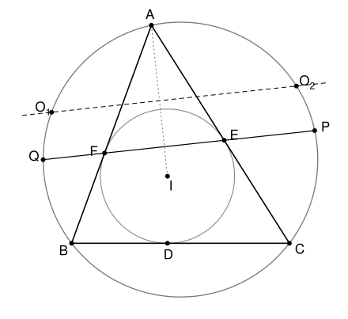

## Statement

Soit $ABC$ un triangle tel que $AB \neq AC$, $\Omega$ son cercle circonscrit et $I$ le centre de son cercle inscrit. Le cercle inscrit touche les côtés $[BC]$, $[CA]$ et $[AB]$ en $D$, $E$ et $F$.

La droite $(EF)$ coupe le cercle $\Omega$ en deux points $P$ et $Q$. On note $O_1$ et $O_2$ les centres des cercles circonscrits aux triangles $AIB$ et $AIC$.

Montrer que le centre du cercle circonscrit au triangle $DPQ$ est sur la droite $(O_1O_2)$.

## Hints

1. Soit $M_C$ le milieu de l'arc $AB$ du cercle $\Omega$ qui ne contient pas $C$. Montre que $M_CA = M_CB = M_CI$. C'est donc le point $O_1$, et il est sur $\Omega$.
2. Montre que les droites $(PQ)$ et $(O_1O_2)$ sont parallèles. Le centre cherché est sur la médiatrice de $[PQ]$, qui est aussi celle de $[O_1O_2]$ : il suffit de montrer que c'est le milieu $T$ de $[O_1O_2]$.
3. Le cercle qui passe par $D$, $P$, $Q$ passe aussi par le milieu $M$ de $[BC]$. Pour le voir, note $X$ le point d'intersection des droites $(EF)$ et $(BC)$, et montre que $\overrightarrow{XB} \cdot \overrightarrow{XC} = \overrightarrow{XD} \cdot \overrightarrow{XM}$.
4. Soit $N$ le point de $\Omega$ diamétralement opposé au milieu de l'arc $BC$ qui ne contient pas $A$. Montre que $IO_1NO_2$ est un parallélogramme, puis regarde les projetés orthogonaux de $I$, $N$ et $T$ sur la droite $(BC)$.

## Solution

On note $O$ et $R$ le centre et le rayon de $\Omega$, et $\alpha$, $\beta$, $\gamma$ les angles du triangle en $A$, $B$, $C$. Les longueurs des tangentes sont notées
$$x = BD = BF, \qquad y = CD = CE, \qquad z = AE = AF .$$
Elles sont égales deux à deux, car par exemple $BD^2 = IB^2 - ID^2 = IB^2 - IF^2 = BF^2$ (théorème de Pythagore dans les triangles $IDB$ et $IFB$, rectangles en $D$ et en $F$).

On note $M$ le milieu de $[BC]$, et $M_A$, $M_B$, $M_C$ les milieux des arcs $BC$, $CA$, $AB$ de $\Omega$ qui ne contiennent pas $A$, $B$, $C$ respectivement.

**Rappel.** Dans un cercle, deux angles inscrits qui interceptent le même arc sont égaux. Deux arcs égaux sont interceptés par des angles inscrits égaux, et ils sont sous-tendus par des cordes égales. Un triangle inscrit dans un cercle, dont un côté est un diamètre, est rectangle.

**Une remarque qui servira plusieurs fois : $x \neq y$.** Sinon $AB = z + x = z + y = AC$, ce qui est exclu.

### Étape 1 : les points $O_1$ et $O_2$ sont sur $\Omega$

Montrons que $M_C$ est sur la droite $(CI)$ et que $M_CA = M_CB = M_CI$.

- Les arcs $AM_C$ et $M_CB$ sont égaux. Les angles inscrits $\widehat{ACM_C}$ et $\widehat{M_CCB}$, qui les interceptent, sont donc égaux : $(CM_C)$ est la bissectrice issue de $C$, et elle passe par $I$. De plus, les cordes $M_CA$ et $M_CB$ sont égales.
- Les angles inscrits $\widehat{M_CAB}$ et $\widehat{M_CCB}$ interceptent le même arc $M_CB$, donc $\widehat{M_CAB} = \frac{\gamma}{2}$. Les points $M_C$ et $I$ sont de part et d'autre de $(AB)$, donc
$$\widehat{M_CAI} = \widehat{M_CAB} + \widehat{BAI} = \frac{\gamma}{2} + \frac{\alpha}{2} .$$
- Le point $I$ est entre $C$ et $M_C$. L'angle $\widehat{AIM_C}$ est donc l'angle extérieur en $I$ du triangle $AIC$ :
$$\widehat{AIM_C} = 180° - \widehat{AIC} = \widehat{IAC} + \widehat{ICA} = \frac{\alpha}{2} + \frac{\gamma}{2} .$$

Le triangle $AIM_C$ a deux angles égaux, en $A$ et en $I$. Il est isocèle en $M_C$, et $M_CA = M_CI$.

Le point $M_C$ est donc à la même distance de $A$, $B$ et $I$ : c'est le centre du cercle circonscrit à $AIB$, c'est-à-dire **$O_1 = M_C$**. En échangeant les rôles de $B$ et de $C$, on obtient **$O_2 = M_B$**, qui est sur la droite $(BI)$, et $M_BA = M_BC = M_BI$. De même, $M_A$ est sur $(AI)$ et $M_AB = M_AC = M_AI$.

### Étape 2 : il suffit de montrer que le centre est le milieu de $[O_1O_2]$

Les points $O_1$ et $O_2$ sont distincts, car ils sont sur deux arcs différents. Ils sont tous les deux à la même distance de $A$ et de $I$, donc $(O_1O_2)$ est la médiatrice de $[AI]$. D'autre part, $AE = AF$ et $IE = IF$, donc $(AI)$ est la médiatrice de $[EF]$. Ainsi $(O_1O_2) \perp (AI)$ et $(EF) \perp (AI)$, donc
$$(PQ) \parallel (O_1O_2) .$$

Le point $E$ est strictement à l'intérieur du segment $[AC]$, donc à l'intérieur du disque limité par $\Omega$, et la droite $(EF)$ coupe bien $\Omega$ en deux points $P$ et $Q$. Le point $D$ n'est pas sur $(EF)$, car une droite coupe le cercle inscrit en au plus deux points. On note $\mathcal{C}$ le cercle qui passe par $D$, $P$, $Q$, et $Z$ son centre.

Soit $\delta$ la droite qui passe par $O$ et qui est perpendiculaire à $(PQ)$. Comme $OP = OQ$, c'est la médiatrice de $[PQ]$, donc $Z$ est sur $\delta$. Elle est aussi perpendiculaire à $(O_1O_2)$, et $OO_1 = OO_2$, donc c'est la médiatrice de $[O_1O_2]$ : elle coupe $(O_1O_2)$ au milieu $T$ de $[O_1O_2]$, et en aucun autre point.

Le point $Z$ est sur $\delta$, donc **il est sur $(O_1O_2)$ si et seulement si $Z = T$**. C'est ce qu'on va montrer. Notons aussi que $\delta \perp (EF)$ et $(AI) \perp (EF)$, donc $\delta \parallel (AI)$.

### Étape 3 : le point $X$

Les droites $(EF)$ et $(BC)$ ne sont pas parallèles. Sinon, d'après le théorème de Thalès dans le triangle $ABC$, on aurait
$$\frac{AF}{AB} = \frac{AE}{AC} ,$$
et comme $AF = AE$, on aurait $AB = AC$. On note $X$ leur point d'intersection.

La droite $(EF)$ sépare $A$ de $B$, car $F$ est entre $A$ et $B$. Elle sépare aussi $A$ de $C$. Donc $B$ et $C$ sont du même côté de $(EF)$, le segment $[BC]$ ne coupe pas $(EF)$, et $X$ n'est pas sur $[BC]$ : **les vecteurs $\overrightarrow{XB}$ et $\overrightarrow{XC}$ ont le même sens.**

La parallèle à $(AB)$ passant par $C$ coupe $(EF)$ en un point $K$.

- Avec les droites $(AC)$ et $(FK)$, qui se coupent en $E$, et les parallèles $(AF)$ et $(CK)$, le théorème de Thalès donne
$$\frac{CK}{AF} = \frac{EC}{EA} = \frac{y}{z} .$$
Comme $AF = z$, on obtient $CK = y$.
- Avec les droites $(BC)$ et $(FK)$, qui se coupent en $X$, et les parallèles $(BF)$ et $(CK)$, il donne
$$\frac{XC}{XB} = \frac{CK}{BF} = \frac{y}{x} .$$

Comme $\overrightarrow{XB}$ et $\overrightarrow{XC}$ ont le même sens,
$$\overrightarrow{XC} = \frac{y}{x}\,\overrightarrow{XB} .$$

### Étape 4 : l'égalité $\overrightarrow{XB} \cdot \overrightarrow{XC} = \overrightarrow{XD} \cdot \overrightarrow{XM}$

On repère les points de la droite $(BC)$ par leur abscisse, avec l'origine $X$ et un vecteur unitaire $\vec u$ dirigé de $X$ vers $B$. Si deux points $U$ et $V$ de cette droite ont pour abscisses $t_U$ et $t_V$, alors $\overrightarrow{XU} \cdot \overrightarrow{XV} = t_U\,t_V$.

On pose
$$s = \frac{XB}{x} .$$
L'abscisse de $B$ est $t_B = xs$, et d'après l'étape 3, celle de $C$ est $t_C = ys$. Le point $D$ est sur le segment $[BC]$, avec $BD = x$ et $BC = x + y$, donc
$$\overrightarrow{BD} = \frac{x}{x + y}\,\overrightarrow{BC}$$
et
$$t_D = xs + \frac{x}{x + y}\,(ys - xs) = \frac{x(x + y) + x(y - x)}{x + y}\,s = \frac{2xy}{x + y}\,s .$$
Enfin, $M$ est le milieu de $[BC]$, donc
$$t_M = \frac{t_B + t_C}{2} = \frac{x + y}{2}\,s .$$
On trouve $t_D\,t_M = xys^2 = t_B\,t_C$, c'est-à-dire
$$\overrightarrow{XB} \cdot \overrightarrow{XC} = \overrightarrow{XD} \cdot \overrightarrow{XM} .$$

### Étape 5 : le cercle $\mathcal{C}$ passe par $M$

**Lemme (puissance d'un point).** Soit $\Gamma$ un cercle de centre $W$ et de rayon $\rho$, et $Y$ un point. Si une droite passant par $Y$ coupe $\Gamma$ en deux points $U$ et $V$, ou si elle est tangente à $\Gamma$ en $U$ (on pose alors $V = U$), alors
$$\overrightarrow{YU} \cdot \overrightarrow{YV} = YW^2 - \rho^2 .$$

*Preuve.* Soit $L$ le milieu de $[UV]$. Comme $\overrightarrow{LV} = -\overrightarrow{LU}$,
$$\overrightarrow{YU} \cdot \overrightarrow{YV} = (\overrightarrow{YL} + \overrightarrow{LU}) \cdot (\overrightarrow{YL} - \overrightarrow{LU}) = YL^2 - LU^2 .$$
La droite $(WL)$ est perpendiculaire à la droite $(UV)$, qui contient $Y$ : c'est la médiatrice de $[UV]$ si $U \neq V$, et le rayon perpendiculaire à la tangente si $U = V$ (si $W = L$, il n'y a rien à faire). Le théorème de Pythagore donne $YW^2 = YL^2 + LW^2$ et $\rho^2 = LU^2 + LW^2$. En faisant la différence, $YL^2 - LU^2 = YW^2 - \rho^2$. $\square$

On applique le lemme au point $X$.

- Pour le cercle $\Omega$, avec les droites $(EF)$ et $(BC)$, qui passent par $X$ : $\overrightarrow{XP} \cdot \overrightarrow{XQ} = XO^2 - R^2 = \overrightarrow{XB} \cdot \overrightarrow{XC}$.
- Pour le cercle $\mathcal{C}$, de rayon $\rho$. La droite $(BC)$ passe par le point $D$ de $\mathcal{C}$. Elle recoupe $\mathcal{C}$ en un point $M'$, ou bien elle lui est tangente en $D$, et on pose alors $M' = D$. Le lemme donne $\overrightarrow{XD} \cdot \overrightarrow{XM'} = XZ^2 - \rho^2 = \overrightarrow{XP} \cdot \overrightarrow{XQ}$.

Avec l'étape 4, on obtient $\overrightarrow{XD} \cdot \overrightarrow{XM'} = \overrightarrow{XB} \cdot \overrightarrow{XC} = \overrightarrow{XD} \cdot \overrightarrow{XM}$, soit $t_D\,t_{M'} = t_D\,t_M$. Comme $t_D \neq 0$, on a $t_{M'} = t_M$, donc $M' = M$ : **le point $M$ est sur le cercle $\mathcal{C}$.**

Les points $D$ et $M$ sont distincts, car $BD = x$, $BM = \frac{x + y}{2}$ et $x \neq y$. Le centre $Z$ est donc sur la médiatrice $\mu$ de $[DM]$, qui est perpendiculaire à $(BC)$.

### Étape 6 : le point $T$ est aussi sur $\mu$

Soit $N$ le point de $\Omega$ diamétralement opposé à $M_A$. Comme $M_AB = M_AC$ et $OB = OC$, la droite $(OM_A)$ est la médiatrice de $[BC]$. Le point $N$ est sur cette droite, donc $NB = NC$.

- D'après l'étape 1, $M_A$ et $M_C$ sont tous les deux à la même distance de $B$ et de $I$. Ils sont distincts, donc $(M_AM_C)$ est la médiatrice de $[BI]$, et $(M_AM_C) \perp (BI)$.
- Le point $M_C$ n'est ni $M_A$, ni $N$. En effet, si $M_C = N$, ce point serait à la même distance de $A$ et $B$ (étape 1) et de $B$ et $C$, donc ce serait $O$, qui n'est pas sur $\Omega$. Le triangle $M_AM_CN$ est inscrit dans $\Omega$, et $[M_AN]$ est un diamètre, donc il est rectangle en $M_C$ : $(M_CN) \perp (M_CM_A)$.
- Les droites $(M_CN)$ et $(BI)$ sont perpendiculaires à $(M_AM_C)$, donc parallèles. Comme $O_1 = M_C$, et que $O_2 = M_B$ est sur $(BI)$ : **la droite $(O_1N)$ est parallèle à $(IO_2)$.**
- De la même façon, **la droite $(O_2N)$ est parallèle à $(IO_1)$.**

Soit $N'$ le point tel que $\overrightarrow{IN'} = \overrightarrow{IO_1} + \overrightarrow{IO_2}$. Alors $\overrightarrow{O_1N'} = \overrightarrow{IO_2}$ et $\overrightarrow{O_2N'} = \overrightarrow{IO_1}$ : le point $N'$ est sur la parallèle à $(BI)$ passant par $O_1$ et sur la parallèle à $(CI)$ passant par $O_2$. Ces deux droites ne sont pas parallèles, car $(BI)$ et $(CI)$ ne le sont pas, donc elles ont un seul point commun. Le point $N$ est aussi sur ces deux droites, donc $N = N'$. Ainsi
$$\overrightarrow{IT} = \frac{1}{2}\left(\overrightarrow{IO_1} + \overrightarrow{IO_2}\right) = \frac{1}{2}\,\overrightarrow{IN} ,$$
et $T$ est le milieu de $[IN]$.

Prenons maintenant un repère orthonormé dont l'axe des abscisses est la droite $(BC)$. Le projeté orthogonal sur $(BC)$ d'un point de coordonnées $(a\,;\,b)$ est le point $(a\,;\,0)$. Comme les coordonnées du milieu d'un segment sont les moyennes de celles des extrémités, le projeté du milieu $T$ de $[IN]$ est le milieu des projetés de $I$ et de $N$. Le projeté de $I$ est $D$, et celui de $N$ est $M$, car $N$ est sur la médiatrice de $[BC]$. Le projeté de $T$ sur $(BC)$ est donc le milieu de $[DM]$, ce qui veut dire que **$T$ est sur $\mu$**.

### Étape 7 : conclusion

Les points $Z$ et $T$ sont tous les deux sur $\delta$ (étape 2) et sur $\mu$ (étapes 5 et 6).

Les droites $\delta$ et $\mu$ ne sont pas parallèles. Sinon, comme $\delta \parallel (AI)$ et $\mu \perp (BC)$, la bissectrice $(AI)$ serait perpendiculaire à $(BC)$. En notant $H$ son point d'intersection avec $[BC]$, les triangles $AHB$ et $AHC$ auraient le côté $[AH]$ en commun, un angle droit en $H$ et le même angle $\frac{\alpha}{2}$ en $A$ : ils seraient égaux, et on aurait $AB = AC$.

Les droites $\delta$ et $\mu$ ont donc un seul point commun, et $Z = T$. **Le centre du cercle circonscrit à $DPQ$ est le milieu de $[O_1O_2]$ : il est sur la droite $(O_1O_2)$.**

## Going further

- Que se passe-t-il quand l'angle en $A$ est droit ? Montre qu'alors les droites $(EF)$ et $(O_1O_2)$ sont confondues.
- Le point $M_C$ de l'étape 1 est le centre du cercle qui passe par $A$, $B$, $I$. Montre qu'il passe aussi par le centre du cercle exinscrit dans l'angle $\widehat{ACB}$.
