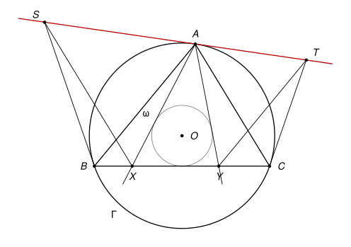

## Statement

Soit $ABC$ un triangle dont les trois angles sont aigus, et $\Gamma$ son cercle circonscrit, de centre $O$. Soit $\omega$ le cercle de centre $O$ qui est tangent à la droite $(BC)$.

Les deux tangentes au cercle $\omega$ issues de $A$ coupent la droite $(BC)$ en un point $X$, du côté de $B$, et en un point $Y$, du côté de $C$.

- La tangente à $\Gamma$ en $B$ et la parallèle à $(AC)$ passant par $X$ se coupent en un point $S$.
- La tangente à $\Gamma$ en $C$ et la parallèle à $(AB)$ passant par $Y$ se coupent en un point $T$.

Montrer que la droite $(ST)$ est tangente au cercle $\Gamma$.

## Hints

1. Devinez le point de contact : sur une figure soignée, la droite $(ST)$ semble passer par $A$. Il suffit donc de montrer que $(AT)$ et $(AS)$ sont toutes les deux tangentes à $\Gamma$ en $A$.
2. Commencez par montrer que $YA = YB$. Le cercle $\omega$ touche $(BC)$ en un point $N$ et $(YA)$ en un point $M$ ; comparez $MA$ et $NB$ à l'aide de deux triangles rectangles.
3. Montrez ensuite que $T$, $A$, $Y$, $C$ sont sur un même cercle : comparez les angles $\widehat{TYA}$ et $\widehat{TCA}$.
4. Pour montrer qu'une droite $(AT)$ est tangente à $\Gamma$ en $A$, il suffit de montrer que $\widehat{TAC} = \widehat{ABC}$ (c'est la réciproque du théorème de l'angle tangentiel).

## Solution

*Rappels.*

- *Angle tangentiel.* Si une droite $d$ passe par un point $A$ d'un cercle et si $[AC]$ est une corde, alors $d$ est tangente au cercle en $A$ **si et seulement si** l'angle entre $d$ et la corde $[AC]$ (pris du côté opposé à $B$) est égal à l'angle inscrit $\widehat{ABC}$, où $B$ est un point du cercle.
- *Points cocycliques.* Si deux points $Y$ et $C$, situés du même côté d'une droite $(TA)$, voient le segment $[TA]$ sous le même angle ($\widehat{TYA} = \widehat{TCA}$), alors $T$, $A$, $Y$, $C$ sont sur un même cercle. Réciproquement, sur un cercle, deux angles inscrits qui interceptent la même corde, du même côté, sont égaux.

On note $\beta = \widehat{ABC}$ et $\gamma = \widehat{ACB}$. On suit la figure, où le triangle est acutangle : les points $X$ et $Y$ sont sur le segment $[BC]$.

**Étape 1 : le triangle $YAB$ est isocèle en $Y$.**

Le centre $O$ est sur la médiatrice de $[BC]$, donc le cercle $\omega$ touche $(BC)$ au milieu $N$ de $[BC]$. Il touche la droite $(YA)$ en un point $M$.

Les triangles $OMA$ et $ONB$ sont rectangles en $M$ et en $N$ (une tangente est perpendiculaire au rayon). Ils ont la même hypoténuse, $OA = OB$ (rayons de $\Gamma$), et un côté de même longueur, $OM = ON$ (rayons de $\omega$). Par le théorème de Pythagore,

$$MA = \sqrt{OA^2 - OM^2} = \sqrt{OB^2 - ON^2} = NB.$$

Depuis le point $Y$, les deux tangentes à $\omega$ touchent le cercle en $N$ et en $M$, donc $YM = YN$. Sur la figure, $M$ est entre $Y$ et $A$, et $N$ est entre $Y$ et $B$. Donc

$$YA = YM + MA = YN + NB = YB.$$

Le triangle $YAB$ est isocèle en $Y$, et $\widehat{YAB} = \widehat{YBA} = \beta$.

**Étape 2 : les points $T$, $A$, $Y$, $C$ sont cocycliques.**

- Les droites $(YT)$ et $(AB)$ sont parallèles, et $(YA)$ les coupe. Les angles alternes-internes sont égaux : $\widehat{TYA} = \widehat{YAB} = \beta$.
- La droite $(CT)$ est tangente à $\Gamma$ en $C$. Par le théorème de l'angle tangentiel, l'angle entre cette tangente et la corde $[CA]$ est égal à l'angle inscrit $\widehat{CBA}$ : $\widehat{TCA} = \beta$.

Les points $Y$ et $C$ sont du même côté de la droite $(TA)$ et voient le segment $[TA]$ sous le même angle $\beta$ : les quatre points $T$, $A$, $Y$, $C$ sont sur un même cercle.

**Étape 3 : la droite $(AT)$ est tangente à $\Gamma$.**

Sur ce nouveau cercle, les angles inscrits $\widehat{TAC}$ et $\widehat{TYC}$ interceptent la même corde $[TC]$, du même côté. Ils sont égaux :

$$\widehat{TAC} = \widehat{TYC}.$$

Or les droites $(YT)$ et $(BA)$ sont parallèles et $(BC)$ les coupe : les angles correspondants $\widehat{TYC}$ et $\widehat{ABC}$ sont égaux. Donc

$$\widehat{TAC} = \widehat{ABC} = \beta.$$

Par la réciproque du théorème de l'angle tangentiel, la droite $(AT)$ est tangente à $\Gamma$ en $A$.

**Étape 4 : la même chose de l'autre côté.**

On refait les étapes 1 à 3 en échangeant les rôles de $B$ et $C$, de $X$ et $Y$, de $S$ et $T$ :

- comme à l'étape 1, $XA = XC$, donc $\widehat{XAC} = \gamma$ ;
- comme $(XS) \parallel (AC)$, on a $\widehat{SXA} = \gamma$, et l'angle tangentiel en $B$ donne $\widehat{SBA} = \gamma$, donc $S$, $A$, $X$, $B$ sont cocycliques ;
- d'où $\widehat{SAB} = \widehat{SXB} = \widehat{ACB} = \gamma$, et la droite $(AS)$ est tangente à $\Gamma$ en $A$.

**Conclusion.**

Il n'y a qu'une seule tangente à $\Gamma$ au point $A$. Les droites $(AS)$ et $(AT)$ sont toutes les deux cette tangente, donc $S$, $A$, $T$ sont alignés sur elle. La droite $(ST)$ est la tangente à $\Gamma$ en $A$.

*Pourquoi supposer le triangle acutangle ?* L'énoncé publié l'avait oublié. Avec un angle obtus en $A$, la figure change (le centre $O$ n'est plus à l'intérieur du triangle, les points $M$ et $N$ changent de place), et une figure tracée dans ce cas peut faire croire que l'énoncé est faux.
