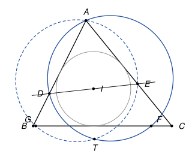
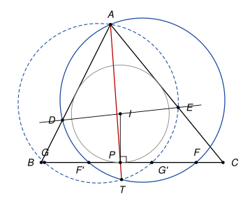

## Statement

Soit $ABC$ un triangle avec $AB \neq AC$, et $I$ le centre de son cercle inscrit.

- La perpendiculaire à la droite $(AI)$ passant par $I$ coupe la droite $(AB)$ en $D$ et la droite $(AC)$ en $E$.
- On suppose que $[BC]$ est le plus grand côté, de sorte qu'il existe deux points $F$ et $G$ du segment $[BC]$ tels que $BF = BA$ et $CG = CA$.
- Les cercles circonscrits aux triangles $ADF$ et $AEG$ se recoupent en un point $T$, autre que $A$.

Montrer que le centre du cercle circonscrit au triangle $AIT$ est sur la droite $(BC)$.

## Hints

1. Soit $P$ le point de contact du cercle inscrit avec $[BC]$. Sur une figure précise, la droite $(AT)$ semble passer par un point remarquable. Lequel ?
2. Le triangle $ABF$ est isocèle en $B$. Pourquoi le cercle circonscrit à $ADF$ est-il symétrique par rapport à la droite $(BI)$ ? Où recoupe-t-il la droite $(BC)$ ?
3. On note $r$ le rayon du cercle inscrit, $x = AR$ où $R$ est le point de contact sur $[AB]$, et $k = AD$. Montrez que $r^2 = x(k - x)$, puis repérez tous les points de la droite $(BC)$ par leur abscisse à partir de $P$.
4. Le point $X$ de $(BC)$ tel que $XA = XI$ est le centre d'un cercle $\omega$ qui passe par $A$ et $I$. Où la droite $(AP)$ recoupe-t-elle $\omega$ ?

## Solution

*Rappels.*

- *Tangentes.* Les deux segments de tangente menés d'un point à un cercle ont la même longueur.
- *Théorème des cordes.* Si deux cordes $[UV]$ et $[WZ]$ d'un cercle se coupent en un point $M$ intérieur au cercle, alors $MU \times MV = MW \times MZ$. (Les triangles $MUW$ et $MZV$ sont semblables, car $\widehat{MUW} = \widehat{VUW} = \widehat{VZW} = \widehat{MZV}$ par le théorème de l'angle inscrit, et les angles en $M$ sont opposés par le sommet.) En prenant pour $[WZ]$ le diamètre qui passe par $M$, on obtient : si le cercle a pour centre $X$ et pour rayon $\rho$, toute corde passant par $M$ vérifie $MU \times MV = (\rho - XM)(\rho + XM) = \rho^2 - XM^2$.
- *Triangle rectangle.* Si un triangle $AID$ est rectangle en $I$ et si $R$ est le pied de la hauteur issue de $I$, alors $R$ est sur $[AD]$ et $IR^2 = RA \times RD$, car les triangles $RAI$ et $RID$ sont semblables.

**Notations.** Soient $R$, $Q$, $P$ les points de contact du cercle inscrit avec $(AB)$, $(AC)$, $(BC)$, et $r$ son rayon. D'après le premier rappel, il existe trois nombres $x$, $y$, $z$ tels que

$$AR = AQ = x, \qquad BR = BP = y, \qquad CP = CQ = z,$$

et alors $AB = x + y$, $AC = x + z$, $BC = y + z$.

**Étape 1 : $AD = AE$ et une relation avec $r$.** Dans le triangle $ADE$, la droite $(AI)$ est la bissectrice de l'angle en $A$, et elle est perpendiculaire à $(DE)$. Une bissectrice qui est aussi une hauteur donne un triangle isocèle, donc $AD = AE$. On note $k$ cette longueur.

Le triangle $AID$ est rectangle en $I$, et $R$ est le pied de la hauteur issue de $I$ (car $(IR)$ est perpendiculaire à $(AB)$). D'après le troisième rappel, $R$ est entre $A$ et $D$ et

$$r^2 = IR^2 = RA \times RD = x\,(k - x).$$

En particulier $k > x$.

**Étape 2 : des abscisses sur la droite $(BC)$.** On repère chaque point de la droite $(BC)$ par son abscisse, avec l'origine en $P$ et le sens de $B$ vers $C$. Ainsi $B$ a pour abscisse $-y$ et $C$ a pour abscisse $z$.

- $BF = BA = x + y$, donc $F$ a pour abscisse $-y + (x + y) = x$.
- $CG = CA = x + z$, donc $G$ a pour abscisse $z - (x + z) = -x$.

**Étape 3 : le second point du cercle $(ADF)$ sur $(BC)$.** Le triangle $ABF$ est isocèle en $B$, donc la médiatrice de $[AF]$ est la bissectrice de l'angle $\widehat{ABC}$, c'est-à-dire la droite $(BI)$. Le centre du cercle circonscrit à $ADF$ est sur cette médiatrice, donc ce cercle est symétrique par rapport à $(BI)$.

La symétrie d'axe $(BI)$ échange les droites $(BA)$ et $(BC)$, et envoie $A$ sur $F$. Le point $D$ est sur la droite $(AB)$, à la distance $AB - AD = x + y - k$ de $B$, comptée vers $A$ (une valeur négative voulant dire que $D$ est au-delà de $B$). Son symétrique $F'$ est donc sur $(BC)$ à la même distance de $B$, comptée vers $C$ : son abscisse est

$$-y + (x + y - k) = x - k.$$

Le point $F'$ est sur le cercle $(ADF)$, puisque ce cercle est symétrique par rapport à $(BI)$.

Exactement de la même façon, le cercle $(AEG)$ est symétrique par rapport à $(CI)$ et recoupe $(BC)$ au symétrique $G'$ de $E$, d'abscisse

$$z - (x + z - k) = k - x.$$

**Étape 4 : la droite $(AT)$ passe par $P$.** Comme $k > x$, le point $F$ (abscisse $x > 0$) et le point $F'$ (abscisse $x - k < 0$) sont de part et d'autre de $P$ : le point $P$ est à l'intérieur du cercle $(ADF)$, et

$$PF \times PF' = x\,(k - x) = r^2.$$

De même $G$ (abscisse $-x$) et $G'$ (abscisse $k - x$) sont de part et d'autre de $P$, et $PG \times PG' = x\,(k - x) = r^2$.

Soit $T_0$ le point de la droite $(AP)$, situé au-delà de $P$ par rapport à $A$, tel que $PA \times PT_0 = r^2$. La droite $(AP)$ recoupe le cercle $(ADF)$ en un point situé au-delà de $P$, et d'après le théorème des cordes ce point $T_1$ vérifie $PA \times PT_1 = PF \times PF' = r^2$. Donc $T_1 = T_0$. Le même raisonnement avec le cercle $(AEG)$ montre que $T_0$ est aussi sur ce cercle.

Ainsi $T_0$ est un point commun aux deux cercles, différent de $A$ : c'est $T$. On a donc montré que **$T$ est sur la droite $(AP)$, au-delà de $P$, avec $PA \times PT = r^2$.**

**Étape 5 : le cercle $\omega$.** Comme $AB \neq AC$, la droite $(AI)$ n'est pas perpendiculaire à $(BC)$, donc la médiatrice de $[AI]$ n'est pas parallèle à $(BC)$. Elle coupe $(BC)$ en un point $X$, qui vérifie $XA = XI$. Soit $\omega$ le cercle de centre $X$ et de rayon $\rho = XI$. Il passe par $A$ et par $I$.

Les points $X$ et $P$ sont sur $(BC)$, et $(IP)$ est perpendiculaire à $(BC)$. Par le théorème de Pythagore dans le triangle $XPI$,

$$\rho^2 = XI^2 = XP^2 + r^2, \qquad \text{donc} \qquad \rho^2 - XP^2 = r^2 > 0.$$

Le point $P$ est donc à l'intérieur de $\omega$. La droite $(AP)$ recoupe $\omega$ en un point $T_2$ situé au-delà de $P$, et d'après le théorème des cordes, $PA \times PT_2 = \rho^2 - XP^2 = r^2$. Donc $T_2 = T_0 = T$.

**Conclusion.** Le cercle $\omega$ passe par $A$, par $I$ et par $T$ : c'est le cercle circonscrit au triangle $AIT$. Son centre $X$ est sur la droite $(BC)$.

*Remarque.* L'hypothèse $AB \neq AC$ est nécessaire : si $AB = AC$, le point $P$ est sur $(AI)$, donc $A$, $I$ et $T$ sont alignés et le triangle $AIT$ n'existe pas. Par ailleurs, la solution n'a pas utilisé le fait que $F$ et $G$ sont sur le segment $[BC]$ : avec des abscisses, la preuve marche aussi quand ils sont sur les prolongements.

## Going further

1. Le corrigé officiel procède autrement : il note $M$ et $N$ les milieux de $[AD]$ et $[AE]$, montre que $(MN)$ est la médiatrice de $[AI]$, que les centres des deux cercles sont sur $(BI)$ et $(CI)$, puis applique deux fois le théorème de Ménélaus pour montrer que le point $X$ est sur la droite qui joint les deux centres. Pourquoi cela suffit-il ?
2. Montrer que, si $AB \neq AC$, le point $T$ est toujours à l'extérieur du triangle $ABC$.
