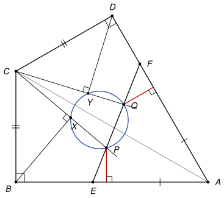

## Statement

Soit $ABCD$ un quadrilatère tel que $AB = AD$, $CB = CD$ et $\widehat{CBA} = 90°$. C'est un cerf-volant : ses diagonales $(AC)$ et $(BD)$ sont perpendiculaires.

Soit $E$ un point de la demi-droite $[AB)$ et $F$ un point de la demi-droite $[AD)$, distincts de $A$. On suppose que le point $C$ n'est pas sur la droite $(EF)$. Soit $P$ et $Q$ deux points du segment $[EF]$, distincts de $E$ et de $F$, tels que

$$\frac{AE}{EP} = \frac{AF}{FQ}.$$

On note $X$ le projeté orthogonal de $B$ sur la droite $(CP)$, et $Y$ le projeté orthogonal de $D$ sur la droite $(CQ)$.

Montrer que les points $P$, $Q$, $X$ et $Y$ sont cocycliques.

![Le cerf-volant ABCD, le segment [EF] avec les points P et Q, et les projetés X et Y de B et D sur les droites (CP) et (CQ)](10226-figure-1.svg)

## Hints

1. Le cercle de centre $C$ qui passe par $B$ est tangent à $(AB)$ en $B$. Montrez que $\overrightarrow{CX} \cdot \overrightarrow{CP} = \overrightarrow{CB} \cdot \overrightarrow{CP}$, puis exprimez ce produit scalaire avec la longueur $CB$ et la distance du point $P$ à la droite $(AB)$.
2. En faisant de même pour $Q$, il suffit de montrer que $P$ est à la même distance de $(AB)$ que $Q$ de $(AD)$. Comparez les aires des triangles $AEP$, $AFQ$ et $AEF$.
3. Il reste à voir que l'égalité $\overrightarrow{CX} \cdot \overrightarrow{CP} = \overrightarrow{CY} \cdot \overrightarrow{CQ}$ entraîne la cocyclicité. Prenez le cercle qui passe par $P$, $Q$ et $X$, écrivez son équation $x^2 + y^2 + \alpha x + \beta y + \gamma = 0$, et regardez ce que vaut le membre de gauche au point $C$.

## Solution

*Rappels.*

- *Produit scalaire et projection.* Si $X$ est le projeté orthogonal de $B$ sur une droite qui passe par $C$ et $P$, alors $\overrightarrow{CX} \cdot \overrightarrow{CP} = \overrightarrow{CB} \cdot \overrightarrow{CP}$.
- *Équation d'un cercle.* Dans un repère orthonormé, un cercle a une équation de la forme $x^2 + y^2 + \alpha x + \beta y + \gamma = 0$.
- *Produit des racines.* Si l'équation $t^2 + pt + q = 0$ a pour racines $t_1$ et $t_2$ (éventuellement égales), alors $t_1 t_2 = q$.

On note $\rho = CB = CD$. On écarte les cas particuliers où deux des points $P$, $Q$, $X$, $Y$ sont confondus.

**Étape 1 : la forme du cerf-volant.** Les triangles $ABC$ et $ADC$ ont leurs trois côtés égaux ($AB = AD$, $CB = CD$, $AC$ commun), donc ils sont isométriques et $\widehat{ADC} = \widehat{ABC} = 90°$. Ainsi $(AB) \perp (CB)$ et $(AD) \perp (CD)$.

Le cercle de centre $C$ et de rayon $\rho$ est donc tangent à $(AB)$ en $B$ : tous ses points autres que $B$ sont du même côté de $(AB)$ que $C$. C'est le cas de $D$. Le point $F$, sur la demi-droite $[AD)$ et distinct de $A$, est du côté de $D$, donc du côté de $C$. Comme $P$ est sur $[EF]$ avec $E \in (AB)$ et $P \neq E$, le point $P$ est lui aussi du même côté de $(AB)$ que $C$. De la même façon, $Q$ est du même côté de $(AD)$ que $C$.

**Étape 2 : calcul de $\overrightarrow{CX} \cdot \overrightarrow{CP}$.** Soit $h_P$ la distance du point $P$ à la droite $(AB)$. On prend le repère orthonormé d'origine $B$ dont l'axe des abscisses est $(BA)$ et l'axe des ordonnées $(BC)$. Alors $C(0 ; \rho)$ et, d'après l'étape 1, $P(x ; h_P)$ avec $h_P > 0$. Le premier rappel donne

$$\overrightarrow{CX} \cdot \overrightarrow{CP} = \overrightarrow{CB} \cdot \overrightarrow{CP} = 0 \times x + (-\rho)(h_P - \rho) = \rho^2 - \rho\,h_P.$$

Le même calcul, avec le repère d'origine $D$ dont les axes sont $(DA)$ et $(DC)$, donne, en notant $h_Q$ la distance de $Q$ à la droite $(AD)$ :

$$\overrightarrow{CY} \cdot \overrightarrow{CQ} = \rho^2 - \rho\,h_Q.$$

**Étape 3 : les distances $h_P$ et $h_Q$ sont égales.** On calcule l'aire du triangle $AEP$ de deux façons.

- Avec la base $[AE]$, portée par $(AB)$ : l'aire vaut $\frac{1}{2}\,AE \times h_P$.
- Avec la base $[EP]$, portée par $(EF)$ : les triangles $AEP$ et $AEF$ ont la même hauteur issue de $A$, donc l'aire de $AEP$ vaut $\frac{EP}{EF}$ fois l'aire $\mathcal{A}$ du triangle $AEF$.

On en tire $h_P = \frac{2\mathcal{A}}{EF} \times \frac{EP}{AE}$. De même, avec le triangle $AFQ$ : $h_Q = \frac{2\mathcal{A}}{EF} \times \frac{FQ}{AF}$. L'hypothèse $\frac{AE}{EP} = \frac{AF}{FQ}$ s'écrit aussi $\frac{EP}{AE} = \frac{FQ}{AF}$, donc $h_P = h_Q$, et avec l'étape 2 :

$$\overrightarrow{CX} \cdot \overrightarrow{CP} = \overrightarrow{CY} \cdot \overrightarrow{CQ}.$$

**Étape 4 : un lemme.** *Soit $\mathcal{C}$ un cercle d'équation $f(x, y) = 0$, où $f(x, y) = x^2 + y^2 + \alpha x + \beta y + \gamma$. Si une droite passant par un point $Z$ coupe $\mathcal{C}$ en $U$ et $U'$ (avec $U = U'$ si la droite est tangente), alors $f(Z) = \overrightarrow{ZU} \cdot \overrightarrow{ZU'}$.*

En effet, soit $\vec{u} = (u_1 ; u_2)$ un vecteur directeur de la droite de norme $1$, et $Z(z_1 ; z_2)$. En développant,

$$f(z_1 + t u_1, z_2 + t u_2) = t^2 + (2 z_1 u_1 + 2 z_2 u_2 + \alpha u_1 + \beta u_2)\,t + f(z_1, z_2).$$

Les points d'intersection sont $Z + t_1 \vec{u}$ et $Z + t_2 \vec{u}$, où $t_1$ et $t_2$ sont les racines de ce trinôme. Donc $f(Z) = t_1 t_2 = (t_1 \vec{u}) \cdot (t_2 \vec{u}) = \overrightarrow{ZU} \cdot \overrightarrow{ZU'}$.

**Étape 5 : conclusion.** Le point $C$ n'est pas sur $(EF)$, donc les droites $(CP)$ et $(CQ)$ sont distinctes, et $Q$ n'est pas sur $(CP)$. Les points $P$, $X$, $Q$ ne sont donc pas alignés : soit $\mathcal{C}$ le cercle qui passe par ces trois points, et $f$ comme dans le lemme. La droite $(CQ)$ coupe $\mathcal{C}$ en $Q$ et en un second point $Y'$. Le lemme appliqué en $Z = C$ aux deux droites $(CP)$ et $(CQ)$ donne

$$\overrightarrow{CY'} \cdot \overrightarrow{CQ} = f(C) = \overrightarrow{CX} \cdot \overrightarrow{CP} = \overrightarrow{CY} \cdot \overrightarrow{CQ}.$$

Donc $\overrightarrow{YY'} \cdot \overrightarrow{CQ} = 0$. Or $Y$ et $Y'$ sont tous deux sur la droite $(CQ)$, donc le vecteur $\overrightarrow{YY'}$ est colinéaire à $\overrightarrow{CQ}$, qui n'est pas nul. Cela force $\overrightarrow{YY'} = \vec{0}$, c'est-à-dire $Y' = Y$.

Le point $Y$ est donc sur le cercle $\mathcal{C}$ : **les points $P$, $Q$, $X$ et $Y$ sont cocycliques.**

*Remarque.* L'énoncé original place $E$ et $F$ sur les **droites** $(AB)$ et $(AD)$. C'est trop large : si un seul des deux points est de l'autre côté de $A$, l'une des distances de l'étape 3 change de signe et le résultat devient faux. Il reste vrai si $E$ et $F$ sont tous deux de l'autre côté de $A$ (voir la question 1 ci-dessous). Le corrigé officiel procède autrement, avec la loi des sinus et le théorème de la bissectrice, en passant par les points de la question 2.

## Going further

1. Montrer que le résultat reste vrai si $E$ est sur la demi-droite opposée à $[AB)$ et $F$ sur la demi-droite opposée à $[AD)$.
2. Soit $P'$ le point d'intersection des droites $(CP)$ et $(AB)$, et $Q'$ celui des droites $(CQ)$ et $(AD)$. Montrer que $\overrightarrow{CX} \cdot \overrightarrow{CP'} = CB^2$ et $\overrightarrow{CY} \cdot \overrightarrow{CQ'} = CD^2$. En déduire que $X$, $Y$, $P'$, $Q'$ sont cocycliques, puis que les droites $(PQ)$ et $(P'Q')$ sont parallèles.
