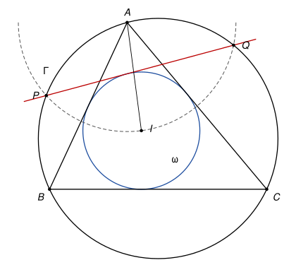
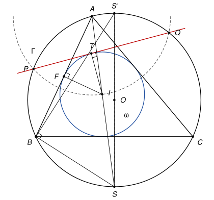

## Statement

Soit $ABC$ un triangle, $\Gamma$ son cercle circonscrit et $\omega$ son cercle inscrit, de centre $I$.

Le cercle de centre $A$ et de rayon $AI$ coupe le cercle $\Gamma$ en deux points $P$ et $Q$.

Montrer que la droite $(PQ)$ est tangente au cercle $\omega$.

## Hints

1. Commencez par un lemme. Un cercle de centre $W$ et de rayon $\rho$ est coupé en $U$ et $V$ par une droite qui passe par un point $X$. Montrez que $\overrightarrow{XU} \cdot \overrightarrow{XV} = XW^2 - \rho^2$, en introduisant le milieu de $[UV]$.
2. Notez $O$ et $R$ le centre et le rayon de $\Gamma$, $r$ le rayon de $\omega$, et $S$ le second point d'intersection de la droite $(AI)$ avec $\Gamma$. Montrez que le triangle $SBI$ est isocèle en $S$ par une chasse aux angles.
3. Soit $S'$ le point de $\Gamma$ diamétralement opposé à $S$, et $F$ le pied de la perpendiculaire à $(AB)$ passant par $I$. Comparez les triangles $AFI$ et $S'BS$. Déduisez-en que $AI \times IS = 2Rr$, puis, avec le lemme, que $IO^2 = R^2 - 2Rr$.
4. Pour un point $X$ du plan, posez $f(X) = (XO^2 - R^2) - (XA^2 - AI^2)$. Montrez que $f(X) = 2\,\overrightarrow{PX} \cdot \overrightarrow{OA}$. Que dit $f(Q) = 0$ sur la direction de $(PQ)$ ? Que dit la valeur de $f(I)$ sur la distance de $I$ à $(PQ)$ ?

## Solution

On note $O$ le centre et $R$ le rayon du cercle $\Gamma$, et $r$ le rayon du cercle $\omega$. On note $\widehat{A}$, $\widehat{B}$, $\widehat{C}$ les angles du triangle. Le point $I$ est sur les trois bissectrices.

**Le lemme (puissance d'un point).** Soit $\mathcal{C}$ un cercle de centre $W$ et de rayon $\rho$, et $X$ un point. Si une droite passant par $X$ coupe $\mathcal{C}$ en $U$ et $V$, alors

$$\overrightarrow{XU} \cdot \overrightarrow{XV} = XW^2 - \rho^2.$$

*Preuve.* Soit $M$ le milieu de $[UV]$. La droite $(WM)$ est la médiatrice de la corde $[UV]$, elle est perpendiculaire à $(UV)$. On a $\overrightarrow{XU} = \overrightarrow{XM} + \overrightarrow{MU}$ et $\overrightarrow{XV} = \overrightarrow{XM} - \overrightarrow{MU}$, donc

$$\overrightarrow{XU} \cdot \overrightarrow{XV} = XM^2 - MU^2.$$

Les points $X$ et $U$ sont sur la droite $(UV)$, perpendiculaire à $(WM)$ en $M$. Le théorème de Pythagore donne $XM^2 = XW^2 - WM^2$ et $MU^2 = \rho^2 - WM^2$. En soustrayant, on obtient $XW^2 - \rho^2$. $\square$

**Étape 1 : le triangle $SBI$ est isocèle en $S$.** Soit $S$ le second point d'intersection de la droite $(AI)$ avec $\Gamma$. Comme $I$ est à l'intérieur du triangle, donc à l'intérieur du disque, il est entre $A$ et $S$. Comme $(AS)$ est la bissectrice de l'angle $\widehat{A}$, le point $S$ est sur l'arc $BC$ qui ne contient pas $A$, donc $S$ et $I$ sont de part et d'autre de $(BC)$.

- Les angles inscrits $\widehat{SBC}$ et $\widehat{SAC}$ interceptent la même corde $[SC]$, et $A$, $B$ sont du même côté de $(SC)$. Donc $\widehat{SBC} = \widehat{SAC} = \frac{\widehat{A}}{2}$, et

$$\widehat{SBI} = \widehat{SBC} + \widehat{CBI} = \frac{\widehat{A}}{2} + \frac{\widehat{B}}{2}.$$

- L'angle $\widehat{SIB}$ est l'angle extérieur en $I$ du triangle $ABI$, il est égal à la somme des deux autres angles de ce triangle :

$$\widehat{SIB} = \widehat{IAB} + \widehat{IBA} = \frac{\widehat{A}}{2} + \frac{\widehat{B}}{2}.$$

Les deux angles à la base sont égaux, donc

$$SB = SI.$$

**Étape 2 : $AI \times IS = 2Rr$.** Soit $S'$ le point de $\Gamma$ diamétralement opposé à $S$, et $F$ le point de contact de $\omega$ avec $[AB]$. On a $IF = r$ et $(IF) \perp (AB)$.

- Le triangle $AFI$ est rectangle en $F$.
- Le triangle $S'BS$ est rectangle en $B$, car $B$ est sur le cercle de diamètre $[SS']$.
- Les angles inscrits $\widehat{BAS}$ et $\widehat{BS'S}$ interceptent la même corde $[BS]$, ils sont donc égaux ou supplémentaires. Ils sont tous les deux aigus : le premier vaut $\frac{\widehat{A}}{2}$ et le second est un angle aigu du triangle rectangle $S'BS$. Ils ne peuvent pas être supplémentaires, donc $\widehat{FAI} = \widehat{BAS} = \widehat{BS'S}$.

Les triangles $AFI$ et $S'BS$ ont deux angles égaux, ils sont semblables, avec $A \leftrightarrow S'$, $F \leftrightarrow B$, $I \leftrightarrow S$. Donc

$$\frac{AI}{S'S} = \frac{FI}{BS}, \qquad \text{soit} \qquad AI \times BS = FI \times S'S = r \times 2R.$$

Avec l'étape 1, $BS = IS$, donc

$$AI \times IS = 2Rr.$$

**Étape 3 : la relation d'Euler $IO^2 = R^2 - 2Rr$.** La droite $(AS)$ passe par $I$ et coupe $\Gamma$ en $A$ et $S$. Le lemme donne $\overrightarrow{IA} \cdot \overrightarrow{IS} = IO^2 - R^2$. Comme $I$ est entre $A$ et $S$, les vecteurs $\overrightarrow{IA}$ et $\overrightarrow{IS}$ sont de sens contraires, et $\overrightarrow{IA} \cdot \overrightarrow{IS} = -IA \times IS = -2Rr$. Donc

$$IO^2 - R^2 = -2Rr.$$

**Étape 4 : la droite $(PQ)$ est perpendiculaire à $(OA)$.** Pour tout point $X$ du plan, on pose

$$f(X) = (XO^2 - R^2) - (XA^2 - AI^2).$$

Soit $N$ le milieu de $[OA]$. On a

$$XO^2 - XA^2 = (\overrightarrow{XO} + \overrightarrow{XA}) \cdot (\overrightarrow{XO} - \overrightarrow{XA}) = 2\,\overrightarrow{XN} \cdot \overrightarrow{AO},$$

donc $f(X) = 2\,\overrightarrow{XN} \cdot \overrightarrow{AO} - R^2 + AI^2$. Le point $P$ est sur les deux cercles, donc $PO = R$, $PA = AI$, et $f(P) = 0$. En soustrayant :

$$f(X) = f(X) - f(P) = 2\,(\overrightarrow{XN} - \overrightarrow{PN}) \cdot \overrightarrow{AO} = 2\,\overrightarrow{XP} \cdot \overrightarrow{AO} = 2\,\overrightarrow{PX} \cdot \overrightarrow{OA}.$$

Le point $Q$ est lui aussi sur les deux cercles, donc $0 = f(Q) = 2\,\overrightarrow{PQ} \cdot \overrightarrow{OA}$. Comme $P \neq Q$ et $O \neq A$, la droite $(PQ)$ est perpendiculaire à la droite $(OA)$.

**Étape 5 : la distance de $I$ à $(PQ)$.** Soit $T$ le pied de la perpendiculaire à $(PQ)$ passant par $I$. Le vecteur $\overrightarrow{PT}$ est dirigé selon $(PQ)$, donc orthogonal à $\overrightarrow{OA}$. Le vecteur $\overrightarrow{TI}$ est perpendiculaire à $(PQ)$, donc colinéaire à $\overrightarrow{OA}$. Ainsi

$$f(I) = 2\,(\overrightarrow{PT} + \overrightarrow{TI}) \cdot \overrightarrow{OA} = 2\,\overrightarrow{TI} \cdot \overrightarrow{OA} = \pm\, 2\,TI \times OA = \pm\, 2R \times TI.$$

D'autre part, $IA^2 - AI^2 = 0$, donc avec l'étape 3

$$f(I) = IO^2 - R^2 = -2Rr.$$

En comparant les valeurs absolues, $2R \times TI = 2Rr$, donc $TI = r$.

La distance du centre $I$ à la droite $(PQ)$ est égale au rayon de $\omega$ : **la droite $(PQ)$ est tangente au cercle $\omega$, au point $T$.**

*Remarques.*

- Les points $P$ et $Q$ existent toujours : $AI < AS \leqslant 2R$, et un cercle centré en un point de $\Gamma$, de rayon strictement compris entre $0$ et $2R$, coupe $\Gamma$ en deux points.
- La droite des points $X$ tels que $f(X) = 0$, c'est-à-dire des points qui ont la même puissance par rapport aux deux cercles, s'appelle l'axe radical des deux cercles. L'étape 4 montre que c'est une droite perpendiculaire à la ligne des centres.
- Le corrigé officiel passe par les axes radicaux et le cercle qui passe par $B$, $I$, $C$ (de centre $S$), avec une chasse aux angles, et traite à part le cas $AB = AC$. Le calcul ci-dessus marche dans tous les cas d'un coup.
