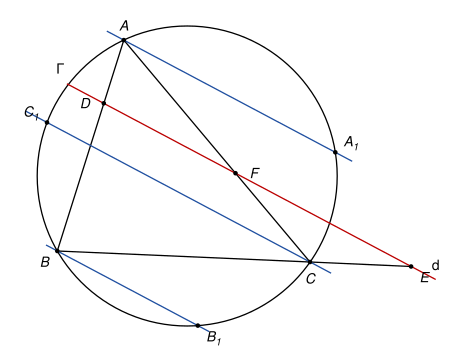
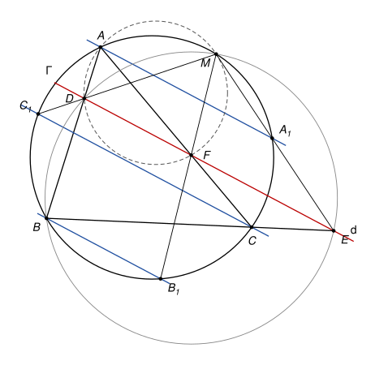

## Statement

Soit $ABC$ un triangle et $\Gamma$ son cercle circonscrit. Une droite $d$ coupe le segment $[AB]$ en un point $D$, le segment $[AC]$ en un point $F$, et la droite $(BC)$ en un point $E$ tel que $C$ soit entre $B$ et $E$.

Les parallèles à $d$ passant par $A$, $B$ et $C$ recoupent le cercle $\Gamma$ en $A_1$, $B_1$ et $C_1$ respectivement.

Montrer que les droites $(A_1E)$, $(B_1F)$ et $(C_1D)$ sont concourantes.

## Hints

1. Tracez une figure précise avec les trois droites. Où semble se trouver leur point commun ?
2. Soit $M$ le second point d'intersection de la droite $(C_1D)$ avec $\Gamma$. Montrez que $M$, $A$, $D$, $F$ sont sur un même cercle. Les angles orientés de droites évitent d'avoir à discuter la position des points.
3. Avec ce cercle et le cercle $\Gamma$, montrez que $M$, $F$ et $B_1$ sont alignés.
4. Pour la troisième droite, il faut un cercle qui passe par $E$. Montrez que $M$, $B$, $D$, $E$ sont sur un même cercle, puis concluez comme à l'indice 3.

## Solution

### Rappel : les angles orientés de droites

Pour deux droites $d_1$ et $d_2$, on note $(d_1, d_2)$ l'angle dont il faut faire tourner $d_1$, dans le sens direct, pour qu'elle devienne parallèle à $d_2$. Cet angle est compté **à $180°$ près**, car une droite tournée de $180°$ revient sur elle-même. On utilise trois règles simples.

- *Relation de Chasles* : $(d_1, d_3) = (d_1, d_2) + (d_2, d_3)$.
- $(d_1, d_2) = 0$ si et seulement si $d_1$ et $d_2$ sont parallèles. En particulier, si $d_2 \parallel d_3$, alors $(d_1, d_2) = (d_1, d_3)$. Et si $(MX, MY) = 0$, les droites $(MX)$ et $(MY)$ sont parallèles et passent par $M$, donc $M$, $X$, $Y$ sont alignés.
- Une droite peut être nommée par deux quelconques de ses points, par exemple $(AB) = (AD) = (BD)$.

**Angle inscrit.** Si $W$, $X$, $Y$, $Z$ sont quatre points distincts d'un même cercle, alors $(ZX, ZY) = (WX, WY)$.

En effet, soit $\theta = \widehat{XZY}$. Si $Z$ et $W$ sont du même côté de $(XY)$, le théorème de l'angle inscrit donne $\widehat{XWY} = \theta$, et les rotations qui amènent $[ZX)$ sur $[ZY)$ et $[WX)$ sur $[WY)$ tournent dans le même sens : les deux angles orientés sont égaux. Si $Z$ et $W$ sont de part et d'autre de $(XY)$, le quadrilatère $XZYW$ est inscrit, donc $\widehat{XWY} = 180° - \theta$, et les deux rotations tournent en sens contraires. L'une vaut $\theta$ et l'autre $-(180° - \theta) = \theta - 180°$, ce qui est la même chose à $180°$ près.

**Réciproque.** Soit $W$, $X$, $Y$, $Z$ quatre points tels que ni $Z$ ni $W$ ne soit sur la droite $(XY)$. Si $(ZX, ZY) = (WX, WY)$, alors ces quatre points sont sur un même cercle. On refait le raisonnement à l'envers : du même côté de $(XY)$, on trouve $\widehat{XZY} = \widehat{XWY}$ ; de part et d'autre, on trouve $\widehat{XZY} + \widehat{XWY} = 180°$. Dans les deux cas, on conclut par la réciproque usuelle.

### Les positions des points

Si $d$ passait par $A$, on aurait $D = F = A$ et les trois droites passeraient par $A$. On écarte ce cas. On a aussi $D \neq B$, sinon $E = B$, et $F \neq C$, sinon $E = C$. Les points $D$ et $F$ sont donc strictement à l'intérieur des côtés, donc strictement à l'intérieur du disque. Le point $E$ est sur la droite $(BC)$ hors du segment $[BC]$, donc hors du disque. Aucun des points $D$, $E$, $F$ n'est sur $\Gamma$.

La droite $d$ n'est parallèle à aucun côté du triangle. Donc $A_1$ n'est ni $B$ ni $C$, et de même $B_1 \notin \{A, C\}$ et $C_1 \notin \{A, B\}$. Comme le dit l'énoncé (« recoupent »), on suppose que les parallèles ne sont pas tangentes à $\Gamma$, donc $A_1 \neq A$, $B_1 \neq B$, $C_1 \neq C$.

**Étape 1 : le point $M$.** La droite $(C_1D)$ passe par le point $D$, intérieur au disque. Elle recoupe donc $\Gamma$ en un second point, que l'on note $M$. On a $M \neq A$ et $M \neq B$ : sinon la droite $(C_1D)$ serait la droite $(AB)$, et $C_1$ serait $A$ ou $B$. On a aussi $M \neq C$ : sinon la droite $(C_1D)$ serait la droite $(CC_1)$, parallèle à $d$ et passant par le point $D$ de $d$, ce serait donc $d$, et $C$ serait sur $d$, donc égal à $E$, ce qui est exclu.

**Étape 2 : $M$, $A$, $D$, $F$ sont sur un même cercle.** Les points $M$, $A$, $C$, $C_1$ sont quatre points distincts de $\Gamma$, donc

$$(MA, MC_1) = (CA, CC_1).$$

Or $(MC_1) = (MD)$, $(CA) = (FA)$, et $(CC_1)$ est parallèle à $d = (FD)$. Donc

$$(MA, MD) = (FA, FD).$$

Les points $M$ et $F$ ne sont pas sur la droite $(AD) = (AB)$. Par la réciproque, $M$, $A$, $D$, $F$ sont sur un même cercle, que l'on note $\omega$.

**Étape 3 : $M$, $F$, $B_1$ sont alignés.** Si $M = B_1$, il n'y a rien à montrer. Sinon, les points $M$, $A$, $B$, $B_1$ sont quatre points distincts de $\Gamma$, donc

$$(MA, MB_1) = (BA, BB_1) = (DA, DF),$$

car $(BA) = (DA)$ et $(BB_1) \parallel d = (DF)$. Sur le cercle $\omega$, on a aussi

$$(MA, MF) = (DA, DF).$$

Donc $(MA, MB_1) = (MA, MF)$, et par Chasles $(MF, MB_1) = 0$ : les points $M$, $F$, $B_1$ sont alignés.

**Étape 4 : $M$, $B$, $D$, $E$ sont sur un même cercle.** Par Chasles,

$$(MB, MD) = (MB, MA) + (MA, MD).$$

Sur $\Gamma$, avec les points $M$, $C$, $B$, $A$, on a $(MB, MA) = (CB, CA)$. Par l'étape 2, $(MA, MD) = (FA, FD) = (CA, d)$. Donc

$$(MB, MD) = (CB, CA) + (CA, d) = (CB, d) = (EB, ED).$$

Les points $M$ et $E$ ne sont pas sur la droite $(BD) = (AB)$. Par la réciproque, $M$, $B$, $D$, $E$ sont sur un même cercle.

**Étape 5 : $M$, $E$, $A_1$ sont alignés.** Si $M = A_1$, il n'y a rien à montrer. Sinon, sur le cercle de l'étape 4,

$$(ME, MB) = (DE, DB) = (d, AB),$$

et sur $\Gamma$, avec les points $M$, $A$, $A_1$, $B$,

$$(MA_1, MB) = (AA_1, AB) = (d, AB),$$

car $(AA_1) \parallel d$. Donc $(ME, MB) = (MA_1, MB)$, et les points $M$, $E$, $A_1$ sont alignés.

**Conclusion.** Le point $M$ est sur la droite $(C_1D)$ par définition, sur $(B_1F)$ par l'étape 3 et sur $(A_1E)$ par l'étape 5. **Les trois droites $(A_1E)$, $(B_1F)$ et $(C_1D)$ sont concourantes, et leur point commun $M$ est sur le cercle circonscrit $\Gamma$.**

*Remarques.*

- Le point $M$ est sur les cercles circonscrits aux triangles $ABC$, $ADF$ et $BDE$, et on montrerait de même qu'il est sur celui de $CEF$. Ce sont les quatre triangles formés par trois des quatre droites $(AB)$, $(BC)$, $(CA)$ et $d$. Ce point commun s'appelle le point de Miquel de ces quatre droites.
- Grâce aux angles orientés, la preuve ne dépend pas de la figure : l'hypothèse « $C$ entre $B$ et $E$ » sert seulement à fixer le dessin. Le résultat reste vrai pour toute droite $d$ qui n'est parallèle à aucun côté et ne passe par aucun sommet.
- Si l'une des parallèles est tangente à $\Gamma$, par exemple si $A_1 = A$, le même calcul marche en remplaçant l'angle inscrit par l'angle entre la tangente et une corde.
- Le corrigé officiel montre que les triangles $AC_1X$ et $AB_1C$ sont semblables, où $X$ est l'intersection de $(CC_1)$ et $(AB)$, puis utilise une similitude de centre $A$. Les correcteurs notent que tous les élèves ont deviné que le point commun est sur $\Gamma$, et que beaucoup ont reconnu le point de Miquel.
