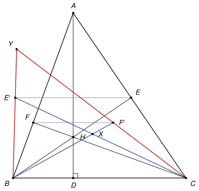

## Statement

Soit $ABC$ un triangle sans angle droit, avec $AB \neq AC$. On note $D$, $E$ et $F$ les pieds des hauteurs issues de $A$, $B$ et $C$, et $H$ l'orthocentre du triangle.

Soient $E'$ et $F'$ les symétriques de $E$ et de $F$ par rapport à la droite $(AD)$. On note $X$ le point d'intersection des droites $(BF')$ et $(CE')$, et $Y$ le point d'intersection des droites $(BE')$ et $(CF')$.

Montrer que les droites $(AX)$ et $(HY)$ se coupent au milieu du segment $[BC]$.

## Hints

1. Tracez le cercle $\omega$ de diamètre $[AH]$. Montrez qu'il passe par $E$, $F$, $E'$ et $F'$.
2. Montrez que $E'$ est sur la droite $(DF)$ et que $F'$ est sur la droite $(DE)$. Utilisez les cercles de diamètres $[BH]$, $[CH]$ et $[BC]$.
3. Le cercle $\omega$ recoupe le cercle circonscrit $\Gamma$ en un point $Q$. Montrez que $Q$ est sur $(BE')$ et sur $(CF')$, donc que $Q = Y$.
4. Soit $A'$ le point de $\Gamma$ diamétralement opposé à $A$. Montrez que $BHCA'$ est un parallélogramme, puis que $Q$, $H$, $A'$ sont alignés.
5. Pour la droite $(AX)$, regardez le triangle $HBC$ : quel est son orthocentre ? Quels sont les pieds de ses hauteurs ?

## Solution

### Rappel : les angles orientés de droites

Pour deux droites $d_1$ et $d_2$, on note $(d_1, d_2)$ l'angle dont il faut faire tourner $d_1$, dans le sens direct, pour qu'elle devienne parallèle à $d_2$. Cet angle est compté **à $180°$ près**. On utilise les règles suivantes.

- *Relation de Chasles* : $(d_1, d_3) = (d_1, d_2) + (d_2, d_3)$.
- $(d_1, d_2) = 0$ si et seulement si $d_1 \parallel d_2$. Si $(MX, MY) = 0$, les points $M$, $X$, $Y$ sont donc alignés. De même, $(d_1, d_2) = 90°$ si et seulement si $d_1 \perp d_2$.
- *Symétrie axiale.* Une symétrie d'axe $\ell$ change le sens de rotation : si elle envoie la droite $m$ sur la droite $m'$, alors $(\ell, m') = -(\ell, m)$.
- *Angle inscrit.* Si $W$, $X$, $Y$, $Z$ sont quatre points distincts d'un même cercle, alors $(ZX, ZY) = (WX, WY)$. C'est le théorème de l'angle inscrit quand $Z$ et $W$ sont du même côté de $(XY)$, et la propriété des angles opposés d'un quadrilatère inscrit quand ils sont de part et d'autre : à $180°$ près, les deux cas donnent la même égalité.

On note $\Gamma$ le cercle circonscrit, $O$ son centre, $M$ le milieu de $[BC]$ et $\omega$ le cercle de diamètre $[AH]$. Comme le triangle n'a pas d'angle droit, les pieds $D$, $E$, $F$ ne sont pas des sommets, et $H$ n'est sur aucune des droites $(AB)$, $(BC)$, $(CA)$.

![La solution : le cercle circonscrit Γ, le cercle ω de diamètre [AH] en pointillés, qui recoupe Γ en Y, le point A′ diamétralement opposé à A, et les droites (HY) et (AX) qui passent par le milieu M de [BC]](10241-figure-2.svg)

**Étape 1 : $E$, $F$, $E'$, $F'$ sont sur $\omega$.** La droite $(EH)$ est la hauteur $(BE)$, perpendiculaire à $(EA) = (AC)$. Donc $E$ est sur le cercle de diamètre $[AH]$. De même pour $F$. La droite $(AD)$ passe par $A$ et $H$, elle contient donc un diamètre de $\omega$, et $\omega$ est symétrique par rapport à $(AD)$. Donc $E'$ et $F'$ sont aussi sur $\omega$.

**Étape 2 : $E'$ est sur $(DF)$, et $F'$ est sur $(DE)$.** Les angles droits donnent trois cercles :

- $D$ et $F$ sont sur le cercle de diamètre $[BH]$ ;
- $D$ et $E$ sont sur le cercle de diamètre $[CH]$ ;
- $E$ et $F$ sont sur le cercle de diamètre $[BC]$.

Avec ces trois cercles :

$$(DA, DF) = (DH, DF) = (BH, BF) = (BE, BA),$$

$$(DE, DA) = (DE, DH) = (CE, CH) = (CA, CF),$$

$$(BE, BA) = (BE, BF) = (CE, CF) = (CA, CF).$$

Donc $(DA, DF) = (DE, DA)$. La symétrie d'axe $(AD)$ fixe $D$ et envoie la droite $(DE)$ sur la droite $(DE')$, donc

$$(DA, DE') = -(DA, DE) = (DE, DA) = (DA, DF).$$

Les droites $(DE')$ et $(DF)$ sont parallèles et passent par $D$ : elles sont confondues, et $E'$ est sur $(DF)$. De la même façon, $(DA, DF') = -(DA, DF) = (DA, DE)$, donc $F'$ est sur $(DE)$.

**Étape 3 : le point $Q$.** Les cercles $\Gamma$ et $\omega$ passent tous les deux par $A$. Ils ne sont pas tangents en $A$. En effet, le centre de $\omega$ est sur $(AD)$, donc sa tangente en $A$ est parallèle à $(BC)$ ; la tangente à $\Gamma$ en $A$ est perpendiculaire à $(OA)$, et elle est parallèle à $(BC)$ seulement si $O$ est sur $(AD)$. Mais la perpendiculaire à $(BC)$ qui passe par $O$ est la médiatrice de $[BC]$, et $A$ n'y est pas car $AB \neq AC$. Les deux cercles se recoupent donc en un point $Q \neq A$.

Le point $Q$ n'est ni $B$ ni $C$ : le point $B$ n'est pas sur $\omega$, car sinon $(BA) \perp (BH)$, et comme $(BH) \perp (AC)$, les droites $(AB)$ et $(AC)$ seraient parallèles. De même pour $C$.

On a aussi $E' \neq F$. Sinon la symétrie d'axe $(AD)$ échangerait $E$ et $F$, donc les droites $(AC)$ et $(AB)$. Elle enverrait $C$ sur un point de $(AB)$ et de $(BC)$, c'est-à-dire sur $B$, et l'on aurait $AB = AC$. De même, $F' \neq E$.

**Étape 4 : $Q$ est sur $(BE')$ et sur $(CF')$, donc $Q = Y$.** Si $Q = E'$, le point $Q$ est sur $(BE')$. Sinon, avec $\Gamma$, puis $\omega$, l'étape 2 et le cercle de diamètre $[AC]$, qui passe par $F$ et $D$ :

$$(QB, QA) = (CB, CA),$$

$$(QE', QA) = (FE', FA) = (FD, FA) = (CD, CA) = (CB, CA).$$

Donc $(QB, QA) = (QE', QA)$, et $Q$, $B$, $E'$ sont alignés. De la même façon, avec le cercle de diamètre $[AB]$, qui passe par $E$ et $D$ :

$$(QC, QA) = (BC, BA) \quad \text{et} \quad (QF', QA) = (EF', EA) = (ED, EA) = (BD, BA) = (BC, BA),$$

donc $Q$, $C$, $F'$ sont alignés.

Les droites $(BE')$ et $(CF')$ sont distinctes : sinon ce serait la droite $(BC)$, et $E'$ serait sur $(BC)$ et sur $(DF)$, donc égal à $D$, et $E$ aussi, ce qui est impossible. Leur unique point commun est donc $Q$ : on a $Y = Q$.

**Étape 5 : la droite $(HY)$ passe par $M$.** Soit $A'$ le point de $\Gamma$ diamétralement opposé à $A$. Le point $B$ est sur le cercle de diamètre $[AA']$, donc $(A'B) \perp (AB)$. Comme $(CH) \perp (AB)$, on a $(A'B) \parallel (CH)$. De même, $(A'C) \parallel (BH)$. Le quadrilatère $BHCA'$ a ses côtés opposés parallèles, c'est un parallélogramme. Ses diagonales $[BC]$ et $[HA']$ ont le même milieu $M$. La droite $(HA')$ est donc la droite $(HM)$.

Si $Q$ est égal à $H$ ou à $A'$, il est sur $(HA')$. Sinon, $Q$ est sur $\omega$, donc $(QA) \perp (QH)$, et $Q$ est sur $\Gamma$, donc $(QA) \perp (QA')$. Les droites $(QH)$ et $(QA')$ sont parallèles, donc $Q$, $H$, $A'$ sont alignés. Dans tous les cas, $Y = Q$ est sur la droite $(HM)$.

Enfin $Y \neq H$, car $H$ n'est pas sur $\Gamma$. Sinon $[HA']$ et $[BC]$ seraient deux cordes de $\Gamma$ de même milieu $M$. Si $M \neq O$, il n'existe qu'une corde de milieu $M$ (elle est perpendiculaire à $(OM)$), donc $H$ serait $B$ ou $C$ ; si $M = O$, l'angle en $A$ serait droit. Les deux cas sont exclus. Ainsi la droite $(HY)$ est bien définie, et **elle passe par $M$**.

**Étape 6 : la droite $(AX)$ passe par $M$, en échangeant les rôles de $A$ et $H$.** Regardons le triangle $HBC$.

- Son orthocentre est $A$ : $(HA) \perp (BC)$, $(BA) \perp (CF) = (HC)$ et $(CA) \perp (BE) = (HB)$.
- Le pied de sa hauteur issue de $H$ est $D$, le pied de sa hauteur issue de $B$ est $F$ (car $F$ est sur $(HC)$ et $(BF) = (AB) \perp (HC)$), et le pied de sa hauteur issue de $C$ est $E$.
- Sa hauteur issue de $H$ est la même droite $(AD)$. Les symétriques des pieds sont donc encore $E'$ et $F'$, avec les rôles échangés.
- Il n'a pas d'angle droit : il serait droit en $B$ si $(BH) \perp (BC)$, donc si $(AC) \parallel (BC)$ ; droit en $H$ si $(HB) \perp (HC)$, donc si $(AC) \perp (AB)$ ; de même en $C$. Et $HB \neq HC$, car sinon $H$ serait sur la médiatrice de $[BC]$, qui serait alors la droite $(AD)$, et l'on aurait $AB = AC$.

Les étapes 1 à 5 n'ont utilisé que ces propriétés, sans jamais regarder la forme de la figure. On peut donc les refaire dans le triangle $HBC$, avec le dictionnaire suivant :

| Dans $ABC$ | $A$ | $H$ | $E$ | $F$ | $E'$ | $F'$ |
|---|---|---|---|---|---|---|
| Dans $HBC$ | $H$ | $A$ | $F$ | $E$ | $F'$ | $E'$ |

Le point $Y = (BE') \cap (CF')$ de $ABC$ devient, dans $HBC$, le point $(BF') \cap (CE')$, c'est-à-dire $X$. L'étape 5 dit alors que la droite $(AX)$ passe par le milieu $M$ de $[BC]$.

**Conclusion.** Les droites $(AX)$ et $(HY)$ passent toutes les deux par $M$. Elles ne sont pas confondues : sinon $A$, $H$, $M$ seraient alignés, donc $M$ serait sur la hauteur $(AD)$, d'où $M = D$ et $AB = AC$. **Les droites $(AX)$ et $(HY)$ se coupent donc au milieu $M$ du segment $[BC]$.**

*Remarques.*

- Les hypothèses ajoutées sont nécessaires. Si $AB = AC$, on a $E' = F$ et $F' = E$, donc $Y = (BF) \cap (CE) = A$ et $X = (BE) \cap (CF) = H$ : les deux droites sont la hauteur $(AD)$ tout entière. Si le triangle est rectangle en $A$, on a $H = E = F = A$ et la figure s'effondre.
- Si $ABC$ a ses trois angles aigus, l'étape 2 dit que les hauteurs sont les bissectrices du triangle $DEF$. Mais alors le triangle $HBC$ a un angle obtus en $H$. C'est pourquoi il fallait une preuve qui marche pour toutes les formes de triangle avant d'échanger les rôles de $A$ et $H$ : les angles orientés le permettent.
- Le corrigé officiel fait la même chasse aux angles sur une figure, et propose une seconde solution avec le théorème de Pascal.
