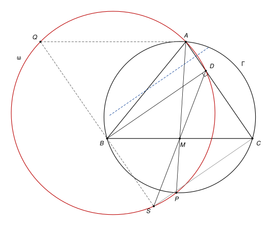

## Statement

Soit $ABC$ un triangle, $\Gamma$ son cercle circonscrit, $M$ le milieu du segment $[BC]$ et $D$ le pied de la hauteur issue de $B$.

La droite $(AM)$ recoupe le cercle $\Gamma$ en un point $P$, autre que $A$. Soit $Q$ le point tel que $BCAQ$ soit un parallélogramme.

Montrer que les points $Q$, $P$, $D$ et $A$ sont sur un même cercle.

![Le triangle ABC, son cercle circonscrit Γ, la hauteur [BD], la médiane (AM) prolongée jusqu'au point P de Γ, et le parallélogramme BCAQ dont deux côtés sont en pointillés](10242-figure-1.svg)

## Hints

1. Pour se servir du milieu $M$, complétez un parallélogramme : soit $S$ le symétrique de $D$ par rapport à $M$. Quelle est la nature du quadrilatère $DBSC$ ? Montrez que $Q$, $B$ et $S$ sont alignés.
2. Montrez que $ADSQ$ est un trapèze isocèle, en comparant les milieux de $[AD]$ et de $[QS]$. Il reste à montrer que $P$ est sur le cercle qui passe par $A$, $D$ et $S$.
3. Un cercle de centre $W$ et de rayon $\rho$ est coupé en $U$ et $V$ par une droite qui passe par un point $X$. Montrez que $\overrightarrow{XU} \cdot \overrightarrow{XV} = XW^2 - \rho^2$, en introduisant le milieu de $[UV]$.
4. Appliquez ce résultat au point $M$, d'une part avec le cercle $\Gamma$ et les droites $(BC)$ et $(AP)$, d'autre part avec le cercle qui passe par $A$, $D$, $S$. Pourquoi a-t-on $MD = MB$ ?

## Solution

**Le lemme (puissance d'un point).** Soit $\mathcal{C}$ un cercle de centre $W$ et de rayon $\rho$, et $X$ un point. Si une droite passant par $X$ coupe $\mathcal{C}$ en $U$ et $V$ (avec $U = V$ si la droite est tangente), alors

$$\overrightarrow{XU} \cdot \overrightarrow{XV} = XW^2 - \rho^2.$$

*Preuve.* Soit $N$ le milieu de $[UV]$. La droite $(WN)$ est perpendiculaire à $(UV)$ : c'est la médiatrice de la corde $[UV]$ (pour une tangente, $N = U$ et c'est le rayon perpendiculaire à la tangente). On a $\overrightarrow{XU} = \overrightarrow{XN} + \overrightarrow{NU}$ et $\overrightarrow{XV} = \overrightarrow{XN} - \overrightarrow{NU}$, donc

$$\overrightarrow{XU} \cdot \overrightarrow{XV} = XN^2 - NU^2.$$

Le théorème de Pythagore donne $XN^2 = XW^2 - WN^2$ et $NU^2 = \rho^2 - WN^2$. En soustrayant, on obtient $XW^2 - \rho^2$. $\square$

Si l'angle en $A$ est droit, on a $D = A$, et il ne reste que trois points $Q$, $P$, $A$. Ils ne sont pas alignés, car la droite $(AQ)$ est parallèle à $(BC)$ alors que la droite $(AP)$ coupe $(BC)$ en $M$. Ils sont donc sur un même cercle. On suppose désormais $D \neq A$. Comme $BCAQ$ est un parallélogramme, $\overrightarrow{AQ} = \overrightarrow{CB}$ et $\overrightarrow{BQ} = \overrightarrow{CA}$.

**Étape 1 : le point $S$.** Soit $S$ le symétrique de $D$ par rapport à $M$. Les diagonales $[BC]$ et $[DS]$ du quadrilatère $DBSC$ ont le même milieu $M$, c'est donc un parallélogramme, et

$$\overrightarrow{BS} = \overrightarrow{DC}.$$

Ce vecteur est dirigé selon $(AC)$, tout comme $\overrightarrow{BQ} = \overrightarrow{CA}$. Les points $Q$ et $S$ sont donc tous les deux sur la parallèle à $(AC)$ qui passe par $B$. Cette droite n'est pas $(AC)$, car $B$ n'est pas sur $(AC)$.

De plus, l'angle $\widehat{BDC}$ est droit (si $D \neq C$), donc $D$ est sur le cercle de diamètre $[BC]$, de centre $M$. Dans tous les cas,

$$MD = MB = MC.$$

Le parallélogramme $DBSC$ est même un rectangle.

**Étape 2 : $ADSQ$ est un trapèze isocèle.** Les points $A$ et $D$ sont sur $(AC)$, les points $Q$ et $S$ sur une parallèle à $(AC)$. Les points $A$, $D$, $S$ ne sont pas alignés, car $S$ n'est pas sur $(AC)$. On note $\omega$ le cercle qui passe par ces trois points.

Soit $I$ le milieu de $[AD]$ et $J$ le milieu de $[QS]$. Alors

$$\overrightarrow{IJ} = \tfrac{1}{2}\left(\overrightarrow{AQ} + \overrightarrow{DS}\right) = \tfrac{1}{2}\left(\overrightarrow{CB} + \overrightarrow{DB} + \overrightarrow{DC}\right),$$

car $\overrightarrow{DS} = 2\,\overrightarrow{DM} = \overrightarrow{DB} + \overrightarrow{DC}$. Comme $\overrightarrow{CB} = \overrightarrow{CD} + \overrightarrow{DB}$, on trouve

$$\overrightarrow{IJ} = \overrightarrow{DB},$$

qui est perpendiculaire à $(AC)$. Soit $\Delta$ la médiatrice de $[AD]$ : c'est la perpendiculaire à $(AC)$ passant par $I$, donc elle passe aussi par $J$. Comme $(QS)$ est parallèle à $(AC)$, la droite $\Delta$ est aussi la médiatrice de $[QS]$ (si $Q \neq S$).

Le centre de $\omega$ est sur la médiatrice $\Delta$ de la corde $[AD]$, donc $\omega$ est symétrique par rapport à $\Delta$. La symétrie d'axe $\Delta$ envoie $S$, qui est sur $\omega$, sur $Q$. Donc $Q$ est sur $\omega$.

**Étape 3 : $P$ est sur $\omega$.** On applique le lemme au point $M$.

- Avec le cercle $\Gamma$ et la droite $(BC)$ : comme $M$ est le milieu de $[BC]$, $\overrightarrow{MB} \cdot \overrightarrow{MC} = -MB^2$. Avec la droite $(AP)$, qui passe aussi par $M$, on a donc $\overrightarrow{MA} \cdot \overrightarrow{MP} = -MB^2$.
- Avec le cercle $\omega$ et la droite $(DS)$ : comme $M$ est le milieu de $[DS]$, $\overrightarrow{MD} \cdot \overrightarrow{MS} = -MD^2 = -MB^2$ par l'étape 1.

La droite $(MA)$ passe par le point $A$ de $\omega$. Elle recoupe $\omega$ en un point $P'$ (avec $P' = A$ si elle est tangente). Le lemme, appliqué à $M$ et à $\omega$ avec les droites $(DS)$ et $(AP')$, donne

$$\overrightarrow{MA} \cdot \overrightarrow{MP'} = \overrightarrow{MD} \cdot \overrightarrow{MS} = -MB^2 = \overrightarrow{MA} \cdot \overrightarrow{MP}.$$

Donc $\overrightarrow{MA} \cdot \overrightarrow{PP'} = 0$. Mais $P$ et $P'$ sont sur la droite $(MA)$, donc $\overrightarrow{PP'} = k\,\overrightarrow{MA}$ pour un réel $k$. Alors $k\,MA^2 = 0$, donc $k = 0$ et $P = P'$.

**Conclusion.** Les points $A$, $D$, $Q$ et $P$ sont tous sur le cercle $\omega$ : **les points $Q$, $P$, $D$ et $A$ sont cocycliques.** Le point $S$ est aussi sur ce cercle.

*Remarques.*

- Le produit scalaire tient compte des sens. On n'a donc pas besoin de savoir si $D$ est sur le segment $[AC]$ ou au-delà, ni si l'angle en $B$ ou en $C$ est obtus.
- Le corrigé officiel utilise le même point $S$ et une chasse aux angles sur la figure : $ADSQ$ est un trapèze isocèle, et $B$, $S$, $P$, $M$ sont cocycliques. Il propose aussi une solution en coordonnées barycentriques.
