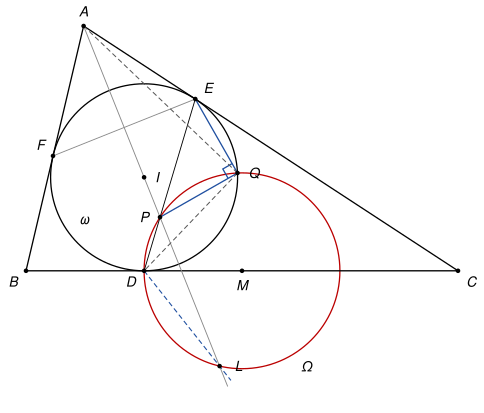

## Statement

Soit $ABC$ un triangle dont les trois angles sont aigus, avec $AB \neq AC$. Soit $\omega$ son cercle inscrit et $I$ le centre de $\omega$. Le cercle $\omega$ touche les côtés $[BC]$, $[CA]$ et $[AB]$ aux points $D$, $E$ et $F$. On note $M$ le milieu du segment $[BC]$.

Soit $P$ le point situé à l'intérieur du triangle $ABC$ tel que $MP = MD$ et $\widehat{PAB} = \widehat{PAC}$.

Soit $Q$ le point du cercle $\omega$, autre que $D$, tel que $\widehat{AQD} = 90°$.

Montrer que $\widehat{PQE} = 90°$ ou que $\widehat{PQF} = 90°$.

![Le triangle ABC, son cercle inscrit ω de centre I, les points de contact D, E, F, le milieu M de [BC], le point P sur la bissectrice issue de A avec MP = MD, et le point Q de ω tel que l'angle AQD est droit](10243-figure-1.svg)

## Hints

1. On peut supposer $AB < AC$ (sinon, on échange les noms de $B$ et $C$). Soit $K$ et $L$ les pieds des perpendiculaires menées de $B$ et de $C$ à la bissectrice $(AI)$. Avec le symétrique de $B$ par rapport à $(AI)$ et la droite des milieux, calculez $MK$. Calculez aussi $ML$ et $MD$ en fonction de $AB$ et $AC$.
2. Déduisez-en que $P$ est l'un des points $K$ et $L$. Lequel est à l'intérieur du triangle ? Montrez ensuite, avec des vecteurs, que $L$ est sur la droite $(DF)$ et que $K$ est sur la droite $(DE)$.
3. Montrez que $Q$ est sur le cercle $\Omega$ de centre $M$ qui passe par $D$. Dans un repère d'origine $D$ dont l'axe des abscisses est $(BC)$, les cercles $\omega$, $\Omega$ et le cercle de diamètre $[AD]$ ont des équations très simples.
4. Terminez avec des angles orientés de droites : $(QP, QE) = (QP, QD) + (QD, QE)$. Le premier angle se lit sur le cercle $\Omega$ depuis le point $L$, le second sur le cercle $\omega$ depuis le point $F$. Pensez enfin à la position de $(AI)$ par rapport à $(EF)$.

## Solution

### Rappels

*Longueurs des tangentes.* Les deux tangentes menées d'un point à un cercle ont la même longueur. On note $a = BC$, $b = CA$, $c = AB$ et $s = \tfrac{1}{2}(a + b + c)$. Si $x = AE = AF$, $y = BD = BF$ et $z = CD = CE$, alors $x + y = c$, $y + z = a$ et $z + x = b$. En additionnant, $x + y + z = s$, donc

$$AE = AF = s - a, \qquad BD = BF = s - b, \qquad CD = CE = s - c.$$

*Angles orientés de droites.* Pour deux droites $d_1$ et $d_2$, on note $(d_1, d_2)$ l'angle dont il faut faire tourner $d_1$, dans le sens direct, pour qu'elle devienne parallèle à $d_2$. Cet angle est compté **à $180°$ près**. On utilise les règles suivantes.

- *Relation de Chasles* : $(d_1, d_3) = (d_1, d_2) + (d_2, d_3)$.
- $(d_1, d_2) = 90°$ si et seulement si $d_1 \perp d_2$.
- Une droite peut être nommée par deux quelconques de ses points.
- *Angle inscrit.* Si $W$, $X$, $Y$, $Z$ sont quatre points distincts d'un même cercle, alors $(ZX, ZY) = (WX, WY)$. C'est le théorème de l'angle inscrit quand $Z$ et $W$ sont du même côté de $(XY)$, et la propriété des angles opposés d'un quadrilatère inscrit quand ils sont de part et d'autre : à $180°$ près, les deux cas donnent la même égalité.

### La preuve

Si l'on échange les noms de $B$ et $C$, les points $E$ et $F$ s'échangent, et les deux conclusions possibles aussi. On peut donc supposer $AB < AC$, c'est-à-dire $c < b$, et on va montrer que $\widehat{PQE} = 90°$.

On note $\alpha$, $\beta$, $\gamma$ les angles du triangle en $A$, $B$, $C$, et $A_1$ le point où la bissectrice $(AI)$ coupe $[BC]$. Les points de la droite $(AI)$ intérieurs au triangle sont ceux situés strictement entre $A$ et $A_1$. Enfin, $K$ et $L$ sont les pieds des perpendiculaires menées de $B$ et de $C$ à la droite $(AI)$.

**Étape 1 : $K$ est à l'intérieur du triangle, $L$ à l'extérieur.** Dans le triangle $ABA_1$,

$$\widehat{AA_1B} = 180° - \tfrac{\alpha}{2} - \beta.$$

Comme $\alpha + \beta + \gamma = 180°$, on a $90° = \tfrac{\alpha + \beta + \gamma}{2}$, et cela s'écrit $\widehat{AA_1B} = \tfrac{\alpha}{2} + \gamma = 90° + \tfrac{\gamma - \beta}{2}$. Comme $AB < AC$, l'angle opposé à $[AB]$ est plus petit que l'angle opposé à $[AC]$ : $\gamma < \beta$. Donc $\widehat{AA_1B} < 90°$ et $\widehat{AA_1C} = 180° - \widehat{AA_1B} > 90°$.

On utilise un fait simple : dans un triangle, le pied de la hauteur issue d'un sommet tombe strictement entre les deux autres sommets lorsque les angles en ces deux sommets sont aigus, et au-delà du sommet dont l'angle est obtus si l'un d'eux est obtus.

- Dans le triangle $ABA_1$, les angles en $A$ (qui vaut $\tfrac{\alpha}{2}$) et en $A_1$ sont aigus. Le pied $K$ de la hauteur issue de $B$ est donc strictement entre $A$ et $A_1$ : il est à l'intérieur du triangle $ABC$.
- Dans le triangle $ACA_1$, l'angle en $A_1$ est obtus. Le pied $L$ de la hauteur issue de $C$ est donc au-delà de $A_1$ : il est hors du triangle $ABC$, et il n'est pas sur la droite $(BC)$.

**Étape 2 : $MK = ML = MD$, donc $P = K$.** La symétrie d'axe $(AI)$ échange les demi-droites $[AB)$ et $[AC)$.

- Elle envoie $B$ sur le point $B'$ de $[AC)$ tel que $AB' = c$. Comme $c < b$, le point $B'$ est sur le segment $[AC]$ et $B'C = b - c$. Le segment $[BB']$ est perpendiculaire à l'axe et son milieu est sur l'axe : ce milieu est $K$. Dans le triangle $BB'C$, la droite des milieux donne $\overrightarrow{MK} = \tfrac{1}{2}\overrightarrow{CB'}$, donc $MK = \tfrac{b - c}{2}$.
- Elle envoie $C$ sur le point $C'$ de $[AB)$ tel que $AC' = b$. Comme $b > c$, le point $C'$ est au-delà de $B$ et $BC' = b - c$. De même, $L$ est le milieu de $[CC']$, et dans le triangle $CBC'$, $\overrightarrow{ML} = \tfrac{1}{2}\overrightarrow{BC'}$, donc $ML = \tfrac{b - c}{2}$.
- Enfin $BD = s - b = \tfrac{a + c - b}{2} < \tfrac{a}{2} = BM$. Le point $D$ est entre $B$ et $M$, et $MD = \tfrac{a}{2} - \tfrac{a + c - b}{2} = \tfrac{b - c}{2}$.

Les trois points $K$, $L$, $D$ sont donc sur le cercle $\Omega$ de centre $M$ et de rayon $\tfrac{b - c}{2}$. Une droite coupe un cercle en deux points au plus. La droite $(AI)$ coupe donc $\Omega$ exactement en $K$ et en $L$, qui sont distincts d'après l'étape 1. Le point $P$ est sur $(AI)$ et sur $\Omega$, et il est intérieur au triangle : c'est $K$.

**Étape 3 : $L$ est sur $(DF)$ et $K$ est sur $(DE)$.** On pose $k = \dfrac{b - c}{2(s - b)}$. Le point $D$ est entre $B$ et $M$, avec $MD = \tfrac{b - c}{2}$ et $DB = s - b$, donc $\overrightarrow{MD} = k\,\overrightarrow{DB}$, c'est-à-dire $\overrightarrow{DM} = -k\,\overrightarrow{DB}$.

Le point $C'$ est sur $[AB)$ au-delà de $B$, avec $BC' = b - c$, donc $\overrightarrow{BC'} = \tfrac{b - c}{c}\,\overrightarrow{AB}$ et $\overrightarrow{ML} = \tfrac{b - c}{2c}\,\overrightarrow{AB}$. D'autre part, $F$ est sur $[BA]$ avec $BF = s - b$, donc $\overrightarrow{BF} = \tfrac{s - b}{c}\,\overrightarrow{BA}$, et

$$-k\,\overrightarrow{BF} = -\frac{b - c}{2(s - b)} \times \frac{s - b}{c}\,\overrightarrow{BA} = \frac{b - c}{2c}\,\overrightarrow{AB} = \overrightarrow{ML}.$$

Donc $\overrightarrow{DL} = \overrightarrow{DM} + \overrightarrow{ML} = -k\left(\overrightarrow{DB} + \overrightarrow{BF}\right) = -k\,\overrightarrow{DF}$ : le point $L$ est sur la droite $(DF)$.

Le même calcul, avec $k' = \dfrac{b - c}{2(s - c)}$, $\overrightarrow{DM} = k'\,\overrightarrow{DC}$, $\overrightarrow{MK} = \tfrac{1}{2}\overrightarrow{CB'} = \tfrac{b - c}{2b}\,\overrightarrow{CA}$ et $\overrightarrow{CE} = \tfrac{s - c}{b}\,\overrightarrow{CA}$, donne $\overrightarrow{MK} = k'\,\overrightarrow{CE}$, puis $\overrightarrow{DK} = k'\left(\overrightarrow{DC} + \overrightarrow{CE}\right) = k'\,\overrightarrow{DE}$ : le point $K$ est sur la droite $(DE)$.

**Étape 4 : $Q$ est sur $\Omega$.** On prend un repère orthonormé d'origine $D$, dont l'axe des abscisses est la droite $(BC)$ orientée de $B$ vers $C$, et dont l'axe des ordonnées est du côté de $A$. Alors

$$B = (-(s - b),\ 0), \qquad C = (s - c,\ 0), \qquad M = \left(m,\ 0\right) \text{ avec } m = \tfrac{b - c}{2}, \qquad I = (0,\ r),$$

où $r$ est le rayon de $\omega$. On écrit $A = (u, h)$, où $h$ est la hauteur issue de $A$.

- *Calcul de $h$.* L'aire $S$ du triangle vaut $\tfrac{1}{2}ah$. En découpant le triangle en $IBC$, $ICA$ et $IAB$, qui ont tous la hauteur $r$, on trouve aussi $S = \tfrac{1}{2}r(a + b + c) = rs$. Donc $\dfrac{h}{r} = \dfrac{2s}{a} = \dfrac{a + b + c}{a}$.
- *Calcul de $u$.* On a $c^2 = (u + s - b)^2 + h^2$ et $b^2 = (u - s + c)^2 + h^2$. On soustrait et on factorise :

$$c^2 - b^2 = (2s - b - c)(2u + c - b) = a(2u + c - b),$$

donc $2u = \dfrac{(c - b)(c + b)}{a} - (c - b)$, soit $u = \dfrac{(c - b)(b + c - a)}{2a}$.

On en déduit l'égalité clé

$$m(2r - h) = \frac{b - c}{2} \times r\left(2 - \frac{a + b + c}{a}\right) = \frac{r(b - c)(a - b - c)}{2a} = \frac{r(c - b)(b + c - a)}{2a} = r\,u.$$

Écrivons maintenant les trois cercles qui passent par $D$, l'origine.

- Le cercle $\omega$, de centre $(0, r)$ et de rayon $r$ : $x^2 + y^2 = 2ry$.
- Le cercle de diamètre $[AD]$ : le point $X = (x, y)$ est dessus si et seulement si $\overrightarrow{XA} \cdot \overrightarrow{XD} = 0$, c'est-à-dire $x^2 + y^2 = ux + hy$. Le point $Q$ est sur ce cercle, puisque $\widehat{AQD} = 90°$.
- Le cercle $\Omega$, de centre $(m, 0)$ et de rayon $|m|$ : $x^2 + y^2 = 2mx$.

Soit $(x, y)$ les coordonnées de $Q$. Les deux premières équations donnent $2ry = ux + hy$, donc $ux = (2r - h)y$. On multiplie par $r$ et on utilise l'égalité clé :

$$m(2r - h)\,x = r(2r - h)\,y.$$

Or $h - 2r = \dfrac{r(b + c - a)}{a}$ n'est pas nul, car $b + c > a$ (inégalité triangulaire). On peut diviser : $mx = ry$. Alors $x^2 + y^2 = 2ry = 2mx$, et **$Q$ est sur le cercle $\Omega$**.

**Étape 5 : l'angle droit.** On vérifie d'abord que les points utilisés sont distincts.

- Sur $\Omega$, les points $K$, $L$, $D$, $Q$ sont distincts. On sait déjà que $K \neq L$ et que $Q \neq D$. Le point $D$ est sur $(BC)$, ce qui n'est le cas ni de $K$ (intérieur au triangle) ni de $L$ (étape 1). Le point $K$ est sur la droite $(DE)$ sans être $D$, ni $E$ (les droites $(AI)$ et $(AC)$ ne se coupent qu'en $A$). Cette droite coupe déjà $\omega$ en $D$ et $E$, elle ne la coupe pas ailleurs : $K$ n'est pas sur $\omega$, donc $K \neq Q$. De même, $L$ est sur $(DF)$ sans être $D$ ni $F$, donc $L \neq Q$.
- Sur $\omega$, les points $D$, $E$, $F$, $Q$ sont distincts. Si l'on avait $Q = E$, l'angle $\widehat{AED}$ serait droit, comme l'angle $\widehat{AEI}$ (la tangente $(AC)$ est perpendiculaire au rayon $[IE]$). Le point $D$ serait sur la droite $(EI)$, diamétralement opposé à $E$, et les tangentes en $D$ et en $E$, c'est-à-dire $(BC)$ et $(CA)$, seraient parallèles : c'est impossible. De même, $Q \neq F$.

Comme $P = K$, la relation de Chasles donne

$$(QP, QE) = (QK, QD) + (QD, QE).$$

- Sur le cercle $\Omega$, avec l'angle inscrit vu de $L$ : $(QK, QD) = (LK, LD)$. Or $(LK) = (AI)$, car $K$ et $L$ sont sur la bissectrice, et $(LD) = (DF)$ d'après l'étape 3. Donc $(QK, QD) = (AI, DF)$.
- Sur le cercle $\omega$, avec l'angle inscrit vu de $F$ : $(QD, QE) = (FD, FE)$.

En additionnant, avec la relation de Chasles :

$$(QP, QE) = (AI, DF) + (DF, FE) = (AI, FE).$$

Enfin $AE = AF$ et $IE = IF$ : les points $A$ et $I$ sont tous les deux sur la médiatrice de $[EF]$, donc $(AI) \perp (EF)$ et $(AI, FE) = 90°$.

On obtient $(QP, QE) = 90°$, donc $(QP) \perp (QE)$.

**Conclusion.** Si $AB < AC$, alors $\widehat{PQE} = 90°$. Si $AB > AC$, le même raisonnement, avec $B$ et $C$ échangés, donne $\widehat{PQF} = 90°$. **Dans tous les cas, $\widehat{PQE} = 90°$ ou $\widehat{PQF} = 90°$.**

*Remarques.*

- Pourquoi faut-il $AB \neq AC$ ? Si $AB = AC$, la bissectrice $(AI)$ est la médiatrice de $[BC]$ et $D = M$. La condition $MP = MD$ impose alors $P = M$, qui n'est pas à l'intérieur du triangle. De plus, le cercle de diamètre $[AD]$ et le cercle $\omega$ sont alors tangents en $D$, et le point $Q$ n'existe pas.
- La preuve n'utilise pas que les angles du triangle sont aigus.
- Le symétrique $D'$ de $D$ par rapport à $M$ est aussi sur $\Omega$, dont $[DD']$ est un diamètre. C'est le point où le cercle exinscrit dans l'angle $\widehat{A}$ touche $[BC]$, car $CD' = BD = s - b$. Le corrigé officiel part de là : il montre avec une homothétie que $Q$ est sur le cercle de diamètre $[DD']$, puis calcule les angles en fonction de $\alpha$, $\beta$, $\gamma$. Le calcul en coordonnées de l'étape 4 remplace l'homothétie, et les angles orientés évitent de dépendre de la figure.

## Going further

Soit $D''$ le point de $\omega$ diamétralement opposé à $D$. Montrer que $A$, $D''$ et $Q$ sont alignés.
