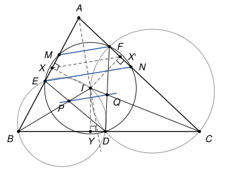

## Statement

Soit $ABC$ un triangle et $I$ le centre de son cercle inscrit. Soit $D$ un point du segment $[BC]$, autre que $B$ et $C$.

Le cercle circonscrit au triangle $DIB$ recoupe la droite $(AB)$ en un point $E \neq B$, et le cercle circonscrit au triangle $DIC$ recoupe la droite $(AC)$ en un point $F \neq C$. Le cercle circonscrit au triangle $DEF$ recoupe $(AB)$ en $M$ et $(AC)$ en $N$. Les droites $(IB)$ et $(DE)$ se coupent en $P$, et les droites $(IC)$ et $(DF)$ se coupent en $Q$.

On suppose que $D$ n'est pas le point de contact du cercle inscrit avec $[BC]$, et que $E$ et $F$ sont différents de $A$.

Montrer que les droites $(EN)$, $(FM)$ et $(PQ)$ sont parallèles.

## Hints

1. Sur une figure précise, le cercle circonscrit à $DEF$ semble avoir pour centre un point déjà nommé. Lequel ?
2. Pour comparer $ID$ et $IE$, regardez sous quel angle on voit les cordes $[ID]$ et $[IE]$ depuis le point $B$ du cercle $BDIE$.
3. Le symétrique de $D$ par rapport à la droite $(BI)$ est sur $(AB)$, à la distance $ID$ de $I$. Est-ce le point $E$ ou le point $M$ ?
4. Pour le point $P$ : il est sur la droite $(DE)$, qui coupe à la fois le cercle $DEF$ et le cercle $BDIE$ en $D$ et $E$. Comparez sa puissance par rapport à ces deux cercles, et déduisez-en $\overrightarrow{IP} \cdot \overrightarrow{IB}$.

## Solution

*Rappels.*

- *Corde et angle inscrit.* Si $U$, $V$, $W$ sont trois points distincts d'un cercle de rayon $r$, alors $UV = 2r \sin \widehat{UWV}$. *Preuve.* Soit $U^*$ le point diamétralement opposé à $U$. Si $V = U^*$, alors $UV = 2r$ et l'angle $\widehat{UWV}$ intercepte un diamètre, il est droit. Sinon, le triangle $UVU^*$ est rectangle en $V$, donc $UV = UU^* \sin \widehat{UU^*V} = 2r \sin \widehat{UU^*V}$. Les angles inscrits $\widehat{UWV}$ et $\widehat{UU^*V}$ interceptent la même corde $[UV]$ : ils sont égaux si $W$ et $U^*$ sont du même côté de $(UV)$, supplémentaires sinon. Dans les deux cas ils ont le même sinus.
- *Puissance d'un point.* Soit $\omega$ un cercle de centre $\Omega$ et de rayon $r$, et $Z$ un point. Si une droite passant par $Z$ coupe $\omega$ en $U$ et $V$, alors $\overrightarrow{ZU} \cdot \overrightarrow{ZV} = Z\Omega^2 - r^2$. *Preuve.* Avec $U^*$ comme ci-dessus, $V$ est le projeté orthogonal de $U^*$ sur la droite $(UV)$ (l'angle $\widehat{UVU^*}$ est droit), donc $\overrightarrow{ZU} \cdot \overrightarrow{ZV} = \overrightarrow{ZU} \cdot \overrightarrow{ZU^*} = \left(\overrightarrow{Z\Omega} + \overrightarrow{\Omega U}\right) \cdot \left(\overrightarrow{Z\Omega} - \overrightarrow{\Omega U}\right) = Z\Omega^2 - r^2$.

On note $\beta$ et $\gamma$ les angles du triangle en $B$ et $C$, et $\rho$ le rayon du cercle inscrit. On note $X$, $Y$, $X'$ les points de contact du cercle inscrit avec $[AB]$, $[BC]$, $[AC]$ : ce sont les pieds des perpendiculaires menées de $I$ à ces trois droites. Enfin $\omega_B$ est le cercle qui passe par $B$, $D$, $I$, $E$, et $\omega_C$ celui qui passe par $C$, $D$, $I$, $F$.

**Étape 1 : $I$ est le centre du cercle $DEF$.** Appliquons le premier rappel dans le cercle $\omega_B$, de rayon $r_B$, avec le point $B$ comme sommet :

$$ID = 2r_B \sin \widehat{IBD} \qquad \text{et} \qquad IE = 2r_B \sin \widehat{IBE}.$$

Comme $D$ est sur la demi-droite $[BC)$, l'angle $\widehat{IBD}$ vaut $\frac{\beta}{2}$. Le point $E$ est sur la droite $(AB)$ : l'angle $\widehat{IBE}$ vaut $\frac{\beta}{2}$ si $E$ est sur la demi-droite $[BA)$, et $180° - \frac{\beta}{2}$ s'il est de l'autre côté de $B$. Dans les deux cas le sinus est le même, donc $IE = ID$. Le même raisonnement dans $\omega_C$, avec le sommet $C$, donne $IF = ID$.

Posons $\rho' = ID$ et appelons $\Sigma$ le cercle de centre $I$ et de rayon $\rho'$. Il passe par $D$, $E$, $F$, qui sont distincts ($D$ n'est ni sur $(AB)$ ni sur $(AC)$, et $E \neq F$ car $(AB)$ et $(AC)$ n'ont que $A$ en commun, alors que $E \neq A$). **Le cercle circonscrit à $DEF$ est donc $\Sigma$.** Comme $D \neq Y$, le théorème de Pythagore dans le triangle $IYD$ donne $\rho'^2 = \rho^2 + YD^2 > \rho^2$.

**Étape 2 : $M$ est le symétrique de $D$ par rapport à $(BI)$.** Soit $s_B$ la symétrie d'axe $(BI)$. Comme $(BI)$ est la bissectrice de l'angle en $B$, elle échange les demi-droites $[BC)$ et $[BA)$. Elle fixe $I$, et elle envoie $Y$ sur $X$ : l'image de $Y$ est sur $(BA)$, et la droite qui la joint à $I$ est perpendiculaire à $(BA)$, donc c'est le pied $X$. Soit $D' = s_B(D)$. C'est un point de $(AB)$, avec $ID' = ID = \rho'$, et $D' \neq X$ car $D \neq Y$.

Un point $Z$ de $(AB)$ est sur $\Sigma$ si et seulement si $XZ^2 = \rho'^2 - \rho^2$, par Pythagore dans le triangle $IXZ$ rectangle en $X$. Il y a donc exactement deux tels points, symétriques par rapport à $X$ : $D'$ et son symétrique $D''$ par rapport à $X$. Ainsi $\{E, M\} = \{D', D''\}$.

Montrons que $E \neq D'$. Supposons $E = D'$. Le cercle $\omega_B$ passerait par $D$ et par $D' = s_B(D)$, qui sont distincts ($D$ n'est pas sur $(BI)$). Son centre serait sur la médiatrice de $[DD']$, qui est l'axe $(BI)$. La droite $(BI)$ passerait alors par le centre de $\omega_B$, et les points $B$ et $I$, communs à cette droite et au cercle, seraient les extrémités d'un diamètre. L'angle $\widehat{BDI}$, qui intercepte ce diamètre, serait droit, et $D$ serait le pied $Y$ de la perpendiculaire menée de $I$ à $(BC)$, ce qui est exclu.

Donc $E = D''$ et $M = D'$. **Le point $M$ est le symétrique de $D$ par rapport à $(BI)$, et $E$ est le symétrique de $M$ par rapport à $X$.** De même, avec la symétrie $s_C$ d'axe $(CI)$, qui envoie $Y$ sur $X'$ : **$N = s_C(D)$, et $F$ est le symétrique de $N$ par rapport à $X'$.**

**Étape 3 : des abscisses.** Soit $\vec{u}$ le vecteur unitaire de même sens que $\overrightarrow{AB}$, $\vec{v}$ celui de $\overrightarrow{AC}$, et $\vec{w}$ celui de $\overrightarrow{BC}$. Tout point $Z$ de $(AB)$ s'écrit $\overrightarrow{AZ} = z\,\vec{u}$, et l'on dit que $z$ est son abscisse ; de même sur $(AC)$ avec $\vec{v}$. On note $e$, $m$, $f$, $n$ les abscisses de $E$, $M$, $F$, $N$, et l'on pose $\overrightarrow{YD} = \delta\,\vec{w}$.

Les points $X$ et $X'$ ont la même abscisse $s = AX = AX'$ : la symétrie d'axe $(AI)$ envoie $X$ sur $X'$, par le même argument que pour $s_B$.

- La symétrie $s_B$ envoie la demi-droite $[BC)$ sur $[BA)$, donc le vecteur $\vec{w}$ sur le vecteur unitaire de $\overrightarrow{BA}$, qui est $-\vec{u}$. Elle envoie $Y$ sur $X$ et $D$ sur $M$, donc $\overrightarrow{XM} = -\delta\,\vec{u}$ : ainsi $m = s - \delta$. Comme $E$ est le symétrique de $M$ par rapport à $X$, $e = 2s - m = s + \delta$.
- La symétrie $s_C$ envoie la demi-droite $[CB)$ sur $[CA)$, donc $-\vec{w}$ sur $-\vec{v}$, c'est-à-dire $\vec{w}$ sur $\vec{v}$. Elle envoie $Y$ sur $X'$ et $D$ sur $N$, donc $\overrightarrow{X'N} = \delta\,\vec{v}$ : ainsi $n = s + \delta$, et $f = 2s - n = s - \delta$.

En résumé, $e = n = s + \delta$ et $f = m = s - \delta$. Par hypothèse $E \neq A$ et $F \neq A$, donc $e \neq 0$ et $f \neq 0$.

**Étape 4 : les droites $(EN)$ et $(FM)$.** On a

$$\overrightarrow{EN} = \overrightarrow{AN} - \overrightarrow{AE} = e\,(\vec{v} - \vec{u}) \qquad \text{et} \qquad \overrightarrow{MF} = f\,(\vec{v} - \vec{u}),$$

deux vecteurs non nuls, puisque $e \neq 0$, $f \neq 0$, et $\vec{u} \neq \vec{v}$. **Les droites $(EN)$ et $(FM)$ sont toutes deux dirigées par $\vec{v} - \vec{u}$.**

**Étape 5 : la droite $(PQ)$.** D'abord, calculons $\overrightarrow{IP} \cdot \overrightarrow{IB}$. La droite $(DE)$ passe par $P$ et coupe $\Sigma$ en $D$ et $E$, et elle coupe aussi $\omega_B$ en $D$ et $E$. D'après le second rappel, les puissances de $P$ par rapport aux deux cercles sont donc égales, toutes deux à $\overrightarrow{PD} \cdot \overrightarrow{PE}$. La puissance par rapport à $\Sigma$ vaut $PI^2 - \rho'^2$. Pour $\omega_B$, utilisons la droite $(IB)$, qui passe par $P$ et coupe $\omega_B$ en $I$ et $B$ : la puissance vaut $\overrightarrow{PI} \cdot \overrightarrow{PB}$. Ainsi $\overrightarrow{PI} \cdot \overrightarrow{PB} = PI^2 - \rho'^2$, et

$$\overrightarrow{IP} \cdot \overrightarrow{IB} = \overrightarrow{IP} \cdot \left(\overrightarrow{IP} + \overrightarrow{PB}\right) = IP^2 - \overrightarrow{PI} \cdot \overrightarrow{PB} = \rho'^2.$$

Ensuite, soit $Z_B$ le milieu de $[XY]$. Comme $X = s_B(Y)$, la droite $(BI)$ est la médiatrice de $[XY]$, donc $Z_B$ est sur $(BI)$ et c'est le projeté orthogonal de $X$ sur $(BI)$. Par la propriété du projeté, et comme $(IX) \perp (XB)$,

$$\overrightarrow{IZ_B} \cdot \overrightarrow{IB} = \overrightarrow{IX} \cdot \overrightarrow{IB} = \overrightarrow{IX} \cdot \left(\overrightarrow{IX} + \overrightarrow{XB}\right) = \rho^2.$$

Les points $P$ et $Z_B$ sont tous deux sur la droite $(IB)$ : $\overrightarrow{IP} = \lambda\,\overrightarrow{IB}$ et $\overrightarrow{IZ_B} = \mu\,\overrightarrow{IB}$, avec $\lambda\,IB^2 = \rho'^2$ et $\mu\,IB^2 = \rho^2$. En posant $k = \frac{\rho'^2}{\rho^2}$, on obtient $\overrightarrow{IP} = k\,\overrightarrow{IZ_B}$.

De la même façon, si $Z_C$ est le milieu de $[X'Y]$, on obtient $\overrightarrow{IQ} = k\,\overrightarrow{IZ_C}$, avec le même nombre $k$. Donc

$$\overrightarrow{PQ} = k\,\overrightarrow{Z_BZ_C} = \frac{k}{2}\,\overrightarrow{XX'} = \frac{k}{2}\,s\,(\vec{v} - \vec{u}),$$

où l'on a utilisé le théorème des milieux dans le triangle $YXX'$, puis $\overrightarrow{XX'} = \overrightarrow{AX'} - \overrightarrow{AX} = s\,(\vec{v} - \vec{u})$. Ce vecteur n'est pas nul : **la droite $(PQ)$ est elle aussi dirigée par $\vec{v} - \vec{u}$.**

**Conclusion.** Les trois droites $(EN)$, $(FM)$ et $(PQ)$ sont dirigées par le même vecteur $\vec{v} - \vec{u}$ :

**les droites $(EN)$, $(FM)$ et $(PQ)$ sont parallèles.**

*Remarques.*

- Comme $(\vec{v} - \vec{u}) \cdot (\vec{u} + \vec{v}) = \|\vec{v}\|^2 - \|\vec{u}\|^2 = 0$, et que la bissectrice $(AI)$ est dirigée par $\vec{u} + \vec{v}$ (la diagonale du losange construit sur $\vec{u}$ et $\vec{v}$), les trois droites sont perpendiculaires à $(AI)$. C'est ce que suggère la figure, et c'est la stratégie du corrigé officiel.
- Les deux hypothèses ajoutées sont nécessaires. Si $D = Y$, alors $\rho' = \rho$ : le cercle $DEF$ est le cercle inscrit, tangent à $(AB)$ et à $(AC)$, et il ne les recoupe pas. Si $E = A$, alors $e = 0$, donc $n = 0$ et $N = A = E$ : la droite $(EN)$ n'existe pas. Ce cas se produit vraiment, pour certains triangles et certaines positions de $D$.
- L'énoncé original suppose le triangle non isocèle. La preuve ci-dessus n'utilise pas cette hypothèse.
- Le corrigé officiel passe par des angles et utilise le théorème de Miquel pour montrer que $A$, $E$, $I$, $F$ sont cocycliques. Les correcteurs signalent que plusieurs positions des points $E$, $M$ et $F$, $N$ sont possibles sur la figure : le calcul par abscisses ci-dessus les traite toutes à la fois.
