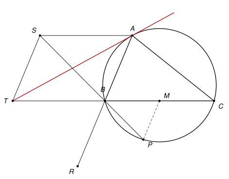

## Statement

Soit $ABC$ un triangle tel que $AC > AB$, et $\Gamma$ son cercle circonscrit. La tangente à $\Gamma$ en $A$ coupe la droite $(BC)$ en $T$. Soit $M$ le milieu de $[BC]$ et $R$ le symétrique de $A$ par rapport à $B$. Soit $S$ le point tel que $SABT$ est un parallélogramme. La parallèle à $(AB)$ qui passe par $M$ coupe la droite $(SB)$ en $P$.

On suppose que le point $P$ est sur $\Gamma$. Montrer que la droite $(AC)$ est tangente au cercle circonscrit au triangle $SRT$.

## Hints

1. Placez-vous dans un repère orthonormé d'origine $M$, avec $B(-2\,;0)$, $C(2\,;0)$ et $A(a\,;b)$. Que devient la condition $AC > AB$ ?
2. Calculez les coordonnées de $T$, $S$, $R$ et $P$ en fonction de $a$ et de $b$. Le nombre $AB^2 = (a + 2)^2 + b^2$ apparaît souvent.
3. Écrivez que $P$ est sur $\Gamma$. L'égalité obtenue se factorise, et elle impose la valeur de $a$. Que signifie-t-elle sur la figure ?
4. Un cercle tangent à $(AC)$ au point $A$ a son centre sur la perpendiculaire à $(AC)$ en $A$. Prenez celui qui passe par $S$, et montrez qu'il passe aussi par $T$ et par $R$.

## Solution

*Rappels.*

- *Coordonnées.* Dans un repère orthonormé, $\vec{u}(x\,;y) \cdot \vec{v}(x'\,;y') = xx' + yy'$. Les vecteurs sont orthogonaux si et seulement si ce nombre est nul, et colinéaires si et seulement si $xy' - yx' = 0$.
- *Tangente.* La tangente en un point $A$ d'un cercle de centre $O$ est la droite qui passe par $A$ et qui est perpendiculaire à $(OA)$.
- *Être sur un cercle.* Soit $\mathcal{C}$ le cercle de centre $\Omega$ qui passe par $A$. Pour tout point $X$, en développant le carré de $\overrightarrow{\Omega X} = \overrightarrow{\Omega A} + \overrightarrow{AX}$, on obtient $\Omega X^2 = \Omega A^2 - 2\,\overrightarrow{AX} \cdot \overrightarrow{A\Omega} + AX^2$. Donc

$$X \in \mathcal{C} \iff AX^2 = 2\,\overrightarrow{AX} \cdot \overrightarrow{A\Omega}.$$

**Étape 0 : le repère.** On prend un repère orthonormé d'origine $M$, dont l'axe des abscisses est la droite $(BC)$ et dont l'unité est le quart de $BC$. Alors $B(-2\,;0)$, $C(2\,;0)$, et on note $A(a\,;b)$ avec $b \neq 0$. On a $AB^2 = (a + 2)^2 + b^2$ et $AC^2 = (a - 2)^2 + b^2$, donc $AC^2 - AB^2 = -8a$. La condition $AC > AB$ s'écrit $a < 0$.

**Étape 1 : le cercle $\Gamma$ et le point $T$.** Le centre $O$ de $\Gamma$ est sur la médiatrice de $[BC]$, l'axe des ordonnées : $O(0\,;h)$. L'égalité $OB^2 = OA^2$ s'écrit $4 + h^2 = a^2 + (b - h)^2$, soit

$$2bh = a^2 + b^2 - 4. \qquad (\star)$$

Un point $(x\,;y)$ est sur $\Gamma$ si et seulement si $x^2 + (y - h)^2 = 4 + h^2$, c'est-à-dire $x^2 + y^2 - 2hy = 4$.

Le point $T(t\,;0)$ est sur la tangente en $A$ si et seulement si $\overrightarrow{AT}(t - a\,;-b)$ est orthogonal à $\overrightarrow{OA}(a\,;b - h)$ :

$$a(t - a) - b(b - h) = 0, \quad\text{soit}\quad at = a^2 + b^2 - bh = \frac{a^2 + b^2 + 4}{2}$$

d'après $(\star)$. Comme $a \neq 0$, on obtient $t = \dfrac{a^2 + b^2 + 4}{2a}$, puis

$$t + 2 = \frac{a^2 + 4a + 4 + b^2}{2a} = \frac{AB^2}{2a}.$$

**Étape 2 : les points $R$, $S$ et $P$.** Le point $B$ est le milieu de $[AR]$, donc $R(-4 - a\,;-b)$. Le quadrilatère $SABT$ est un parallélogramme, donc $\overrightarrow{SA} = \overrightarrow{TB}$, ce qui donne $S(a + 2 + t\,;b)$.

Le point $P$ est sur la parallèle à $(AB)$ passant par $M$, donc $\overrightarrow{MP} = \lambda\,\overrightarrow{AB}$ pour un réel $\lambda$, soit $P\left(-\lambda(a + 2)\,;-\lambda b\right)$. Il est sur $(SB)$ si et seulement si $\overrightarrow{BP}\left(2 - \lambda(a + 2)\,;-\lambda b\right)$ et $\overrightarrow{BS}(a + t + 4\,;b)$ sont colinéaires :

$$\left(2 - \lambda(a + 2)\right) b + \lambda b\,(a + t + 4) = b\left(2 + \lambda(t + 2)\right) = 0.$$

Donc $\lambda = -\dfrac{2}{t + 2} = -\dfrac{4a}{AB^2}$, et

$$P\left(\frac{4a(a + 2)}{AB^2}\,;\frac{4ab}{AB^2}\right).$$

**Étape 3 : la condition « $P$ est sur $\Gamma$ » impose $a = -1$.** Calculons $x^2 + y^2 - 2hy$ pour le point $P$. D'une part $x^2 + y^2 = \dfrac{16a^2\left((a + 2)^2 + b^2\right)}{AB^4} = \dfrac{16a^2}{AB^2}$. D'autre part, avec $(\star)$, $2hy = \dfrac{4a \times 2bh}{AB^2} = \dfrac{4a(a^2 + b^2 - 4)}{AB^2}$. Le point $P$ est donc sur $\Gamma$ si et seulement si

$$16a^2 - 4a(a^2 + b^2 - 4) = 4\,AB^2 = 4(a^2 + b^2 + 4a + 4).$$

On divise par $4$ et on regroupe : $4a^2 - 4 - (a^2 + b^2)(a + 1) = 0$, c'est-à-dire

$$(a + 1)\left(4a - 4 - a^2 - b^2\right) = 0.$$

Le second facteur vaut $-\left((a - 2)^2 + b^2\right) = -AC^2$, qui n'est pas nul. Donc $a = -1$.

Sur la figure, cela veut dire que le pied $H(-1\,;0)$ de la hauteur issue de $A$ est le milieu de $[BM]$.

**Étape 4 : les points avec $a = -1$.** On a alors $t = -\dfrac{b^2 + 5}{2}$, et

$$T\left(-\frac{b^2 + 5}{2}\,;0\right), \quad S\left(-\frac{b^2 + 3}{2}\,;b\right), \quad R(-3\,;-b), \quad A(-1\,;b).$$

Les vecteurs utiles sont

$$\overrightarrow{AS}\left(-\frac{b^2 + 1}{2}\,;0\right), \quad \overrightarrow{AT}\left(-\frac{b^2 + 3}{2}\,;-b\right), \quad \overrightarrow{AR}(-2\,;-2b), \quad \overrightarrow{AC}(3\,;-b).$$

**Étape 5 : le cercle.** Le vecteur $\vec{u}(b\,;3)$ vérifie $\vec{u} \cdot \overrightarrow{AC} = 3b - 3b = 0$, il est orthogonal à $(AC)$. Soit $\Omega$ le point tel que $\overrightarrow{A\Omega} = \mu\,\vec{u}$ avec $\mu = -\dfrac{b^2 + 1}{4b}$, et $\mathcal{C}$ le cercle de centre $\Omega$ qui passe par $A$. Son rayon $[\Omega A]$ est perpendiculaire à $(AC)$, donc la droite $(AC)$ est tangente à $\mathcal{C}$ en $A$.

D'après le dernier rappel, un point $X$ est sur $\mathcal{C}$ si et seulement si $AX^2 = 2\mu\,\overrightarrow{AX} \cdot \vec{u}$. Vérifions-le pour les trois points.

- Pour $S$ : $\overrightarrow{AS} \cdot \vec{u} = -\dfrac{b(b^2 + 1)}{2}$, donc $2\mu\,\overrightarrow{AS} \cdot \vec{u} = \dfrac{(b^2 + 1)^2}{4} = AS^2$.
- Pour $T$ : $\overrightarrow{AT} \cdot \vec{u} = -\dfrac{b(b^2 + 3)}{2} - 3b = -\dfrac{b(b^2 + 9)}{2}$, donc $2\mu\,\overrightarrow{AT} \cdot \vec{u} = \dfrac{(b^2 + 1)(b^2 + 9)}{4}$. Et $AT^2 = \dfrac{(b^2 + 3)^2}{4} + b^2 = \dfrac{b^4 + 10b^2 + 9}{4} = \dfrac{(b^2 + 1)(b^2 + 9)}{4}$.
- Pour $R$ : $\overrightarrow{AR} \cdot \vec{u} = -2b - 6b = -8b$, donc $2\mu\,\overrightarrow{AR} \cdot \vec{u} = 4(b^2 + 1) = AR^2$.

Les points $S$, $R$ et $T$ sont donc sur $\mathcal{C}$. Ils sont distincts, car leurs ordonnées $b$, $-b$ et $0$ sont différentes. Trois points distincts d'un cercle ne sont pas alignés, et il ne passe qu'un cercle par trois points non alignés : $\mathcal{C}$ est le cercle circonscrit au triangle $SRT$.

**La droite $(AC)$ est tangente au cercle circonscrit au triangle $SRT$, au point $A$.**

![Le cercle circonscrit à SRT, en bleu, de centre Ω : il passe par A, et son rayon [ΩA] est perpendiculaire à (AC)](10272-figure-2.svg)

*Remarques.*

- La condition « $P$ est sur $\Gamma$ » se traduit simplement : le pied de la hauteur issue de $A$ est le milieu de $[BM]$, autrement dit $AB = AM$. C'est ainsi qu'on peut tracer la figure. L'hypothèse $AC > AB$ est indispensable : si $AC < AB$, alors $a > 0$ et la condition est impossible, et si $AC = AB$, la tangente en $A$ est parallèle à $(BC)$ et le point $T$ n'existe pas.
- Le même critère montre que les points $M$ et $P$ sont eux aussi sur le cercle $\mathcal{C}$. Par exemple $\overrightarrow{AM}(1\,;-b)$ donne $2\mu\,\overrightarrow{AM} \cdot \vec{u} = -4\mu b = b^2 + 1 = AM^2$.
- Le corrigé officiel est synthétique. Il montre d'abord, avec le théorème de Thalès et des angles, que $BT = BS$ et que $A$ est sur le cercle $SRT$. Il montre ensuite que $(AC)$ est tangente au cercle qui passe par $A$, $B$ et le milieu $N$ de $[AT]$, et conclut avec l'homothétie de centre $A$ et de rapport $2$, qui envoie ce cercle sur le cercle $ATR$. Les correcteurs signalent des solutions très variées, en coordonnées barycentriques, avec des homothéties ou avec des divisions harmoniques.
