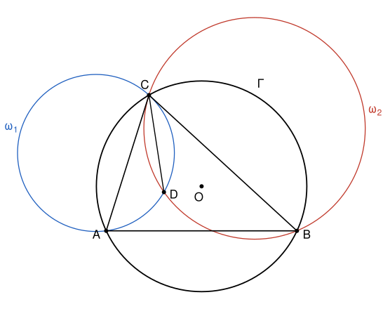

## Statement

Soit $\Gamma$ un cercle de centre $O$ et de rayon $R$, et soient $A$ et $B$ deux points fixes de $\Gamma$ tels que $[AB]$ ne soit pas un diamètre de $\Gamma$. Soit $C$ un point de $\Gamma$ tel que le triangle $ABC$ ne soit pas isocèle.

On note $\omega_1$ le cercle qui passe par $A$ et qui est tangent en $C$ à la droite $(BC)$, et $\omega_2$ le cercle qui passe par $B$ et qui est tangent en $C$ à la droite $(AC)$. Ces deux cercles se recoupent en un point $D$.

a) Montrer que $CD \leqslant R$.

b) Montrer que, lorsque $C$ se déplace sur $\Gamma$, la droite $(CD)$ passe toujours par un même point.

## Hints

1. Utilise l'angle entre une tangente et une corde : dans $\omega_1$, l'angle entre la tangente $(CB)$ et la corde $[CD]$ est égal à l'angle inscrit $\widehat{CAD}$. Fais de même dans $\omega_2$.
2. Note $\gamma = \widehat{ACB}$. Calcule $\widehat{ADC}$ et $\widehat{BDC}$ en fonction de $\gamma$, puis $\widehat{ADB}$. Compare avec l'angle au centre $\widehat{AOB}$.
3. Soit $S$ le point où se coupent les tangentes à $\Gamma$ en $A$ et en $B$. Montre que $A$, $B$, $O$, $D$ et $S$ sont sur un même cercle, dont $[OS]$ est un diamètre.
4. Comme $SA = SB$, la demi-droite $[DS)$ coupe l'angle $\widehat{ADB}$ en deux. Déduis-en que $C$, $D$ et $S$ sont alignés, puis regarde l'angle $\widehat{ODC}$.

## Solution

**Deux rappels sur les cercles.**

- *Angle inscrit.* Si $X$, $Y$, $Z$ sont sur un cercle de centre $\Omega$, l'angle inscrit $\widehat{XZY}$ vaut la moitié de l'angle au centre $\widehat{X\Omega Y}$ qui intercepte le même arc. Deux angles inscrits qui interceptent des cordes de même longueur, du même côté, sont donc égaux. Réciproquement, si deux points $M$ et $N$, situés du même côté de la droite $(XY)$, voient le segment $[XY]$ sous le même angle, alors $X$, $Y$, $M$, $N$ sont sur un même cercle.
- *Angle entre une tangente et une corde.* Soit $\omega$ un cercle de centre $\Omega$, $C$ et $D$ deux points de $\omega$, $T$ un point de la tangente en $C$, et $P$ un point de $\omega$ situé de l'autre côté de $(CD)$ par rapport à $T$. Alors $\widehat{TCD} = \widehat{CPD}$. En effet, quand $\widehat{CPD}$ est aigu, l'angle au centre $\widehat{C\Omega D}$ vaut $2\,\widehat{CPD}$, le triangle $\Omega CD$ est isocèle donc $\widehat{\Omega CD} = 90° - \widehat{CPD}$, et la tangente est perpendiculaire à $(\Omega C)$, donc $\widehat{TCD} = 90° - \widehat{\Omega CD} = \widehat{CPD}$.

On note $\gamma = \widehat{ACB}$. On traite le cas où $C$ est sur le grand arc $AB$, comme sur la figure. Comme $[AB]$ n'est pas un diamètre, l'angle au centre $\widehat{AOB}$ vaut $2\gamma < 180°$, donc $\gamma < 90°$, et $O$ est du même côté de $(AB)$ que $C$. L'autre cas est discuté à la fin.

**Étape 1 : deux paires d'angles égaux.** Un cercle tangent à une droite est tout entier d'un même côté de cette droite. Donc $\omega_1$ est du côté de $A$ par rapport à $(BC)$, et $\omega_2$ du côté de $B$ par rapport à $(AC)$. Le point $D$, qui est sur les deux cercles, est donc à l'intérieur de l'angle $\widehat{ACB}$ : la demi-droite $[CD)$ est entre $[CA)$ et $[CB)$, et $A$, $B$ sont de part et d'autre de $(CD)$.

Dans $\omega_1$, la droite $(CB)$ est la tangente en $C$, et $A$ est de l'autre côté de $(CD)$ par rapport à $B$. D'après le rappel,

$$\widehat{DCB} = \widehat{CAD}.$$

De même, dans $\omega_2$, la droite $(CA)$ est la tangente en $C$, donc

$$\widehat{DCA} = \widehat{CBD}.$$

**Étape 2 : l'angle $\widehat{ADB}$.** Dans le triangle $ADC$,

$$\widehat{ADC} = 180° - \widehat{CAD} - \widehat{DCA} = 180° - \widehat{DCB} - \widehat{DCA} = 180° - \gamma.$$

Dans le triangle $BDC$, de la même façon, $\widehat{BDC} = 180° - \widehat{CBD} - \widehat{DCB} = 180° - \widehat{DCA} - \widehat{DCB} = 180° - \gamma$.

Ces deux angles dépassent $90°$. Le point $D$ est donc du même côté de $(AB)$ que $C$ : sinon, la demi-droite $[DC)$ serait à l'intérieur de l'angle $\widehat{ADB}$, et l'on aurait $\widehat{ADC} + \widehat{CDB} = \widehat{ADB} \leqslant 180°$, ce qui est impossible. Ainsi $D$ est à l'intérieur du triangle $ABC$, et le tour complet autour de $D$ donne

$$\widehat{ADB} = 360° - (180° - \gamma) - (180° - \gamma) = 2\gamma.$$

**Étape 3 : cinq points sur un même cercle.** L'angle au centre $\widehat{AOB}$ vaut aussi $2\gamma$. Les points $D$ et $O$ sont du même côté de $(AB)$ et voient $[AB]$ sous le même angle $2\gamma$ : d'après le rappel, $A$, $B$, $O$, $D$ sont sur un même cercle $\mathcal{C}$ (si $D = O$, c'est évident).

Comme $[AB]$ n'est pas un diamètre, les tangentes à $\Gamma$ en $A$ et en $B$ ne sont pas parallèles. Elles se coupent en un point $S$, qui ne dépend que de $A$ et de $B$. Une tangente est perpendiculaire au rayon, donc $\widehat{OAS} = \widehat{OBS} = 90°$ : les points $A$ et $B$ sont sur le cercle de diamètre $[OS]$. Ce cercle passe par $O$, $A$, $B$, comme $\mathcal{C}$, et il n'y a qu'un cercle passant par trois points non alignés. Donc $S$ est sur $\mathcal{C}$, et **$[OS]$ est un diamètre de $\mathcal{C}$**. Enfin, $S$ est de l'autre côté de $(AB)$ par rapport à $O$, donc par rapport à $D$.

**Étape 4 : $C$, $D$, $S$ sont alignés.** Les deux tangentes issues de $S$ ont la même longueur : $SA = SB$. Dans le cercle $\mathcal{C}$, les cordes $[SA]$ et $[SB]$ ont donc la même longueur, et les angles inscrits $\widehat{ADS}$ et $\widehat{SDB}$ sont égaux. Comme $S$ et $D$ sont de part et d'autre de $(AB)$, la demi-droite $[DS)$ est à l'intérieur de l'angle $\widehat{ADB}$, et

$$\widehat{ADS} = \widehat{SDB} = \frac{2\gamma}{2} = \gamma.$$

Autour de $D$, on rencontre dans l'ordre les demi-droites $[DC)$, $[DA)$, $[DS)$, $[DB)$, car $[DS)$ est dans l'angle $\widehat{ADB}$ et $[DC)$ en dehors. En passant de $[DC)$ à $[DS)$ par $[DA)$, on tourne de

$$\widehat{CDA} + \widehat{ADS} = (180° - \gamma) + \gamma = 180°.$$

Les demi-droites $[DC)$ et $[DS)$ sont donc opposées : **$C$, $D$ et $S$ sont alignés**.

**Réponse à b).** La droite $(CD)$ passe toujours par $S$, le point de rencontre des tangentes à $\Gamma$ en $A$ et en $B$. Ce point ne dépend pas de $C$.

**Réponse à a).** Si $D = O$, alors $CD = OC = R$. Sinon, $D$ est sur le cercle $\mathcal{C}$ de diamètre $[OS]$, et il est différent de $O$ et de $S$, donc $\widehat{ODS} = 90°$. Comme $C$ est sur la droite $(DS)$, le triangle $ODC$ est rectangle en $D$, d'hypoténuse $[OC]$. Par le théorème de Pythagore,

$$CD^2 = OC^2 - OD^2 = R^2 - OD^2 \leqslant R^2.$$

**Conclusion : $CD \leqslant R$, et la droite $(CD)$ passe toujours par le point $S$ où se coupent les tangentes à $\Gamma$ en $A$ et en $B$.**

**L'autre cas.** Si $C$ est sur le petit arc $AB$, alors $\gamma > 90°$. Les étapes 1 et 2 donnent encore $\widehat{ADC} = \widehat{BDC} = 180° - \gamma$, mais ces angles sont aigus : cette fois, $D$ est de l'autre côté de $(AB)$, du côté de $O$, et voit $[AB]$ sous l'angle $360° - 2\gamma$, comme $O$. Le point $S$ est alors du côté de $C$. Le même raisonnement montre que $A$, $B$, $O$, $D$, $S$ sont sur le cercle de diamètre $[OS]$, que $(DC)$ coupe l'angle $\widehat{ADB}$ en deux et passe donc par $S$, et la fin est identique.

## Going further

L'étape « $\widehat{ODS} = 90°$ » dit que $D$ est le pied de la perpendiculaire menée de $O$ à la droite $(CS)$ : c'est le **milieu** de la corde que la droite $(CS)$ découpe dans $\Gamma$. La droite $(CS)$ est appelée la **symédiane** issue de $C$ : c'est la symétrique de la médiane par rapport à la bissectrice de l'angle $\widehat{ACB}$.

L'hypothèse « non isocèle » sert seulement à éviter $D = O$ : si $CA = CB$, on trouve $D = O$, et la droite $(CD) = (CO)$ passe encore par $S$.
