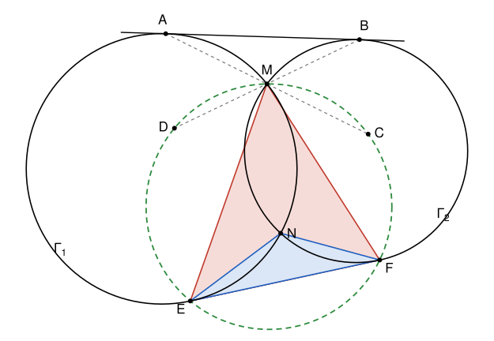

## Statement

Soient $\Gamma_1$ et $\Gamma_2$ deux cercles qui se coupent en deux points $M$ et $N$. On considère une tangente commune extérieure aux deux cercles, c'est-à-dire une droite tangente à $\Gamma_1$ et à $\Gamma_2$ qui laisse les deux cercles du même côté. On choisit celle des deux qui est la plus proche de $M$. Elle touche $\Gamma_1$ en $A$ et $\Gamma_2$ en $B$.

Soient $C$ et $D$ les symétriques respectifs de $A$ et de $B$ par rapport au point $M$. Le cercle circonscrit au triangle $MCD$ recoupe $\Gamma_1$ en un point $E$ et $\Gamma_2$ en un point $F$, autres que $M$.

Montrer que les cercles circonscrits aux triangles $MEF$ et $NEF$ ont le même rayon.

## Hints

1. Le cercle circonscrit à $MEF$ n'est pas un nouveau cercle : lequel est-ce ? Compare son rayon à celui du cercle circonscrit à $MAB$, en pensant à la symétrie de centre $M$.
2. Soit $L$ le point où la droite $(AB)$ coupe la droite $(MN)$. Pour un point $P$ de la tangente en $A$, le triangle $O_1AP$ est rectangle en $A$, où $O_1$ est le centre de $\Gamma_1$. Déduis-en que $LA = LB$.
3. Les centres des deux cercles sont sur la médiatrice de $[MN]$. Prends un repère orthonormé dont l'origine est le milieu de $[MN]$ et dont l'axe des abscisses est cette médiatrice. Note $A'$ le symétrique de $A$ par rapport à l'axe des abscisses, et montre que $A$, $D$ et $A'$ sont alignés.
4. Montre que $A'$ est sur le cercle circonscrit à $MCD$, en comparant les produits scalaires $\overrightarrow{AD} \cdot \overrightarrow{AA'}$ et $\overrightarrow{AM} \cdot \overrightarrow{AC}$. Tu dois trouver que $E = A'$.

## Solution

**Un lemme : la puissance d'un point.** Soit $\mathcal{C}$ un cercle de centre $O$ et de rayon $r$, et soit $P$ un point. Si une droite passant par $P$ coupe $\mathcal{C}$ en deux points $X$ et $Y$, avec $X = Y$ quand la droite est tangente, alors

$$\overrightarrow{PX} \cdot \overrightarrow{PY} = PO^2 - r^2.$$

En particulier, ce produit scalaire est le même pour toutes les droites passant par $P$ qui coupent le cercle.

*Preuve.* Soit $H$ le projeté orthogonal de $O$ sur la droite. Si $X \neq Y$, le triangle $OXY$ est isocèle en $O$, donc $H$ est le milieu de $[XY]$. Si la droite est tangente en $X$, elle est perpendiculaire à $(OX)$, donc $H = X = Y$. Dans les deux cas, $\overrightarrow{HY} = -\overrightarrow{HX}$, et

$$\overrightarrow{PX} \cdot \overrightarrow{PY} = \left(\overrightarrow{PH} + \overrightarrow{HX}\right) \cdot \left(\overrightarrow{PH} - \overrightarrow{HX}\right) = PH^2 - HX^2.$$

Le théorème de Pythagore dans les triangles $OHP$ et $OHX$, rectangles en $H$, donne $PH^2 = PO^2 - OH^2$ et $HX^2 = r^2 - OH^2$. La différence vaut $PO^2 - r^2$.

**Étape 0 : quelques points distincts.** La droite $(AB)$ ne touche $\Gamma_1$ qu'en $A$, et $\Gamma_2$ qu'en $B$.

- $A \neq B$ : sinon les deux cercles seraient tangents à la même droite au même point, donc tangents entre eux, et n'auraient qu'un seul point commun.
- $A$ n'est ni $M$ ni $N$ : sinon $A$ serait un point de $\Gamma_2$ situé sur $(AB)$, donc $A = B$. De même, $B$ n'est ni $M$ ni $N$.
- En particulier, $M$ n'est pas sur la droite $(AB)$, car le seul point de $\Gamma_1$ sur cette droite est $A$. Donc $M$, $A$, $B$ forment un vrai triangle.

**Étape 1 : le repère.** Soit $K$ le milieu de $[MN]$. Les centres $O_1$ et $O_2$ des deux cercles sont à égale distance de $M$ et de $N$, donc ils sont sur la médiatrice de $[MN]$. On prend un repère orthonormé d'origine $K$, dont l'axe des abscisses est cette médiatrice et l'axe des ordonnées la droite $(MN)$ :

$$M(0\,;\,\mu), \qquad N(0\,;\,-\mu), \qquad O_1(c_1\,;\,0), \qquad O_2(c_2\,;\,0),$$

avec $\mu > 0$. Le rayon $r_1$ de $\Gamma_1$ vérifie $r_1^2 = O_1M^2 = c_1^2 + \mu^2$, et de même $r_2^2 = c_2^2 + \mu^2$.

On note $s$ la symétrie par rapport à l'axe des abscisses, qui envoie le point $(x\,;\,y)$ sur le point $(x\,;\,-y)$. Elle échange $M$ et $N$. Elle envoie chacun des deux cercles sur lui-même, puisque son centre est sur l'axe et qu'une symétrie conserve les distances.

**Étape 2 : $(MN)$ coupe $[AB]$ en son milieu.** La droite $(AB)$ n'est pas parallèle à l'axe des ordonnées. En effet, si elle l'était, le rayon $[O_1A]$, qui lui est perpendiculaire, serait horizontal, donc $A$ serait sur l'axe des abscisses. De même pour $B$, et $A$, $B$ seraient alors deux points de l'axe des abscisses sur une même droite verticale, donc confondus. La droite $(AB)$ coupe donc l'axe des ordonnées en un point $L(0\,;\,\lambda)$.

Le triangle $O_1AL$ est rectangle en $A$, car la tangente en $A$ est perpendiculaire au rayon $[O_1A]$. Par le théorème de Pythagore,

$$LA^2 = O_1L^2 - r_1^2 = \left(c_1^2 + \lambda^2\right) - \left(c_1^2 + \mu^2\right) = \lambda^2 - \mu^2.$$

Le même calcul dans $\Gamma_2$ donne $LB^2 = \lambda^2 - \mu^2$. Donc $LA = LB$. Les points $A$ et $B$ sont distincts et alignés avec $L$, donc $L$ est le milieu de $[AB]$. Enfin $LA \neq 0$, puisque $A$ n'est pas sur $(MN)$, donc $\lambda^2 - \mu^2 > 0$ et $\lambda \neq \mu$.

Notons $A(p\,;\,\alpha)$. L'égalité $LA^2 = \lambda^2 - \mu^2$ s'écrit $p^2 + (\alpha - \lambda)^2 = \lambda^2 - \mu^2$, c'est-à-dire

$$p^2 + \alpha^2 + \mu^2 = 2\alpha\lambda. \qquad (1)$$

**Étape 3 : le symétrique $A'$ de $A$ est sur le cercle $(MCD)$.** Notons $\omega$ le cercle circonscrit au triangle $MCD$, et $A' = s(A)$, de coordonnées $(p\,;\,-\alpha)$.

Comme $D$ est le symétrique de $B$ par rapport à $M$, on a $\overrightarrow{MD} = \overrightarrow{BM}$, et comme $L$ est le milieu de $[AB]$,

$$\overrightarrow{AD} = \overrightarrow{AM} + \overrightarrow{BM} = 2\,\overrightarrow{LM}, \qquad \text{donc} \qquad \overrightarrow{AD}\,(0\,;\,2\mu - 2\lambda).$$

Ce vecteur n'est pas nul, car $\lambda \neq \mu$. Par ailleurs $\overrightarrow{AA'}\,(0\,;\,-2\alpha)$. Les points $A$, $D$, $A'$ sont donc sur une même droite verticale, et

$$\overrightarrow{AD} \cdot \overrightarrow{AA'} = (2\mu - 2\lambda)(-2\alpha) = 4\alpha\,(\lambda - \mu).$$

Calculons maintenant la puissance de $A$ par rapport à $\omega$. La droite $(AC)$ passe par $M$, puisque $M$ est le milieu de $[AC]$, et elle coupe $\omega$ en $M$ et en $C$. D'après le lemme, la puissance vaut

$$\overrightarrow{AM} \cdot \overrightarrow{AC} = \overrightarrow{AM} \cdot 2\,\overrightarrow{AM} = 2AM^2 = 2\left(p^2 + (\alpha - \mu)^2\right) = 2\left(p^2 + \alpha^2 + \mu^2\right) - 4\alpha\mu.$$

Avec $(1)$, cela donne $4\alpha\lambda - 4\alpha\mu = 4\alpha\,(\lambda - \mu)$. On a donc trouvé

$$\overrightarrow{AD} \cdot \overrightarrow{AA'} = \overrightarrow{AM} \cdot \overrightarrow{AC}.$$

La droite $(AD)$ passe par le point $D$ de $\omega$, donc elle recoupe $\omega$ en un point $X$, avec $X = D$ si elle est tangente. D'après le lemme, $\overrightarrow{AD} \cdot \overrightarrow{AX} = \overrightarrow{AM} \cdot \overrightarrow{AC} = \overrightarrow{AD} \cdot \overrightarrow{AA'}$. En soustrayant, $\overrightarrow{AD} \cdot \overrightarrow{A'X} = 0$. Or $A'$ et $X$ sont tous les deux sur la droite $(AD)$, donc $\overrightarrow{A'X}$ est colinéaire au vecteur non nul $\overrightarrow{AD}$, tout en lui étant orthogonal : c'est le vecteur nul. Ainsi $X = A'$, et **$A'$ est sur le cercle $\omega$.**

Le même raisonnement, en échangeant les rôles de $A$ et $B$, de $C$ et $D$, et de $\Gamma_1$ et $\Gamma_2$, montre que **$B' = s(B)$ est aussi sur $\omega$**. En effet, $\overrightarrow{BC} = \overrightarrow{BM} + \overrightarrow{AM} = 2\,\overrightarrow{LM}$, et avec $B(q\,;\,\beta)$, l'égalité $LB^2 = \lambda^2 - \mu^2$ donne $q^2 + \beta^2 + \mu^2 = 2\beta\lambda$, ce qui permet de refaire le même calcul.

**Étape 4 : $E = A'$ et $F = B'$.** Le point $A'$ est sur $\Gamma_1$, car $s$ envoie $\Gamma_1$ sur lui-même. Il est sur $\omega$ d'après l'étape 3. Il est différent de $M$, car sinon $A = s(M) = N$, ce qui est exclu.

Les cercles $\Gamma_1$ et $\omega$ sont différents. En effet, la droite $(AM)$ ne coupe $\Gamma_1$ qu'en $A$ et en $M$, et le point $C$ de cette droite n'est ni $A$ (puisque $M \neq A$) ni $M$. Donc $C$, qui est sur $\omega$, n'est pas sur $\Gamma_1$.

Deux cercles différents ont au plus deux points communs. Les points communs à $\Gamma_1$ et à $\omega$ sont donc exactement $M$ et $A'$, et par définition de $E$, on a $E = A'$. De même, $F = B'$.

**Étape 5 : conclusion.** Notons $R$ le rayon du cercle circonscrit au triangle $MAB$.

- *Le cercle $MEF$.* La symétrie de centre $M$ envoie $M$, $A$, $B$ sur $M$, $C$, $D$. Elle conserve les distances, donc elle envoie le cercle circonscrit à $MAB$ sur un cercle de rayon $R$ qui passe par $M$, $C$ et $D$ : c'est $\omega$. Les points $M$, $E$, $F$ sont sur $\omega$, et ils sont distincts : $E$ et $F$ sont différents de $M$ par définition, et si l'on avait $E = F$, ce serait un point commun à $\Gamma_1$ et $\Gamma_2$ autre que $M$, donc $N$, et l'on aurait $A = s(E) = s(N) = M$. Le cercle circonscrit à $MEF$ est donc $\omega$, de rayon $R$.
- *Le cercle $NEF$.* La symétrie $s$ envoie $M$, $A$, $B$ sur $N$, $A'$, $B'$, c'est-à-dire sur $N$, $E$, $F$. Elle conserve les distances, donc le triangle $NEF$ est l'image du triangle $MAB$, et son cercle circonscrit est l'image du cercle circonscrit à $MAB$. Son rayon est $R$.

**Conclusion : les cercles circonscrits à $MEF$ et à $NEF$ ont le même rayon, égal à celui du cercle circonscrit à $MAB$.**

## Going further

La preuve montre plus que ce qui était demandé : le triangle $NEF$ est le symétrique du triangle $MAB$ par rapport à la droite des centres. En particulier, $(AE)$ et $(BF)$ sont parallèles à $(MN)$, et les quadrilatères $AMNE$ et $BMNF$ sont des trapèzes isocèles.

On n'a jamais utilisé le fait que la tangente choisie est la plus proche de $M$ : le résultat reste vrai avec l'autre tangente commune extérieure. Cette condition sert seulement à fixer la figure.

Le corrigé original suit un autre chemin, par les angles inscrits. Il montre d'abord que $B$, $C$, $F$ sont alignés, ainsi que $A$, $D$, $E$, puis que $\widehat{EMF} + \widehat{ENF} = 180^\circ$. Il conclut avec la formule $EF = 2R\sin\widehat{EMF}$, qui relie une corde à l'angle inscrit qui la voit, et où $R$ est le rayon du cercle.
