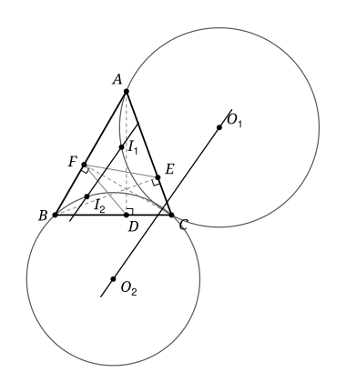

## Statement

Soit $ABC$ un triangle dont les trois angles sont aigus. On note $D$, $E$ et $F$ les pieds des hauteurs issues respectivement de $A$, $B$ et $C$.

On note $I_1$ le centre du cercle inscrit dans le triangle $AEF$, et $I_2$ le centre du cercle inscrit dans le triangle $BDF$. On note $O_1$ le centre du cercle circonscrit au triangle $ACI_1$, et $O_2$ le centre du cercle circonscrit au triangle $BCI_2$.

Montrer que les droites $(I_1I_2)$ et $(O_1O_2)$ sont parallèles.

## Hints

1. Ajoutez à la figure le centre $I$ du cercle inscrit dans $ABC$. Quelle droite passant par $I$ semble perpendiculaire aux deux droites de l'énoncé ?
2. Le triangle $AEF$ est une réduction du triangle $ABC$. Montrez que $I_1$ est sur le segment $[AI]$, avec $AI_1 = AI \cos \widehat{BAC}$.
3. Notez $r$ le rayon du cercle inscrit dans $ABC$. Montrez que $IA \times II_1 = 2r^2$, et de même $IB \times II_2 = 2r^2$.
4. Avec le milieu de $[AI_1]$ et le théorème de Pythagore, calculez $O_1I^2 - O_1C^2$. Que vaut $O_2I^2 - O_2C^2$ ?

## Solution

On note $\alpha = \widehat{BAC}$, $\beta = \widehat{ABC}$ et $\gamma = \widehat{ACB}$, et $I$ et $r$ le centre et le rayon du cercle inscrit dans $ABC$. L'idée est de montrer que les deux droites $(I_1I_2)$ et $(O_1O_2)$ sont perpendiculaires à une même troisième droite, la droite $(CI)$.

**Deux outils.**

*(T1) Puissance d'un point.* Soit un cercle de centre $O$ et de rayon $R$, et un point $P$. Si une droite passant par $P$ coupe le cercle en deux points $U$ et $V$, et si $P$ n'est pas sur le segment $[UV]$, alors

$$OP^2 - R^2 = PU \times PV .$$

En effet, soit $H$ le milieu de $[UV]$. Comme $OU = OV$, la droite $(OH)$ est perpendiculaire à $(UV)$, et le théorème de Pythagore donne $OP^2 = OH^2 + HP^2$ et $R^2 = OU^2 = OH^2 + HU^2$. Donc $OP^2 - R^2 = HP^2 - HU^2 = (HP - HU)(HP + HU)$. Comme $P$ est en dehors de $[UV]$, l'un des deux points, disons $V$, est entre $H$ et $P$, et alors $PV = HP - HU$ et $PU = HP + HU$, car $HU = HV$.

*(T2) Une ligne de niveau.* Soient $P$ et $Q$ deux points distincts et $k$ un réel. Les points $M$ tels que $MP^2 - MQ^2 = k$ forment une droite perpendiculaire à $(PQ)$.

En effet, prenons un repère orthonormé dans lequel $P = (0, 0)$ et $Q = (d, 0)$, avec $d = PQ > 0$. Pour $M = (x, y)$, on a $MP^2 - MQ^2 = x^2 + y^2 - (x - d)^2 - y^2 = 2dx - d^2$. La condition s'écrit donc $x = (k + d^2)/(2d)$ : c'est une droite perpendiculaire à l'axe des abscisses, c'est-à-dire à $(PQ)$.

**Étape 1 : $I_1$ est sur $[AI]$, et $AI_1 = AI \cos \alpha$.** Le triangle est acutangle, donc $E$ est sur le segment $[AC]$ et $F$ sur le segment $[AB]$. Dans le triangle $ABE$, rectangle en $E$, on a $AE = AB \cos \alpha$. Dans le triangle $ACF$, rectangle en $F$, on a $AF = AC \cos \alpha$. Le théorème d'Al-Kashi dans $AEF$, puis dans $ABC$, donne

$$EF^2 = AE^2 + AF^2 - 2\,AE \times AF \cos \alpha = \cos^2 \alpha \left(AB^2 + AC^2 - 2\,AB \times AC \cos \alpha\right) = \cos^2 \alpha \times BC^2 ,$$

donc $EF = BC \cos \alpha$.

Rappelons comment on calcule la distance d'un sommet au centre du cercle inscrit. Dans un triangle $XYZ$, soit $J$ le centre du cercle inscrit et $T$ son point de contact avec $[XY]$. Les deux segments tangents issus d'un même sommet ont la même longueur, d'où $XT = (XY + XZ - YZ)/2$. De plus, le triangle $XTJ$ est rectangle en $T$, et son angle en $X$ est la moitié de l'angle $\widehat{YXZ}$, car $(XJ)$ est une bissectrice. Donc $XT = XJ \cos\left(\widehat{YXZ}/2\right)$.

Les triangles $ABC$ et $AEF$ ont le même angle $\alpha$ en $A$. On obtient

$$AI \cos(\alpha/2) = \frac{AB + AC - BC}{2} , \qquad AI_1 \cos(\alpha/2) = \frac{AE + AF - EF}{2} = \cos \alpha \times \frac{AB + AC - BC}{2} ,$$

donc $AI_1 = AI \cos \alpha$. De plus, $I$ et $I_1$ sont tous deux sur la bissectrice de cet angle commun, et $0 < \cos \alpha < 1$. Donc $I_1$ est sur le segment $[AI]$, strictement entre $A$ et $I$, et

$$II_1 = AI - AI_1 = AI\,(1 - \cos \alpha) .$$

De la même façon, dans le triangle $BDF$, qui a le même angle $\beta$ en $B$ que $ABC$ : $I_2$ est strictement entre $B$ et $I$, et $II_2 = BI\,(1 - \cos \beta)$.

**Étape 2 : $IA \times II_1 = 2r^2 = IB \times II_2$.** Soit $T$ le point de contact du cercle inscrit avec $[AB]$. Le triangle $ATI$ est rectangle en $T$, avec un angle $\alpha/2$ en $A$, donc $r = IT = AI \sin(\alpha/2)$.

On a aussi $1 - \cos \alpha = 2 \sin^2(\alpha/2)$. Pour le voir, prenons un triangle isocèle dont les deux côtés égaux mesurent $1$ et forment un angle $\alpha$. D'après Al-Kashi, le carré de sa base vaut $1 + 1 - 2\cos \alpha$. Sa hauteur issue du sommet principal le coupe en deux triangles rectangles d'hypoténuse $1$ et d'angle $\alpha/2$ au sommet, donc la base mesure $2\sin(\alpha/2)$. Ainsi $4 \sin^2(\alpha/2) = 2 - 2\cos \alpha$.

Par conséquent

$$IA \times II_1 = AI^2\,(1 - \cos \alpha) = 2\,AI^2 \sin^2(\alpha/2) = 2r^2 .$$

De même, $r = BI \sin(\beta/2)$, et $IB \times II_2 = BI^2\,(1 - \cos \beta) = 2r^2$.

**Étape 3 : $(O_1O_2)$ est perpendiculaire à $(CI)$.** Soit $R_1 = O_1C = O_1A = O_1I_1$ le rayon du cercle passant par $A$, $C$ et $I_1$. La droite $(AI)$ coupe ce cercle en $A$ et en $I_1$, et $I$ n'est pas sur le segment $[AI_1]$ d'après l'étape 1. L'outil (T1) et l'étape 2 donnent

$$O_1I^2 - R_1^2 = IA \times II_1 = 2r^2 .$$

Comme $R_1 = O_1C$, cela s'écrit $O_1C^2 - O_1I^2 = -2r^2$.

De même, avec le cercle passant par $B$, $C$ et $I_2$, on obtient $O_2C^2 - O_2I^2 = -2r^2$.

Les points $C$ et $I$ sont distincts. D'après l'outil (T2), appliqué avec $P = C$, $Q = I$ et $k = -2r^2$, les points $O_1$ et $O_2$ sont sur une même droite perpendiculaire à $(CI)$.

Il reste à voir que $O_1 \neq O_2$. Sinon, ce point serait à la même distance de $A$, de $B$ et de $C$ : ce serait le centre du cercle circonscrit à $ABC$, et les deux cercles seraient ce cercle circonscrit. Le point $I_1$ serait alors sur le cercle circonscrit, ce qui est faux, car $I_1$ est à l'intérieur du triangle. Donc la droite $(O_1O_2)$ est perpendiculaire à $(CI)$.

**Étape 4 : $(I_1I_2)$ est perpendiculaire à $(CI)$.** D'après l'étape 2, $IA \times II_1 = IB \times II_2$, donc

$$\frac{II_1}{IB} = \frac{II_2}{IA} .$$

Les triangles $II_1I_2$ et $IBA$ ont le même angle en $I$, car $I_1$ est sur $[IA]$ et $I_2$ sur $[IB]$, et les côtés qui encadrent cet angle sont proportionnels. Ils sont donc semblables, $I_1$ correspondant à $B$ et $I_2$ à $A$. En particulier, $\widehat{II_1I_2} = \widehat{IBA} = \beta/2$.

Soit $W$ le point où la bissectrice issue de $C$ coupe $[AB]$ ; le point $I$ est sur le segment $[CW]$. Dans le triangle $AIC$, on a $\widehat{AIC} = 180^\circ - \alpha/2 - \gamma/2 = 90^\circ + \beta/2$, car $\alpha + \beta + \gamma = 180^\circ$. Comme $C$, $I$ et $W$ sont alignés dans cet ordre,

$$\widehat{AIW} = 180^\circ - \widehat{AIC} = 90^\circ - \beta/2 .$$

Le point $W$ est sur $[AB]$, donc la demi-droite $[IW)$ passe entre les demi-droites $[IA)$ et $[IB)$. Elle coupe donc le segment $[I_1I_2]$ en un point $K$. Dans le triangle $II_1K$, les angles en $I$ et en $I_1$ valent $90^\circ - \beta/2$ et $\beta/2$, donc

$$\widehat{IKI_1} = 180^\circ - (90^\circ - \beta/2) - \beta/2 = 90^\circ .$$

Ainsi $(I_1I_2)$ est perpendiculaire à $(IW)$, c'est-à-dire à $(CI)$.

**Conclusion.** Les droites $(I_1I_2)$ et $(O_1O_2)$ sont toutes les deux perpendiculaires à la droite $(CI)$. Elles sont donc parallèles.

## Going further

1. Montrer que les points $A$, $B$, $I_1$ et $I_2$ sont sur un même cercle.
2. Le cercle inscrit dans $ABC$ touche $[CA]$ en $V$ et $[CB]$ en $U$. Montrer que $(UV)$ est elle aussi parallèle à $(I_1I_2)$.
