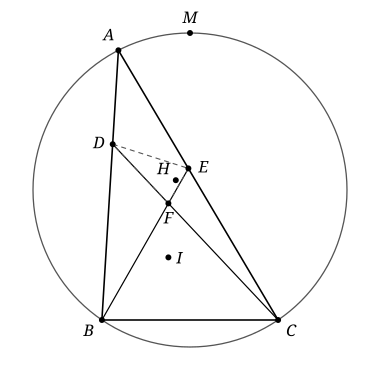

## Statement

Soit $ABC$ un triangle tel que $BC < AB$ et $BC < AC$. On place le point $D$ sur le segment $[AB]$ et le point $E$ sur le segment $[AC]$ de sorte que

$$DB = BC = CE .$$

Les droites $(CD)$ et $(BE)$ se coupent en $F$. On note :

- $I$ le centre du cercle inscrit dans le triangle $ABC$ ;
- $H$ l'orthocentre du triangle $DEF$ ;
- $M$ le milieu de l'arc $BC$ du cercle circonscrit au triangle $ABC$ qui contient $A$.

Montrer que les points $I$, $H$ et $M$ sont alignés.

## Hints

1. Le triangle $BCD$ est isocèle en $B$. Que représente la bissectrice $(BI)$ pour ce triangle ? Déduisez-en que $(BI)$ et $(CD)$ sont perpendiculaires, puis, de la même façon, que $(CI)$ et $(BE)$ le sont aussi.
2. Notez $O_1$ le milieu de $[BD]$ et $O_2$ celui de $[CE]$. Montrez que, pour tout point $P$, on a $\overrightarrow{PB} \cdot \overrightarrow{PD} = PO_1^2 - BC^2/4$, puis l'égalité analogue avec $C$, $E$ et $O_2$. L'idée est de prouver que $I$, $H$ et $M$ sont tous les trois à égale distance de $O_1$ et de $O_2$.
3. Pour le point $I$, écrivez $\overrightarrow{ID} = \overrightarrow{IC} + \overrightarrow{CD}$ et $\overrightarrow{IE} = \overrightarrow{IB} + \overrightarrow{BE}$. Pour le point $H$, écrivez de même $\overrightarrow{HB} = \overrightarrow{HE} + \overrightarrow{EB}$ et $\overrightarrow{HC} = \overrightarrow{HD} + \overrightarrow{DC}$.
4. Pour le point $M$, comparez les triangles $MBO_1$ et $MCO_2$ : deux côtés sont égaux, et les angles en $B$ et en $C$ sont des angles inscrits.

## Solution

Notons $a = BC$.

**Étape 1 : deux angles droits.** Comme $BD = BC$, le triangle $BCD$ est isocèle en $B$. Le point $D$ est sur le segment $[BA]$, donc la droite $(BI)$, bissectrice de l'angle $\widehat{ABC}$, est aussi la bissectrice de l'angle $\widehat{DBC}$. Dans un triangle isocèle, la bissectrice issue du sommet principal est aussi une hauteur. Donc $(BI) \perp (CD)$.

De même, $CE = CB$, donc le triangle $BCE$ est isocèle en $C$, et la bissectrice $(CI)$ de l'angle $\widehat{BCE}$ est perpendiculaire à $(BE)$.

En termes de vecteurs, on a donc

$$\overrightarrow{IB} \cdot \overrightarrow{CD} = 0 \qquad \text{et} \qquad \overrightarrow{IC} \cdot \overrightarrow{BE} = 0 .$$

**Étape 2 : un outil.** Soit $[XY]$ un segment de milieu $O$, et $P$ un point quelconque. Comme $\overrightarrow{OY} = -\overrightarrow{OX}$, on a

$$\overrightarrow{PX} \cdot \overrightarrow{PY} = (\overrightarrow{PO} + \overrightarrow{OX}) \cdot (\overrightarrow{PO} - \overrightarrow{OX}) = PO^2 - OX^2 .$$

Notons $O_1$ le milieu de $[BD]$ et $O_2$ le milieu de $[CE]$. On a $O_1B = O_2C = a/2$, donc, pour tout point $P$,

$$\overrightarrow{PB} \cdot \overrightarrow{PD} - \overrightarrow{PC} \cdot \overrightarrow{PE} = (PO_1^2 - a^2/4) - (PO_2^2 - a^2/4) = PO_1^2 - PO_2^2 .$$

Ainsi, **un point $P$ est à égale distance de $O_1$ et de $O_2$ exactement lorsque $\overrightarrow{PB} \cdot \overrightarrow{PD} = \overrightarrow{PC} \cdot \overrightarrow{PE}$.**

Les points $O_1$ et $O_2$ sont distincts : $O_1$ est sur le segment $[AB]$, $O_2$ sur le segment $[AC]$, ces deux segments n'ont que le point $A$ en commun, et $O_1 \neq A$ puisque $AO_1 = AB - a/2 > 0$. Les points à égale distance de $O_1$ et de $O_2$ forment donc une droite, la médiatrice $\Delta$ du segment $[O_1 O_2]$.

Il suffit de montrer que $I$, $H$ et $M$ sont tous les trois sur $\Delta$.

**Étape 3 : le point $I$.** On décompose $\overrightarrow{ID}$ en passant par $C$, et on utilise l'étape 1 :

$$\overrightarrow{IB} \cdot \overrightarrow{ID} = \overrightarrow{IB} \cdot (\overrightarrow{IC} + \overrightarrow{CD}) = \overrightarrow{IB} \cdot \overrightarrow{IC} + \overrightarrow{IB} \cdot \overrightarrow{CD} = \overrightarrow{IB} \cdot \overrightarrow{IC} .$$

De même, en passant par $B$ :

$$\overrightarrow{IC} \cdot \overrightarrow{IE} = \overrightarrow{IC} \cdot (\overrightarrow{IB} + \overrightarrow{BE}) = \overrightarrow{IC} \cdot \overrightarrow{IB} + \overrightarrow{IC} \cdot \overrightarrow{BE} = \overrightarrow{IC} \cdot \overrightarrow{IB} .$$

Les deux produits scalaires sont égaux, donc $I$ est sur $\Delta$.

**Étape 4 : le point $H$.** Le point $F$ est distinct de $E$, car la droite $(CD)$ ne coupe la droite $(AC)$ qu'au point $C$, et $E \neq C$. De même, $F \neq D$. Comme $E$ et $F$ sont sur la droite $(BE)$, la droite $(EF)$ est la droite $(BE)$. De même, la droite $(DF)$ est la droite $(CD)$.

Le point $H$ est l'orthocentre du triangle $DEF$ : la droite $(DH)$ est perpendiculaire à $(EF)$, c'est-à-dire à $(BE)$, et la droite $(EH)$ est perpendiculaire à $(DF)$, c'est-à-dire à $(CD)$. En vecteurs,

$$\overrightarrow{HD} \cdot \overrightarrow{EB} = 0 \qquad \text{et} \qquad \overrightarrow{HE} \cdot \overrightarrow{DC} = 0 .$$

Ces égalités restent vraies si $H$ est confondu avec $D$ ou avec $E$, car le vecteur nul est orthogonal à tout vecteur. On calcule alors comme à l'étape 3 :

$$\overrightarrow{HB} \cdot \overrightarrow{HD} = (\overrightarrow{HE} + \overrightarrow{EB}) \cdot \overrightarrow{HD} = \overrightarrow{HE} \cdot \overrightarrow{HD} ,$$

$$\overrightarrow{HC} \cdot \overrightarrow{HE} = (\overrightarrow{HD} + \overrightarrow{DC}) \cdot \overrightarrow{HE} = \overrightarrow{HD} \cdot \overrightarrow{HE} .$$

Les deux produits scalaires sont égaux, donc $H$ est sur $\Delta$.

**Étape 5 : le point $M$.** Ici, on montre directement que $MO_1 = MO_2$. Comme $M$ est le milieu de l'arc $BC$, les cordes $[MB]$ et $[MC]$ ont la même longueur : $MB = MC$.

*Si $AB = AC$*, le milieu de l'arc $BC$ qui contient $A$ est le point $A$ lui-même, donc $M = A$. Alors $MO_1 = AB - a/2 = AC - a/2 = MO_2$.

*Si $AB \neq AC$*, alors $M \neq A$. Les points $A$ et $M$ sont tous les deux sur l'arc $BC$ qui contient $A$. L'autre arc $BC$, qui va de $B$ à $C$ sans passer par $A$, ne contient pas non plus $M$. Il ne rencontre donc pas la droite $(AM)$, qui ne coupe le cercle qu'en $A$ et en $M$, et ses deux extrémités $B$ et $C$ sont du même côté de la droite $(AM)$. D'après le théorème de l'angle inscrit, les angles $\widehat{MBA}$ et $\widehat{MCA}$, qui interceptent la même corde $[AM]$ depuis le même côté, sont égaux.

Comme $O_1$ est sur le segment $[BA]$ et $O_2$ sur le segment $[CA]$, on a $\widehat{MBO_1} = \widehat{MBA}$ et $\widehat{MCO_2} = \widehat{MCA}$. Notons $\theta$ cet angle commun. La formule d'Al-Kashi dans les triangles $MBO_1$ et $MCO_2$ donne

$$MO_1^2 = MB^2 + \frac{a^2}{4} - a \cdot MB \cos\theta ,$$

$$MO_2^2 = MC^2 + \frac{a^2}{4} - a \cdot MC \cos\theta .$$

Comme $MB = MC$, on obtient $MO_1 = MO_2$.

Dans les deux cas, $M$ est sur $\Delta$.

**Conclusion.** Les trois points $I$, $H$ et $M$ sont sur la droite $\Delta$, la médiatrice de $[O_1 O_2]$. Ils sont donc alignés.

**Remarque.** Le nombre $\overrightarrow{PB} \cdot \overrightarrow{PD}$ s'appelle la *puissance* du point $P$ par rapport au cercle de diamètre $[BD]$. La solution montre que $I$, $H$ et $M$ ont la même puissance par rapport aux deux cercles de diamètres $[BD]$ et $[CE]$, qui ont le même rayon $a/2$.

## Going further

1. En utilisant l'étape 2, montrer que l'ensemble des points $P$ tels que $\overrightarrow{PB} \cdot \overrightarrow{PD} = 0$ est le cercle de diamètre $[BD]$.
2. Montrer que le point $A$ est sur la droite $(IM)$ seulement lorsque $AB = AC$.
