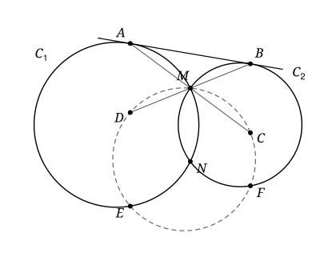

## Statement

Deux cercles $\mathcal{C}_1$ et $\mathcal{C}_2$, de centres $O_1$ et $O_2$, se coupent en deux points $M$ et $N$. Ces deux cercles ont deux tangentes communes. On choisit celle qui est la plus proche de $M$ : elle touche $\mathcal{C}_1$ en $A$ et $\mathcal{C}_2$ en $B$.

On note $C$ et $D$ les symétriques respectifs de $A$ et de $B$ par rapport au point $M$. Le cercle circonscrit au triangle $MCD$ recoupe $\mathcal{C}_1$ en un point $E$ et $\mathcal{C}_2$ en un point $F$, tous deux distincts de $M$.

Montrer que les cercles circonscrits aux triangles $MEF$ et $NEF$ ont le même rayon.

## Hints

1. Notez $\sigma$ la symétrie par rapport à la droite $(O_1 O_2)$. Que deviennent $M$, $N$ et les deux cercles par $\sigma$ ? Sur la figure, devinez où se trouvent $\sigma(A)$ et $\sigma(B)$.
2. Prenez un repère orthonormé d'origine le milieu de $[MN]$, dont l'axe des abscisses est la droite $(O_1 O_2)$. La droite $(AB)$ coupe la droite $(MN)$ en un point $X$ : montrez que $XA^2 = \overrightarrow{XM} \cdot \overrightarrow{XN} = XB^2$.
3. Pour montrer qu'un point $A'$ de la droite $(AD)$ est sur le cercle circonscrit à $MCD$, comparez $\overrightarrow{AM} \cdot \overrightarrow{AC}$ et $\overrightarrow{AD} \cdot \overrightarrow{AA'}$.
4. Une fois prouvé que $E = \sigma(A)$ et $F = \sigma(B)$, le cercle $NEF$ est l'image du cercle $MAB$ par $\sigma$. Le cercle $MEF$ est l'image du même cercle par quelle transformation ?

## Solution

Notons $\sigma$ la symétrie par rapport à la droite $(O_1 O_2)$, et $\rho$ la symétrie de centre $M$. Le point $\rho(A)$ est $C$ et le point $\rho(B)$ est $D$.

**Étape 1 : un outil, la puissance d'un point.** Soit $\Gamma$ un cercle de centre $\Omega$ et de rayon $R$, et $P$ un point. Si une droite passant par $P$ coupe $\Gamma$ en $U$ et $V$ (avec $U = V$ si la droite est tangente à $\Gamma$ en $U$), alors

$$\overrightarrow{PU} \cdot \overrightarrow{PV} = P\Omega^2 - R^2 .$$

En effet, soit $K$ le projeté orthogonal de $\Omega$ sur la droite. Comme $\Omega U = \Omega V$, le point $K$ est le milieu de $[UV]$, donc $\overrightarrow{KV} = -\overrightarrow{KU}$, et

$$\overrightarrow{PU} \cdot \overrightarrow{PV} = (\overrightarrow{PK} + \overrightarrow{KU}) \cdot (\overrightarrow{PK} - \overrightarrow{KU}) = PK^2 - KU^2 .$$

Le théorème de Pythagore dans les triangles $\Omega K P$ et $\Omega K U$, rectangles en $K$, donne $PK^2 = P\Omega^2 - \Omega K^2$ et $KU^2 = R^2 - \Omega K^2$. En soustrayant, on obtient $P\Omega^2 - R^2$.

*Une réciproque.* Soient $U$, $V$, $W$ trois points de $\Gamma$, et $P$ un point de la droite $(UV)$, distinct de $W$. Soit $V'$ un point de la droite $(PW)$ tel que $\overrightarrow{PU} \cdot \overrightarrow{PV} = \overrightarrow{PW} \cdot \overrightarrow{PV'}$. Alors $V'$ est sur $\Gamma$.

En effet, la droite $(PW)$ recoupe $\Gamma$ en un point $W'$ (avec $W' = W$ si elle est tangente). D'après l'outil, $\overrightarrow{PW} \cdot \overrightarrow{PW'} = P\Omega^2 - R^2 = \overrightarrow{PU} \cdot \overrightarrow{PV} = \overrightarrow{PW} \cdot \overrightarrow{PV'}$, donc $\overrightarrow{PW} \cdot \overrightarrow{V'W'} = 0$. Or le vecteur $\overrightarrow{V'W'}$ est colinéaire au vecteur non nul $\overrightarrow{PW}$, puisque $V'$ et $W'$ sont sur la droite $(PW)$. Il est donc nul, et $V' = W'$ est sur $\Gamma$.

**Étape 2 : un repère.** Comme $O_1 M = O_1 N$ et $O_2 M = O_2 N$, la droite $(O_1 O_2)$ est la médiatrice de $[MN]$. Prenons un repère orthonormé dont l'origine est le milieu de $[MN]$, dont l'axe des abscisses est $(O_1 O_2)$ et dont l'axe des ordonnées est donc $(MN)$. On écrit

$$M(0\,;\,m), \qquad N(0\,;\,-m), \qquad A(a\,;\,\alpha), \qquad B(b\,;\,\beta) .$$

Dans ce repère, $\sigma$ envoie le point $(x\,;\,y)$ sur le point $(x\,;\,-y)$. Elle échange $M$ et $N$, et elle conserve chacun des deux cercles, dont le centre est sur l'axe de symétrie.

Les points $A$ et $B$ sont distincts : sinon les deux cercles seraient tangents à la même droite au même point, et ils n'auraient que ce point en commun.

**Étape 3 : ce que dit la tangente.** La droite $(AB)$ n'est pas parallèle à $(MN)$. Sinon le rayon $[O_1 A]$, perpendiculaire à la tangente, serait parallèle à $(O_1 O_2)$, donc $A$ serait sur l'axe des abscisses, de même que $B$, et la droite $(AB)$ serait l'axe des abscisses, ce qui est absurde. Notons $X$ le point d'intersection de $(AB)$ et de $(MN)$.

Appliquons l'outil au point $X$ et au cercle $\mathcal{C}_1$, une fois avec la tangente $(XA)$ et une fois avec la droite $(MN)$ : $XA^2 = \overrightarrow{XM} \cdot \overrightarrow{XN}$. Avec le cercle $\mathcal{C}_2$, on obtient de même $XB^2 = \overrightarrow{XM} \cdot \overrightarrow{XN}$. Donc $XA = XB$ : le point $X$, situé sur la droite $(AB)$, est le milieu de $[AB]$.

Comme $X$ est sur l'axe des ordonnées, $a + b = 0$, donc $b = -a$, et $X$ a pour coordonnées $(0\,;\,s)$ avec $s = (\alpha + \beta)/2$. L'égalité $XA^2 = \overrightarrow{XM} \cdot \overrightarrow{XN}$ s'écrit

$$a^2 + \frac{(\alpha - \beta)^2}{4} = (m - s)(-m - s) = s^2 - m^2 .$$

Or $4s^2 - (\alpha - \beta)^2 = (\alpha + \beta)^2 - (\alpha - \beta)^2 = 4\alpha\beta$, donc $s^2 - (\alpha - \beta)^2/4 = \alpha\beta$. On obtient

$$\alpha\beta = a^2 + m^2 . \qquad (\star)$$

**Étape 4 : le point $E$ est le symétrique de $A$.** Notons $A' = \sigma(A)$, de coordonnées $(a\,;\,-\alpha)$. C'est un point de $\mathcal{C}_1$. On a aussi

$$C(-a\,;\,2m - \alpha), \qquad D(a\,;\,2m - \beta) .$$

Les points $A$, $D$, $A'$ ont la même abscisse $a$ : ils sont alignés. Les points $A$, $M$, $C$ sont alignés, puisque $M$ est le milieu de $[AC]$. Calculons deux produits scalaires. D'une part, grâce à $(\star)$,

$$\overrightarrow{AM} \cdot \overrightarrow{AC} = 2AM^2 = 2\,[a^2 + (m - \alpha)^2] = 2(\alpha\beta - 2m\alpha + \alpha^2) = 2\alpha(\alpha + \beta - 2m) .$$

D'autre part, $\overrightarrow{AD}$ a pour coordonnées $(0\,;\,2m - \beta - \alpha)$ et $\overrightarrow{AA'}$ a pour coordonnées $(0\,;\,-2\alpha)$, donc

$$\overrightarrow{AD} \cdot \overrightarrow{AA'} = -2\alpha(2m - \alpha - \beta) = 2\alpha(\alpha + \beta - 2m) .$$

Les deux produits sont égaux. Appliquons la réciproque de l'étape 1 au cercle $\Gamma$ circonscrit à $MCD$, avec $P = A$, $U = M$, $V = C$, $W = D$ et $V' = A'$. Le point $D$ est bien distinct de $A$ : sinon $M$ serait le milieu de $[AB]$, donc un point de la tangente $(AB)$. Or cette tangente ne rencontre $\mathcal{C}_1$ qu'en $A$ et $\mathcal{C}_2$ qu'en $B$, et l'on aurait $M = A$ et $M = B$, ce qui est impossible puisque $A \neq B$. On obtient que $A'$ est sur $\Gamma$.

Le point $A'$ est donc sur $\mathcal{C}_1$ et sur $\Gamma$. Il est distinct de $M$ : sinon $A = \sigma(M) = N$, et la tangente $(AB)$ passerait par le point $N$ de $\mathcal{C}_2$, donc on aurait $N = B$ et $A = B$. Comme deux cercles distincts ont au plus deux points communs, $A'$ est le point $E$ de l'énoncé : $E = \sigma(A)$.

On montre de même que $F = \sigma(B)$. Le point $B' = \sigma(B)$ a pour coordonnées $(-a\,;\,-\beta)$, les points $B$, $C$, $B'$ ont la même abscisse $-a$, les points $B$, $M$, $D$ sont alignés, et

$$\overrightarrow{BM} \cdot \overrightarrow{BD} = 2BM^2 = 2\,[a^2 + (m - \beta)^2] = 2\beta(\alpha + \beta - 2m) = \overrightarrow{BC} \cdot \overrightarrow{BB'} .$$

**Étape 5 : conclusion.** La symétrie $\sigma$ envoie $M$, $A$, $B$ sur $N$, $E$, $F$. Elle envoie donc le cercle circonscrit à $MAB$ sur le cercle circonscrit à $NEF$.

Les points $M$, $E$, $F$ sont sur $\Gamma$, donc le cercle circonscrit à $MEF$ est $\Gamma$, le cercle circonscrit à $MCD$. La symétrie $\rho$ envoie $M$, $A$, $B$ sur $M$, $C$, $D$. Elle envoie donc le cercle circonscrit à $MAB$ sur le cercle circonscrit à $MEF$.

Une symétrie conserve les longueurs, donc elle transforme un cercle en un cercle de même rayon. Les cercles circonscrits à $NEF$ et à $MEF$ ont tous les deux le même rayon que le cercle circonscrit à $MAB$ : ils ont donc le même rayon.

**Remarque.** Puisque $E = \sigma(A)$ et $F = \sigma(B)$, la droite $(EF)$ est l'image par $\sigma$ de la tangente $(AB)$ : c'est l'autre tangente commune aux deux cercles. La solution n'a pas utilisé le fait que la tangente choisie est la plus proche de $M$ : le résultat reste vrai avec l'autre tangente commune.

## Going further

1. Montrer que les points $A$, $D$, $E$ sont alignés sur une droite perpendiculaire à $(O_1 O_2)$.
2. Montrer que le quadrilatère $ABCD$ est un parallélogramme, puis que le milieu $X$ de $[AB]$ est sur la droite $(MN)$. Pourquoi cela entraîne-t-il $(AD) \parallel (MN)$ ?
