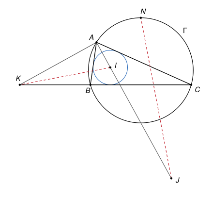

## Statement

Soit $ABC$ un triangle tel que $AB \neq AC$, et $\Gamma$ son cercle circonscrit. On note :

- $N$ le milieu de l'arc de $\Gamma$ qui va de $B$ à $C$ en passant par $A$ ;
- $I$ le centre du cercle inscrit dans le triangle $ABC$ ;
- $J$ le centre du cercle exinscrit dans l'angle $\widehat{BAC}$, c'est-à-dire du cercle tangent au segment $[BC]$ et aux demi-droites $[AB)$ et $[AC)$ au-delà de $B$ et de $C$ ;
- $K$ le point d'intersection de la droite $(BC)$ avec la bissectrice extérieure de l'angle $\widehat{BAC}$.

Montrer que les droites $(JN)$ et $(IK)$ sont perpendiculaires.

## Hints

1. Montre que $N$ est sur la bissectrice extérieure de l'angle $\widehat{BAC}$. Pense au milieu $M$ de l'autre arc $BC$, et à la droite $(MN)$.
2. Place-toi dans un repère orthonormé d'origine $A$ dont les axes sont les deux bissectrices de l'angle $\widehat{BAC}$. Les points $I$ et $J$ sont sur l'un des axes, $K$ et $N$ sur l'autre.
3. Avec $c = AB$, $b = AC$ et $\alpha = \frac{1}{2}\widehat{BAC}$, écris les coordonnées de $B$ et de $C$. Pourquoi $B$ et $C$ sont-ils sur le cercle de diamètre $[IJ]$ ?
4. Si $I = (i, 0)$ et $J = (j, 0)$, calcule le produit $ij$. Calcule aussi les ordonnées de $K$ et de $N$, puis le produit scalaire $\overrightarrow{KI} \cdot \overrightarrow{JN}$.

## Solution

On note $c = AB$, $b = AC$ et $\alpha = \frac{1}{2}\widehat{BAC}$, de sorte que $0° < \alpha < 90°$. Par hypothèse, $b \neq c$.

**Étape 1. $N$ est sur la bissectrice extérieure de l'angle $\widehat{BAC}$.**

Soit $M$ le milieu de l'arc $BC$ qui ne contient pas $A$. On a $MB = MC$ et $NB = NC$, donc $M$ et $N$ sont tous deux sur la médiatrice de $[BC]$. Cette droite passe par le centre de $\Gamma$, donc elle coupe $\Gamma$ en deux points diamétralement opposés, qui sont $M$ et $N$ : le segment $[MN]$ est un diamètre de $\Gamma$.

Comme $M$ est sur l'arc qui ne contient pas $A$, la demi-droite $[AM)$ coupe le segment $[BC]$ : elle est à l'intérieur de l'angle $\widehat{BAC}$. Les angles inscrits $\widehat{BAM}$ et $\widehat{MAC}$ interceptent les arcs $BM$ et $MC$, qui ont la même longueur, donc ils sont égaux. Ainsi $(AM)$ est la bissectrice intérieure de l'angle $\widehat{BAC}$.

Comme $AB \neq AC$, le point $A$ n'est pas sur la médiatrice de $[BC]$, donc $A \neq M$ et $A \neq N$. Le point $A$ est sur le cercle de diamètre $[MN]$, donc $\widehat{MAN} = 90°$. La droite $(AN)$ est donc la perpendiculaire en $A$ à la bissectrice intérieure : c'est la bissectrice extérieure.

**Étape 2. Un repère bien choisi.**

On prend le repère orthonormé d'origine $A$ dont l'axe des abscisses est la bissectrice intérieure de l'angle $\widehat{BAC}$, orientée vers l'intérieur de l'angle, et dont l'axe des ordonnées est orienté du côté de $B$. La demi-droite $[AB)$ fait l'angle $\alpha$ avec l'axe des abscisses, d'un côté, et $[AC)$ fait l'angle $\alpha$ de l'autre côté. Donc

$$B = (c\cos\alpha,\ c\sin\alpha), \qquad C = (b\cos\alpha,\ -b\sin\alpha).$$

L'axe des ordonnées est la bissectrice extérieure, donc d'après l'étape 1, $K = (0, k)$ et $N = (0, n)$ pour certains réels $k$ et $n$, avec $n \neq 0$ puisque $N \neq A$.

Les points $I$ et $J$ sont sur la bissectrice intérieure de l'angle $\widehat{BAC}$ : pour $I$, c'est la définition du centre du cercle inscrit, et $J$ est à égale distance des droites $(AB)$ et $(AC)$, à l'intérieur de l'angle. Donc $I = (i, 0)$ et $J = (j, 0)$, avec $i \neq 0$ et $j \neq 0$.

**Étape 3. $ij = bc$.**

En $B$, la bissectrice intérieure $(BI)$ et la bissectrice extérieure $(BJ)$ sont perpendiculaires, car $\frac{1}{2}\widehat{ABC} + \frac{1}{2}\left(180° - \widehat{ABC}\right) = 90°$. Donc $\widehat{IBJ} = 90°$, et $B$ est sur le cercle $\omega$ de diamètre $[IJ]$. De même, $C$ est sur $\omega$.

Un point $P = (x, y)$ est sur $\omega$ si et seulement si $\overrightarrow{PI} \cdot \overrightarrow{PJ} = 0$, c'est-à-dire

$$(i - x)(j - x) + y^2 = 0, \qquad \text{soit} \qquad x^2 + y^2 - (i + j)\,x + ij = 0.$$

Pour $B$, comme $x^2 + y^2 = c^2$ et $x = c\cos\alpha$, puis pour $C$, on obtient

$$c^2 - (i + j)\,c\cos\alpha + ij = 0, \qquad b^2 - (i + j)\,b\cos\alpha + ij = 0.$$

En soustrayant, $c^2 - b^2 = (i + j)(c - b)\cos\alpha$. On divise par $c - b \neq 0$ : $b + c = (i + j)\cos\alpha$. En reportant dans la première égalité, $c^2 - (b + c)\,c + ij = 0$, d'où

$$ij = bc.$$

**Étape 4. L'ordonnée de $K$.**

Les points de la droite $(BC)$ sont les points $B + t\,\overrightarrow{BC}$, de coordonnées

$$\left(\cos\alpha\,[c + t(b - c)],\ \ \sin\alpha\,[c - t(b + c)]\right).$$

L'abscisse est nulle pour $t = \frac{c}{c - b}$, ce qui est possible car $b \neq c$. L'ordonnée vaut alors

$$k = \sin\alpha\left(c - \frac{c\,(b + c)}{c - b}\right) = \sin\alpha \times \frac{c\,(c - b) - c\,(b + c)}{c - b} = \frac{2bc\sin\alpha}{b - c}.$$

**Étape 5. L'ordonnée de $N$.**

Soit $O = (x_0, y_0)$ le centre de $\Gamma$. Comme $\Gamma$ passe par l'origine $A$, son rayon au carré est $x_0^2 + y_0^2$, et son équation $(x - x_0)^2 + (y - y_0)^2 = x_0^2 + y_0^2$ se simplifie en

$$x^2 + y^2 - 2x_0\,x - 2y_0\,y = 0.$$

Pour $B$ : $c^2 - 2x_0\,c\cos\alpha - 2y_0\,c\sin\alpha = 0$, et en divisant par $c$, $c = 2x_0\cos\alpha + 2y_0\sin\alpha$. De même pour $C$ : $b = 2x_0\cos\alpha - 2y_0\sin\alpha$. En soustrayant, $c - b = 4y_0\sin\alpha$.

Le point $N = (0, n)$ est sur $\Gamma$, donc $n^2 - 2y_0\,n = 0$. Comme $n \neq 0$, on obtient

$$n = 2y_0 = \frac{c - b}{2\sin\alpha}.$$

**Étape 6. Conclusion.**

D'après les étapes 4 et 5,

$$kn = \frac{2bc\sin\alpha}{b - c} \times \frac{c - b}{2\sin\alpha} = -bc.$$

Les points $K$ et $I$ sont différents, car l'un est sur l'axe des ordonnées, l'autre sur l'axe des abscisses, et aucun n'est l'origine (on a $k \neq 0$ car $bc \neq 0$). De même $J \neq N$. On a $\overrightarrow{KI} = (i, -k)$ et $\overrightarrow{JN} = (-j, n)$, donc, avec l'étape 3,

$$\overrightarrow{KI} \cdot \overrightarrow{JN} = -ij - kn = -bc + bc = 0.$$

**Les droites $(JN)$ et $(IK)$ sont donc perpendiculaires.**

## Going further

Le calcul montre deux égalités de longueurs qui ont aussi une preuve sans repère :

$$AI \times AJ = AB \times AC = AK \times AN.$$

Pour la première, les triangles $ABJ$ et $AIC$ sont semblables. Pour la seconde, ce sont les triangles $ABK$ et $ANC$. Le signe de $kn = -bc$ dit en plus que $A$ est entre $K$ et $N$. Les deux triangles rectangles $KAI$ et $JAN$ sont alors semblables, et l'un s'obtient à partir de l'autre par un quart de tour suivi d'un agrandissement : c'est une autre façon de voir l'angle droit.

Le corrigé officiel montre que $I$ est l'**orthocentre** du triangle $KJN$. En effet, $(JA)$ est déjà une hauteur, puisque $(AJ) \perp (KN)$, et l'exercice dit que $(KI)$ en est une autre.
