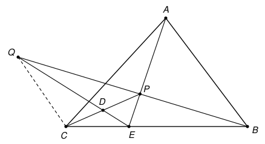

## Statement

Soit $ABC$ un triangle dont les trois angles sont aigus, et soit $P$ un point situé à l'intérieur
du triangle. On note :

- $D$ le milieu du segment $[PC]$ ;
- $E$ le point d'intersection des droites $(AP)$ et $(BC)$ ;
- $Q$ le point d'intersection des droites $(BP)$ et $(DE)$ (on suppose que ces deux droites se
  coupent).

On suppose que les angles $\widehat{PAC}$ et $\widehat{PCB}$ sont égaux. Montrer que
$$\sin\left(\widehat{BCQ}\right) = \sin\left(\widehat{BAP}\right).$$

## Hints

1. Sur la figure, les angles $\widehat{BCQ}$ et $\widehat{BAP}$ ne sont pas égaux : ils ont pour
   somme $180°$. Cela explique les sinus dans l'énoncé.
2. Trace la parallèle à $(PC)$ passant par $B$. Elle coupe la droite $(AP)$ en un point $R$.
   Commence par montrer que les points $C$, $Q$ et $R$ sont alignés.
3. Pour cela, utilise deux homothéties : celle de centre $E$ qui envoie $C$ sur $B$, puis celle de
   centre $Q$ qui envoie $P$ sur $B$. Regarde ce que devient le milieu $D$ du segment $[PC]$.
4. Compare ensuite les angles $\widehat{RBC}$ et $\widehat{RAC}$. Que peux-tu dire des quatre
   points $A$, $B$, $R$, $C$ ?

## Solution

On utilise deux rappels.

**Rappel 1 : les homothéties.** Une homothétie transforme une droite en une droite parallèle, et
elle conserve les milieux. L'image d'un point $M$ est sur la droite qui joint le centre à $M$. Une
homothétie de rapport négatif fait passer le centre entre chaque point et son image.

**Rappel 2 : l'angle inscrit.** Soient $K$ et $L$ deux points, et $X$, $Y$ deux points situés du
même côté de la droite $(KL)$. Les points $K$, $L$, $X$, $Y$ sont sur un même cercle si et
seulement si $\widehat{KXL} = \widehat{KYL}$.

### Étape 1 : le point $R$

Comme $P$ est à l'intérieur du triangle, les points $A$, $P$, $C$ ne sont pas alignés : les droites
$(AP)$ et $(PC)$ se coupent en $P$ sans être confondues, elles ne sont donc pas parallèles. La
parallèle à $(PC)$ passant par $B$ coupe donc la droite $(AP)$ en un point, que l'on note $R$.

### Étape 2 : la position de $R$

Le point $E$ est sur le segment $[BC]$, strictement entre $B$ et $C$. Soit $h_1$ l'homothétie de
centre $E$ qui envoie $C$ sur $B$. Son rapport est négatif, puisque $E$ est entre $C$ et $B$.

Elle transforme la droite $(CP)$ en la parallèle à $(CP)$ passant par $B$, c'est-à-dire en la
droite $(BR)$. Le point $P$ est sur $(EP)$, donc son image est à la fois sur $(EP)$ et sur $(BR)$ :
c'est $R$. Ainsi $h_1(P) = R$.

Comme le rapport est négatif, $E$ est entre $P$ et $R$. Sur la droite $(AP)$, on rencontre donc
dans l'ordre $A$, $P$, $E$, $R$. En particulier, $R$ est sur la demi-droite $[AP)$, et les
segments $[AR]$ et $[BC]$ se coupent en $E$. Le quadrilatère $ABRC$ est donc convexe, de diagonales
$[AR]$ et $[BC]$.

Enfin, $h_1$ envoie le milieu $D$ de $[CP]$ sur le milieu de $[BR]$, que l'on note $D'$, et $D'$
est sur la droite $(ED)$.

### Étape 3 : les points $C$, $Q$, $R$ sont alignés

D'abord, $Q \neq P$ : la droite $(DE)$ coupe la droite $(PC)$ seulement en $D$ (elle n'est pas
confondue avec $(PC)$, car $E$ n'est pas sur $(PC)$), et $D \neq P$. De même $Q \neq D$, car $D$
n'est pas sur la droite $(BP)$.

Soit $h_2$ l'homothétie de centre $Q$ qui envoie $P$ sur $B$ (elle existe car $Q$, $P$, $B$ sont
alignés et $Q \neq P$).

- Elle transforme la droite $(PC)$ en la parallèle à $(PC)$ passant par $B$, c'est-à-dire $(BR)$.
- Le point $D$ est sur $(PC)$, donc $h_2(D)$ est sur $(BR)$. Il est aussi sur la droite $(QD)$,
  qui est la droite $(ED)$. Or $(ED)$ coupe $(BR)$ en un seul point, qui est $D'$ d'après
  l'étape 2 (ces droites ne sont pas parallèles, car $(ED)$ n'est pas parallèle à $(PC)$). Donc
  $h_2(D) = D'$.
- Le point $D$ est le milieu de $[PC]$, donc $h_2(D) = D'$ est le milieu de $[h_2(P)\,h_2(C)]$,
  c'est-à-dire de $[B\,h_2(C)]$. Comme $D'$ est le milieu de $[BR]$, on obtient $h_2(C) = R$.

L'image de $C$ par une homothétie de centre $Q$ est sur la droite $(QC)$. **Les points $Q$, $C$,
$R$ sont donc alignés.**

### Étape 4 : les points $A$, $B$, $R$, $C$ sont sur un même cercle

Les droites $(BR)$ et $(CP)$ sont parallèles, et $R$, $P$ sont de part et d'autre de $(BC)$. Les
angles $\widehat{RBC}$ et $\widehat{PCB}$ sont donc alternes-internes, donc égaux. Par hypothèse,
$\widehat{PCB} = \widehat{PAC}$. Enfin, $R$ est sur la demi-droite $[AP)$, donc
$\widehat{PAC} = \widehat{RAC}$. Finalement
$$\widehat{RBC} = \widehat{RAC}.$$
Comme $ABRC$ est convexe et que $[RC]$ est l'un de ses côtés, les points $A$ et $B$ sont du même
côté de la droite $(RC)$. D'après le rappel 2, **les points $A$, $B$, $R$, $C$ sont sur un même
cercle.**

### Étape 5 : conclusion

Les points $A$ et $C$ sont du même côté de la droite $(BR)$, qui porte un autre côté du
quadrilatère convexe $ABRC$. Le rappel 2, appliqué au segment $[BR]$, donne
$$\widehat{BCR} = \widehat{BAR} = \widehat{BAP},$$
la dernière égalité parce que $R$ est sur la demi-droite $[AP)$.

Le point $Q$ est sur la droite $(CR)$ et $Q \neq C$ (le point $C$ n'est pas sur $(BP)$). Deux cas
sont possibles :

- si $Q$ est sur la demi-droite $[CR)$, alors $\widehat{BCQ} = \widehat{BCR}$ ;
- sinon, $\widehat{BCQ} = 180° - \widehat{BCR}$.

Comme $\sin(180° - \theta) = \sin\theta$, dans les deux cas
$$\sin\left(\widehat{BCQ}\right) = \sin\left(\widehat{BCR}\right) = \sin\left(\widehat{BAP}\right).$$
Les deux cas se produisent vraiment : sur la figure de l'énoncé, c'est le second.

## Going further

1. Dans un trapèze, montrer que la droite qui joint le point d'intersection des diagonales au
   point d'intersection des deux côtés non parallèles passe par les milieux des deux bases.
   Reconnaître ce résultat dans l'étape 3, avec le trapèze de bases $[BR]$ et $[CP]$.
2. Où a-t-on utilisé que les angles du triangle sont aigus ?
