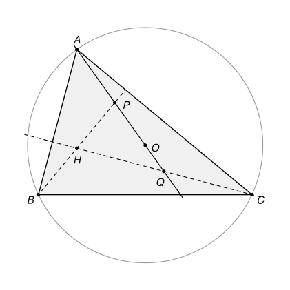

## Statement

Soit $ABC$ un triangle dont les trois angles sont aigus, et dont les trois côtés ont des longueurs
différentes. On note $O$ le centre de son cercle circonscrit et $H$ son orthocentre. La droite
$(AO)$ coupe la droite $(BH)$ en $P$ et la droite $(CH)$ en $Q$.

Montrer que le centre du cercle passant par $P$, $Q$ et $H$ se trouve sur une médiane du triangle
$ABC$.

## Hints

1. Fais une figure très précise et trace le cercle qui passe par $P$, $Q$ et $H$. Son centre
   semble se trouver sur une droite très simple qui passe par $H$ : laquelle ?
2. Trace la parallèle à $(BC)$ qui passe par $H$. Elle coupe $[AB]$ en $B'$ et $[AC]$ en $C'$.
   Montre que la médiane issue de $A$ passe par le milieu $M'$ de $[B'C']$, et devine le rôle de
   $M'$.
3. Le triangle $AB'C'$ est une réduction du triangle $ABC$. Montre que le centre de son cercle
   circonscrit est sur $(AO)$, et que $H$ est le pied de sa hauteur issue de $A$. Le problème ne
   parle alors plus que du triangle $AB'C'$.
4. Choisis un repère orthonormé d'origine $H$ dont l'axe des abscisses est $(B'C')$. Calcule les
   coordonnées de $Q$, puis la distance $M'Q$.

## Solution

Notons $D$ le pied de la hauteur issue de $A$ et $M$ le milieu de $[BC]$. Comme les angles du
triangle sont aigus, l'orthocentre $H$ est à l'intérieur du triangle, sur le segment $[AD]$, et
distinct de $A$ et de $D$. Nous allons montrer que le centre du cercle $PQH$ est sur la médiane
$(AM)$.

### Étape 1 : un petit triangle $AB'C'$

La parallèle à $(BC)$ passant par $H$ coupe $[AB]$ en $B'$ et $[AC]$ en $C'$. Posons
$k = \dfrac{AH}{AD}$, avec $0 < k < 1$. Par le théorème de Thalès (dans les triangles $ABD$ et
$ACD$),
$$\frac{AB'}{AB} = \frac{AC'}{AC} = \frac{AH}{AD} = k.$$

**La médiane passe par le milieu de $[B'C']$.** Soit $N$ le point où $(AM)$ coupe $[B'C']$. Par le
théorème de Thalès dans les triangles $ABM$ et $ACM$,
$$\frac{B'N}{BM} = \frac{AN}{AM} = \frac{C'N}{CM}.$$
Comme $BM = CM$, on obtient $B'N = C'N$ : le point $N$ est le milieu de $[B'C']$, que nous notons
désormais $M'$. **Le point $M'$ est sur la médiane $(AM)$.**

**Le centre du cercle circonscrit à $AB'C'$ est sur $(AO)$.** Soit $O'$ le point du segment
$[AO]$ tel que $AO' = k \times AO$. Dans le triangle $AOB$, on a
$\dfrac{AO'}{AO} = \dfrac{AB'}{AB} = k$, donc, par la réciproque du théorème de Thalès,
$(O'B') \parallel (OB)$ et $O'B' = k \times OB$. De même, $O'C' = k \times OC$. Comme
$OA = OB = OC$, on obtient
$$O'A = O'B' = O'C' = k \times OA.$$
Le point $O'$ est donc le centre du cercle circonscrit au triangle $AB'C'$, et la droite $(AO')$
est la droite $(AO)$.

**Ce que deviennent $H$, $P$ et $Q$.** Le point $H$ est sur $[B'C']$ et $(AH) \perp (B'C')$ : c'est
le pied de la hauteur issue de $A$ dans le triangle $AB'C'$. La droite $(BH)$ est la perpendiculaire
à $(AC)$, c'est-à-dire à $(AC')$, passant par $H$. Donc :

- $P$ est le point où $(AO')$ coupe la perpendiculaire à $(AC')$ passant par $H$ ;
- $Q$ est le point où $(AO')$ coupe la perpendiculaire à $(AB')$ passant par $H$.

Il suffit maintenant de montrer que $M'H = M'P = M'Q$.

### Étape 2 : un calcul dans un repère

Prenons un repère orthonormé d'origine $H$, dont l'axe des abscisses est la droite $(B'C')$ et
l'axe des ordonnées la droite $(HA)$. On a
$$A = (0, h), \qquad B' = (b, 0), \qquad C' = (c, 0),$$
avec $h > 0$ et $b < 0 < c$. Le milieu de $[B'C']$ est $M' = \left(\dfrac{b + c}{2}, 0\right)$, donc
$$M'H = \frac{|b + c|}{2}.$$

**Le point $O'$.** Il est sur la médiatrice de $[B'C']$, donc son abscisse vaut $\dfrac{b + c}{2}$.
Notons $y$ son ordonnée. L'égalité $O'A^2 = O'B'^2$ s'écrit
$$\left(\frac{b + c}{2}\right)^2 + (y - h)^2 = \left(\frac{c - b}{2}\right)^2 + y^2.$$
Comme $\left(\dfrac{b + c}{2}\right)^2 - \left(\dfrac{c - b}{2}\right)^2 = bc$, cela donne
$bc + h^2 - 2hy = 0$, donc
$$O' = \left(\frac{b + c}{2},\ \frac{h^2 + bc}{2h}\right).$$
Le vecteur $\overrightarrow{AO'}$ a pour coordonnées
$$\left(\frac{b + c}{2},\ \frac{bc - h^2}{2h}\right),$$
et il est colinéaire au vecteur $\left(h(b + c),\ bc - h^2\right)$ (on a multiplié par $2h$). Les points de la droite
$(AO')$ sont donc les points
$$\left(s\,h(b + c),\ h + s\,(bc - h^2)\right), \qquad s \text{ réel}.$$

**La perpendiculaire à $(AB')$ passant par $H$.** Le vecteur $\overrightarrow{AB'}$ a pour
coordonnées $(b, -h)$, et le vecteur $(h, b)$ lui est orthogonal, car $bh - hb = 0$. Les points de
cette perpendiculaire sont donc les points $(t\,h,\ t\,b)$, avec $t$ réel.

**Le point $Q$.** Il faut résoudre
$$t\,h = s\,h(b + c) \qquad\text{et}\qquad t\,b = h + s\,(bc - h^2).$$
La première équation donne $t = s(b + c)$. En reportant dans la seconde :
$s\,(b + c)\,b = h + s\,bc - s\,h^2$, c'est-à-dire $s\,(b^2 + h^2) = h$. Donc
$$s = \frac{h}{b^2 + h^2}, \qquad t = \frac{h(b + c)}{b^2 + h^2}, \qquad
Q = \left(\frac{h^2(b + c)}{b^2 + h^2},\ \frac{hb(b + c)}{b^2 + h^2}\right).$$

**La distance $M'Q$.** On a
$$x_Q - x_{M'} = (b + c)\left(\frac{h^2}{b^2 + h^2} - \frac{1}{2}\right) = \frac{(b + c)(h^2 - b^2)}{2(b^2 + h^2)},
\qquad y_Q - y_{M'} = \frac{(b + c) \times 2hb}{2(b^2 + h^2)}.$$
Donc
$$M'Q^2 = \frac{(b + c)^2}{4(b^2 + h^2)^2}\left[(h^2 - b^2)^2 + 4h^2b^2\right].$$
Or $(h^2 - b^2)^2 + 4h^2b^2 = h^4 + 2h^2b^2 + b^4 = (h^2 + b^2)^2$, d'où
$$M'Q^2 = \frac{(b + c)^2}{4}, \qquad M'Q = \frac{|b + c|}{2} = M'H.$$

**La distance $M'P$.** Dans tout ce qui précède, les rôles de $b$ et $c$ sont symétriques : en les
échangeant, on échange $B'$ et $C'$, donc $P$ et $Q$, sans changer $A$, $H$, $O'$ ni $M'$. Le même
calcul donne donc $M'P = \dfrac{|b + c|}{2}$.

### Étape 3 : conclusion

Le triangle $ABC$ n'est pas isocèle en $A$, donc $AB' = k \times AB$ et $AC' = k \times AC$ sont
différents. Comme $AB'^2 = b^2 + h^2$ et $AC'^2 = c^2 + h^2$, on a $b \neq -c$, et le nombre
$r = \dfrac{|b + c|}{2}$ est strictement positif.

Les points $H$, $P$, $Q$ sont tous les trois sur le cercle de centre $M'$ et de rayon $r$.
Vérifions qu'ils sont distincts. Si $H$ était sur la droite $(AO')$, alors $O'$ serait sur l'axe des
ordonnées, et l'on aurait $b + c = 0$, ce qui est exclu. Donc $H$ n'est pas sur $(AO')$, et il est
différent de $P$ et de $Q$. Enfin, $P \neq Q$ : sinon ce point serait commun aux deux
perpendiculaires passant par $H$, qui sont deux droites distinctes, donc ce serait $H$.

Trois points distincts d'un cercle ne sont pas alignés (une droite coupe un cercle en au plus deux
points), et il passe par eux un seul cercle. **Le cercle passant par $P$, $Q$ et $H$ est donc le
cercle de centre $M'$**, et ce centre est sur la médiane $(AM)$ d'après l'étape 1.

## Going further

1. Montrer que la droite $(AH)$ est tangente au cercle passant par $P$, $Q$ et $H$.
2. Montrer que les angles du triangle $HPQ$ sont égaux à ceux du triangle $ABC$ : $\widehat{QHP} = \widehat{BAC}$,
   $\widehat{HPQ} = \widehat{ABC}$ et $\widehat{PQH} = \widehat{BCA}$.
