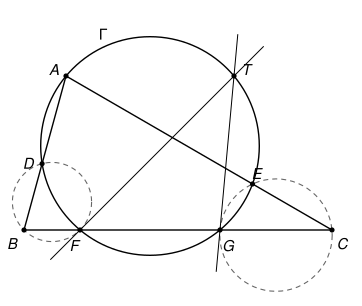

## Statement

Soit $ABC$ un triangle et $\Gamma$ un cercle passant par $A$. On suppose que $\Gamma$ recoupe les
segments $[AB]$ et $[AC]$ en deux points, notés respectivement $D$ et $E$, et qu'il coupe le
segment $[BC]$ en deux points, notés $F$ et $G$, de sorte que $F$ se trouve entre $B$ et $G$.

On note $T$ le point d'intersection de la tangente en $F$ au cercle circonscrit au triangle $BDF$
et de la tangente en $G$ au cercle circonscrit au triangle $CEG$.

Démontrer que, si les points $A$ et $T$ sont distincts, alors les droites $(AT)$ et $(BC)$ sont
parallèles.

## Hints

1. Regarde bien la figure. Où semble se trouver le point $T$ ?
2. Note $\Delta$ la médiatrice du segment $[FG]$, et $A'$ le symétrique de $A$ par rapport à
   $\Delta$. Explique pourquoi $A'$ est sur $\Gamma$ et pourquoi $(AA')$ est parallèle à $(BC)$.
   Il suffit alors de montrer que $A'$ est sur les deux tangentes.
3. Prends un repère orthonormé dont l'axe des abscisses est $(BC)$ et l'axe des ordonnées est
   $\Delta$. Écris une équation de $\Gamma$.
4. Un cercle qui passe par les points $(b, 0)$ et $(\varphi, 0)$ a une équation de la forme
   $x^2 + y^2 - (b + \varphi)x + vy + b\varphi = 0$. Trouve $v$ à l'aide du troisième point.
5. La tangente à un cercle en un point $P$ est la droite qui passe par $P$ et qui est
   perpendiculaire au rayon qui aboutit en $P$. Utilise le produit scalaire.

## Solution

### Le repère

Notons $\Delta$ la médiatrice du segment $[FG]$. On prend un repère orthonormé dont l'origine est
le milieu de $[FG]$, dont l'axe des abscisses est la droite $(BC)$ et dont l'axe des ordonnées
est $\Delta$. Il existe un réel $f > 0$ tel que
$$F = (-f, 0) \qquad \text{et} \qquad G = (f, 0).$$

Le centre de $\Gamma$ est à égale distance de $F$ et de $G$, donc il est sur $\Delta$ : c'est un
point $(0, c)$. Le rayon $r$ vérifie $r^2 = f^2 + c^2$ (distance du centre à $F$). Un point
$(x, y)$ est donc sur $\Gamma$ si et seulement si $x^2 + (y - c)^2 = f^2 + c^2$, c'est-à-dire
$$x^2 + y^2 - 2cy - f^2 = 0. \qquad (\Gamma)$$

Notons $A = (a, h)$. Comme $A$ n'est pas sur la droite $(BC)$, on a $h \neq 0$. Notons enfin
$A' = (-a, h)$, le symétrique de $A$ par rapport à $\Delta$. L'équation de $\Gamma$ ne contient
$x$ qu'à travers $x^2$, donc $A'$ est sur $\Gamma$, comme $A$.

Nous allons montrer que **les deux tangentes passent par $A'$**. Ce sera l'essentiel du travail.

### Un lemme

**Lemme.** Soit $P = (\varphi, 0)$ l'un des deux points $F$ et $G$ (donc $\varphi = -f$ ou
$\varphi = f$, et $\varphi^2 = f^2$). Soit $Q = (b, 0)$ un point de la droite $(BC)$ qui n'est
pas sur $\Gamma$, donc $b^2 \neq f^2$. Soit $R$ le second point d'intersection de la droite $(AQ)$
avec $\Gamma$. Alors la tangente en $P$ au cercle circonscrit au triangle $QRP$ passe par $A'$.

**Étape 1 : les coordonnées de $R$.** Les points de la droite $(AQ)$ sont les points
$M_s = Q + s\,\overrightarrow{QA} = (b + s(a - b),\ sh)$, où $s$ est un réel. En remplaçant dans
l'équation de $\Gamma$ et en développant, on voit que $M_s$ est sur $\Gamma$ si et seulement si
$$\left[(a - b)^2 + h^2\right] s^2 + \left[2b(a - b) - 2ch\right] s + (b^2 - f^2) = 0.$$
C'est une équation du second degré en $s$, de coefficient dominant $QA^2 > 0$. Ses racines
correspondent aux points d'intersection de la droite $(AQ)$ et de $\Gamma$. Le nombre $s = 1$ est
une racine, puisque $M_1 = A$ est sur $\Gamma$. L'autre racine $\sigma$ correspond au point $R$,
et le produit des deux racines donne
$$1 \times \sigma = \frac{b^2 - f^2}{QA^2}, \qquad \text{donc} \qquad \frac{b^2 - f^2}{\sigma} = QA^2 = (a - b)^2 + h^2.$$
On a $\sigma \neq 0$ puisque $b^2 \neq f^2$. Ainsi $R = (x_R, y_R)$ avec
$$x_R = b + \sigma(a - b) \qquad \text{et} \qquad y_R = \sigma h \neq 0.$$
En particulier $R$ n'est pas sur $(BC)$, donc les points $Q$, $R$, $P$ ne sont pas alignés, et le
cercle circonscrit au triangle $QRP$ existe bien. Notons-le $\omega$.

**Étape 2 : une équation de $\omega$.** Si $(x_0, y_0)$ est le centre de $\omega$ et $\rho$ son
rayon, une équation de $\omega$ est $(x - x_0)^2 + (y - y_0)^2 = \rho^2$, qui s'écrit
$$x^2 + y^2 + ux + vy + w = 0 \qquad \text{avec} \quad u = -2x_0, \quad v = -2y_0, \quad w = x_0^2 + y_0^2 - \rho^2.$$

- Les points $Q$ et $P$ sont sur $\omega$, donc $b^2 + ub + w = 0$ et $\varphi^2 + u\varphi + w = 0$.
  En soustrayant, $(b - \varphi)(b + \varphi + u) = 0$. Comme $b \neq \varphi$, on obtient
  $u = -(b + \varphi)$, puis $w = -b^2 - ub = b\varphi$.
- Le point $R$ est sur $\omega$, donc $x_R^2 + y_R^2 - (b + \varphi)x_R + v\,y_R + b\varphi = 0$.
  Mais $R$ est aussi sur $\Gamma$, donc $x_R^2 + y_R^2 = 2c\,y_R + f^2 = 2c\,y_R + \varphi^2$. En
  remplaçant, puis en regroupant,
  $$v\,y_R = -2c\,y_R + (b + \varphi)x_R - \varphi^2 - b\varphi = -2c\,y_R + (b + \varphi)(x_R - \varphi).$$

**Étape 3 : on calcule $vh$.** Remplaçons $x_R$ et $y_R$ par leurs valeurs. Comme
$x_R - \varphi = (b - \varphi) + \sigma(a - b)$,
$$v\,\sigma h = -2c\,\sigma h + (b + \varphi)(b - \varphi) + \sigma\,(b + \varphi)(a - b).$$
On divise par $\sigma \neq 0$, et on utilise $(b + \varphi)(b - \varphi) = b^2 - f^2$ et
l'étape 1 :
$$vh = -2ch + (a - b)^2 + h^2 + (b + \varphi)(a - b).$$
Comme $A$ est sur $\Gamma$, on a $a^2 + h^2 - 2ch - f^2 = 0$, donc $h^2 - 2ch = \varphi^2 - a^2$.
Par conséquent
$$vh = (\varphi - a)(\varphi + a) + (a - b)\left[(a - b) + (b + \varphi)\right] = (\varphi - a)(\varphi + a) + (a - b)(a + \varphi),$$
et en mettant $a + \varphi$ en facteur,
$$vh = (a + \varphi)\left[(\varphi - a) + (a - b)\right] = (a + \varphi)(\varphi - b).$$

**Étape 4 : la tangente en $P$.** Le centre de $\omega$ est
$O_1 = \left(-\frac{u}{2}, -\frac{v}{2}\right) = \left(\frac{b + \varphi}{2}, -\frac{v}{2}\right)$, donc
$$\overrightarrow{O_1P} = \left(\frac{\varphi - b}{2},\ \frac{v}{2}\right).$$
La tangente en $P$ à $\omega$ est la droite qui passe par $P$ et qui est perpendiculaire à
$(O_1P)$. Un point $M = (x, y)$ est sur cette tangente si et seulement si
$\overrightarrow{PM} \cdot \overrightarrow{O_1P} = 0$, c'est-à-dire
$$(x - \varphi)(\varphi - b) + vy = 0.$$
Pour $M = A' = (-a, h)$, le membre de gauche vaut $-(a + \varphi)(\varphi - b) + vh$, qui est nul
d'après l'étape 3. **La tangente en $P$ à $\omega$ passe donc par $A'$**, ce qui démontre le
lemme.

### Conclusion

Les points $B$ et $C$ sont sur la droite $(BC)$ mais pas sur $\Gamma$ (le cercle ne coupe $(BC)$
qu'en $F$ et $G$).

- Avec $P = F$, $Q = B$ et $R = D$, le lemme dit que la tangente en $F$ au cercle circonscrit à
  $BDF$ passe par $A'$.
- Avec $P = G$, $Q = C$ et $R = E$, il dit que la tangente en $G$ au cercle circonscrit à $CEG$
  passe aussi par $A'$.

Ces deux tangentes ne sont pas la même droite : sinon, cette droite passerait par $F$ et par $G$,
ce serait la droite $(BC)$, qui ne contient pas $A'$ puisque $h \neq 0$. Deux droites distinctes
ont au plus un point commun, donc leur point d'intersection $T$ est le point $A'$.

Si $A \neq T$, alors $a \neq 0$, et la droite $(AT)$ passe par les points $(a, h)$ et $(-a, h)$,
qui ont la même ordonnée. C'est la droite d'équation $y = h$, parallèle à l'axe des abscisses.
**Les droites $(AT)$ et $(BC)$ sont donc parallèles.** Au passage, on a montré que $T$ est sur le
cercle $\Gamma$.

On remarque que l'ordre des points sur la figure n'a jamais servi : le résultat reste vrai dès
que les points dont on parle existent.

## Going further

1. D'après le lemme, la tangente en $F$ au cercle circonscrit à $BDF$ est toujours la droite
   $(FA')$, quelle que soit la position de $B$ sur la droite $(BC)$. Le vérifier avec un logiciel
   de géométrie en déplaçant $B$, puis expliquer avec le lemme ce qui se passe quand $A = T$.
2. Pour qui connaît le théorème de l'angle inscrit et sa version avec une tangente : retrouver le
   résultat avec des angles, sur la figure de l'énoncé. Pourquoi une preuve par les angles
   dépend-elle de la position des points ?
