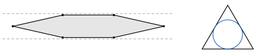
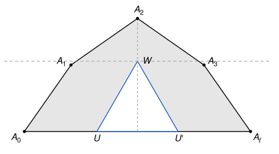

## Statement

Trouver tous les entiers $n \geqslant 3$ pour lesquels tout polygone convexe à $n$ côtés, dont tous les côtés mesurent $1$, contient un triangle équilatéral de côté $1$.

## Hints

1. Commence par $n = 3$ et $n = 4$. Un losange de côté $1$ contient-il toujours un triangle équilatéral de côté $1$ ? Pense à un losange très aplati.
2. Un triangle équilatéral de côté $1$ contient son cercle inscrit, de diamètre $\sqrt{3}/3$, qui est plus grand que $1/2$. Un polygone très plat, contenu dans une bande de largeur $1/2$, ne peut donc pas en contenir. Sais-tu fabriquer un tel polygone avec $6$ côtés égaux à $1$ ? Avec $2m$ côtés ?
3. Pour $n$ impair, prends deux sommets $A_0$ et $A_\ell$ aussi éloignés que possible, à la distance $d$. La diagonale $[A_0A_\ell]$ coupe le polygone en deux morceaux. Si le morceau $A_0A_1 \ldots A_\ell$ ne contient pas de triangle équilatéral de côté $1$, montre que ses angles en $A_0$ et en $A_\ell$ sont inférieurs à $60°$, puis que tous ses sommets sont à une hauteur au plus $\sqrt{3}/2$ au-dessus de $[A_0A_\ell]$.
4. Montre ensuite que $\ell - 1 < d \leqslant \ell$, en comparant la longueur $1$ de chaque côté avec la longueur de son ombre sur $[A_0A_\ell]$. Fais de même avec l'autre morceau. Que peux-tu en déduire sur $n$ ?

## Solution

**Réponse : les entiers $n$ impairs.**

**Deux outils.**

*Le cercle inscrit d'un triangle équilatéral.* Dans un triangle équilatéral de côté $1$, chaque médiane est aussi une hauteur, de longueur $\sqrt{3}/2$. Le centre de gravité $G$ est sur chaque médiane, aux deux tiers à partir du sommet. Il est donc à la distance
$$\frac{1}{3} \times \frac{\sqrt{3}}{2} = \frac{\sqrt{3}}{6}$$
de chacun des trois côtés. Ainsi le triangle contient le disque de centre $G$ et de rayon $\sqrt{3}/6$, dont le diamètre vaut $\sqrt{3}/3$.

*Au plus grand côté est opposé le plus grand angle.* Soit $UVW$ un triangle avec $WU > WV$. Montrons que $\widehat{WVU} > \widehat{WUV}$. Soit $M$ le point du segment $[WU]$ tel que $WM = WV$. Le triangle $WMV$ est isocèle en $W$, donc $\widehat{WMV} = \widehat{WVM}$. Le point $M$ est entre $W$ et $U$, donc $\widehat{WVU} > \widehat{WVM} = \widehat{WMV}$. Enfin $\widehat{WMV}$ est un angle extérieur du triangle $MUV$ : il est égal à la somme des deux autres angles de ce triangle, donc $\widehat{WMV} > \widehat{MUV} = \widehat{WUV}$. Si $WU = WV$, le triangle est isocèle et $\widehat{WVU} = \widehat{WUV}$. Dans tous les cas, $WU \geqslant WV$ entraîne $\widehat{WVU} \geqslant \widehat{WUV}$.

On utilisera aussi que la somme des angles d'un polygone convexe à $k$ côtés vaut $(k - 2) \times 180°$.

**Première partie : pour $n$ pair, un polygone sans triangle.** Soit $n = 2m$, avec $m \geqslant 2$. Construisons un polygone convexe à $n$ côtés de longueur $1$, très aplati.

Pour $i = 1, \ldots, m$, on pose
$$b_i = \frac{m + 1 - 2i}{m^2}, \qquad a_i = \sqrt{1 - b_i^2}.$$
On a $|b_i| \leqslant (m - 1)/m^2 < 1$, donc $a_i > 0$. Les nombres $b_i$ diminuent quand $i$ augmente, et $b_{m+1-i} = -b_i$, donc $b_1 + b_2 + \cdots + b_m = 0$.

Dans un repère orthonormé, on part de $A_0 = (0, 0)$ et on pose $A_i = A_{i-1} + (a_i, b_i)$ pour $i = 1, \ldots, m$. Chaque segment $[A_{i-1}A_i]$ mesure $\sqrt{a_i^2 + b_i^2} = 1$. Comme $b_1 + \cdots + b_m = 0$, le point $A_m$ est sur l'axe des abscisses. On note $A'_i$ le symétrique de $A_i$ par rapport à cet axe, et l'on regarde le polygone
$$Q = A_0 A_1 \ldots A_{m-1} A_m A'_{m-1} \ldots A'_1,$$
qui a $2m$ côtés de longueur $1$. Pour $n = 6$, il a l'allure d'une amande.

*Le polygone $Q$ est convexe.* Soit $\theta_i$ l'angle compris entre $-90°$ et $90°$ tel que $\sin \theta_i = b_i$. Alors $a_i = \cos \theta_i$, et $\theta_i$ est l'angle que fait le côté $[A_{i-1}A_i]$ avec l'axe des abscisses. Les $b_i$ diminuent, donc $\theta_1 > \theta_2 > \cdots > \theta_m = -\theta_1$ : en allant de $A_0$ à $A_m$, on tourne toujours vers la droite. L'angle de $Q$ en $A_i$, pour $1 \leqslant i \leqslant m - 1$, vaut $180° - (\theta_i - \theta_{i+1})$, qui est inférieur à $180°$. Par symétrie, c'est la même chose en $A'_i$. En $A_0$ et en $A_m$, l'angle de $Q$ vaut $2\theta_1$, inférieur à $180°$. Enfin la ligne $A_0A_1 \ldots A_m$ est au-dessus de l'axe et sa symétrique au-dessous (voir ci-dessous), donc elles ne se croisent pas. Le polygone $Q$ est convexe.

*Le polygone $Q$ est très plat.* La hauteur du point $A_j$ est $y_j = b_1 + \cdots + b_j$. Soit $q$ le nombre d'indices $i$ pour lesquels $b_i > 0$, c'est-à-dire $i < (m+1)/2$. Alors $y_j$ est au plus la somme des $b_i$ positifs :
$$y_j \leqslant \frac{1}{m^2} \sum_{i=1}^{q} (m + 1 - 2i) = \frac{q(m + 1) - q(q + 1)}{m^2} = \frac{q(m - q)}{m^2} \leqslant \frac{1}{4},$$
car $m^2/4 - q(m - q) = (m/2 - q)^2 \geqslant 0$. De plus $y_j \geqslant 0$ : pour $j \leqslant q$ c'est une somme de nombres positifs, et pour $j > q$, par symétrie, $y_j = -(b_{j+1} + \cdots + b_m) = b_1 + \cdots + b_{m-j} \geqslant 0$. Les sommets de $Q$ sont donc tous dans la bande formée des points dont l'ordonnée est comprise entre $-1/4$ et $1/4$. Cette bande est convexe, donc elle contient tout le polygone $Q$.

*Le polygone $Q$ ne contient pas de triangle équilatéral de côté $1$.* Sinon il contiendrait aussi le disque inscrit de ce triangle, de diamètre $\sqrt{3}/3$. Le point le plus haut et le point le plus bas de ce disque ont des ordonnées qui diffèrent de $\sqrt{3}/3$. Mais deux points de la bande ont des ordonnées qui diffèrent d'au plus $1/2$, et $\sqrt{3}/3 > 1/2$ car $(\sqrt{3}/3)^2 = 1/3 > 1/4$. C'est impossible.

Ainsi, **aucun entier $n$ pair ne convient.** Pour $n = 4$, le polygone $Q$ est simplement un losange de côté $1$ très aplati.

**Deuxième partie : pour $n$ impair, il y a toujours un triangle.** Si $n = 3$, le polygone est lui-même un triangle équilatéral de côté $1$. Soit maintenant $n \geqslant 5$ impair, et $P = A_0A_1 \ldots A_{n-1}$ un polygone convexe dont les côtés mesurent $1$. Supposons que $P$ ne contienne aucun triangle équilatéral de côté $1$, et cherchons une contradiction.

**Étape 1 : deux sommets à une distance plus grande que $1$.** Soit $d$ la plus grande distance entre deux sommets de $P$. Comme les côtés mesurent $1$, on a $d \geqslant 1$. Supposons $d = 1$. Pour chaque sommet $A_i$, ses voisins $A_{i-1}$ et $A_{i+1}$ (les indices étant comptés modulo $n$) sont à une distance au plus $1$. Si $\gamma_i$ est l'angle de $P$ en $A_i$, le théorème d'Al-Kashi dans le triangle $A_{i-1}A_iA_{i+1}$ donne
$$A_{i-1}A_{i+1}^2 = 1 + 1 - 2\cos \gamma_i \leqslant 1, \qquad \text{donc} \qquad \cos \gamma_i \geqslant \frac{1}{2} \qquad \text{et} \qquad \gamma_i \leqslant 60°.$$
En faisant la somme sur les $n$ sommets, $(n - 2) \times 180° \leqslant n \times 60°$, d'où $120\, n \leqslant 360$ et $n \leqslant 3$. C'est faux, donc $d > 1$.

**Étape 2 : on coupe le polygone en deux.** On numérote les sommets pour que $A_0$ et $A_\ell$ soient à la distance $d$. Comme $d > 1$, ces deux sommets ne sont pas voisins : $2 \leqslant \ell \leqslant n - 2$. La diagonale $[A_0A_\ell]$ coupe $P$ en deux polygones convexes :

- $P_1 = A_0A_1 \ldots A_\ell$, formé de $\ell$ côtés de longueur $1$ et du côté $[A_\ell A_0]$ ;
- $P_2 = A_\ell A_{\ell+1} \ldots A_{n-1} A_0$, formé de $n - \ell$ côtés de longueur $1$ et du côté $[A_0A_\ell]$.

Ils sont contenus dans $P$, donc aucun des deux ne contient de triangle équilatéral de côté $1$. Nous allons montrer, pour $P_1$, que
$$\ell - 1 < d \leqslant \ell.$$
Le même raisonnement s'applique à $P_2$.

On place $A_0 = (0, 0)$ et $A_\ell = (d, 0)$, avec $P_1$ au-dessus de l'axe des abscisses. Pour $i = 1, \ldots, \ell$, on note $(a_i, b_i)$ les coordonnées du vecteur $\overrightarrow{A_{i-1}A_i}$. On a $a_i^2 + b_i^2 = 1$, et en ajoutant ces vecteurs, $a_1 + \cdots + a_\ell = d$ et $b_1 + \cdots + b_\ell = 0$. Comme chaque $a_i$ est au plus $1$, on a déjà $d \leqslant \ell$.

**Étape 3 : les angles en $A_0$ et en $A_\ell$ sont inférieurs à $60°$.** Soit $\alpha = \widehat{A_\ell A_0 A_1}$, et supposons $\alpha \geqslant 60°$. Dans le triangle $A_0A_1A_\ell$, on a $A_\ell A_0 = d \geqslant A_\ell A_1$. Par le deuxième outil, $\widehat{A_0A_1A_\ell} \geqslant \widehat{A_1A_0A_\ell} = \alpha \geqslant 60°$.

Soit $E$ le point tel que $A_0A_1E$ soit équilatéral, du même côté de $(A_0A_1)$ que $A_\ell$. La demi-droite $[A_0E)$ fait un angle de $60°$ avec $[A_0A_1)$, et $60° \leqslant \alpha$ : elle est à l'intérieur de l'angle $\widehat{A_1A_0A_\ell}$. De même, $[A_1E)$ est à l'intérieur de l'angle $\widehat{A_0A_1A_\ell}$. Un point qui est à l'intérieur de ces deux angles est dans le triangle $A_0A_1A_\ell$. Donc $E$ est dans ce triangle, et le triangle équilatéral $A_0A_1E$ aussi. Or le triangle $A_0A_1A_\ell$ est contenu dans $P_1$, qui est convexe : c'est la contradiction cherchée.

Ainsi $\alpha < 60°$. De la même façon, avec le triangle $A_\ell A_{\ell-1} A_0$, l'angle $\varphi = \widehat{A_0 A_\ell A_{\ell-1}}$ est inférieur à $60°$.

**Étape 4 : la direction des côtés.** Soit $t_i$ l'angle que fait le vecteur $\overrightarrow{A_{i-1}A_i}$ avec l'axe des abscisses, de sorte que $a_i = \cos t_i$ et $b_i = \sin t_i$. Le premier côté monte avec l'angle $t_1 = \alpha$, et le dernier descend vers $A_\ell$ avec l'angle $t_\ell = -\varphi$.

En chaque sommet $A_i$, pour $1 \leqslant i \leqslant \ell - 1$, on passe du côté $i$ au côté $i + 1$ en tournant vers la droite d'un angle $e_i = 180° - \widehat{A_{i-1}A_iA_{i+1}}$, qui est positif car $P_1$ est convexe. Ainsi $t_{i+1} = t_i - e_i$. Le polygone $P_1$ a $\ell + 1$ côtés, donc la somme de ses angles vaut $(\ell - 1) \times 180°$, et
$$e_1 + \cdots + e_{\ell-1} = (\ell - 1) \times 180° - \left(\widehat{A_0A_1A_2} + \cdots + \widehat{A_{\ell-2}A_{\ell-1}A_\ell}\right) = \alpha + \varphi.$$
On retrouve bien $t_\ell = \alpha - (\alpha + \varphi) = -\varphi$, et
$$60° > \alpha = t_1 > t_2 > \cdots > t_\ell = -\varphi > -60°.$$
On en tire deux conséquences.

- Pour tout $i$, $a_i = \cos t_i > \cos 60° = 1/2$.
- Les $b_i = \sin t_i$ sont d'abord positifs, puis négatifs ou nuls. La hauteur des sommets, partie de $0$ en $A_0$, augmente donc jusqu'à une valeur maximale $h$, puis diminue jusqu'à $0$ en $A_\ell$. La montée totale et la descente totale valent $h$ toutes les deux, donc
$$|b_1| + |b_2| + \cdots + |b_\ell| = 2h.$$

**Étape 5 : tous les sommets sont à une hauteur au plus $\sqrt{3}/2$.** Supposons qu'un sommet $V = A_i$, avec $1 \leqslant i \leqslant \ell - 1$, ait une ordonnée $y$ plus grande que $\sqrt{3}/2$, et notons $x$ son abscisse. D'après l'étape 4,
$$x = a_1 + \cdots + a_i > \frac{1}{2} \qquad \text{et} \qquad d - x = a_{i+1} + \cdots + a_\ell > \frac{1}{2}.$$
Les points $U = (x - 1/2, 0)$ et $U' = (x + 1/2, 0)$ sont donc sur le segment $[A_0A_\ell]$, et le point $W = (x, \sqrt{3}/2)$ est sur le segment qui joint $(x, 0)$ à $V$. Ces trois points sont dans $P_1$, qui est convexe, donc le triangle $UU'W$ est contenu dans $P_1$. Or $UU' = 1$ et $W$ est sur la médiatrice de $[UU']$ à la hauteur $\sqrt{3}/2$ : le triangle $UU'W$ est équilatéral de côté $1$. C'est impossible, donc $h \leqslant \sqrt{3}/2$.

**Étape 6 : chaque côté est presque horizontal.** Pour chaque $i$,
$$1 - a_i = \frac{(1 - a_i)(1 + a_i)}{1 + a_i} = \frac{1 - a_i^2}{1 + a_i} = \frac{b_i^2}{1 + a_i}.$$
Si $b_i \neq 0$ : comme $a_i > 1/2$, on a $|b_i| = \sqrt{1 - a_i^2} < \sqrt{3/4} = \sqrt{3}/2$ et $1 + a_i > 3/2$, donc
$$1 - a_i = |b_i| \times \frac{|b_i|}{1 + a_i} < |b_i| \times \frac{\sqrt{3}/2}{3/2} = \frac{|b_i|}{\sqrt{3}}.$$
Si $b_i = 0$, alors $a_i = 1$ et $1 - a_i = 0 = |b_i|/\sqrt{3}$. Comme $b_1 = \sin \alpha > 0$, l'inégalité stricte a lieu au moins une fois. En faisant la somme, avec les étapes 4 et 5,
$$\ell - d = (1 - a_1) + \cdots + (1 - a_\ell) < \frac{|b_1| + \cdots + |b_\ell|}{\sqrt{3}} = \frac{2h}{\sqrt{3}} \leqslant 1.$$
Avec l'étape 2, on obtient $\ell - 1 < d \leqslant \ell$.

**Étape 7 : la contradiction.** Le même raisonnement, appliqué à $P_2$, donne $(n - \ell) - 1 < d \leqslant n - \ell$. Or il n'existe qu'un seul entier $k$ tel que $k - 1 < d \leqslant k$. Donc $\ell = n - \ell$, et $n = 2\ell$ est pair. C'est faux, puisque $n$ est impair.

Ainsi, **pour $n$ impair, tout polygone convexe à $n$ côtés de longueur $1$ contient un triangle équilatéral de côté $1$.**

**Conclusion.** **Les entiers cherchés sont exactement les entiers impairs $n \geqslant 3$.**

## Going further

- Pour $n = 4$, un carré de côté $1$ contient bien un triangle équilatéral de côté $1$, construit sur l'un de ses côtés, car sa hauteur $\sqrt{3}/2$ est plus petite que $1$. Mais un losange très aplati n'en contient pas : la propriété doit être vraie pour **tous** les polygones, et un seul contre-exemple suffit à l'écarter.
- Le corrigé officiel construit pour $n$ pair une amande formée de deux arcs de cercle. Pour $n$ impair, il enferme la ligne $A_0A_1 \ldots A_\ell$ dans un trapèze isocèle d'angles $60°$ à la base, puis utilise un résultat classique : un polygone convexe contenu dans un autre polygone a un périmètre plus petit. Les étapes 4 à 6 ci-dessus remplacent ce résultat par un calcul direct sur les côtés.
- L'idée de l'étape 6 sert souvent : un segment de longueur $1$ qui fait un petit angle avec une droite a une ombre presque égale à $1$ sur cette droite, et l'écart $1 - a$ est bien plus petit que la hauteur $|b|$ gagnée ou perdue.
