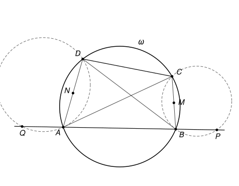

## Statement

Soit $A$, $B$, $C$, $D$ quatre points situés dans cet ordre sur un cercle $\omega$. Soit $P$ et $Q$ deux points de la droite $(AB)$ tels que :

- les points $Q$, $A$, $B$, $P$ sont alignés dans cet ordre ;
- le cercle circonscrit au triangle $ADQ$ est tangent à la droite $(AC)$ ;
- le cercle circonscrit au triangle $BCP$ est tangent à la droite $(BD)$.

On note $M$ et $N$ les milieux respectifs des segments $[BC]$ et $[AD]$.

Démontrer que la tangente en $A$ au cercle circonscrit à $ANQ$, la tangente en $B$ au cercle circonscrit à $BMP$ et la droite $(CD)$ sont concourantes.

## Hints

1. Montrez que les triangles $QAD$ et $BCD$ sont semblables. Pour l'angle en $Q$, utilisez la tangence du cercle $ADQ$ avec la droite $(AC)$.
2. Notez $R$ le milieu de $[CD]$. Déduisez de l'indication 1 que les triangles $QAN$ et $BCR$ sont semblables. Que donne le même raisonnement du côté de $B$ ?
3. La tangente en $A$ au cercle $ANQ$ est déterminée par l'angle qu'elle fait avec la droite $(AB)$. Quel est cet angle ?
4. Tracez le cercle qui passe par $A$, $B$ et $R$. Il recoupe la droite $(CD)$ en un second point $X$. Montrez que les deux tangentes passent par $X$.

## Solution

**Rappel.** On utilise trois conséquences du théorème de l'angle inscrit.

- Deux angles inscrits qui interceptent le même arc sont égaux.
- Dans un quadrilatère convexe dont les quatre sommets sont sur un cercle, deux angles opposés ont pour somme $180^\circ$.
- *Angle entre une tangente et une corde.* Soit $[UV]$ une corde d'un cercle et $[Ut)$ une demi-droite tangente au cercle en $U$. Alors l'angle $\widehat{tUV}$ est égal à l'angle inscrit $\widehat{UWV}$, pour tout point $W$ du cercle situé de l'autre côté de la droite $(UV)$ par rapport à $t$. On le démontre avec le centre $O'$ du cercle : la tangente est perpendiculaire au rayon $[O'U]$, et dans le triangle isocèle $O'UV$ on trouve $\widehat{tUV} = 90^\circ - \widehat{O'UV} = \frac{1}{2}\,\widehat{UO'V}$, qui est la valeur de l'angle inscrit.

Comme une demi-droite issue d'un point est déterminée par l'angle qu'elle fait avec une droite donnée et par le côté où elle se trouve, cette troisième propriété permet aussi de *reconnaître* une tangente.

On note $R$ le milieu de $[CD]$. Les points $C$ et $D$, donc aussi $M$, $N$ et $R$, sont du même côté de la droite $(AB)$ : appelons-le le côté « haut ».

### Étape 1 : les triangles QAD et BCD sont semblables

- **L'angle en $A$.** Comme $Q$, $A$, $B$ sont alignés dans cet ordre, $\widehat{QAD} = 180^\circ - \widehat{BAD}$. Le quadrilatère $ABCD$ est inscrit dans $\omega$, donc $\widehat{BAD} + \widehat{BCD} = 180^\circ$. Ainsi $\widehat{QAD} = \widehat{BCD}$.
- **L'angle en $Q$.** La droite $(AC)$ est tangente en $A$ au cercle $ADQ$. Les points $B$ et $C$ sont du même côté de $(AD)$, et $Q$ est de l'autre côté que $B$ ; donc $Q$ et $C$ sont de part et d'autre de $(AD)$. L'angle entre la tangente et la corde donne $\widehat{AQD} = \widehat{CAD}$. Dans $\omega$, les angles inscrits $\widehat{CAD}$ et $\widehat{CBD}$ interceptent le même arc, donc $\widehat{AQD} = \widehat{CBD}$.

Les triangles $QAD$ et $BCD$ ont deux angles égaux : ils sont semblables, avec $Q$ qui correspond à $B$, $A$ à $C$ et $D$ à $D$. En particulier,

$$\frac{QA}{BC} = \frac{AD}{CD}.$$

### Étape 2 : les triangles QAN et BCR sont semblables

On a $\widehat{QAN} = \widehat{QAD} = \widehat{BCD} = \widehat{BCR}$. De plus $AN = \frac{1}{2}AD$ et $CR = \frac{1}{2}CD$, donc

$$\frac{QA}{BC} = \frac{AD}{CD} = \frac{AN}{CR}.$$

Les triangles $QAN$ et $BCR$ ont un angle égal compris entre deux côtés proportionnels : ils sont semblables. Donc

$$\widehat{ANQ} = \widehat{CRB}. \qquad (1)$$

### Étape 3 : le même raisonnement du côté de B

On échange les rôles : $A$ avec $B$, $D$ avec $C$, $Q$ avec $P$, $N$ avec $M$.

- $\widehat{PBC} = 180^\circ - \widehat{ABC} = \widehat{ADC}$.
- La droite $(BD)$ est tangente en $B$ au cercle $BCP$, et $P$ et $D$ sont de part et d'autre de $(BC)$, donc $\widehat{BPC} = \widehat{DBC} = \widehat{DAC}$.

Les triangles $PBC$ et $ADC$ sont donc semblables ($P$ correspond à $A$, $B$ à $D$, $C$ à $C$). Puis, avec $BM = \frac{1}{2}BC$ et $DR = \frac{1}{2}DC$, les triangles $PBM$ et $ADR$ sont semblables, et

$$\widehat{BMP} = \widehat{DRA}. \qquad (2)$$

### Étape 4 : reconnaître les deux tangentes

Soit $t_A$ la tangente en $A$ au cercle $ANQ$. Prenons sur $t_A$ une demi-droite $[AY)$ du côté opposé à $N$ par rapport à $(AB)$. L'angle entre la tangente et la corde $[AQ]$ donne $\widehat{YAQ} = \widehat{ANQ}$. La demi-droite opposée à $[AY)$ est du côté haut, et elle fait avec $[AB)$, demi-droite opposée à $[AQ)$, le même angle (angles opposés par le sommet).

**Conclusion : un point $X$ du côté haut est sur $t_A$ si et seulement si $\widehat{XAB} = \widehat{ANQ}$.**

De même, un point $X$ du côté haut est sur la tangente $t_B$ en $B$ au cercle $BMP$ si et seulement si $\widehat{XBA} = \widehat{BMP}$.

### Étape 5 : le point de concours

Le cercle passant par $A$, $B$ et $R$ recoupe la droite $(CD)$ en un second point $X$. Ce point est toujours sur le segment $[CD]$, donc du côté haut (nous l'admettons ici ; une figure soignée le confirme). Plaçons-nous dans le cas de la figure, où $X$ est entre $R$ et $C$, de sorte que $A$, $B$, $X$, $R$ sont dans cet ordre sur ce cercle.

- Les angles inscrits $\widehat{XAB}$ et $\widehat{XRB}$ interceptent le même arc, donc $\widehat{XAB} = \widehat{XRB} = \widehat{CRB}$, puisque $X$ est sur la demi-droite $[RC)$. D'après $(1)$, $\widehat{XAB} = \widehat{ANQ}$ : **$X$ est sur $t_A$**.
- Dans le quadrilatère inscrit $ABXR$, $\widehat{XBA} = 180^\circ - \widehat{XRA}$. Comme $R$ est entre $D$ et $X$, $180^\circ - \widehat{XRA} = \widehat{DRA}$. D'après $(2)$, $\widehat{XBA} = \widehat{BMP}$ : **$X$ est sur $t_B$**.

Si $X$ est entre $D$ et $R$, les points sont dans l'ordre $A$, $B$, $R$, $X$ sur le cercle, et le même calcul marche en échangeant les rôles : on obtient $\widehat{XBA} = \widehat{XRA} = \widehat{DRA}$ par les angles inscrits, et $\widehat{XAB} = 180^\circ - \widehat{XRB} = \widehat{CRB}$ par le quadrilatère inscrit.

**Dans tous les cas, les tangentes $t_A$ et $t_B$ passent par le point $X$ de la droite $(CD)$ : les trois droites sont concourantes.**
