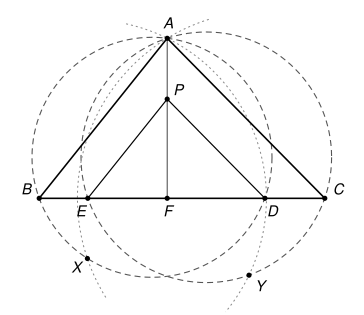

## Statement

Soit $ABC$ un triangle dont les trois angles sont aigus. Soit $F$ le pied de la hauteur issue de $A$, et soit $P$ un point du segment $[AF]$, différent de $F$.

On note $D$ le point de la droite $(BC)$ tel que $(PD)$ soit parallèle à $(AC)$. Le cercle circonscrit au triangle $ABD$ et le cercle de centre $D$ passant par $A$ se recoupent en un point $X$.

De même, on note $E$ le point de la droite $(BC)$ tel que $(PE)$ soit parallèle à $(AB)$. Le cercle circonscrit au triangle $ACE$ et le cercle de centre $E$ passant par $A$ se recoupent en un point $Y$.

Démontrer que les points $B$, $C$, $X$ et $Y$ sont sur un même cercle.

## Hints

1. Faites une grande figure soignée. Les droites $(BX)$ et $(CY)$ semblent se couper en un point remarquable. Lequel ? Pensez au symétrique $A'$ de $A$ par rapport à $(BC)$.
2. Avec le théorème de Thalès, montrez que $FB \times FD = FC \times FE$.
3. Déduisez-en que les cercles circonscrits à $ABD$ et à $ACE$ se recoupent en un point $G$ de la droite $(AF)$.
4. Montrez que $X$ est sur la droite $(BA')$. Dans un cercle de rayon $R$, une corde $[MN]$ vue d'un point $Q$ du cercle mesure $2R \sin \widehat{MQN}$.
5. Comparez les produits $A'B \times A'X$, $A'A \times A'G$ et $A'C \times A'Y$.

## Solution

**Rappel.** On utilise trois propriétés du cercle.

- **(R1) Puissance d'un point.** Soit $\mathcal{C}$ un cercle et $M$ un point. Si une droite passant par $M$ coupe $\mathcal{C}$ en deux points $P$ et $Q$, le produit $MP \times MQ$ ne dépend pas de la droite choisie. On le démontre avec des triangles semblables : si une autre droite passant par $M$ coupe $\mathcal{C}$ en $R$ et $S$, les triangles $MPS$ et $MRQ$ ont les mêmes angles (un angle en $M$ commun ou opposé par le sommet, et deux angles inscrits qui interceptent le même arc), donc $\frac{MP}{MR} = \frac{MS}{MQ}$. De plus, les points de la droite $(PQ)$ situés à l'intérieur du cercle sont exactement ceux du segment $]PQ[$. Donc $M$ est à l'extérieur du cercle si et seulement si $P$ et $Q$ sont du même côté de $M$.
- **(R2) Une réciproque.** Soit deux droites différentes passant par un point $M$, des points $P$, $Q$ sur la première et $R$, $S$ sur la seconde, tous différents de $M$, avec $P$ et $Q$ du même côté de $M$, $R$ et $S$ du même côté de $M$, et $P$, $Q$, $R$ non alignés. Si $MP \times MQ = MR \times MS$, alors $P$, $Q$, $R$, $S$ sont sur un même cercle.
  En effet, soit $\omega$ le cercle passant par $P$, $Q$, $R$. Le point $M$ n'est pas entre $P$ et $Q$, donc il est à l'extérieur de $\omega$. La droite $(MR)$ recoupe $\omega$ en un point $S'$ situé du même côté de $M$ que $R$, et d'après (R1), $MR \times MS' = MP \times MQ = MR \times MS$. Donc $MS' = MS$, et comme $S$ et $S'$ sont du même côté de $M$, $S' = S$.
- **(R3) Corde et sinus.** Si $M$, $N$, $Q$ sont trois points d'un cercle de rayon $R$, alors $MN = 2R \sin \widehat{MQN}$. En effet, soit $M^*$ le point du cercle diamétralement opposé à $M$. Le triangle $MNM^*$ est rectangle en $N$, donc $MN = MM^* \sin \widehat{MM^*N} = 2R \sin \widehat{MM^*N}$. Or les angles inscrits $\widehat{MM^*N}$ et $\widehat{MQN}$ sont égaux ou supplémentaires, et $\sin(180° - \theta) = \sin \theta$.

On note $\Gamma_D$ le cercle circonscrit à $ABD$, $\Gamma_E$ celui de $ACE$, et $A'$ le symétrique de $A$ par rapport à la droite $(BC)$. Le point $A'$ est sur la droite $(AF)$, de l'autre côté de $F$, et $FA' = FA$.

### Étape 1 : FB × FD = FC × FE

Comme les angles $\widehat{B}$ et $\widehat{C}$ sont aigus, le point $F$ est strictement entre $B$ et $C$. Dans le triangle $AFC$, la droite $(PD)$ est parallèle à $(AC)$. D'après le théorème de Thalès, $D$ est sur le segment $[FC]$ et $\frac{FD}{FC} = \frac{FP}{FA}$. De même, dans le triangle $AFB$, $E$ est sur le segment $[FB]$ et $\frac{FE}{FB} = \frac{FP}{FA}$. En notant $t = \frac{FP}{FA}$, qui n'est pas nul, on obtient

$$FB \times FD = FB \times t\,FC = FC \times t\,FB = FC \times FE.$$

### Étape 2 : les deux cercles circonscrits se recoupent sur la droite (AF)

Le point $F$ est strictement entre $B$ et $D$, donc à l'intérieur du cercle $\Gamma_D$. La droite $(AF)$ recoupe donc $\Gamma_D$ en un point $G$ situé de l'autre côté de $F$ par rapport à $A$, et d'après (R1), $FA \times FG = FB \times FD$.

De même, $F$ est strictement entre $E$ et $C$, et la droite $(AF)$ recoupe $\Gamma_E$ en un point $G'$ situé de l'autre côté de $F$, avec $FA \times FG' = FC \times FE$.

D'après l'étape 1, $FG = FG'$. Comme $G$ et $G'$ sont du même côté de $F$, $G = G'$ : **les deux cercles passent par le point $G$ de la droite $(AF)$.**

### Étape 3 : le point A' est à l'extérieur des deux cercles

C'est ici que sert l'angle aigu en $A$. Avec le produit scalaire, comme $\overrightarrow{AF}$ est orthogonal à $\overrightarrow{FB}$ et à $\overrightarrow{FC}$,

$$\overrightarrow{AB} \cdot \overrightarrow{AC} = \left(\overrightarrow{AF} + \overrightarrow{FB}\right) \cdot \left(\overrightarrow{AF} + \overrightarrow{FC}\right) = AF^2 + \overrightarrow{FB} \cdot \overrightarrow{FC} = AF^2 - FB \times FC,$$

car $\overrightarrow{FB}$ et $\overrightarrow{FC}$ sont de sens contraires. L'angle $\widehat{BAC}$ est aigu, donc ce produit scalaire est positif : $FB \times FC < FA^2$. Comme $FD \leq FC$,

$$FG = \frac{FB \times FD}{FA} \leq \frac{FB \times FC}{FA} < FA = FA'.$$

Le point $G$ est donc strictement entre $F$ et $A'$. Sur la droite $(AF)$, les points intérieurs à $\Gamma_D$ sont ceux du segment $]AG[$, qui ne contient pas $A'$ : **$A'$ est à l'extérieur de $\Gamma_D$**, et de même à l'extérieur de $\Gamma_E$.

### Étape 4 : X est sur la droite (BA')

La droite $(BA')$ recoupe $\Gamma_D$ en un point $X'$. (On laisse de côté le cas particulier où elle est tangente en $B$ au cercle.) Notons $R$ le rayon de $\Gamma_D$. D'après (R3), avec le point $B$ du cercle,

$$DA = 2R \sin \widehat{DBA} \qquad \text{et} \qquad DX' = 2R \sin \widehat{DBX'}.$$

La symétrie d'axe $(BC)$ fixe $B$ et $D$ et envoie $A$ sur $A'$, donc $\widehat{DBA'} = \widehat{DBA}$. La demi-droite $[BX')$ est soit $[BA')$, soit la demi-droite opposée, donc $\widehat{DBX'}$ vaut $\widehat{DBA}$ ou $180° - \widehat{DBA}$. Dans les deux cas, les sinus sont égaux, et $DX' = DA$.

Le point $X'$ est donc à la fois sur $\Gamma_D$ et sur le cercle de centre $D$ passant par $A$. Ces deux cercles n'ont que deux points communs, $A$ et $X$. Or $X' \neq A$ : sinon $A$ serait sur $(BA')$, donc $B$ serait sur la droite $(AA') = (AF)$, c'est-à-dire $B = F$, ce qui est faux. Donc $X' = X$ : **le point $X$ est sur la droite $(BA')$.**

De la même façon, **le point $Y$ est sur la droite $(CA')$.**

### Étape 5 : conclusion avec la puissance de A'

Appliquons (R1) au point $A'$ et au cercle $\Gamma_D$, avec les droites $(A'A)$, qui coupe $\Gamma_D$ en $A$ et $G$, et $(A'B)$, qui le coupe en $B$ et $X$ :

$$A'B \times A'X = A'A \times A'G.$$

Le cercle $\Gamma_E$ passe aussi par $A$ et $G$, et la droite $(A'C)$ le coupe en $C$ et $Y$, donc de même

$$A'C \times A'Y = A'A \times A'G.$$

Ainsi $A'B \times A'X = A'C \times A'Y$.

Vérifions les conditions de (R2) avec $M = A'$. Les droites $(A'B)$ et $(A'C)$ sont différentes, car $A'$ n'est pas sur $(BC)$. Comme $A'$ est à l'extérieur des deux cercles, $B$ et $X$ sont du même côté de $A'$, ainsi que $C$ et $Y$. Enfin $B$, $X$, $C$ ne sont pas alignés, car la droite $(A'B)$ ne coupe $(BC)$ qu'en $B$.

**D'après (R2), les points $B$, $C$, $X$ et $Y$ sont sur un même cercle.**

## Going further

1. Dans le cas $P = A$, que deviennent les points $D$ et $E$, et les cercles $\Gamma_D$ et $\Gamma_E$ ?
2. Soit $H$ l'orthocentre de $ABC$. Montrez que $FB \times FC = FA \times FH$ (comparez les triangles $FBH$ et $FAC$). Déduisez-en que, dans le cas $P = A$, le point $G$ est le symétrique de $H$ par rapport à $(BC)$ : ce symétrique est donc sur le cercle circonscrit à $ABC$.
