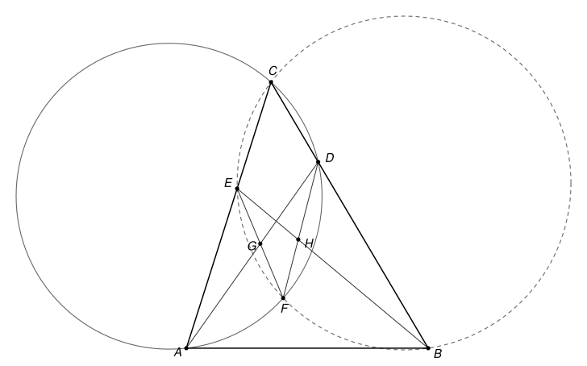

## Statement

Soit $ABC$ un triangle, $D$ un point du segment $[BC]$ et $E$ un point du segment $[AC]$. On note :

- $F$ le second point d'intersection, autre que $C$, des cercles circonscrits aux triangles $ACD$ et $BCE$ ;
- $G$ le point d'intersection des droites $(AD)$ et $(EF)$ ;
- $H$ le point d'intersection des droites $(BE)$ et $(DF)$.

Démontrer que les trois droites $(AH)$, $(BG)$ et $(CF)$ sont concourantes.

## Hints

1. Notez $K$ le point d'intersection de $(AD)$ et $(BE)$. Sur une figure précise, il semble que $B$, $D$, $F$, $K$ soient sur un même cercle, et aussi $A$, $E$, $F$, $K$. Démontrez-le par une chasse aux angles.
2. La droite $(CF)$ est la corde commune des deux cercles de l'énoncé. Pour montrer que trois droites sont concourantes, on peut chercher à les voir comme les cordes communes de trois cercles pris deux à deux. Le troisième cercle passe par $A$, $B$ et $K$.
3. L'outil qui fait marcher cette idée est la puissance d'un point $Z$ par rapport à un cercle : si une droite passant par $Z$ coupe le cercle en $P$ et $Q$, le produit scalaire $\overrightarrow{ZP} \cdot \overrightarrow{ZQ}$ ne dépend pas de la droite choisie.
4. Calculez la puissance de $H$ par rapport au cercle $ACD$ en utilisant la droite $(DF)$, puis par rapport au cercle $ABK$ en utilisant la droite $(BK)$. Le cercle $BDFK$ fait le lien entre les deux.

## Solution

On note $\omega_1$ le cercle circonscrit à $ACD$ et $\omega_2$ le cercle circonscrit à $BCE$ : ils passent tous les deux par $F$. On note $K$ le point d'intersection des droites $(AD)$ et $(BE)$. Comme $D$ est sur $]BC[$ et $E$ sur $]AC[$, le point $K$ est à l'intérieur du triangle, sur les segments $[AD]$ et $[BE]$. Dans toute la solution, on suppose que les points de l'énoncé sont deux à deux distincts, ce qui est le cas en général.

### Deux outils : les angles orientés de droites

Pour deux droites $d_1$ et $d_2$, on note $(d_1, d_2)$ l'angle dont il faut faire tourner $d_1$, dans le sens direct, pour la rendre parallèle à $d_2$. Cet angle est compté **à $180^\circ$ près** : tourner une droite de $180^\circ$ la ramène sur elle-même. Ces angles suivent des règles simples.

- **Relation de Chasles** : $(d_1, d_3) = (d_1, d_2) + (d_2, d_3)$.
- $(d_1, d_2) = 0$ si et seulement si $d_1$ et $d_2$ sont parallèles (ou confondues). En particulier, si $d_2$ et $d_3$ sont parallèles, alors $(d_1, d_2) = (d_1, d_3)$.
- Une droite peut être nommée par deux quelconques de ses points : par exemple $(AD) = (AK) = (DK)$.

Le théorème de l'angle inscrit et sa réciproque prennent alors une forme qui ne dépend plus de la figure.

**Angle inscrit.** Si $W$, $X$, $Y$, $Z$ sont quatre points d'un même cercle, alors $(ZX, ZY) = (WX, WY)$.

En effet, notons $\theta = \widehat{XZY}$. Si $Z$ et $W$ sont du même côté de la droite $(XY)$, le théorème de l'angle inscrit donne $\widehat{XWY} = \theta$, et les deux rotations, de $[ZX)$ vers $[ZY)$ et de $[WX)$ vers $[WY)$, tournent dans le même sens : les deux angles orientés sont égaux. Si $Z$ et $W$ sont de part et d'autre de $(XY)$, on a $\widehat{XWY} = 180^\circ - \theta$, et les deux rotations tournent en sens contraires. Si la première vaut $\theta$, la seconde vaut $-(180^\circ - \theta) = \theta - 180^\circ$, c'est-à-dire $\theta$ à $180^\circ$ près.

**Réciproque.** Soit $W$, $X$, $Y$, $Z$ quatre points tels que ni $Z$ ni $W$ ne soit sur la droite $(XY)$. Si $(ZX, ZY) = (WX, WY)$, alors ces quatre points sont sur un même cercle.

En effet, on refait le raisonnement à l'envers. Si $Z$ et $W$ sont du même côté de $(XY)$, les deux rotations tournent dans le même sens, donc $\widehat{XZY} = \widehat{XWY}$ : les deux points voient le segment $[XY]$ sous le même angle, du même côté, donc ils sont sur un même arc de cercle d'extrémités $X$ et $Y$. Si $Z$ et $W$ sont de part et d'autre de $(XY)$, les rotations tournent en sens contraires, donc $\widehat{XZY} + \widehat{XWY} = 180^\circ$, et $W$ est sur l'arc qui complète, de l'autre côté de $(XY)$, le cercle passant par $X$, $Y$ et $Z$.

### Un troisième outil : la puissance d'un point

Soit $\Gamma$ un cercle de centre $O$ et de rayon $r$, et $Z$ un point du plan. On appelle **puissance de $Z$ par rapport à $\Gamma$** le nombre $p_\Gamma(Z) = ZO^2 - r^2$. Il est négatif si $Z$ est à l'intérieur du cercle, nul si $Z$ est sur le cercle, positif si $Z$ est à l'extérieur.

**Propriété.** Si une droite passant par $Z$ coupe $\Gamma$ en $P$ et $Q$, alors $\overrightarrow{ZP} \cdot \overrightarrow{ZQ} = p_\Gamma(Z)$.

En effet, soit $M$ le milieu de $[PQ]$. La droite $(OM)$ est perpendiculaire à $(PQ)$ (c'est la médiatrice de la corde). Comme $\overrightarrow{MQ} = -\overrightarrow{MP}$,

$$\overrightarrow{ZP} \cdot \overrightarrow{ZQ} = \left(\overrightarrow{ZM} + \overrightarrow{MP}\right) \cdot \left(\overrightarrow{ZM} - \overrightarrow{MP}\right) = ZM^2 - MP^2.$$

Le théorème de Pythagore dans les triangles $OMZ$ et $OMP$, rectangles en $M$, donne $ZM^2 = ZO^2 - OM^2$ et $MP^2 = r^2 - OM^2$. La différence vaut bien $ZO^2 - r^2$.

Comme $Z$, $P$, $Q$ sont alignés, ce produit scalaire vaut $ZP \times ZQ$ si $Z$ est en dehors du segment $[PQ]$, et $-ZP \times ZQ$ si $Z$ est entre $P$ et $Q$.

### Un quatrième outil : l'axe radical

**Propriété.** Soit $\Gamma_1$ et $\Gamma_2$ deux cercles de centres $O_1 \neq O_2$ et de rayons $r_1$, $r_2$. L'ensemble des points $Z$ qui ont la même puissance par rapport aux deux cercles est une droite, perpendiculaire à $(O_1O_2)$. On l'appelle l'**axe radical** des deux cercles.

En effet, soit $\Omega$ le milieu de $[O_1O_2]$. Alors $\overrightarrow{ZO_1} + \overrightarrow{ZO_2} = 2\,\overrightarrow{Z\Omega}$ et $\overrightarrow{ZO_1} - \overrightarrow{ZO_2} = \overrightarrow{O_2O_1}$, donc

$$ZO_1^2 - ZO_2^2 = \left(\overrightarrow{ZO_1} - \overrightarrow{ZO_2}\right) \cdot \left(\overrightarrow{ZO_1} + \overrightarrow{ZO_2}\right) = 2\,\overrightarrow{O_2O_1} \cdot \overrightarrow{Z\Omega}.$$

Donc $p_{\Gamma_1}(Z) = p_{\Gamma_2}(Z)$ équivaut à $\overrightarrow{O_2O_1} \cdot \overrightarrow{\Omega Z} = (r_2^2 - r_1^2)/2$. L'ensemble des points $Z$ qui vérifient $\vec{u} \cdot \overrightarrow{\Omega Z} = c$, pour un vecteur $\vec{u}$ non nul et un nombre $c$ fixés, est une droite perpendiculaire à $\vec{u}$.

Deux conséquences, qui serviront :

- si l'on connaît deux points distincts qui ont la même puissance par rapport aux deux cercles, l'axe radical est la droite qui les joint ; c'est le cas en particulier de deux points communs aux deux cercles ;
- pour trois cercles de centres deux à deux distincts, si l'axe radical de $\Gamma_1$ et $\Gamma_3$ et celui de $\Gamma_2$ et $\Gamma_3$ se coupent en un point $Z$, alors $p_{\Gamma_1}(Z) = p_{\Gamma_3}(Z) = p_{\Gamma_2}(Z)$, donc $Z$ est aussi sur l'axe radical de $\Gamma_1$ et $\Gamma_2$ : **les trois axes radicaux passent par $Z$**.

### Étape 1 : deux nouveaux cercles

**Les points $B$, $D$, $F$, $K$ sont cocycliques.** Par la relation de Chasles, puis en utilisant que $A$, $C$, $D$, $F$ sont sur $\omega_1$ et que $B$, $C$, $E$, $F$ sont sur $\omega_2$ :

$$(FD, FB) = (FD, FC) + (FC, FB) = (AD, AC) + (EC, EB).$$

Comme $(EC) = (AC)$, la relation de Chasles donne $(AD, AC) + (AC, EB) = (AD, EB)$, et $(AD) = (KD)$, $(EB) = (KB)$. Donc $(FD, FB) = (KD, KB)$, et d'après la réciproque, $B$, $D$, $F$, $K$ sont sur un même cercle, que l'on note $\omega_4$.

**Les points $A$, $E$, $F$, $K$ sont cocycliques.** De la même façon,

$$(FA, FE) = (FA, FC) + (FC, FE) = (DA, DC) + (BC, BE) = (DA, BC) + (BC, BE) = (DA, BE) = (KA, KE),$$

en utilisant $(DC) = (BC)$, puis $(DA) = (KA)$ et $(BE) = (KE)$. Donc $A$, $E$, $F$, $K$ sont sur un même cercle, que l'on note $\omega_5$.

### Étape 2 : trois axes radicaux

Les points $A$, $B$, $K$ ne sont pas alignés ($K$ est à l'intérieur du triangle). Soit $\omega_3$ le cercle qui passe par $A$, $B$ et $K$.

Les trois cercles $\omega_1$, $\omega_2$, $\omega_3$ sont différents : par exemple $\omega_1 \neq \omega_3$, car sinon $B$ serait sur $\omega_1$, qui contiendrait alors trois points alignés $B$, $D$, $C$. Deux cercles différents qui ont un point commun n'ont pas le même centre. Leurs centres sont donc deux à deux distincts.

**L'axe radical de $\omega_1$ et $\omega_2$** est la droite $(CF)$, car $C$ et $F$ sont sur les deux cercles.

**L'axe radical de $\omega_1$ et $\omega_3$ est la droite $(AH)$.** Le point $A$ est sur les deux cercles, donc a une puissance nulle par rapport à chacun. Calculons les puissances de $H$. La droite $(DF)$ passe par $H$ et coupe $\omega_1$ et $\omega_4$ en $D$ et $F$. La droite $(BK)$, qui est la droite $(BE)$, passe par $H$ et coupe $\omega_4$ et $\omega_3$ en $B$ et $K$. Donc

$$p_{\omega_1}(H) = \overrightarrow{HD} \cdot \overrightarrow{HF} = p_{\omega_4}(H) = \overrightarrow{HB} \cdot \overrightarrow{HK} = p_{\omega_3}(H).$$

Les points distincts $A$ et $H$ ont la même puissance par rapport à $\omega_1$ et $\omega_3$ : l'axe radical est la droite $(AH)$.

**L'axe radical de $\omega_2$ et $\omega_3$ est la droite $(BG)$.** De même, $B$ est sur les deux cercles, et en utilisant les droites $(EF)$ et $(AK) = (AD)$, qui passent par $G$, et le cercle $\omega_5$ :

$$p_{\omega_2}(G) = \overrightarrow{GE} \cdot \overrightarrow{GF} = p_{\omega_5}(G) = \overrightarrow{GA} \cdot \overrightarrow{GK} = p_{\omega_3}(G).$$

### Étape 3 : les droites (AH) et (BG) se coupent

Il reste à vérifier que les droites $(AH)$ et $(BG)$ ne sont pas parallèles. Pour cela, on montre que $H$ est sur le segment $]BK[$ et $G$ sur le segment $]AK[$.

**Où est $F$ ?** Calculons deux puissances par rapport à $\omega_1$, avec la droite $(BC)$ pour $B$ et la droite $(AC)$ pour $E$ :

- $p_{\omega_1}(B) = \overrightarrow{BD} \cdot \overrightarrow{BC} > 0$, car $D$ et $C$ sont du même côté de $B$ : $B$ est à l'extérieur de $\omega_1$ ;
- $p_{\omega_1}(E) = \overrightarrow{EA} \cdot \overrightarrow{EC} < 0$, car $E$ est entre $A$ et $C$ : $E$ est à l'intérieur de $\omega_1$.

Les points $B$ et $E$ découpent le cercle $\omega_2$ en deux arcs, dont un seul contient $C$. L'autre arc va de $B$, à l'extérieur de $\omega_1$, à $E$, à l'intérieur : il traverse donc le cercle $\omega_1$. Or les seuls points communs à $\omega_1$ et $\omega_2$ sont $C$ et $F$, et $C$ n'est pas sur cet arc. Donc **$F$ est sur l'arc $BE$ de $\omega_2$ qui ne contient pas $C$**, c'est-à-dire que $F$ et $C$ sont de part et d'autre de la droite $(BE)$.

**Le point $H$.** Le point $D$, sur $]BC[$, est du même côté de $(BE)$ que $C$, donc de l'autre côté que $F$. Le segment $[DF]$ coupe donc la droite $(BE)$ : $H$ est strictement entre $D$ et $F$, et $\overrightarrow{HD} \cdot \overrightarrow{HF} < 0$. D'après l'étape 2, $\overrightarrow{HB} \cdot \overrightarrow{HK} < 0$ aussi : **$H$ est strictement entre $B$ et $K$.**

**Le point $G$.** Le même raisonnement, en échangeant les rôles, donne $p_{\omega_2}(A) = \overrightarrow{AE} \cdot \overrightarrow{AC} > 0$ et $p_{\omega_2}(D) = \overrightarrow{DB} \cdot \overrightarrow{DC} < 0$. Donc $F$ est sur l'arc $AD$ de $\omega_1$ qui ne contient pas $C$, et $F$ est de l'autre côté de $(AD)$ que $C$ et $E$. Ainsi $G$ est strictement entre $E$ et $F$, et $\overrightarrow{GA} \cdot \overrightarrow{GK} = \overrightarrow{GE} \cdot \overrightarrow{GF} < 0$ : **$G$ est strictement entre $A$ et $K$.**

**Conclusion de l'étape.** Dans le triangle $ABK$, le segment $[AH]$ joint le sommet $A$ à un point du côté opposé $[BK]$, et le segment $[BG]$ joint le sommet $B$ à un point du côté opposé $[AK]$. Le segment $[AH]$ coupe le triangle en deux morceaux, l'un contenant $B$, l'autre contenant $G$ : le segment $[BG]$ traverse donc $[AH]$. Les droites $(AH)$ et $(BG)$ se coupent en un point $Z$.

### Conclusion

Le point $Z$ est sur l'axe radical $(AH)$ de $\omega_1$ et $\omega_3$, et sur l'axe radical $(BG)$ de $\omega_2$ et $\omega_3$. D'après le quatrième outil, il est aussi sur l'axe radical $(CF)$ de $\omega_1$ et $\omega_2$.

**Les droites $(AH)$, $(BG)$ et $(CF)$ sont concourantes en $Z$.**

## Going further

1. Le point $F$ est sur les quatre cercles circonscrits aux triangles $ACD$, $BCE$, $BDK$ et $AEK$, c'est-à-dire aux quatre triangles formés par trois des quatre droites $(AC)$, $(BC)$, $(AD)$, $(BE)$. On l'appelle le point de Miquel de ces quatre droites.
2. Notez $J$ le second point d'intersection de $(AH)$ avec $\omega_1$. Montrez que $J$ est sur $\omega_3$. (C'est ainsi que le corrigé officiel trouve le cercle $\omega_3$.)
