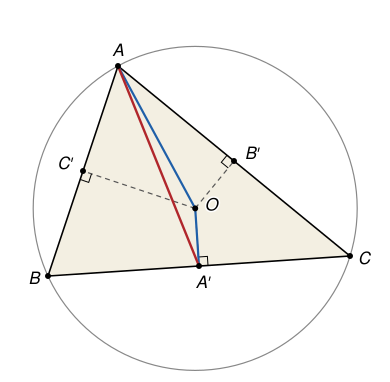
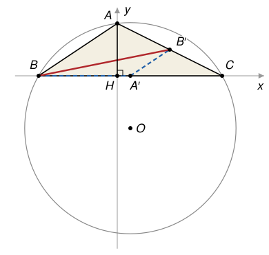

## Statement

Soit $ABC$ un triangle d'aire $S$. On note $a = BC$, $b = CA$ et $c = AB$ les longueurs de ses côtés. On note $A'$, $B'$ et $C'$ les milieux respectifs de $[BC]$, $[CA]$ et $[AB]$, et $a' = AA'$, $b' = BB'$, $c' = CC'$ les longueurs des trois médianes. Enfin, $R$ est le rayon du cercle circonscrit au triangle $ABC$.

1. Montrer que, si les trois angles du triangle $ABC$ sont aigus,
$$aa' + bb' + cc' \le 2S + R(a + b + c) .$$
2. Cette inégalité est-elle encore vraie pour tous les triangles qui ont un angle obtus ?

## Hints

1. Pour la question 1 : le centre $O$ du cercle circonscrit est à l'intérieur du triangle. Découpe $ABC$ en trois triangles de sommet $O$, et exprime $2S$ à l'aide des distances $OA'$, $OB'$ et $OC'$.
2. Toujours pour la question 1 : écris l'inégalité triangulaire dans le triangle $AOA'$.
3. Pour la question 2, suppose que l'angle obtus est en $A$. Montre que $a' < \frac{a}{2}$, et majore $b'$ en passant par le point $A'$.
4. Il te faudra aussi la formule $bc = 2R \times AH$, où $H$ est le pied de la hauteur issue de $A$. Démontre-la dans un repère où $H$ est l'origine, la droite $(BC)$ l'axe des abscisses et $A$ un point de l'axe des ordonnées.

## Solution

On note $O$ le centre du cercle circonscrit et $H$ le pied de la hauteur issue de $A$. On commence par quelques calculs dans un repère, qui serviront dans les deux questions.

**Les calculs dans un repère.** On choisit un repère orthonormé d'origine $H$, dont l'axe des abscisses est la droite $(BC)$, et tel que $A = (0\,;\,h)$ avec $h = AH > 0$. Alors $B = (u\,;\,0)$ et $C = (v\,;\,0)$ pour deux nombres $u \ne v$, et

$$a^2 = (v - u)^2, \qquad b^2 = AC^2 = v^2 + h^2, \qquad c^2 = AB^2 = u^2 + h^2 .$$

Le point $O$ est à la même distance de $B$ et de $C$ : il est sur la médiatrice de $[BC]$, qui est la droite verticale passant par $A' = \left(\frac{u+v}{2}\,;\,0\right)$. Donc $O = \left(\frac{u+v}{2}\,;\,k\right)$ pour un certain nombre $k$. L'égalité $OA^2 = OB^2$ s'écrit

$$\left(\frac{u+v}{2}\right)^2 + (k - h)^2 = \left(\frac{v-u}{2}\right)^2 + k^2 .$$

Or $\left(\frac{u+v}{2}\right)^2 - \left(\frac{v-u}{2}\right)^2 = uv$, donc $uv + (k - h)^2 - k^2 = 0$, c'est-à-dire $uv + h^2 - 2hk = 0$. On pose $P = uv + h^2$. On a donc obtenu

$$k = \frac{P}{2h} .$$

Le nombre $P$ a un sens : c'est le produit scalaire $\overrightarrow{AB} \cdot \overrightarrow{AC}$, puisque $\overrightarrow{AB} = (u\,;\,-h)$ et $\overrightarrow{AC} = (v\,;\,-h)$. On en tire trois faits.

*Fait 1 : la position de $O$.* L'angle $\widehat{BAC}$ est aigu si $P > 0$, droit si $P = 0$, obtus si $P < 0$. Comme $h > 0$, le nombre $k$ a le même signe que $P$. Donc **$O$ est du même côté de $(BC)$ que $A$ exactement quand l'angle en $A$ est aigu**, et de l'autre côté quand il est obtus.

*Fait 2 : la médiane issue de $A$.* On a $AA'^2 = \left(\frac{u+v}{2}\right)^2 + h^2$ et $\left(\frac{a}{2}\right)^2 = \left(\frac{v-u}{2}\right)^2$. Avec le même calcul que plus haut,

$$a'^2 - \left(\frac{a}{2}\right)^2 = uv + h^2 = P .$$

Donc, **si l'angle en $A$ est obtus, alors $a' < \frac{a}{2}$**.

*Fait 3 : la formule $bc = 2Rh$.* On a $R^2 = OB^2 = \left(\frac{v-u}{2}\right)^2 + k^2$, et $2hk = P$. Donc

$$4R^2h^2 = (v - u)^2 h^2 + (2hk)^2 = (u^2 - 2uv + v^2)h^2 + (uv + h^2)^2 .$$

On développe le dernier carré : $(uv + h^2)^2 = u^2v^2 + 2uvh^2 + h^4$. Les termes $-2uvh^2$ et $+2uvh^2$ s'annulent, et il reste

$$4R^2h^2 = u^2h^2 + v^2h^2 + u^2v^2 + h^4 = (u^2 + h^2)(v^2 + h^2) = c^2 b^2 .$$

Comme tous ces nombres sont positifs, **$bc = 2R \times AH$**.

Ces trois faits valent pour n'importe quel sommet, en changeant les noms.

**1. Le cas où les trois angles sont aigus.**

*Le point $O$ est à l'intérieur du triangle.* D'après le fait 1, appliqué aux trois sommets : $O$ est du même côté de $(BC)$ que $A$, du même côté de $(CA)$ que $B$, et du même côté de $(AB)$ que $C$. C'est exactement dire que $O$ est à l'intérieur du triangle $ABC$.

*Une expression de $2S$.* On découpe donc $ABC$ en trois triangles $OBC$, $OCA$ et $OAB$. Le point $O$ est sur la médiatrice de $[BC]$, qui passe par $A'$, donc $(OA')$ est perpendiculaire à $(BC)$ : $OA'$ est la hauteur du triangle $OBC$ issue de $O$. L'aire de $OBC$ vaut donc $\frac{1}{2}\, a \times OA'$. De même pour les deux autres, et on obtient

$$2S = a \times OA' + b \times OB' + c \times OC' .$$

*L'inégalité triangulaire.* Dans le triangle $AOA'$, on a $AA' \le AO + OA'$, c'est-à-dire $a' \le R + OA'$. En multipliant par $a > 0$ :

$$aa' \le aR + a \times OA' .$$

De même, $bb' \le bR + b \times OB'$ et $cc' \le cR + c \times OC'$. En additionnant ces trois inégalités, puis en utilisant l'expression de $2S$ :

$$aa' + bb' + cc' \le R(a + b + c) + a \times OA' + b \times OB' + c \times OC' = 2S + R(a + b + c) .$$

**2. Le cas d'un angle obtus : l'inégalité reste vraie.**

La preuve précédente ne marche plus : le point $O$ est maintenant à l'extérieur du triangle, et le découpage en trois triangles de sommet $O$ ne donne plus l'aire $S$. Il faut une autre idée. On nomme les sommets de sorte que l'angle obtus soit en $A$.

*Majorer $aa'$.* D'après le fait 2, $a' < \frac{a}{2}$. De plus, $a = BC \le BO + OC = 2R$, donc $\frac{a}{2} \le R$. Ainsi $a' < R$, et

$$aa' < aR .$$

*Majorer $bb'$ et $cc'$.* Dans le triangle $ABC$, le segment $[A'B']$ joint les milieux de deux côtés, donc $A'B' = \frac{AB}{2} = \frac{c}{2}$. L'inégalité triangulaire dans $BA'B'$ donne

$$b' = BB' \le BA' + A'B' = \frac{a}{2} + \frac{c}{2}, \qquad \text{donc} \qquad bb' \le \frac{b(a + c)}{2} .$$

De même, $c' = CC' \le CA' + A'C' = \frac{a}{2} + \frac{b}{2}$, donc $cc' \le \frac{c(a + b)}{2}$. En additionnant les trois majorations :

$$aa' + bb' + cc' < aR + \frac{ab + bc}{2} + \frac{ac + bc}{2} = aR + \frac{a(b + c)}{2} + bc .$$

*Comparer avec le membre de droite.* Il reste à montrer que ce dernier nombre est au plus $2S + R(a + b + c)$. On utilise $2S = a \times AH = ah$ (base $[BC]$, hauteur $[AH]$) et le fait 3, $bc = 2Rh$ :

$$2S + R(a + b + c) - \left[ aR + \frac{a(b + c)}{2} + bc \right] = ah + R(b + c) - \frac{a(b + c)}{2} - 2Rh .$$

On regroupe les termes qui contiennent $b + c$ et ceux qui contiennent $h$ :

$$ah + R(b + c) - \frac{a(b + c)}{2} - 2Rh = (b + c)\left(R - \frac{a}{2}\right) - 2h\left(R - \frac{a}{2}\right) = \left(R - \frac{a}{2}\right)(b + c - 2h) .$$

Le premier facteur est positif ou nul, car $a \le 2R$. Le second aussi : $b^2 = v^2 + h^2 \ge h^2$ et $c^2 = u^2 + h^2 \ge h^2$, donc $b \ge h$ et $c \ge h$. (Cela dit simplement que la hauteur $AH$ est plus courte que les côtés $AB$ et $AC$.) Le produit est donc positif ou nul, et

$$aa' + bb' + cc' < aR + \frac{a(b + c)}{2} + bc \le 2S + R(a + b + c) .$$

**Conclusion.** L'inégalité $aa' + bb' + cc' \le 2S + R(a + b + c)$ est vraie quand les trois angles sont aigus, et elle reste vraie, et même stricte, pour tous les triangles qui ont un angle obtus.

## Going further

1. Montrer que la preuve de la question 1 marche encore pour un triangle rectangle. L'inégalité est donc vraie pour tous les triangles.
2. Montrer que, pour un triangle aux trois angles aigus, il y a égalité seulement pour le triangle équilatéral. (Quand a-t-on $AA' = AO + OA'$ ? Que dire alors du point $A$ et de la médiatrice de $[BC]$ ?)
3. Le fait 3 donne une formule pour l'aire de tout triangle : $S = \frac{abc}{4R}$. Vérifie-la sur un triangle rectangle.
