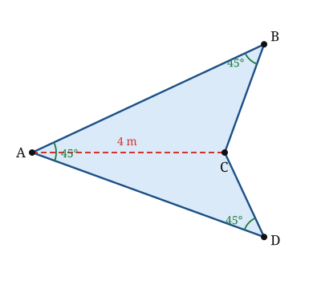

## Statement

Une voile a la forme d'un quadrilatère $ABCD$ dont les angles intérieurs en $A$, en $B$ et en $D$ mesurent chacun $45°$. La diagonale $[AC]$ mesure $4$ mètres.

1. Montrer que l'angle intérieur en $C$ mesure $225°$ : la voile présente donc un creux en $C$, et la diagonale $[AC]$ la partage en deux triangles $ABC$ et $ACD$.
2. Calculer l'aire de la voile.

La réponse est-elle la même pour toutes les voiles vérifiant ces conditions ?

## Hints

1. La somme des angles intérieurs d'un quadrilatère vaut toujours $360°$, qu'il soit convexe ou non.
2. Rien dans l'énoncé ne fixe la forme exacte de la voile. Introduis donc un paramètre : pose $\alpha = \widehat{BAC}$. Que vaut alors $\widehat{CAD}$ ?
3. L'aire de chacun des deux triangles se calcule avec la distance de $B$, puis de $D$, à la droite $(AC)$. Exprime ces deux distances en fonction de $\alpha$, avec la loi des sinus.
4. Tu obtiendras une somme du type $\sin(45° + \alpha)\sin\alpha + \cos\alpha \sin(45° - \alpha)$. Développe les deux sinus avec les formules d'addition et regarde ce qui reste.

## Solution

**1. L'angle en $C$.**

La somme des angles intérieurs d'un quadrilatère vaut $360°$. Comme trois d'entre eux valent $45°$,

$$\widehat{C} = 360° - 3 \times 45° = 360° - 135° = 225° .$$

Cet angle dépasse $180°$ : le quadrilatère n'est pas convexe, il rentre vers l'intérieur au sommet $C$. La diagonale $[AC]$ est alors intérieure à la voile, et elle la découpe en deux triangles $ABC$ et $ACD$ situés de part et d'autre de la droite $(AC)$.

**2. L'aire.**

*On introduit un paramètre.* Posons $\alpha = \widehat{BAC}$. Comme la demi-droite $[AC)$ est à l'intérieur de l'angle $\widehat{DAB}$, qui mesure $45°$,

$$\widehat{CAD} = 45° - \alpha, \qquad \text{avec } 0 < \alpha < 45°.$$

*Le triangle $ABC$.* Ses angles sont $\widehat{BAC} = \alpha$, $\widehat{ABC} = 45°$ et donc $\widehat{ACB} = 180° - 45° - \alpha = 135° - \alpha$. La loi des sinus, avec $AC = 4$ opposé à l'angle $\widehat{ABC} = 45°$, donne

$$\frac{AB}{\sin \widehat{ACB}} = \frac{AC}{\sin \widehat{ABC}} = \frac{4}{\sin 45°}, \qquad \text{d'où} \qquad AB = \frac{4\,\sin(135° - \alpha)}{\sin 45°}.$$

Notons $h_B$ la distance du point $B$ à la droite $(AC)$. Dans le triangle rectangle formé par $A$, $B$ et le pied de la perpendiculaire issue de $B$,

$$h_B = AB \sin\alpha = \frac{4\,\sin(135° - \alpha)\,\sin\alpha}{\sin 45°}.$$

*Le triangle $ACD$.* Ses angles sont $\widehat{CAD} = 45° - \alpha$, $\widehat{ADC} = 45°$ et donc $\widehat{ACD} = 180° - 45° - (45° - \alpha) = 90° + \alpha$. La loi des sinus donne de même

$$AD = \frac{4\,\sin(90° + \alpha)}{\sin 45°} = \frac{4\cos\alpha}{\sin 45°},$$

et la distance $h_D$ du point $D$ à la droite $(AC)$ vaut

$$h_D = AD \sin(45° - \alpha) = \frac{4\,\cos\alpha\,\sin(45° - \alpha)}{\sin 45°}.$$

*L'aire totale.* Les deux triangles ont la même base $[AC]$, de longueur $4$ :

$$\mathcal{A} = \frac{1}{2} \times 4 \times h_B + \frac{1}{2} \times 4 \times h_D = 2\left(h_B + h_D\right) = \frac{8}{\sin 45°}\Big[\sin(135° - \alpha)\sin\alpha + \cos\alpha\,\sin(45° - \alpha)\Big].$$

*Le crochet se simplifie entièrement.* D'abord $\sin(135° - \alpha) = \sin\big(180° - (135° - \alpha)\big) = \sin(45° + \alpha)$. Ensuite, les formules d'addition donnent

$$\sin(45° + \alpha) = \frac{\sqrt2}{2}\left(\cos\alpha + \sin\alpha\right), \qquad \sin(45° - \alpha) = \frac{\sqrt2}{2}\left(\cos\alpha - \sin\alpha\right).$$

Donc

$$\sin(45° + \alpha)\sin\alpha + \cos\alpha\,\sin(45° - \alpha) = \frac{\sqrt2}{2}\Big[\sin\alpha\cos\alpha + \sin^2\alpha + \cos^2\alpha - \cos\alpha\sin\alpha\Big].$$

Les deux produits $\sin\alpha\cos\alpha$ se détruisent, et il reste $\sin^2\alpha + \cos^2\alpha = 1$ :

$$\sin(45° + \alpha)\sin\alpha + \cos\alpha\,\sin(45° - \alpha) = \frac{\sqrt2}{2}.$$

*On conclut.* Comme $\sin 45° = \dfrac{\sqrt2}{2}$ également,

$$\mathcal{A} = \frac{8}{\frac{\sqrt2}{2}} \times \frac{\sqrt2}{2} = 8 .$$

**Conclusion.** L'aire de la voile vaut $8$ mètres carrés. Le paramètre $\alpha$ a disparu : **toutes** les voiles vérifiant les conditions de l'énoncé ont exactement la même aire, alors qu'elles n'ont pas du tout la même forme.

**Une remarque qui éclaire le résultat.** Le calcul a donné $h_B + h_D = \dfrac{4 \times \frac{\sqrt2}{2}}{\sin 45°} = 4$. Autrement dit, la somme des distances de $B$ et de $D$ à la droite $(AC)$ vaut toujours $4$, c'est-à-dire $AC$ elle-même. L'aire est alors $\frac12 \times AC \times (h_B + h_D) = \frac12 \times 4 \times 4 = 8$.

## Going further

1. Montrer que la droite $(BD)$ est toujours perpendiculaire à $(AC)$, et que $BD = AC$. (Indication : comparer les distances de $B$ et de $D$ au point $A$ mesurées le long de $(AC)$.)
2. Reprendre le problème avec $AC = d$ au lieu de $4$. Quelle est l'aire ?
3. Que se passe-t-il si les trois angles valent $60°$ au lieu de $45°$ ? Calculer l'angle en $C$ et expliquer pourquoi la question n'a alors plus de sens. Pour quelles valeurs de l'angle commun le problème garde-t-il un sens ?
4. Construire à la règle et au compas une voile vérifiant l'énoncé, en partant du segment $[AC]$.
