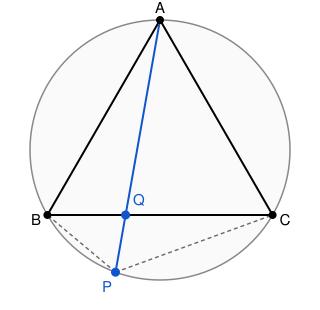
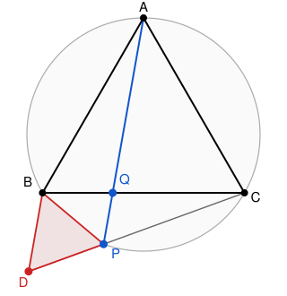

## Statement

Soit $ABC$ un triangle **équilatéral**, et soit $\Gamma$ son cercle circonscrit.

Une droite passant par le sommet $A$ coupe le côté $[BC]$ en un point $Q$, et recoupe le
cercle $\Gamma$ en un point $P$.

Montrer que
$$\frac{1}{PB} + \frac{1}{PC} = \frac{1}{PQ} .$$

## Hints

1. Commence par calculer les angles en $P$ : combien valent $\widehat{BPC}$,
   $\widehat{BPA}$ et $\widehat{APC}$ ?
2. Tu trouveras $\widehat{BPC} = 120°$ et $\widehat{BPA} = \widehat{APC} = 60°$. La droite
   $(PA)$ est donc la bissectrice de l'angle $\widehat{BPC}$.
3. Une relation du type $\dfrac1x + \dfrac1y = \dfrac1z$ se traduit souvent par une histoire
   de triangles semblables. Cherche à construire un triangle.
4. Prolonge la demi-droite $[CP)$ au-delà de $P$ jusqu'à un point $D$ tel que $PD = PB$. Quel
   est alors l'angle $\widehat{BPD}$, et quelle est la nature du triangle $BPD$ ?
5. Montre que $(AP)$ et $(BD)$ sont parallèles, puis applique le théorème de Thalès dans le
   triangle $CBD$.

## Solution

**Étape 1 : les angles en $P$.**

Le point $P$ est sur l'arc $\overset{\frown}{BC}$ ne contenant pas $A$, donc $BPCA$ est un
quadrilatère inscrit dans $\Gamma$. Les angles opposés d'un quadrilatère inscriptible sont
supplémentaires, donc
$$\widehat{BPC} = 180° - \widehat{BAC} = 180° - 60° = 120° .$$

Par ailleurs, les angles inscrits $\widehat{BPA}$ et $\widehat{BCA}$ interceptent le même arc
$\overset{\frown}{AB}$, donc
$$\widehat{BPA} = \widehat{BCA} = 60° ,$$
et de même $\widehat{APC} = \widehat{ABC} = 60°$.

La demi-droite $[PA)$ partage donc l'angle $\widehat{BPC}$ en deux angles de $60°$ : c'est sa
bissectrice.

**Étape 2 : construire un triangle équilatéral.**

Prolongeons la demi-droite $[CP)$ au-delà de $P$, et plaçons sur ce prolongement le point $D$
tel que
$$PD = PB .$$

Comme $D$ est sur la droite $(CP)$, de l'autre côté de $P$ par rapport à $C$, les angles
$\widehat{BPC}$ et $\widehat{BPD}$ sont supplémentaires :
$$\widehat{BPD} = 180° - 120° = 60° .$$

Le triangle $BPD$ a donc deux côtés égaux ($PB = PD$) et l'angle entre eux vaut $60°$ : il est
**équilatéral**. En particulier
$$BD = PB = PD .$$

**Étape 3 : deux droites parallèles.**

Comme $\widehat{APC} = 60°$ et que $D$ est sur la droite $(CP)$ au-delà de $P$,
$$\widehat{APD} = 180° - \widehat{APC} = 120° .$$

Par ailleurs, le triangle $BPD$ étant équilatéral, $\widehat{PDB} = 60°$.

Les angles $\widehat{APD}$ et $\widehat{PDB}$ sont deux angles situés du même côté de la
droite $(PD)$, l'un en $P$ et l'autre en $D$. Leur somme vaut $120° + 60° = 180°$, ce qui
signifie exactement que
$$(PA) \parallel (DB) .$$

**Étape 4 : le théorème de Thalès.**

Le point $Q$ est sur la droite $(AP)$, donc la droite $(QP)$ n'est autre que la droite $(AP)$,
et elle est parallèle à $(DB)$.

Regardons maintenant le triangle $CBD$ :

- $Q$ est sur la droite $(CB)$ ;
- $P$ est sur la droite $(CD)$ ;
- $(QP)$ est parallèle à $(BD)$.

Le théorème de Thalès donne donc
$$\frac{BD}{QP} = \frac{CD}{CP} .$$

**Étape 5 : conclure.**

Comme $D$ est au-delà de $P$ sur la demi-droite $[CP)$, on a $CD = CP + PD$, donc
$$\frac{BD}{QP} = \frac{CP + PD}{CP} = 1 + \frac{PD}{CP} .$$

Divisons les deux membres par $BD$, en utilisant $BD = PD = PB$ :
$$\frac{1}{QP} = \frac{1}{BD} + \frac{PD}{CP \times BD}
= \frac{1}{PB} + \frac{PD}{CP \times PD}
= \frac{1}{PB} + \frac{1}{PC} .$$

C'est exactement l'égalité demandée. $\blacksquare$

## Going further

Le résultat est un cas particulier du **théorème de Ptolémée** : dans un quadrilatère
inscriptible $BPCA$, on a
$$PA \times BC = PB \times AC + PC \times AB .$$

Comme le triangle est équilatéral, $AB = BC = CA$, ce qui se simplifie en
$$PA = PB + PC .$$

Cette relation s'appelle le **théorème de Van Schooten** : pour tout point $P$ de l'arc
$\overset{\frown}{BC}$, la distance $PA$ est la somme des deux autres.

On peut en déduire l'énoncé de l'exercice par un autre chemin, en montrant d'abord que
$$PQ = \frac{PB \times PC}{PB + PC} ,$$
puis en reconnaissant dans cette expression la **moyenne harmonique** de $PB$ et $PC$,
divisée par deux. Cherche à retrouver cette formule directement à partir de la relation
démontrée plus haut.
