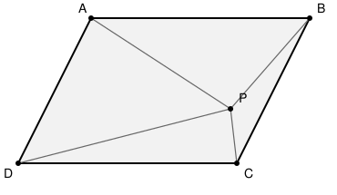

## Statement

Soit $ABCD$ un parallélogramme et soit $P$ un point situé à l'intérieur, tel que

$$\widehat{APB} + \widehat{DPC} = 180^\circ .$$

Démontrer que

$$\widehat{ADP} = \widehat{PBA} .$$

## Hints

1. L'hypothèse porte sur deux angles **opposés** vus de $P$, et la conclusion sur deux angles vus de deux sommets. Il n'y a aucun cercle dans la figure : c'est donc qu'il faut en fabriquer un.
2. Une somme de deux angles égale à $180^\circ$ fait penser à un quadrilatère inscrit dans un cercle. Mais les deux angles de l'hypothèse ont le même sommet $P$. Cherchez à en transporter un ailleurs.
3. Construisez le point $Q$ tel que $APQD$ soit un parallélogramme. Autrement dit, $Q$ est le translaté de $D$ par le vecteur $\overrightarrow{AP}$.
4. Comparez alors les triangles $APB$ et $DQC$. Que valent $DQ$, $QC$ et $DC$ ?
5. Une fois que vous savez que $D$, $P$, $C$, $Q$ sont sur un même cercle, enchaînez trois égalités d'angles : une par des droites parallèles, une par le théorème de l'angle inscrit, une encore par des droites parallèles.

## Solution

### La construction

Appelons $Q$ le point tel que $APQD$ soit un parallélogramme, c'est-à-dire le point défini par

$$\overrightarrow{DQ} = \overrightarrow{AP} .$$

Comme $P$ est à l'intérieur de $ABCD$, le point $Q$ se trouve de l'autre côté de la droite $(DC)$ par rapport à $P$.

### Étape 1 : le triangle $DQC$ est une copie du triangle $APB$

Travaillons avec des vecteurs.

- Par construction, $\overrightarrow{DQ} = \overrightarrow{AP}$.
- Comme $ABCD$ est un parallélogramme, $\overrightarrow{DC} = \overrightarrow{AB}$.
- En soustrayant ces deux égalités :
$$\overrightarrow{QC} = \overrightarrow{DC} - \overrightarrow{DQ} = \overrightarrow{AB} - \overrightarrow{AP} = \overrightarrow{PB} .$$

Les trois côtés du triangle $DQC$ sont donc respectivement égaux aux trois côtés du triangle $APB$ :

$$DQ = AP, \qquad QC = PB, \qquad DC = AB .$$

Ces deux triangles sont donc **superposables**, et en particulier

$$\widehat{DQC} = \widehat{APB} .$$

### Étape 2 : quatre points sur un même cercle

Reprenons l'hypothèse et remplaçons $\widehat{APB}$ par $\widehat{DQC}$ :

$$\widehat{DQC} + \widehat{DPC} = 180^\circ .$$

Dans le quadrilatère $DPCQ$, les angles de sommets $P$ et $Q$ sont donc supplémentaires. Comme $P$ et $Q$ sont de part et d'autre de la droite $(DC)$, ce quadrilatère est convexe, et deux angles opposés supplémentaires signifient exactement que

> **les points $D$, $P$, $C$ et $Q$ sont cocycliques**, c'est-à-dire situés sur un même cercle.

### Étape 3 : la chaîne d'égalités d'angles

Il reste trois pas, chacun très court.

**Premier pas : $\widehat{ADP} = \widehat{QPD}$.**

Puisque $APQD$ est un parallélogramme, $(AD)$ et $(PQ)$ sont parallèles. La droite $(DP)$ les coupe toutes les deux, et les angles $\widehat{ADP}$ et $\widehat{QPD}$ sont alternes-internes. Ils sont donc égaux.

**Deuxième pas : $\widehat{QPD} = \widehat{QCD}$.**

Les points $D$, $P$, $C$, $Q$ sont sur un même cercle. Les angles $\widehat{QPD}$ et $\widehat{QCD}$ sont deux angles inscrits qui interceptent le même arc $QD$, du même côté. D'après le théorème de l'angle inscrit, ils sont égaux.

**Troisième pas : $\widehat{QCD} = \widehat{PBA}$.**

Regardons les côtés de ces deux angles.

- Le côté $[CQ]$ : on a montré $\overrightarrow{QC} = \overrightarrow{PB}$, donc $(CQ)$ et $(BP)$ sont parallèles, et les deux vecteurs $\overrightarrow{CQ}$ et $\overrightarrow{BP}$ pointent dans le même sens.
- Le côté $[CD]$ : on a $\overrightarrow{DC} = \overrightarrow{AB}$, donc $\overrightarrow{CD} = \overrightarrow{BA}$, et là aussi les deux vecteurs pointent dans le même sens.

Deux angles dont les côtés sont deux à deux portés par des vecteurs de même direction et de même sens sont égaux. Donc $\widehat{QCD} = \widehat{PBA}$.

### Conclusion

En mettant les trois pas bout à bout :

$$\widehat{ADP} \;=\; \widehat{QPD} \;=\; \widehat{QCD} \;=\; \widehat{PBA} .$$

$$\boxed{\widehat{ADP} = \widehat{PBA}} \qquad \blacksquare$$

## Going further

**Ce qu'il faut retenir de la méthode.** L'énoncé parle d'angles, mais ne contient aucun cercle. Or la seule façon courante de faire parler une somme d'angles égale à $180^\circ$ est le critère du quadrilatère inscriptible. Toute la difficulté est donc de faire apparaître un quadrilatère dont deux angles opposés soient précisément $\widehat{APB}$ et $\widehat{DPC}$. La translation qui envoie $A$ sur $P$ déplace $D$ en un point $Q$ situé de l'autre côté de $(DC)$ et y transporte l'angle $\widehat{APB}$ tel quel : le quadrilatère cherché est alors sous les yeux.

**Une translation, et pas une rotation.** On aurait pu songer à faire tourner le triangle $APB$ autour d'un point. Mais dans un parallélogramme, c'est la translation de vecteur $\overrightarrow{AD}$ (ou $\overrightarrow{AB}$) qui respecte la figure, et c'est elle qu'il faut utiliser.

**Pour vérifier avant de se lancer.** Prenez $A(2\,;4)$, $B(8\,;4)$, $C(6\,;0)$, $D(0\,;0)$. Le point $P$ de coordonnées $(2\,;2)$ vérifie l'hypothèse (ce n'est pas celui de la figure : il y a plusieurs positions possibles), avec $\widehat{APB} \approx \text{71,57}^\circ$ et $\widehat{DPC} \approx \text{108,43}^\circ$. On calcule alors $\widehat{ADP} = \widehat{PBA} \approx \text{18,43}^\circ$, conformément au résultat. Cette vérification numérique ne remplace pas la démonstration, mais elle rassure sur la lecture de l'énoncé.

**Une question à creuser.** L'ensemble des points $P$ intérieurs vérifiant $\widehat{APB} + \widehat{DPC} = 180^\circ$ n'est pas réduit à un point : en balayant le parallélogramme à la calculatrice, on en trouve toute une famille. Pouvez-vous décrire cet ensemble ?
