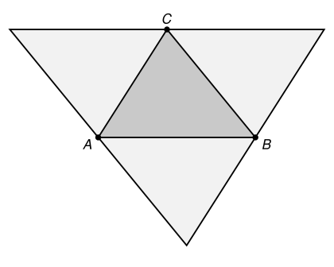

## Statement

On se donne $n$ points du plan, avec $n \geqslant 3$, et on suppose que trois d'entre eux au moins ne sont pas alignés.

On suppose que **tout triangle formé par trois de ces points a une aire inférieure ou égale à $1$**.

Montrer qu'il existe un triangle d'aire inférieure ou égale à $4$ qui contient les $n$ points.

## Hints

1. Il n'y a qu'un nombre fini de triangles formés par trois des points. L'un d'eux a donc l'aire la plus grande.
2. Appelle $ABC$ un triangle d'aire maximale. Par hypothèse, son aire vaut au plus $1$. Il s'agit maintenant de fabriquer, à partir de lui, un triangle qui contient tout.
3. Où peut se trouver un point $P$ de l'ensemble ? Compare l'aire de $PBC$ à celle de $ABC$ : les deux triangles ont la même base $[BC]$.
4. Tu en déduis que $P$ ne peut pas être trop loin de la droite $(BC)$. Traduis cela avec une droite parallèle à $(BC)$.
5. Fais-le pour les trois côtés à la fois. Quelle figure obtiens-tu ? Quelle est son aire par rapport à celle de $ABC$ ?

## Solution

**L'idée : partir du plus grand triangle possible, et l'agrandir exactement deux fois dans chaque direction.**

**Un triangle d'aire maximale existe.** Le nombre de triangles formés par trois des $n$ points est fini, et comme trois des points ne sont pas alignés, au moins l'un de ces triangles a une aire strictement positive. Choisissons donc trois points $A$, $B$, $C$ tels que l'aire du triangle $ABC$ soit **la plus grande possible**. Notons $S$ cette aire ; par hypothèse $S \leqslant 1$.

**La construction.** Traçons trois droites :

- la parallèle à $(BC)$ passant par $A$ ;
- la parallèle à $(CA)$ passant par $B$ ;
- la parallèle à $(AB)$ passant par $C$.

Ces trois droites délimitent un grand triangle, que nous noterons $T$.

**L'aire de $T$ vaut $4S$.** Les trois droites découpent $T$ en quatre petits triangles, et l'on reconnaît la construction inverse du théorème des milieux : $A$, $B$, $C$ sont les milieux des côtés de $T$. Les quatre petits triangles sont alors superposables au triangle $ABC$, donc

$$\text{aire}(T) = 4S \leqslant 4 .$$

**Tous les points sont dans $T$.** Soit $P$ l'un des $n$ points. Montrons qu'il est du bon côté de chacune des trois droites.

Prenons la parallèle à $(BC)$ passant par $A$. Elle sépare le plan en deux demi-plans : celui qui contient $B$ et $C$, et l'autre. Supposons que $P$ soit strictement dans l'autre, c'est-à-dire de l'autre côté de cette droite par rapport à $(BC)$.

Les triangles $ABC$ et $PBC$ ont la même base $[BC]$. Leurs aires valent donc

$$\text{aire}(ABC) = \frac{BC \times h_A}{2}, \qquad \text{aire}(PBC) = \frac{BC \times h_P}{2} ,$$

où $h_A$ et $h_P$ sont les distances de $A$ et de $P$ à la droite $(BC)$. Or $P$ est plus loin de $(BC)$ que ne l'est $A$, puisqu'il est au-delà de la parallèle menée par $A$ : donc $h_P > h_A$, et

$$\text{aire}(PBC) > \text{aire}(ABC) = S .$$

Cela contredit le fait que $S$ est l'aire maximale, puisque $P$, $B$, $C$ sont trois des points donnés. Donc $P$ est bien du même côté que $B$ et $C$ (ou sur la droite).

Le même raisonnement avec la parallèle à $(CA)$ menée par $B$, puis avec la parallèle à $(AB)$ menée par $C$, montre que $P$ est du bon côté des trois droites. Être du bon côté des trois droites à la fois, c'est exactement être dans le triangle $T$.

**Conclusion : le triangle $T$ contient les $n$ points et son aire vaut $4S \leqslant 4$.**

## Going further

La valeur $4$ ne peut pas être améliorée : si l'on prend simplement trois points formant un triangle d'aire exactement $1$, tout triangle qui les contient a une aire d'au moins... eh bien, d'au moins $1$, et l'on peut faire beaucoup mieux que $4$ dans ce cas précis. En revanche, pour des configurations de points bien étalées, la borne $4$ est atteinte de près, et c'est la meilleure que cette méthode puisse donner.

Remarque aussi que la démonstration ne se sert jamais du nombre $n$ : elle marche avec trois points comme avec un million.
