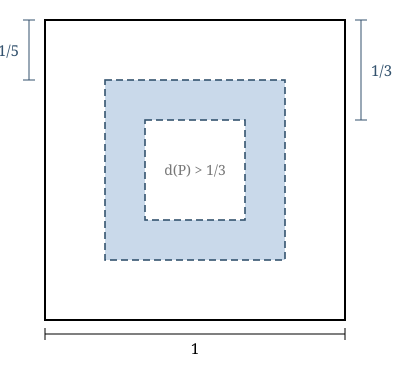

## Statement

Un point $P$ est choisi au hasard à l'intérieur d'un carré de côté $1$. Le tirage est
uniforme : la probabilité que $P$ tombe dans une zone donnée est égale à l'aire de cette zone.

On note $d(P)$ la distance de $P$ au côté du carré **le plus proche** de lui.

Calculer la probabilité que
$$\frac15 \le d(P) \le \frac13 .$$

## Hints

1. Commence par une question plus simple : pour un nombre $t$ fixé entre $0$ et $\frac12$, quel est l'ensemble des points $P$ du carré tels que $d(P) \ge t$ ?
2. Être à une distance d'au moins $t$ du côté le plus proche, c'est être à une distance d'au moins $t$ des **quatre** côtés à la fois. Dessine cette zone.
3. C'est un carré, plus petit, de même centre. Quel est son côté ?
4. Une fois calculée la probabilité $P(d(P) \ge t)$ pour $t = \frac15$ puis pour $t = \frac13$, comment obtenir celle de l'énoncé ?

## Solution

**L'idée : l'ensemble des points assez loin du bord est un carré plus petit, et la zone
cherchée est la différence de deux tels carrés.**

**Étape 1. Les points à distance au moins $t$ du bord.**

Plaçons le carré dans un repère : ses sommets sont $(0,0)$, $(1,0)$, $(1,1)$ et $(0,1)$. Pour
un point $P$ de coordonnées $(x, y)$ à l'intérieur du carré, les distances aux quatre côtés
sont $x$, $1-x$, $y$ et $1-y$. Donc
$$d(P) = \min(x,\ 1-x,\ y,\ 1-y) .$$

Soit $t$ un nombre tel que $0 \le t \le \frac12$. Dire $d(P) \ge t$, c'est dire que les quatre
distances sont au moins $t$ :
$$x \ge t, \quad 1-x \ge t, \quad y \ge t, \quad 1-y \ge t ,$$
c'est-à-dire
$$t \le x \le 1-t \qquad\text{et}\qquad t \le y \le 1-t .$$

L'ensemble de ces points est donc un **carré de même centre**, de côté $1 - 2t$. Son aire vaut
$$(1-2t)^2 .$$

Comme le grand carré a pour aire $1$, on obtient
$$P(d(P) \ge t) = (1-2t)^2 .$$

**Étape 2. Les deux valeurs utiles.**

Pour $t = \dfrac15$ : le petit carré a pour côté $1 - \dfrac25 = \dfrac35$, donc
$$P\!\left(d(P) \ge \tfrac15\right) = \left(\frac35\right)^2 = \frac{9}{25} .$$

Pour $t = \dfrac13$ : le petit carré a pour côté $1 - \dfrac23 = \dfrac13$, donc
$$P\!\left(d(P) \ge \tfrac13\right) = \left(\frac13\right)^2 = \frac19 .$$

**Étape 3. La différence.**

La zone cherchée est le carré de côté $\frac35$ privé du carré de côté $\frac13$ : c'est le
« cadre » grisé de la figure. Son aire est la différence des deux aires :
$$P\!\left(\frac15 \le d(P) \le \frac13\right) = \frac{9}{25} - \frac19 .$$

(Les deux bords de cette zone sont des segments, d'aire nulle : peu importe qu'on les compte
ou non.)

Avec le dénominateur commun $225$ :
$$\frac{9}{25} - \frac19 = \frac{81}{225} - \frac{25}{225} = \frac{56}{225} .$$

**Conclusion.**

$$P\!\left(\frac15 \le d(P) \le \frac13\right) = \frac{56}{225} \approx \text{0,249} .$$

Soit à peu près une chance sur quatre.

## Going further

La fonction $t \mapsto P(d(P) \ge t) = (1-2t)^2$ décrit complètement la loi de la variable
aléatoire $d(P)$. On peut en tirer d'autres renseignements : par exemple $d(P) \ge \frac14$
avec la probabilité $\left(\frac12\right)^2 = \frac14$, donc trois points sur quatre tombent à
moins d'un quart de côté du bord. Le bord d'un carré est plus « encombrant » qu'on ne
l'imagine.
