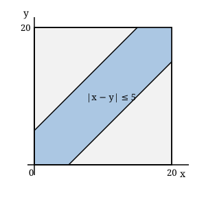

## Statement

Deux amis prennent le train à la même gare. Chacun arrive à un instant au hasard entre
$8$ h $00$ et $8$ h $20$, indépendamment de l'autre, et attend l'autre pendant $5$ minutes
au maximum : au bout de $5$ minutes d'attente, il monte seul dans un train.

Quelle est la probabilité qu'ils se retrouvent et partent ensemble ?

*On admettra le principe suivant.* Si l'on note $x$ et $y$ les instants d'arrivée des deux
amis, mesurés en minutes après $8$ h $00$, alors le couple $(x \, ; y)$ est un point tiré au
hasard dans le carré $[0 \, ; 20] \times [0 \, ; 20]$, et la probabilité d'un événement est
le rapport

$$\frac{\text{aire de la région du carré qui correspond à l'événement}}{\text{aire totale du carré}}.$$

## Hints

1. Traduis « ils se retrouvent » par une condition sur l'écart entre $x$ et $y$.
2. La condition s'écrit $|x - y| \leqslant 5$. Dessine la région correspondante dans le carré.
3. Elle est délimitée par les deux droites d'équations $y = x + 5$ et $y = x - 5$.
4. Il est plus simple de calculer l'aire de ce qui reste : deux triangles rectangles, dans les deux coins du carré.

## Solution

**Étape 1. Traduire la rencontre.**

Le premier arrivé attend au plus $5$ minutes. Les deux amis se retrouvent donc exactement
lorsque l'écart entre leurs deux instants d'arrivée est inférieur ou égal à $5$ minutes :

$$|x - y| \leqslant 5.$$

**Étape 2. Dessiner la région.**

Dans le carré $[0 \, ; 20] \times [0 \, ; 20]$, cette condition décrit la bande située entre
les deux droites $y = x + 5$ et $y = x - 5$.

**Étape 3. Calculer l'aire, par le complémentaire.**

L'aire totale du carré vaut $20 \times 20 = 400$.

La région où les amis se **manquent** est formée de deux morceaux :

- $y > x + 5$ : c'est le triangle de sommets $(0 \, ; 5)$, $(0 \, ; 20)$ et $(15 \, ; 20)$. C'est un triangle rectangle isocèle dont les côtés de l'angle droit mesurent $20 - 5 = 15$, donc son aire vaut $\dfrac{15 \times 15}{2} = \text{112,5}$ ;
- $y < x - 5$ : par symétrie, un triangle identique d'aire $\text{112,5}$.

L'aire de la région où ils se manquent vaut donc $2 \times \text{112,5} = 225$, et l'aire de
la bande vaut

$$400 - 225 = 175.$$

**Étape 4. Conclure.**

$$P(\text{ils partent ensemble}) = \frac{175}{400} = \frac{7}{16} = \text{0,4375}.$$

**Réponse : la probabilité vaut $\dfrac{7}{16}$, soit environ $44\,\%$.**

## Going further

Avec une durée d'attente de $t$ minutes au lieu de $5$, la même méthode donne une
probabilité de
$$1 - \left(\frac{20 - t}{20}\right)^2 .$$
Il faut donc accepter d'attendre environ $\text{5,9}$ minutes pour que la probabilité de se
retrouver dépasse $\dfrac12$. Cela surprend souvent : une attente de $5$ minutes sur une
fenêtre de $20$ minutes, soit un quart de la fenêtre, donne bien plus qu'un quart de chance.
