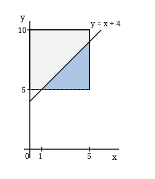

## Statement

Chaque matin, le bus passe à mon arrêt à un instant au hasard entre $6$ h $45$ et
$6$ h $50$. J'arrive à l'arrêt à un instant au hasard entre $6$ h $40$ et $6$ h $45$,
indépendamment du bus, et j'attends jusqu'à son passage.

Quelle est la probabilité que j'attende **moins de $4$ minutes** ?

*On admettra le principe suivant.* Si l'on note $x$ mon instant d'arrivée et $y$ celui du
bus, tous deux comptés en minutes après $6$ h $40$, alors le couple $(x \, ; y)$ est un
point tiré au hasard dans le rectangle $[0 \, ; 5] \times [5 \, ; 10]$, et la probabilité
d'un événement est le rapport entre l'aire de la région correspondante et l'aire totale du
rectangle.

## Hints

1. Exprime mon temps d'attente en fonction de $x$ et de $y$. Remarque au passage que le bus passe toujours après mon arrivée.
2. La condition cherchée s'écrit $y - x < 4$, c'est-à-dire $y < x + 4$.
3. Trace la droite d'équation $y = x + 4$ dans le rectangle. Où coupe-t-elle les bords ?
4. La région favorable est un triangle. Trouve ses trois sommets, puis son aire.

## Solution

**Étape 1. Le temps d'attente.**

J'arrive à l'instant $x$ avec $0 \leqslant x \leqslant 5$, le bus passe à l'instant $y$ avec
$5 \leqslant y \leqslant 10$. Comme $x \leqslant 5 \leqslant y$, le bus passe toujours après
mon arrivée, et mon temps d'attente vaut exactement

$$y - x.$$

La condition « j'attends moins de $4$ minutes » s'écrit donc

$$y - x < 4, \qquad \text{c'est-à-dire} \qquad y < x + 4.$$

**Étape 2. La région favorable.**

Le domaine total est le rectangle $[0 \, ; 5] \times [5 \, ; 10]$, d'aire
$5 \times 5 = 25$.

La droite $y = x + 4$ coupe ce rectangle. Pour $x = 1$, elle passe par le point
$(1 \, ; 5)$, qui est sur le bord inférieur. Pour $x = 5$, elle passe par $(5 \, ; 9)$, qui
est sur le bord droit.

La région favorable, sous la droite et dans le rectangle, est donc le triangle de sommets

$$(1 \, ; 5), \qquad (5 \, ; 5), \qquad (5 \, ; 9).$$

C'est un triangle rectangle dont les deux côtés de l'angle droit mesurent
$5 - 1 = 4$ et $9 - 5 = 4$.

**Étape 3. Conclure.**

$$\text{Aire favorable} = \frac{4 \times 4}{2} = 8 .$$

$$P(\text{attente} < 4\,\text{min}) = \frac{8}{25} = \text{0,32}.$$

**Réponse : la probabilité vaut $\dfrac{8}{25}$, soit $32\,\%$.**

## Going further

Si $x$ est très petit, disons $x < 1$, l'attente dépasse forcément $4$ minutes, puisque le
bus ne passe jamais avant $6$ h $45$. C'est exactement ce que dit la figure : aucune partie
de la région favorable ne se trouve à gauche de $x = 1$. En moyenne, l'attente vaut
$\mathbb{E}(y) - \mathbb{E}(x) = \text{7,5} - \text{2,5} = 5$ minutes.
