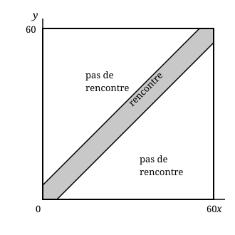

## Statement

Anne et Bruno se donnent rendez-vous à l'arrêt de bus « entre midi et treize heures », sans plus de précision.

Chacun arrive à un instant quelconque de cette heure-là, indépendamment de l'autre. Arrivé sur place, chacun attend **cinq minutes** puis repart, à moins qu'il ne voie l'autre arriver entre-temps.

Quelle est la probabilité qu'ils se rencontrent ?

*On admettra la règle suivante : si l'on note $x$ le nombre de minutes après midi de l'arrivée d'Anne et $y$ celui de Bruno, alors le couple $(x\,;\,y)$ est un point tiré au hasard dans le carré $[0\,;\,60] \times [0\,;\,60]$, et la probabilité d'un événement est le rapport de l'aire de la région correspondante à l'aire du carré.*

## Hints

1. Traduis « ils se rencontrent » en une inégalité entre $x$ et $y$. Qui attend qui ?
2. Si Anne arrive à $x$ et Bruno à $y$ avec $y > x$, ils se rencontrent si Bruno arrive avant qu'Anne ne reparte. Écris cette condition, puis fais de même dans l'autre sens.
3. Les deux cas se résument en une seule inégalité avec une valeur absolue.
4. La région correspondante est une bande en diagonale. Il est bien plus facile de calculer l'aire de ce qui est **en dehors** de la bande : deux triangles.

## Solution

**Mise en équation.**

Notons $x$ le nombre de minutes écoulées depuis midi quand Anne arrive, et $y$ celui pour Bruno. Ainsi $0 \leq x \leq 60$ et $0 \leq y \leq 60$.

- Si Anne arrive la première ($x \leq y$), elle repart à l'instant $x + 5$. Ils se rencontrent si et seulement si Bruno arrive avant, c'est-à-dire $y \leq x + 5$.
- Si Bruno arrive le premier ($y \leq x$), le même raisonnement donne $x \leq y + 5$.

Les deux conditions se résument en une seule :
$$|x - y| \leq 5 .$$

La région favorable est donc la bande diagonale du carré comprise entre les droites $y = x - 5$ et $y = x + 5$.

**Le calcul de l'aire, en passant par le contraire.**

L'aire totale du carré vaut $60 \times 60 = 3600$.

Il est plus simple de calculer l'aire de la région où ils **ne** se rencontrent **pas**, c'est-à-dire $|x - y| > 5$. Elle est formée de deux triangles :

- le triangle au-dessus de la droite $y = x + 5$, dont les sommets sont $(0\,;\,5)$, $(0\,;\,60)$ et $(55\,;\,60)$ : c'est un triangle rectangle isocèle dont les deux côtés de l'angle droit mesurent $55$ ;
- le triangle symétrique en dessous de la droite $y = x - 5$, de sommets $(5\,;\,0)$, $(60\,;\,0)$ et $(60\,;\,55)$, lui aussi de côtés $55$.

Chacun a pour aire $\dfrac{55 \times 55}{2}$, donc les deux ensemble ont pour aire
$$2 \times \frac{55^2}{2} = 55^2 = 3025 .$$

**Conclusion.**

$$P(\text{ils ne se rencontrent pas}) = \frac{3025}{3600}, \qquad \text{donc} \qquad P(\text{ils se rencontrent}) = 1 - \frac{3025}{3600} = \frac{575}{3600} .$$

En simplifiant par $25$ :

$$\boxed{P(\text{ils se rencontrent}) = \frac{23}{144} \approx \text{0,16} .}$$

Ils n'ont donc qu'environ **une chance sur six** de se voir. Un rendez-vous « entre midi et treize heures » n'en est pas vraiment un.

**Contrôle par simulation.** En tirant un million de couples $(x\,;\,y)$ au hasard dans le carré et en comptant ceux qui vérifient $|x-y| \leq 5$, on trouve une proportion voisine de $\text{0,1597}$, tandis que $\dfrac{23}{144} \approx \text{0,1597}$.

## Going further

Si chacun acceptait d'attendre $t$ minutes au lieu de $5$, le même calcul donnerait
$$P = 1 - \left(\frac{60-t}{60}\right)^2 .$$
Pour avoir une chance sur deux de se rencontrer, il faut $\left(\dfrac{60-t}{60}\right)^2 = \dfrac12$, soit $t = 60\left(1 - \dfrac{1}{\sqrt2}\right) \approx \text{17,6}$ minutes d'attente. Il vaut vraiment mieux fixer une heure.
