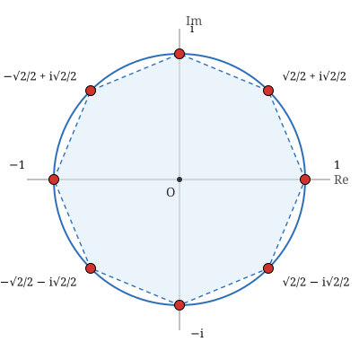

## Statement

Résoudre dans $\mathbb{C}$ les trois équations suivantes, et donner les solutions sous forme algébrique $x + iy$ :

1. $z^4 = 1$ ;
2. $z^3 = 1$ ;
3. $z^8 = 1$.

Placer à chaque fois les solutions dans le plan complexe. Que remarque-t-on ?

## Hints

1. Commence par le module. Si $z^n = 1$, que vaut $|z|^n$ ? Qu'en déduis-tu sur $|z|$ ?
2. Une fois le module connu, écris $z$ sous forme exponentielle $z = e^{i\theta}$ et traduis l'équation sur $\theta$.
3. Attention : deux valeurs de $\theta$ qui diffèrent de $2\pi$ donnent le même nombre complexe. Combien de valeurs de $\theta$ donnent des solutions **différentes** ?
4. Pour la question 3, une autre voie est purement algébrique : $z^8 - 1 = \left(z^4 - 1\right)\left(z^4 + 1\right)$, puis on factorise encore.

## Solution

**Le module d'abord.**

Supposons $z^n = 1$. En passant aux modules, $|z|^n = |z^n| = 1$. Or $|z|$ est un réel positif, et le seul réel positif dont la puissance $n$-ième vaut $1$ est $1$ lui-même. Donc $|z| = 1$ : **toutes les solutions sont sur le cercle unité.**

On peut donc écrire $z = e^{i\theta}$ avec $\theta$ réel. Alors $z^n = e^{in\theta}$, et

$$e^{in\theta} = 1 \iff n\theta \equiv 0 \; [2\pi] \iff \theta = \frac{2k\pi}{n} \ \text{ avec } k \in \mathbb{Z}.$$

Deux valeurs de $k$ qui diffèrent de $n$ donnent le même nombre $z$. On obtient donc exactement $n$ solutions, pour $k = 0, 1, \ldots, n-1$.

**1. L'équation $z^4 = 1$.**

Les solutions sont $e^{2ik\pi/4} = e^{ik\pi/2}$ pour $k = 0, 1, 2, 3$, c'est-à-dire

$$1, \quad i, \quad -1, \quad -i .$$

Ce sont les quatre sommets d'un carré inscrit dans le cercle unité.

On peut aussi le voir sans exponentielles : $z^4 - 1 = \left(z^2 - 1\right)\left(z^2 + 1\right) = (z-1)(z+1)(z-i)(z+i)$.

**2. L'équation $z^3 = 1$.**

Les solutions sont $e^{2ik\pi/3}$ pour $k = 0, 1, 2$ :

$$1, \qquad e^{2i\pi/3} = -\frac{1}{2} + i\frac{\sqrt{3}}{2}, \qquad e^{4i\pi/3} = -\frac{1}{2} - i\frac{\sqrt{3}}{2} .$$

Ce sont les trois sommets d'un triangle équilatéral inscrit dans le cercle unité.

*Vérification algébrique.* $z^3 - 1 = (z-1)\left(z^2 + z + 1\right)$. Le trinôme $z^2 + z + 1$ a pour discriminant $\Delta = 1 - 4 = -3 < 0$, donc ses racines sont

$$\frac{-1 \pm i\sqrt{3}}{2} = -\frac{1}{2} \pm i\frac{\sqrt{3}}{2}.$$

On retrouve bien les deux mêmes nombres.

**3. L'équation $z^8 = 1$.**

Les solutions sont $e^{2ik\pi/8} = e^{ik\pi/4}$ pour $k = 0, 1, \ldots, 7$. En écrivant chacune sous forme algébrique, et en se souvenant que $\cos\frac{\pi}{4} = \sin\frac{\pi}{4} = \frac{\sqrt{2}}{2}$ :

| $k$ | 0 | 1 | 2 | 3 |
|---|---|---|---|---|
| solution | $1$ | $\dfrac{\sqrt{2}}{2} + i\dfrac{\sqrt{2}}{2}$ | $i$ | $-\dfrac{\sqrt{2}}{2} + i\dfrac{\sqrt{2}}{2}$ |

| $k$ | 4 | 5 | 6 | 7 |
|---|---|---|---|---|
| solution | $-1$ | $-\dfrac{\sqrt{2}}{2} - i\dfrac{\sqrt{2}}{2}$ | $-i$ | $\dfrac{\sqrt{2}}{2} - i\dfrac{\sqrt{2}}{2}$ |

*La voie algébrique.* On peut aussi factoriser pas à pas :

$$z^8 - 1 = \left(z^4 - 1\right)\left(z^4 + 1\right) = (z-1)(z+1)\left(z^2+1\right)\left(z^4+1\right).$$

Pour le dernier facteur, on ajoute et on retranche $2z^2$ afin de faire apparaître une identité remarquable :

$$z^4 + 1 = z^4 + 2z^2 + 1 - 2z^2 = \left(z^2+1\right)^2 - \left(z\sqrt{2}\right)^2 = \left(z^2 - z\sqrt{2} + 1\right)\left(z^2 + z\sqrt{2} + 1\right).$$

Chacun de ces deux trinômes a pour discriminant $2 - 4 = -2$, et fournit les racines $\dfrac{\pm\sqrt{2} \pm i\sqrt{2}}{2}$. On retrouve les quatre solutions qui ne sont ni réelles ni imaginaires pures.

**Ce que l'on remarque.**

Dans les trois cas, les solutions sont les sommets d'un polygone régulier inscrit dans le cercle unité, avec un sommet en $1$ : un carré pour $n = 4$, un triangle équilatéral pour $n = 3$, un octogone régulier pour $n = 8$. Passer d'une solution à la suivante revient à tourner d'un angle de $\dfrac{2\pi}{n}$ autour de l'origine.

On remarque aussi que les quatre solutions de $z^4 = 1$ sont parmi les huit solutions de $z^8 = 1$ : c'est normal, puisque $z^4 = 1$ entraîne $z^8 = \left(z^4\right)^2 = 1$.

## Going further

1. Quelle est la somme des $n$ solutions de $z^n = 1$ ? La deviner sur la figure de l'octogone, puis la démontrer avec la somme d'une suite géométrique.
2. Quel est le produit des $n$ solutions de $z^n = 1$ ?
3. Résoudre $z^6 = 1$, puis $z^{12} = 1$. Combien de solutions de $z^{12} = 1$ sont aussi solutions de $z^8 = 1$ ?
4. Résoudre $z^4 = -1$, puis $z^3 = 8i$.
