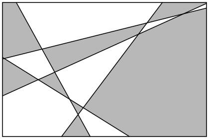

## Statement

On trace $n$ droites dans le plan. Elles le découpent en régions.

Deux régions sont dites *voisines* lorsque leurs frontières se touchent le long d'un segment ou d'une demi-droite (se toucher en un seul point ne suffit pas).

Montrer que l'on peut toujours colorier ces régions avec **deux** couleurs, de telle sorte que deux régions voisines ne reçoivent jamais la même couleur.

## Hints

1. Fais le dessin pour $1$ droite, puis $2$, puis $3$. Trouve à chaque fois un coloriage qui convient.
2. Le nombre de droites est un entier : cela invite à un raisonnement par récurrence sur $n$.
3. Suppose le plan déjà colorié correctement avec $n$ droites, et ajoute une $(n+1)$-ième droite $d$. Le coloriage d'avant ne convient plus : les deux moitiés d'une ancienne région coupée par $d$ ont la même couleur, et elles sont voisines.
4. Répare cela sans tout recommencer : garde le coloriage tel quel d'un côté de $d$, et **échange les deux couleurs** de l'autre côté.
5. Il reste à vérifier que rien n'est cassé ailleurs. Deux cas : les deux régions voisines sont du même côté de $d$, ou elles sont de part et d'autre de $d$.

## Solution

**Ce qu'on démontre.** Notons $P(n)$ l'affirmation : « quelles que soient $n$ droites tracées dans le plan, on peut colorier les régions obtenues avec deux couleurs de sorte que deux régions voisines aient des couleurs différentes ».

**Initialisation ($n = 0$).** Sans aucune droite, il n'y a qu'une région, le plan tout entier. On la colorie en noir. Il n'y a aucune paire de régions voisines à vérifier, donc $P(0)$ est vraie.

(Le cas $n = 1$ est tout aussi clair : une droite coupe le plan en deux demi-plans, qu'on colorie l'un en noir, l'autre en blanc.)

**Hérédité.** Supposons $P(n)$ vraie et traçons $n+1$ droites. Mettons de côté l'une d'elles, appelons-la $d$ ; il reste $n$ droites.

Par hypothèse de récurrence, on sait colorier correctement les régions découpées par ces $n$ droites. Fixons un tel coloriage.

*On remet $d$.* La droite $d$ partage le plan en deux demi-plans ouverts, appelons-les $H^+$ et $H^-$. Chaque ancienne région est soit entièrement dans $H^+$, soit entièrement dans $H^-$, soit coupée en deux par $d$ : un morceau dans $H^+$ et un morceau dans $H^-$. Les nouvelles régions sont exactement ces morceaux.

*Le nouveau coloriage.* On décide :

- dans $H^+$, chaque morceau garde la couleur de l'ancienne région dont il provient ;
- dans $H^-$, chaque morceau prend la couleur **opposée** à celle de l'ancienne région dont il provient.

*Vérification.* Prenons deux nouvelles régions voisines $R$ et $R'$, et notons $F$ le segment (ou la demi-droite) le long duquel elles se touchent.

- **Cas 1 : $F$ n'est pas porté par $d$.** Alors $F$ est porté par l'une des $n$ anciennes droites. Comme $F$ ne rencontre pas $d$ (sauf peut-être en un point, ce qui ne compte pas), les régions $R$ et $R'$ sont du même côté de $d$. Elles proviennent de deux anciennes régions voisines, qui avaient donc des couleurs différentes. Or, du même côté de $d$, on a soit tout gardé, soit tout échangé : dans les deux cas les couleurs restent différentes.

- **Cas 2 : $F$ est porté par $d$.** Alors $R$ et $R'$ sont les deux morceaux d'une même ancienne région coupée par $d$ : ils avaient la même couleur au départ. L'un est dans $H^+$ et garde cette couleur, l'autre est dans $H^-$ et prend la couleur opposée. Leurs couleurs sont donc différentes.

Dans tous les cas, deux régions voisines ont des couleurs différentes : le nouveau coloriage convient, et $P(n+1)$ est vraie.

**Conclusion.** Par récurrence, $P(n)$ est vraie pour tout entier naturel $n$ : **deux couleurs suffisent toujours.**

## Going further

1. **Une démonstration directe, sans récurrence.** Pour chacune des $n$ droites, choisis un des deux côtés et appelle-le le « bon » côté. À une région $R$, associe le nombre $c(R)$ de droites pour lesquelles $R$ est du bon côté, puis colorie $R$ en noir si $c(R)$ est pair, en blanc s'il est impair. Montre que deux régions voisines ont des couleurs différentes. (Indication : en passant d'une région à sa voisine, on ne traverse qu'une seule droite.)
2. Le résultat reste-t-il vrai si l'on remplace les droites par des cercles ? Par un mélange de droites et de cercles ?
3. Et si l'on remplace les droites par des courbes fermées quelconques qui peuvent se couper plusieurs fois ? (Attention : il faut que trois courbes ne passent jamais par un même point.)
