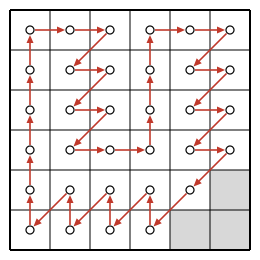

## Statement

Soit $n \geqslant 2$ un entier. Clara dispose d'un plateau de $3n \times 3n$ cases, comme un
échiquier. Elle a inventé une nouvelle pièce, le **léopard**, qui se déplace d'une case à chaque
fois, de l'une des trois façons suivantes :

- d'une case vers le haut ;
- d'une case vers la droite ;
- d'une case en diagonale, vers le bas et la gauche.

Clara pose son léopard sur une case du plateau, puis le déplace, sans jamais le faire passer deux
fois par la même case, jusqu'à ce qu'il revienne sur sa case de départ.

Quel est le plus grand nombre de déplacements que Clara a pu effectuer ?

## Hints

1. Repère chaque case par sa colonne $x$ (de gauche à droite) et sa ligne $y$ (de bas en haut), et
   colorie-la avec la couleur $x + y$ modulo $3$. Comment la couleur change-t-elle à chaque
   déplacement ? Qu'en déduis-tu sur le nombre de déplacements ?
2. Le nombre de déplacements est donc un multiple de $3$, au plus égal à $9n^2$. Il reste à voir si
   le léopard peut passer par toutes les cases. Regarde la case du coin en bas à droite : par où
   le léopard peut-il y entrer, et par où peut-il en sortir ? Même question pour le coin en haut
   à gauche.
3. Trace le trajet en reliant les centres des cases. Il forme une ligne fermée qui ne se recoupe
   pas. D'après chacun des deux coins, dans quel sens tourne-t-elle autour de son intérieur ?
4. Pour la construction, découpe le plateau en bandes verticales de trois colonnes, et garde les
   deux lignes du bas pour le chemin du retour.

## Solution

**Rappel (théorème de Jordan pour les polygones).** Une ligne polygonale fermée qui ne se recoupe
pas sépare le plan en deux régions : son **intérieur**, qui est borné, et son **extérieur**, qui
contient des points aussi loin que l'on veut. Quand on parcourt la ligne, l'intérieur reste
toujours du même côté : soit il est toujours à gauche, et on tourne dans le sens inverse des
aiguilles d'une montre, soit il est toujours à droite, et on tourne dans le sens des aiguilles
d'une montre. Ce résultat paraît évident sur un dessin, mais sa preuve complète dépasse le
programme du lycée ; on l'admet.

Repérons chaque case par le couple $(x, y)$, où $x$ est le numéro de sa colonne (de $1$ à $3n$, de
gauche à droite) et $y$ celui de sa ligne (de $1$ à $3n$, de bas en haut). Les trois déplacements
du léopard envoient $(x, y)$ sur
$$(x, y + 1), \qquad (x + 1, y), \qquad (x - 1, y - 1).$$

Comme le léopard ne passe jamais deux fois par la même case, le nombre de déplacements est égal
au nombre de cases visitées. Nous allons montrer que **le maximum est $9n^2 - 3$**.

### Étape 1 : un circuit de $9n^2 - 3$ déplacements

Découpons les colonnes en $n$ bandes de trois colonnes. La bande numéro $b$, pour
$b = 1, 2, \ldots, n$, est formée des colonnes $3b - 2$, $3b - 1$ et $3b$. Le léopard part de la
case $(1, 1)$ et traite les bandes l'une après l'autre. Dans la bande numéro $b$ :

- il monte la colonne $3b - 2$ jusqu'à la ligne du haut (depuis la ligne $1$ pour la première
  bande, depuis la ligne $3$ pour les suivantes) ;
- il fait deux pas vers la droite sur la ligne du haut, jusqu'à la case $(3b, 3n)$ ;
- il redescend en zigzag dans les colonnes $3b - 1$ et $3b$, en alternant un pas en diagonale et un
  pas vers la droite : $(3b, y) \to (3b - 1, y - 1) \to (3b, y - 1)$, de la ligne $3n$ jusqu'à la
  case $(3b, 3)$ ;
- si $b < n$, il fait un pas vers la droite et arrive en $(3b + 1, 3)$, au pied de la bande
  suivante.

Après la dernière bande, il est en $(3n, 3)$. Il fait alors deux pas en diagonale jusqu'à la case
$(3n - 2, 1)$, puis il revient vers la gauche sur les deux lignes du bas, en alternant un pas vers
le haut et un pas en diagonale :
$$(3n - 2, 1) \to (3n - 2, 2) \to (3n - 3, 1) \to (3n - 3, 2) \to \cdots \to (2, 1) \to (2, 2) \to (1, 1).$$
Il est revenu à son point de départ. Voici ce circuit pour $n = 2$ :

Vérifions que chaque case est visitée au plus une fois, et comptons-les.

- Dans les lignes $3$ à $3n$ : chaque colonne $3b - 2$ est montée une fois ; dans les colonnes
  $3b - 1$ et $3b$, la ligne du haut est visitée par les deux pas vers la droite, et les lignes $3$
  à $3n - 1$ par le zigzag. Toutes ces cases sont visitées, une seule fois.
- Dans les lignes $1$ et $2$ : la colonne $1$ est visitée par la première montée, les colonnes $2$ à
  $3n - 2$ par le chemin du retour, et la case $(3n - 1, 2)$ par le premier pas en diagonale.

Seules les trois cases $(3n - 1, 1)$, $(3n, 1)$ et $(3n, 2)$ ne sont pas visitées. Ce circuit compte
donc $9n^2 - 3$ cases, et autant de déplacements.

### Étape 2 : le nombre de déplacements est un multiple de $3$

Colorions la case $(x, y)$ avec la couleur $x + y$ modulo $3$, donc avec trois couleurs $0$, $1$ et
$2$. Un pas vers le haut ou vers la droite augmente $x + y$ de $1$ ; un pas en diagonale le diminue
de $2$, ce qui revient aussi à l'augmenter de $1$ modulo $3$. Après $k$ déplacements, la couleur a
donc augmenté de $k$ modulo $3$. Comme le léopard revient sur sa case de départ, $k$ est un
multiple de $3$.

Comme $9n^2$ est un multiple de $3$, le multiple de $3$ qui précède est $9n^2 - 3$. Pour conclure, il
suffit donc de montrer que **le léopard ne peut pas visiter toutes les cases**.

### Étape 3 : les deux coins

Supposons, par l'absurde, que le léopard visite toutes les cases.

**Le coin en bas à droite, $(3n, 1)$.** Il ne peut pas en sortir vers la droite ni en diagonale
(il sortirait du plateau), donc il en sort vers le haut, vers $(3n, 2)$. Il ne peut pas y entrer par
le bas ni par une diagonale venant de $(3n + 1, 2)$, donc il y entre par la gauche, depuis
$(3n - 1, 1)$. Le trajet contient donc
$$(3n - 1, 1) \to (3n, 1) \to (3n, 2).$$

**Le coin en haut à gauche, $(1, 3n)$.** Il ne peut pas en sortir vers le haut ni en diagonale,
donc il en sort vers la droite, vers $(2, 3n)$. Il ne peut pas y entrer par la gauche ni par une
diagonale venant de $(2, 3n + 1)$, donc il y entre par le bas, depuis $(1, 3n - 1)$. Le trajet
contient donc
$$(1, 3n - 1) \to (1, 3n) \to (2, 3n).$$

### Étape 4 : le trajet tourne dans les deux sens à la fois

Relions les centres des cases dans l'ordre du trajet. On obtient une ligne polygonale fermée,
formée de segments horizontaux ou verticaux de longueur $1$ et de segments diagonaux allant de
$(x, y)$ à $(x - 1, y - 1)$.

**Cette ligne ne se recoupe pas.** Un segment diagonal ne contient aucun point ayant une coordonnée
entière, à part ses extrémités ; or les segments horizontaux et verticaux sont sur des droites
d'équation $x = k$ ou $y = k$, avec $k$ entier. Un segment diagonal et un segment horizontal ou vertical ne peuvent
donc se toucher qu'en une extrémité commune. Deux segments distincts horizontaux ou verticaux de longueur
$1$ entre centres de cases, et deux segments diagonaux distincts de même longueur, ne peuvent aussi se
toucher qu'en une extrémité commune. Enfin une extrémité commune est une case, visitée une seule
fois, donc les deux segments sont consécutifs sur le trajet.

On peut donc appliquer le rappel. Toute la ligne est dans le carré $K$ dont les sommets sont les
centres des quatre cases des coins. La région située hors de $K$ ne rencontre pas la ligne et
contient des points aussi loin que l'on veut : elle est dans l'extérieur.

- **En bas à droite**, le léopard parcourt le segment de $(3n - 1, 1)$ à $(3n, 1)$ vers la droite,
  sur le côté du bas de $K$. Juste à sa droite, c'est-à-dire juste en dessous, on est hors de $K$,
  donc dans l'extérieur. L'intérieur est donc à sa gauche : **le trajet tourne dans le sens inverse
  des aiguilles d'une montre.**
- **En haut à gauche**, il parcourt le segment de $(1, 3n - 1)$ à $(1, 3n)$ vers le haut, sur le côté
  gauche de $K$. Juste à sa gauche, on est hors de $K$, donc dans l'extérieur. L'intérieur est donc à
  sa droite : **le trajet tourne dans le sens des aiguilles d'une montre.**

C'est impossible, d'après le rappel. Le léopard ne peut donc pas visiter toutes les cases.

### Conclusion

Le nombre de déplacements est un multiple de $3$ strictement inférieur à $9n^2$, donc au plus
$9n^2 - 3$, et l'étape 1 montre que cette valeur est atteinte. **Le plus grand nombre de
déplacements possible est $9n^2 - 3$.**

## Going further

1. L'étape 4 montre en fait plus : aucun circuit du léopard, même court, ne passe à la fois par les
   deux coins $(3n, 1)$ et $(1, 3n)$. Le circuit de l'étape 1 passe par le coin en haut à gauche.
   Trouver une transformation du plateau qui échange ces deux coins et qui transforme tout
   déplacement du léopard en un déplacement du léopard. En déduire un circuit de $9n^2 - 3$
   déplacements qui passe par le coin en bas à droite.
2. Que donne la construction de l'étape 1 pour $n = 1$, sur un plateau de $3 \times 3$ cases ?
