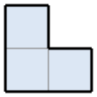
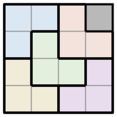

## Statement

On appelle **tromino en L** la pièce formée de trois cases en forme de coin :

Soit $n$ un entier naturel. On prend un carré quadrillé de $2^n \times 2^n$ cases et on en retire **une case, n'importe laquelle**.

Démontrer qu'on peut toujours recouvrir entièrement la figure restante avec des trominos en L, sans chevauchement et sans débordement. Les pièces peuvent être tournées dans les quatre sens.

Voici par exemple une solution pour $n = 2$, la case retirée étant celle en haut à droite :

## Hints

1. Vérifiez d'abord que le compte des cases est possible : combien de cases reste-t-il, et est-ce un multiple de $3$ ?
2. Traitez le cas $n = 1$ à la main : un carré $2 \times 2$ privé d'une case, c'est déjà un tromino en L.
3. Pour passer de $n$ à $n+1$, coupez le carré $2^{n+1} \times 2^{n+1}$ en quatre quarts de taille $2^n \times 2^n$. Dans quel quart se trouve la case retirée ?
4. Les trois autres quarts sont complets, et vous ne savez traiter que des quarts privés d'une case. Posez un seul tromino bien placé au centre pour « percer » ces trois quarts d'un coup.

## Solution

Notons $P(n)$ la propriété : « pour tout carré $2^n \times 2^n$ et toute case retirée, la figure restante se recouvre par des trominos en L ».

**Le compte des cases.** Le carré a $2^n \times 2^n = 4^n$ cases, donc il en reste $4^n - 1$. Comme $4 \equiv 1 \pmod 3$, on a $4^n \equiv 1 \pmod 3$, donc $4^n - 1$ est bien divisible par $3$. Le recouvrement utilisera $\dfrac{4^n-1}{3}$ trominos. Ce calcul ne prouve rien, mais il montre qu'aucun obstacle évident ne s'oppose au recouvrement.

**Initialisation ($n = 1$).** Le carré $2 \times 2$ a quatre cases ; on en retire une, il en reste trois qui forment exactement un tromino en L. Donc $P(1)$ est vraie.

(Pour $n = 0$ la propriété est vraie aussi, de façon vide : le carré $1 \times 1$ privé de sa seule case ne contient plus rien à recouvrir.)

**Hérédité.** Supposons $P(n)$ vraie pour un entier $n \geqslant 1$. Prenons un carré $C$ de taille $2^{n+1} \times 2^{n+1}$ et retirons-en une case quelconque.

Coupons $C$ en quatre quarts égaux, chacun de taille $2^n \times 2^n$. La case retirée se trouve dans l'un de ces quarts ; appelons-le $Q_1$, et $Q_2$, $Q_3$, $Q_4$ les trois autres.

Les quatre quarts se rejoignent au centre de $C$. Chaque quart possède donc une case « de coin central », celle qui touche le centre. Posons **un** tromino en L sur les trois cases de coin central de $Q_2$, $Q_3$ et $Q_4$. Ces trois cases forment bien un coin, donc c'est un placement légal.

Regardons maintenant la situation quart par quart :

- $Q_1$ est un carré $2^n \times 2^n$ privé d'une case : celle qu'on avait retirée ;
- $Q_2$, $Q_3$ et $Q_4$ sont chacun un carré $2^n \times 2^n$ privé d'une case : celle que le tromino central vient de recouvrir.

Dans les quatre cas, on a un carré $2^n \times 2^n$ privé d'une seule case. Par hypothèse de récurrence, chacun de ces quatre morceaux se recouvre par des trominos en L. En réunissant ces quatre recouvrements et le tromino central, on obtient un recouvrement de $C$ privé de sa case, sans chevauchement puisque les quatre quarts sont disjoints.

Donc $P(n+1)$ est vraie.

**Conclusion.** Par récurrence, $P(n)$ est vraie pour tout $n \geqslant 1$ : un carré $2^n \times 2^n$ privé de n'importe quelle case se recouvre toujours par des trominos en L.

## Going further

La démonstration est **constructive** : elle ne dit pas seulement que le pavage existe, elle explique comment le fabriquer. Elle donne même un algorithme, celui que l'on appelle « diviser pour régner » : pour paver un carré de côté $2^{n+1}$, on pose un tromino puis on relance le même procédé sur quatre carrés deux fois plus petits. Le nombre de trominos posés est $\dfrac{4^{n}-1}{3}$ pour le côté $2^n$, soit $1$, $5$, $21$, $85$, $341$, ...
