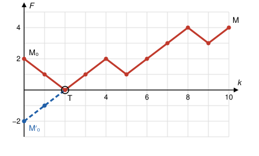

## Statement

On dispose d'une pièce : la probabilité d'obtenir Pile est $p$, avec $0 < p < 1$, et on pose
$q = 1 - p$. Un joueur lance la pièce $n$ fois de suite ($n \geq 1$), les lancers étant
indépendants. À chaque Pile il gagne $1$ euro, à chaque Face il perd $1$ euro. Sa fortune initiale
est $f_0$ euros ($f_0$ entier relatif, une dette comptant comme une fortune négative). On note
$F_0 = f_0$ et $F_k$ sa fortune après le $k$-ième lancer.

**Trajectoires.** Pour des entiers $c$ et $d$, on appelle *trajectoire de $(0, c)$ à $(n, d)$*
une ligne brisée dont les sommets sont des points $(k, y_k)$ pour $0 \leq k \leq n$, avec
$y_0 = c$, $y_n = d$, et $y_{k+1} - y_k = \pm 1$ pour chaque $k$. Une partie du jeu donne ainsi la
trajectoire de sommets $(k, F_k)$, qui part de $M_0(0, f_0)$.

**Ce qu'on admet.** Une trajectoire est déterminée par la liste de ses montées (les Pile). Pour
aller de la hauteur $c$ à la hauteur $d$ en $n$ pas, il faut exactement $j = \frac{n + d - c}{2}$
montées. Le nombre de trajectoires de $(0, c)$ à $(n, d)$ est donc $\binom{n}{j}$ si $j$ est un
entier compris entre $0$ et $n$, et $0$ sinon. On convient que $\binom{n}{j} = 0$ quand $j > n$.
Enfin, chaque partie qui comporte $j$ Pile et $n - j$ Face a la probabilité $p^j q^{n-j}$.

Dans les questions 1 à 3, on se donne un entier $b > 0$ tel qu'il existe une trajectoire de $M_0$
à $M(n, b)$, et on pose $j = \frac{n + b - f_0}{2}$ : c'est un entier entre $0$ et $n$.

1. On suppose $f_0 > 0$. On note $M_0'(0, -f_0)$ le symétrique de $M_0$ par rapport à l'axe des
   abscisses. Montrer qu'il y a autant de trajectoires de $M_0$ à $M(n, b)$ qui ont au moins un
   sommet sur l'axe des abscisses que de trajectoires de $M_0'$ à $M(n, b)$.

2. On suppose encore $f_0 > 0$.

   a) En déduire la probabilité de l'événement « la fortune finale est $b$, et la fortune reste
      strictement positive pendant toute la partie », c'est-à-dire $F_n = b$ et $F_k > 0$ pour
      tout $k$.

   b) En déduire la probabilité que la fortune reste strictement positive pendant toute la partie,
      sachant que $F_n = b$.

   c) Que signifie, pour le joueur, une telle trajectoire ?

3. On suppose maintenant seulement $f_0 \geq 0$. Quelle est la probabilité que $F_n = b$ et que
   $F_k \geq 0$ pour tout $k$ ? À quelle situation du joueur cela correspond-il ?

4. Dans cette question, la pièce est équilibrée ($p = q = \frac{1}{2}$), $f_0 = 0$, et le joueur
   lance la pièce $2n$ fois.

   a) Soit $k$ un entier avec $1 \leq k \leq 2n$. Montrer que si une trajectoire partant de
      $(0, 0)$ passe par le point $(k, 0)$, alors $k$ est pair.

   b) Calculer $p_{2n} = P(F_{2n} = 0)$.

   c) On note $N_{2n}$ le nombre de trajectoires de $(0, 0)$ à $(2n, 0)$ dont tous les sommets
      intermédiaires sont strictement au-dessus de l'axe : $F_i > 0$ pour $1 \leq i \leq 2n - 1$.
      Montrer que
      $$N_{2n} = \binom{2n-2}{n-1} - \binom{2n-2}{n} .$$

## Hints

1. **Question 1.** Partir d'une trajectoire de $M_0$ à $M(n, b)$ qui touche l'axe, et repérer le
   **premier** sommet $T$ situé sur l'axe. Que se passe-t-il si l'on remplace la partie de la
   trajectoire avant $T$ par sa symétrique par rapport à l'axe ?
2. **Question 1.** Dans l'autre sens : pourquoi une trajectoire de $M_0'$ à $M(n, b)$ a-t-elle
   forcément un sommet sur l'axe ? Vérifier que les deux transformations se défont l'une l'autre.
3. **Question 2 a).** Compter les trajectoires de $M_0$ à $M(n, b)$ qui ne touchent jamais l'axe,
   en retirant de toutes les trajectoires celles qui le touchent. Toutes ont le même nombre de
   Pile, donc la même probabilité.
4. **Question 3.** Monter tout d'un cran : une trajectoire reste $\geq 0$ exactement quand la
   trajectoire décalée de $1$ vers le haut reste $> 0$.
5. **Question 4 a).** Comparer la parité de $F_k$ et celle de $k$.
6. **Question 4 c).** Si tous les sommets intermédiaires sont au-dessus de l'axe, que valent
   forcément $F_1$ et $F_{2n-1}$ ?
7. **Question 4 c).** Entre les abscisses $1$ et $2n - 1$, il reste une trajectoire de $2n - 2$
   pas, de la hauteur $1$ à la hauteur $1$, qui ne touche jamais l'axe : appliquer la question 2.

## Solution

**1.** Appelons $\mathcal{A}$ l'ensemble des trajectoires de $M_0$ à $M(n, b)$ qui ont au moins
un sommet sur l'axe, et $\mathcal{B}$ l'ensemble des trajectoires de $M_0'$ à $M(n, b)$.

*De $\mathcal{A}$ vers $\mathcal{B}$.* Soit une trajectoire de $\mathcal{A}$, de sommets
$(k, y_k)$, et soit $i$ le plus petit indice tel que $y_i = 0$. On a $i \geq 1$ car $y_0 = f_0 > 0$.
On remplace les sommets d'indice $k \leq i$ par leurs symétriques $(k, -y_k)$ et on garde les
autres. Les pas avant $i$ changent de signe et restent égaux à $\pm 1$ ; au point $T(i, 0)$ les deux
morceaux se raccordent, puisque $-y_i = 0 = y_i$. On obtient une trajectoire de $(0, -f_0) = M_0'$
à $M(n, b)$, qui est dans $\mathcal{B}$.

*De $\mathcal{B}$ vers $\mathcal{A}$.* Une trajectoire de $\mathcal{B}$ part de la hauteur
$-f_0 < 0$ et arrive à la hauteur $b > 0$, par pas de $\pm 1$ entre des hauteurs entières. Elle
passe donc par toutes les hauteurs entières intermédiaires, en particulier par $0$ : elle a au
moins un sommet sur l'axe. Soit $i$ le premier indice où elle est à la hauteur $0$. On réfléchit de
même la partie avant $i$, et on obtient une trajectoire de $M_0$ à $M(n, b)$ qui touche l'axe : elle
est dans $\mathcal{A}$.

*Ces deux transformations se défont l'une l'autre.* La réflexion ne change pas les sommets
situés sur l'axe et envoie les sommets hors de l'axe hors de l'axe, donc le premier indice $i$ où la
hauteur vaut $0$ est le même avant et après. Réfléchir deux fois la partie avant $i$ redonne la
trajectoire de départ.

On a donc une correspondance un à un entre $\mathcal{A}$ et $\mathcal{B}$ : **ces deux ensembles
ont le même nombre d'éléments.**

**2. a)** Le nombre total de trajectoires de $M_0$ à $M(n, b)$ est $\binom{n}{j}$, avec
$j = \frac{n + b - f_0}{2}$.

Pour aller de $M_0'(0, -f_0)$ à $M(n, b)$, il faut $\frac{n + b + f_0}{2} = j + f_0$ montées, donc
il y a $\binom{n}{j + f_0}$ trajectoires de $M_0'$ à $M(n, b)$ (ce nombre est nul si $j + f_0 > n$).
D'après la question 1, c'est aussi le nombre de trajectoires de $M_0$ à $M(n, b)$ qui touchent
l'axe.

Une trajectoire qui part de $f_0 > 0$ et ne touche jamais l'axe reste strictement positive : pour
devenir négative, elle devrait passer par $0$, puisque ses pas valent $\pm 1$. Le nombre de
trajectoires de $M_0$ à $M(n, b)$ dont tous les sommets sont strictement positifs est donc
$$\binom{n}{j} - \binom{n}{j + f_0} .$$

Chacune de ces trajectoires comporte $j$ Pile et $n - j$ Face, donc a la probabilité
$p^j q^{n-j}$. La probabilité cherchée est
$$P(F_n = b \text{ et } F_k > 0 \text{ pour tout } k)
= \binom{n}{j} p^j q^{n-j} - \binom{n}{j + f_0} p^j q^{n-j}
\qquad \text{avec} \qquad j = \frac{n + b - f_0}{2} .$$

**b)** On a $P(F_n = b) = \binom{n}{j} p^j q^{n-j}$. En divisant, la probabilité conditionnelle
cherchée est
$$\frac{\binom{n}{j} - \binom{n}{j + f_0}}{\binom{n}{j}} = 1 - \frac{\binom{n}{j + f_0}}{\binom{n}{j}} .$$
Elle ne dépend pas de $p$ : une fois la fortune finale connue, toutes les trajectoires possibles
sont également probables.

**c)** Une trajectoire dont tous les sommets sont strictement positifs est une partie pendant
laquelle **le joueur a toujours au moins $1$ euro** : il n'est jamais à zéro, et jamais endetté.

**3.** Soit une trajectoire de $(0, f_0)$ à $(n, b)$. Ses sommets sont tous positifs ou nuls si et
seulement si, en la décalant de $1$ vers le haut, on obtient une trajectoire de $(0, f_0 + 1)$ à
$(n, b + 1)$ dont tous les sommets sont strictement positifs. Le décalage fait correspondre un à
un ces deux familles de trajectoires.

On applique la question 2 a) avec la fortune initiale $f_0 + 1 > 0$ et la fortune finale
$b + 1 > 0$. Le nombre de montées est inchangé :
$\frac{n + (b + 1) - (f_0 + 1)}{2} = j$. Le nombre de trajectoires cherché est donc
$$\binom{n}{j} - \binom{n}{j + f_0 + 1} ,$$
et
$$P(F_n = b \text{ et } F_k \geq 0 \text{ pour tout } k)
= \binom{n}{j} p^j q^{n-j} - \binom{n}{j + f_0 + 1} p^j q^{n-j} .$$
Cela correspond à une partie pendant laquelle **le joueur n'est jamais endetté** (il peut en
revanche se retrouver à zéro).

Par exemple, avec $f_0 = 0$ et $b = n$, on trouve $\binom{n}{n} - \binom{n}{n+1} = 1$ trajectoire :
il faut n'obtenir que des Pile.

**4. a)** À chaque lancer, la fortune change de $\pm 1$, donc change de parité. Partant de
$F_0 = 0$, qui est pair, $F_k$ a donc la même parité que $k$. Si la trajectoire passe par $(k, 0)$,
alors $F_k = 0$ est pair, donc **$k$ est pair**.

**b)** On a $F_{2n} = 0$ exactement quand on obtient autant de Pile que de Face, c'est-à-dire $n$
Pile. Chacune des $\binom{2n}{n}$ parties concernées a la probabilité
$\left(\frac{1}{2}\right)^n \left(\frac{1}{2}\right)^n = \frac{1}{4^n}$, donc
$$p_{2n} = \frac{1}{4^n}\binom{2n}{n} .$$
Par exemple $p_2 = \frac{1}{2}$, $p_4 = \frac{3}{8}$, $p_6 = \frac{5}{16}$.

**c)** Soit une trajectoire comptée par $N_{2n}$.

- Comme $F_1 > 0$ et $F_1 = \pm 1$, on a $F_1 = 1$ : le premier lancer est Pile.
- Comme $F_{2n - 1} > 0$, $F_{2n} = 0$ et $F_{2n} - F_{2n-1} = \pm 1$, on a $F_{2n-1} = 1$ : le
  dernier lancer est Face.

Pour $n = 1$, la seule trajectoire est Pile puis Face, donc $N_2 = 1$, et la formule donne bien
$\binom{0}{0} - \binom{0}{1} = 1 - 0 = 1$.

Pour $n \geq 2$, entre les abscisses $1$ et $2n - 1$, la trajectoire fait $2n - 2$ pas, va de la
hauteur $1$ à la hauteur $1$, et tous ses sommets sont strictement positifs. Inversement, toute
telle trajectoire, précédée d'une montée et suivie d'une descente, donne une trajectoire comptée
par $N_{2n}$. Donc $N_{2n}$ est le nombre de trajectoires de $(0, 1)$ à $(2n - 2, 1)$ dont tous les
sommets sont strictement positifs (on a décalé les abscisses de $1$, ce qui ne change rien).

On applique la question 2 a) avec $2n - 2$ pas, la hauteur de départ $1$ et la hauteur d'arrivée
$1$ : le nombre de montées est $j = \frac{(2n - 2) + 1 - 1}{2} = n - 1$, donc
$$N_{2n} = \binom{2n-2}{n-1} - \binom{2n-2}{n - 1 + 1} = \binom{2n-2}{n-1} - \binom{2n-2}{n} .$$

Par exemple $N_4 = \binom{2}{1} - \binom{2}{2} = 1$, $N_6 = \binom{4}{2} - \binom{4}{3} = 2$ et
$N_8 = \binom{6}{3} - \binom{6}{4} = 5$.

**Bilan.** En réfléchissant le début d'une trajectoire jusqu'à son premier passage sur l'axe, on
met en correspondance un à un les trajectoires qui touchent l'axe et celles qui partent du point
symétrique. Pour une fortune finale $b > 0$ donnée, on en déduit le nombre de parties qui finissent
à $b$ et où la fortune reste strictement positive, $\binom{n}{j} - \binom{n}{j + f_0}$ (quand
$f_0 > 0$), celui des parties qui finissent à $b$ et où elle reste positive ou nulle,
$\binom{n}{j} - \binom{n}{j + f_0 + 1}$ (quand $f_0 \geq 0$), et le nombre $N_{2n}$ de parties équilibrées de $2n$
lancers où la fortune ne revient à $0$ qu'à la fin.

## Going further

- Montrer que $N_{2n} = \frac{1}{n}\binom{2n-2}{n-1}$. Ce sont les *nombres de Catalan*
  $1, 1, 2, 5, 14, 42, \ldots$ ; l'exercice 2405 les obtient avec la même idée de réflexion, sur
  des chemins dans un quadrillage.
- Avec une pièce équilibrée et $f_0 = 0$, quelle est la probabilité que la fortune revienne à $0$
  pour la première fois exactement au lancer $2n$ ? (Penser aux trajectoires au-dessus de l'axe et
  à leurs symétriques au-dessous.)
- *Le problème du scrutin.* Lors d'une élection, A obtient $a$ voix et B en obtient $c$, avec
  $a > c$. On dépouille les bulletins un par un, dans un ordre au hasard. Montrer que la
  probabilité que A soit strictement en tête pendant tout le dépouillement vaut
  $\frac{a - c}{a + c}$.
