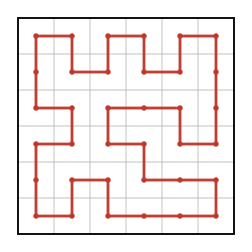
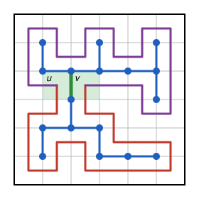

## Statement

Soit $n \geqslant 2$ un entier. Sur un échiquier de $n \times n$ cases, on trace un circuit qui passe
exactement une fois par chaque case et revient à sa case de départ. Deux cases qui se suivent sur
le circuit doivent avoir un côté commun.

Montrer qu'il existe deux cases voisines de l'échiquier (c'est-à-dire qui ont un côté commun)
telles que, si l'on « coupe » le circuit en ces deux cases, chacun des deux chemins obtenus ait une
longueur au moins égale au quart de la longueur du circuit.

*La longueur d'un chemin est le nombre de fois où il change de case. Ainsi le circuit a pour
longueur $n^2$, et quand on le coupe en deux cases, la somme des longueurs des deux chemins obtenus
vaut $n^2$.*

## Hints

1. Colorie l'échiquier en noir et blanc, comme d'habitude. Que peux-tu dire de $n$ ?
2. Trace le circuit en reliant les centres des cases. C'est une ligne fermée qui ne se recoupe pas.
   Marque les coins des cases qui sont à l'intérieur de cette ligne, et relie deux de ces coins
   quand ils sont les deux bouts d'un même côté de case. Que remarques-tu sur le dessin obtenu ?
3. Ce dessin est d'un seul tenant et il n'a aucune boucle. Autour de chaque coin marqué, les quatre
   centres de cases voisins forment un petit carré. Compte de deux façons les côtés de tous ces
   petits carrés, pour trouver le nombre de coins marqués.
4. Si on enlève un des segments du dessin, il se sépare en deux morceaux. Que deviennent alors les
   deux chemins obtenus en coupant le circuit dans les deux cases qui bordent ce segment ? Il
   reste à trouver un segment qui sépare le dessin en deux morceaux qui ne sont pas trop petits.

## Solution

Notons $C$ le circuit. Il change de case $n^2$ fois : sa longueur est $n^2$.

**Étape 0. L'entier $n$ est pair.** Colorions l'échiquier en noir et blanc, comme d'habitude. Deux
cases voisines sont de couleurs différentes, donc le circuit passe alternativement par une case
noire et par une case blanche. Comme il revient à sa case de départ, il fait un nombre pair de pas :
$n^2$ est pair, donc $n$ est pair. Écrivons $n = 2m$. Il faut trouver deux cases voisines telles que
les deux chemins obtenus aient une longueur au moins égale à $\frac{n^2}{4} = m^2$.

Si $n = 2$, le circuit fait le tour des quatre cases. Deux cases voisines quelconques se suivent
sur le circuit, et en les coupant on obtient deux chemins de longueurs $1$ et $3$, qui sont au moins
égales à $\frac{4}{4} = 1$. Dans la suite, on suppose donc $m \geqslant 2$.

### Le dessin bleu

**La ligne fermée.** Traçons $C$ en reliant les centres des cases qui se suivent. Chaque **pas** du
circuit est un segment qui relie les centres de deux cases voisines : il traverse leur côté commun
en son milieu, et il ne touche aucun autre côté de case. En particulier, $C$ ne passe par aucun
coin de case. Comme $C$ passe une seule fois par chaque case, c'est une ligne fermée qui ne se
recoupe pas : elle partage le plan en un **intérieur** et un **extérieur**, et chaque fois qu'on la
traverse, on change de côté. Nous admettons ce fait, qui est très intuitif.

**La règle des deux bouts.** Prenons un côté de case $[pp']$, commun à deux cases voisines $a$ et
$b$. D'après ce qui précède, le seul pas qui peut traverser $[pp']$ est le pas qui relie $a$ et
$b$. Donc :

- si le pas de $a$ à $b$ fait partie du circuit, les points $p$ et $p'$ sont de part et d'autre de
  $C$, l'un à l'intérieur et l'autre à l'extérieur ;
- sinon, $p$ et $p'$ sont du même côté de $C$.

**Les nœuds.** Le circuit reste à une distance au moins $\frac{1}{2}$ du bord de l'échiquier. Depuis
un coin situé sur le bord, on peut donc s'éloigner aussi loin qu'on veut sans traverser $C$ : les
coins du bord sont à l'extérieur de $C$. Appelons **nœuds** les autres
coins de cases. Notons $\mathcal{T}$ l'ensemble des nœuds qui sont à l'intérieur de $C$, et $N$
leur nombre. Quand deux nœuds de $\mathcal{T}$ sont les deux bouts d'un même côté de case, on trace
ce côté en bleu : c'est un **segment bleu**. Notons $A$ le nombre de segments bleus. D'après la
règle des deux bouts, le pas qui traverse un segment bleu ne fait jamais partie du circuit.

**Le petit carré d'un nœud.** Autour d'un nœud $t$, il y a quatre cases. Leurs centres forment un
carré de côté $1$, de centre $t$, que l'on note $Q(t)$. Chaque côté de $Q(t)$ est un pas possible
entre deux de ces quatre cases, et il traverse l'un des quatre côtés de case qui partent de $t$,
disons $[tt'']$. Si $t$ est dans $\mathcal{T}$, la règle des deux bouts donne :

- ou bien ce côté de $Q(t)$ fait partie du circuit, et $t''$ est à l'extérieur ;
- ou bien il n'en fait pas partie, et $t''$ est à l'intérieur, c'est donc un nœud de
  $\mathcal{T}$ et $[tt'']$ est un segment bleu.

Pour un nœud $t$ de $\mathcal{T}$, notons $c(t)$ le nombre de côtés de $Q(t)$ qui sont des pas du
circuit, et $s(t)$ le nombre de segments bleus qui partent de $t$. Nous venons de voir que
$$c(t) + s(t) = 4 .$$
Appelons (E) cette égalité.

Inversement, prenons un pas du circuit. Il traverse un côté de case $[pp']$, et d'après la règle des
deux bouts, un seul des deux points $p$ et $p'$ est à l'intérieur : c'est un nœud $t$ de
$\mathcal{T}$, et notre pas est un côté de $Q(t)$. Chaque pas du circuit est donc un côté de $Q(t)$
pour **exactement un** nœud $t$ de $\mathcal{T}$. On dira que ce pas **appartient** à $t$.

### Trois propriétés du dessin bleu

**Propriété 1. Autour d'une case.** Prenons une case $w$. Le circuit traverse exactement deux des
quatre côtés de $w$ : celui par lequel il entre dans $w$ et celui par lequel il en sort. Faisons le
tour du bord de $w$ en passant par ses quatre coins : d'après la règle des deux bouts, on change de
côté de $C$ exactement en traversant ces deux côtés. Les coins de $w$ qui sont à l'intérieur se
suivent donc sur le tour de $w$, et ils sont reliés entre eux par des côtés de $w$ qui sont des
segments bleus. Le pas qui entre dans $w$ appartient au bout intérieur du côté qu'il traverse, qui
est l'un de ces coins, et de même pour le pas qui sort de $w$. Donc :

*les deux pas du circuit qui passent par le centre d'une case $w$ appartiennent à deux nœuds qui
sont reliés par des segments bleus, tous situés sur le bord de $w$* (les deux nœuds peuvent être le
même).

**Propriété 2. Le dessin bleu n'a pas de boucle.** Supposons qu'il existe des nœuds distincts
$t_1, t_2, \ldots, t_k$ de $\mathcal{T}$, avec $k \geqslant 3$, tels que $[t_1t_2]$, $[t_2t_3]$,
…, $[t_kt_1]$ soient des segments bleus. Ils forment un polygone tracé sur les lignes de
l'échiquier, qui entoure au moins une case, donc le centre d'au moins une case. Le circuit passe par
ce centre, et il passe aussi par les cases du bord de l'échiquier, qui sont en dehors du polygone
(le polygone n'utilise que des nœuds, qui ne sont pas sur le bord). Le circuit doit donc traverser
le polygone, c'est-à-dire traverser l'un des segments bleus $[t_it_{i+1}]$. Or aucun pas du circuit
ne traverse un segment bleu. C'est impossible.

**Propriété 3. Le dessin bleu est d'un seul tenant :** deux nœuds quelconques de $\mathcal{T}$ sont
reliés par une suite de segments bleus.

- *Les nœuds qui possèdent un pas.* Parcourons le circuit. Deux pas qui se suivent passent par le
  centre d'une même case, donc d'après la propriété 1 ils appartiennent à deux nœuds reliés par des
  segments bleus. De proche en proche, tous les nœuds qui possèdent au moins un pas sont reliés
  entre eux.
- *Un nœud quelconque.* Partons d'un nœud $t$ de $\mathcal{T}$, et avançons vers la droite le long
  de la ligne de l'échiquier qui passe par $t$. Le coin du bord droit est à l'extérieur. Soit $t^*$
  le dernier coin intérieur rencontré avant le premier coin extérieur. Les coins de $t$ à $t^*$
  sont des nœuds intérieurs qui se suivent, reliés par des segments bleus. Le côté de case qui va de
  $t^*$ au coin suivant (extérieur) est traversé par un pas du circuit, d'après la règle des deux
  bouts, et ce pas appartient à $t^*$. Donc $t$ est relié à un nœud qui possède un pas.

Un dessin d'un seul tenant et sans boucle s'appelle un **arbre**.

### Compter les nœuds

**Un arbre de $N$ points a $N - 1$ segments.** Si $N \geqslant 2$, partons d'un point et marchons le
long des segments, sans jamais reprendre aussitôt le segment par lequel on vient d'arriver. On ne
repasse jamais par un même point, sinon on aurait fait une boucle. La marche s'arrête donc, en un
point d'où ne part qu'un seul segment : une **feuille**. Enlevons cette feuille et son segment. Ce
qui reste est encore d'un seul tenant (une suite de segments entre deux autres points ne passe
jamais par une feuille) et sans boucle. On recommence jusqu'à ce qu'il reste un seul point et aucun
segment. On a enlevé autant de points que de segments, donc il y avait $N - 1$ segments.

**Le double comptage.** Additionnons les égalités (E) pour tous les nœuds de $\mathcal{T}$. Chaque
pas du circuit est compté une fois, car il appartient à un seul nœud. Chaque segment bleu est compté
deux fois, une fois pour chacun de ses bouts. On obtient
$$n^2 + 2A = 4N, \qquad \text{avec } A = N - 1,$$
donc $2N = n^2 - 2$, c'est-à-dire
$$N = 2m^2 - 1 .$$
Comme $m \geqslant 2$, on a $N \geqslant 7$.

### Couper un segment bleu

Prenons un segment bleu $e = [tt']$. C'est le côté commun de deux cases voisines $u$ et $v$, et le
pas de $u$ à $v$ ne fait pas partie du circuit.

**Enlever $e$ coupe l'arbre en deux.** Enlevons le segment $e$. Les points $t$ et $t'$ ne sont plus
reliés : sinon, avec $e$, on aurait une boucle. Et tout nœud $x$ de $\mathcal{T}$ reste relié à $t$
ou à $t'$ : avant d'enlever $e$, il existait une suite de segments de $x$ à $t$, et si elle passait
par $e$, sa partie située avant $e$ relie $x$ à $t$ ou à $t'$. On obtient donc deux morceaux,
$\mathcal{T}_1$ qui contient $t$ et $\mathcal{T}_2$ qui contient $t'$, avec $N_1$ et $N_2$ nœuds,
$N_1 + N_2 = N$. Chacun est un arbre, donc $\mathcal{T}_1$ contient $N_1 - 1$ segments bleus et
$\mathcal{T}_2$ en contient $N_2 - 1$.

**Combien de pas appartiennent à chaque morceau.** Notons $P_1$ le nombre de pas qui appartiennent
à un nœud de $\mathcal{T}_1$. Additionnons les égalités (E) pour les nœuds de $\mathcal{T}_1$
seulement. La somme des $c(t)$ vaut $P_1$. Les segments bleus qui partent d'un nœud de
$\mathcal{T}_1$ sont les $N_1 - 1$ segments de $\mathcal{T}_1$, comptés deux fois, et le segment
$e$, compté une fois (un autre segment bleu entre les deux morceaux les relierait encore). Donc
$$P_1 + 2(N_1 - 1) + 1 = 4N_1 ,$$
et il y a exactement $P_1 = 2N_1 + 1$ pas qui appartiennent à $\mathcal{T}_1$. De même, il y a
$2N_2 + 1$ pas qui appartiennent à $\mathcal{T}_2$.

**Les deux chemins.** Coupons le circuit dans les cases $u$ et $v$ : on obtient deux chemins de $u$
à $v$. Dans l'un de ces chemins, deux pas qui se suivent passent par le centre d'une case $w$
différente de $u$ et de $v$. D'après la propriété 1, ils appartiennent à deux nœuds reliés par des
segments bleus du bord de $w$. Le segment $e$ n'est pas sur le bord de $w$, car un côté de case ne
borde que deux cases, $u$ et $v$. Ces deux nœuds sont donc dans le même morceau. Par conséquent,
tous les pas d'un même chemin appartiennent au même morceau. Comme chaque morceau possède au moins
un pas, l'un des chemins est formé des $2N_1 + 1$ pas de $\mathcal{T}_1$, et l'autre des $2N_2 + 1$
pas de $\mathcal{T}_2$.

**Bilan : en coupant le circuit dans les deux cases qui bordent un segment bleu, on obtient deux
chemins de longueurs $2N_1 + 1$ et $2N_2 + 1$.**

Sur la figure, en enlevant le segment vert, on obtient le morceau du haut, avec $9$ nœuds, et le
morceau du bas, avec $8$ nœuds. Le chemin violet, qui fait le tour du morceau du haut, a pour
longueur $2 \times 9 + 1 = 19$, et le chemin rouge a pour longueur $2 \times 8 + 1 = 17$.

### Un segment bleu qui coupe bien

**Lemme.** Soit un arbre de $N \geqslant 2$ points, dont chaque point est le bout d'au plus $4$
segments. Posons $q = \frac{N - 1}{4}$. Il existe un segment tel que, si on l'enlève, chacun des
deux morceaux obtenus ait au moins $q$ points.

*Preuve.* Pour un segment $[xy]$, appelons **branche de $y$ vue de $x$** le morceau qui contient $y$
quand on enlève $[xy]$.

- *Il existe une branche d'au moins $q$ points.* Prenons un point $x$. Si on l'enlève avec ses
  segments, les autres points se répartissent dans les branches $B_1, \ldots, B_k$ vues de $x$, avec
  $k \leqslant 4$, et ces branches contiennent en tout $N - 1$ points. Si toutes avaient moins de
  $q$ points, elles en contiendraient en tout moins de $4q = N - 1$. Donc l'une d'elles a au moins
  $q$ points.
- *On prend la plus petite.* Parmi toutes les branches qui ont au moins $q$ points, choisissons-en
  une, la branche de $y$ vue de $x$, avec le plus petit nombre $b$ de points. Si on enlève $[xy]$,
  les deux morceaux sont cette branche, qui a $b \geqslant q$ points, et l'autre morceau, qui a
  $N - b$ points. Si $N - b \geqslant q$, le segment $[xy]$ convient.
- *Sinon, on aboutit à une contradiction.* Supposons $N - b < q$, c'est-à-dire
  $b > N - q = 3q + 1$. Les autres segments qui partent de $y$ sont au plus $3$, vers des points
  $z_1, \ldots, z_j$. La branche de $y$ vue de $x$ est formée de $y$ et des branches de
  $z_1, \ldots, z_j$ vues de $y$. Ces $j \leqslant 3$ branches contiennent en tout
  $b - 1 > 3q$ points, donc l'une d'elles a plus de $q$ points. Elle a aussi moins de points que la
  branche de $y$ vue de $x$, puisqu'elle est contenue dedans sans contenir $y$. Cela contredit le
  choix de la plus petite. $\square$

### Conclusion

L'arbre $\mathcal{T}$ a $N = 2m^2 - 1 \geqslant 2$ points, et chaque nœud est le bout d'au plus
$4$ segments. Ici $q = \frac{N - 1}{4} = \frac{m^2 - 1}{2}$. D'après le lemme, il existe un segment
bleu dont le retrait laisse deux morceaux de $N_1 \geqslant \frac{m^2 - 1}{2}$ et
$N_2 \geqslant \frac{m^2 - 1}{2}$ nœuds. En coupant le circuit dans les deux cases $u$ et $v$ qui
bordent ce segment, on obtient deux chemins de longueurs
$$2N_1 + 1 \geqslant (m^2 - 1) + 1 = m^2 \qquad \text{et} \qquad 2N_2 + 1 \geqslant m^2 .$$

**Conclusion : les cases $u$ et $v$ sont voisines, et les deux chemins obtenus en y coupant le
circuit ont chacun une longueur au moins égale à $m^2 = \frac{n^2}{4}$, le quart de la longueur du
circuit.**

## Going further

- Les cases $u$ et $v$ trouvées ne se suivent jamais sur le circuit, puisque le pas de $u$ à $v$
  traverse un segment bleu. Si l'on coupait le circuit en deux cases qui se suivent, l'un des deux
  chemins aurait pour longueur $1$.
- Le double comptage montre aussi, sans coloriage, pourquoi $n$ est pair : il donne
  $n^2 = 2N + 2$, qui est un nombre pair.
