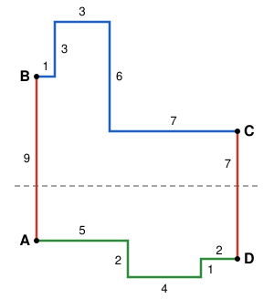

## Statement

Soient $n \geqslant 2$ un entier, et $a_1, \ldots, a_n$, $b_1, \ldots, b_n$ des réels strictement
positifs. Les $a_i$ sont deux à deux distincts, et les $b_i$ aussi. On suppose qu'on peut séparer
les $a_i$ en deux groupes qui ont la même somme, et qu'on peut faire de même avec les $b_i$.

Montrer qu'il existe un polygone simple à $2n$ côtés, qui a exactement $n$ côtés horizontaux et
$n$ côtés verticaux, dont les côtés horizontaux ont pour longueurs $a_1, \ldots, a_n$ et les côtés
verticaux $b_1, \ldots, b_n$.

*Un polygone est **simple** si ses côtés ne se coupent pas, sauf deux côtés consécutifs, qui se
touchent seulement en leur extrémité commune.*

## Hints

1. Fais le tour du polygone dans le sens des aiguilles d'une montre. Les côtés horizontaux vont vers
   la droite ou vers la gauche, les côtés verticaux vers le haut ou vers le bas. Comment répartir
   les longueurs entre ces quatre directions ?
2. Essaie de prendre comme côté le plus à gauche le plus grand des côtés qui montent, et comme côté
   le plus à droite le plus grand des côtés qui descendent. Il reste à relier leurs extrémités du
   haut par un chemin « du haut », et leurs extrémités du bas par un chemin « du bas ».
3. Pour que ces deux chemins ne se coupent pas, il suffit que celui du haut reste au-dessus d'une
   ligne horizontale et celui du bas en dessous. Un chemin qui monte d'abord, puis descend, ne passe
   jamais plus bas que la plus basse de ses deux extrémités.
4. Tout revient à bien choisir les côtés verticaux du chemin du haut. Pars des plus petits, et
   remplace-les un par un par les plus grands : la somme change par petits sauts.

## Solution

**Les quatre directions.** Séparons les $a_i$ en deux groupes de même somme $S$ : le groupe
$\mathcal{R}$ (ce seront les côtés parcourus vers la droite) et le groupe $\mathcal{L}$ (vers la
gauche). Notons $\ell$ le nombre d'éléments de $\mathcal{R}$. Les $a_i$ sont positifs, donc un groupe vide aurait
une somme nulle, plus petite que celle de l'autre : les deux groupes ne sont pas vides, et $1 \leqslant \ell \leqslant n - 1$.

Séparons de même les $b_i$ en deux groupes de même somme : le groupe des côtés qui **montent** et
celui des côtés qui **descendent**. Pour décrire un déplacement vertical, il est commode de compter
une montée positivement et une descente négativement. On forme donc la liste de nombres
$c_1, c_2, \ldots, c_n$ obtenue en prenant les longueurs des côtés qui montent, et les **opposées**
des longueurs des côtés qui descendent, puis en les rangeant dans l'ordre décroissant.

- Les $c_i$ sont deux à deux distincts : deux longueurs qui montent sont distinctes, deux longueurs
  qui descendent aussi, et un nombre positif n'est jamais égal à un nombre négatif. Donc
  $c_1 > c_2 > \cdots > c_n$.
- Leur somme est nulle, car les deux groupes de $b_i$ ont la même somme.
- $c_1 > 0$ est la plus grande longueur qui monte, et $c_n < 0$ est l'opposée de la plus grande
  longueur qui descend.

**Le plan.** Le polygone aura quatre morceaux, parcourus dans cet ordre :

- un côté vertical $[AB]$ qui monte de $c_1$ ;
- un **chemin du haut**, de $B$ à $C$, qui va vers la droite : il utilise les $\ell$ longueurs de
  $\mathcal{R}$, entre lesquelles on intercale $\ell - 1$ côtés verticaux ;
- un côté vertical $[CD]$ qui descend de $-c_n$ ;
- un **chemin du bas**, de $D$ à $A$, qui va vers la gauche : il utilise les $n - \ell$ longueurs de
  $\mathcal{L}$, entre lesquelles on intercale les $n - \ell - 1$ côtés verticaux restants.

On a bien $2 + (\ell - 1) + (n - \ell - 1) = n$ côtés verticaux. Il reste à choisir lesquels des
$c_2, \ldots, c_{n-1}$ vont dans le chemin du haut. C'est l'objet du lemme suivant.

### Le lemme

**Lemme.** Il existe un ensemble $I$ de $\ell - 1$ indices, pris parmi $2, 3, \ldots, n - 1$, tel que
$$-c_1 < \sum_{i \in I} c_i < -c_n .$$

*Preuve.* Commençons par deux remarques.

- **La somme des $\ell$ plus petits $c_i$ est strictement négative.** Notons $m$ la moyenne des
  $\ell$ plus petits, et $M$ la moyenne des $n - \ell$ autres. On a $m \leqslant c_{n-\ell+1}$ et
  $c_{n-\ell} \leqslant M$, avec $c_{n-\ell+1} < c_{n-\ell}$, donc $m < M$. Comme
  $\ell m + (n - \ell)M = 0$, on obtient $0 > \ell m + (n - \ell)m = nm$, donc $m < 0$.
- De la même façon, **la somme des $\ell$ plus grands $c_i$ est strictement positive.**

Pour $t = 0, 1, \ldots, \ell - 1$, notons $J_t$ l'ensemble formé des $t$ indices
$2, 3, \ldots, t + 1$ et des $\ell - 1 - t$ indices $n - \ell + 1 + t, \ldots, n - 1$. Ces deux
morceaux ne se chevauchent pas, car $t + 1 < n - \ell + 1 + t$ (puisque $\ell < n$). Chaque $J_t$
contient donc $\ell - 1$ indices pris parmi $2, \ldots, n - 1$. Notons $s_t$ la somme des $c_i$
pour $i \in J_t$.

- $J_0 = \{n - \ell + 1, \ldots, n - 1\}$, donc $s_0 + c_n$ est la somme des $\ell$ plus petits
  $c_i$ : elle est négative, et $s_0 < -c_n$.
- $J_{\ell - 1} = \{2, \ldots, \ell\}$, donc $s_{\ell-1} + c_1$ est la somme des $\ell$ plus grands
  $c_i$ : elle est positive, et $s_{\ell-1} > -c_1$.
- Pour passer de $J_t$ à $J_{t+1}$, on remplace l'indice $j = n - \ell + 1 + t$ par l'indice
  $i = t + 2$. La somme augmente de $c_i - c_j$, et comme $2 \leqslant i$ et $j \leqslant n - 1$,
  $$c_i - c_j \leqslant c_2 - c_{n-1} < c_1 - c_n .$$
  Chaque saut est donc strictement plus petit que $c_1 - c_n$, qui est la distance entre $-c_1$
  et $-c_n$.

Si $s_0 > -c_1$, l'ensemble $I = J_0$ convient, puisque $s_0 < -c_n$. Sinon, comme
$s_{\ell-1} > -c_1$, il existe un premier indice $t \geqslant 1$ tel que $s_t > -c_1$. Alors
$s_{t-1} \leqslant -c_1$, et
$$s_t = s_{t-1} + (\text{un saut}) < -c_1 + (c_1 - c_n) = -c_n .$$
L'ensemble $I = J_t$ convient. $\square$

### La construction

Fixons un tel ensemble $I$, et notons $K$ l'ensemble des indices de $2, \ldots, n - 1$ qui ne sont
pas dans $I$. Il en contient $n - \ell - 1$. Plaçons-nous dans un repère, et prenons $A = (0, 0)$.

- **Côté $[AB]$.** On monte de $c_1$ : $B = (0, c_1)$.
- **Chemin du haut.** De $B$, on alterne un pas vers la droite, d'une longueur de $\mathcal{R}$, et
  un pas vertical $c_i$ avec $i \in I$, en prenant les $c_i$ **dans l'ordre décroissant** : on fait
  d'abord les montées, puis les descentes. On commence et on finit par un pas vers la droite. On
  arrive en $C = (S, \; c_1 + \sum_{i \in I} c_i)$.
- **Côté $[CD]$.** On descend de $-c_n$ : $D = (S, \; c_1 + c_n + \sum_{i \in I} c_i)$.
- **Chemin du bas.** De $D$, on alterne un pas vers la gauche, d'une longueur de $\mathcal{L}$, et un
  pas vertical $c_i$ avec $i \in K$, cette fois **dans l'ordre croissant** : d'abord les descentes,
  puis les montées. On commence et on finit par un pas vers la gauche.

À la fin du chemin du bas, l'abscisse vaut $S - S = 0$ et l'ordonnée vaut
$c_1 + c_n + \sum_{i \in I} c_i + \sum_{i \in K} c_i = c_1 + c_2 + \cdots + c_n = 0$. On est revenu
en $A$ : la ligne se referme.

Elle est formée de $2n$ côtés, horizontaux et verticaux en alternance. Les côtés horizontaux ont
pour longueurs les éléments de $\mathcal{R}$ et de $\mathcal{L}$, c'est-à-dire $a_1, \ldots, a_n$.
Les côtés verticaux ont pour longueurs les $|c_i|$, c'est-à-dire $b_1, \ldots, b_n$. Comme deux
côtés consécutifs sont l'un horizontal et l'autre vertical, chaque sommet est un vrai coin, à angle
droit.

Voici le polygone obtenu pour $a = 1, 2, 3, 4, 5, 7$ et $b = 1, 2, 3, 6, 7, 9$, avec les groupes
$\{1, 3, 7\}$ et $\{2, 4, 5\}$ (de somme $11$) pour les $a_i$, et $\{2, 3, 9\}$ et $\{1, 6, 7\}$
(de somme $14$) pour les $b_i$. Ici $c = (9, 3, 2, -1, -6, -7)$ et $\ell = 3$. On a pris
$I = \{2, 5\}$, qui convient : la somme $c_2 + c_5 = 3 - 6 = -3$ est bien entre $-9$ et $7$.

### Le polygone est simple

**Les hauteurs.** Le chemin du haut monte d'abord, puis descend. Il ne passe donc jamais plus bas
que la plus basse de ses extrémités : tous ses points ont une ordonnée au moins égale à
$\min(y_B, y_C)$. De même, le chemin du bas descend d'abord puis remonte : tous ses points ont une
ordonnée au plus égale à $\max(y_D, y_A)$. Or, avec $\Sigma = \sum_{i \in I} c_i$ :

- $y_B = c_1 > 0 = y_A$ ;
- $y_C = c_1 + \Sigma > 0 = y_A$, d'après le lemme ;
- $y_D = y_C + c_n < y_C$, car $c_n < 0$ ;
- $y_D = c_1 + c_n + \Sigma < c_1 = y_B$, d'après le lemme.

Donc $\min(y_B, y_C) > \max(y_A, y_D)$ : **le chemin du haut est tout entier strictement au-dessus
du chemin du bas**, et une ligne horizontale les sépare. Ils ne se touchent pas.

**Les abscisses.** Le côté $[AB]$ est sur la droite $x = 0$, et le côté $[CD]$ sur la droite $x = S$.
Le chemin du haut avance toujours vers la droite ou verticalement : ses points autres que $B$ et
$C$ ont une abscisse strictement comprise entre $0$ et $S$. Il ne touche donc $[AB]$ qu'en $B$ et
$[CD]$ qu'en $C$, qui sont des extrémités communes de côtés consécutifs. Il en va de même pour le
chemin du bas, en $D$ et en $A$. Enfin $[AB]$ et $[CD]$ sont sur deux droites parallèles distinctes.

**Un même chemin ne se recoupe pas.** Dans le chemin du haut, notons $X_1 < X_2 < \cdots < X_\ell$
les abscisses atteintes après chaque pas vers la droite, avec $X_0 = 0$. Le $k$-ième côté horizontal
est dans la bande $X_{k-1} \leqslant x \leqslant X_k$, et le $k$-ième côté vertical sur la droite
$x = X_k$. Deux côtés horizontaux qui ne se suivent pas sont dans des bandes disjointes, et deux
côtés horizontaux séparés par un seul côté vertical sont à des hauteurs différentes. Deux côtés
verticaux sont sur des droites différentes. Un côté vertical ne touche que les deux côtés
horizontaux qui l'entourent, en ses extrémités. Le chemin du bas se traite de la même façon.

**Conclusion : le polygone construit est simple, il a $2n$ côtés, et ses côtés horizontaux et
verticaux ont exactement les longueurs demandées.**

## Going further

- **L'hypothèse « deux à deux distincts » est indispensable.** L'énoncé envoyé aux élèves l'avait
  oubliée, et il était faux. Pour $n = 4$, avec tous les $a_i$ et tous les $b_i$ égaux à $1$, les
  séparations en deux groupes de même somme existent, mais aucun octogone simple n'a huit côtés de
  longueur $1$, horizontaux et verticaux. En effet, dessiné sur du papier quadrillé à partir d'un
  nœud, un tel octogone entourerait des carreaux, avec un périmètre de $8$, et les seules figures de périmètre $8$ sont trois carreaux en
  ligne, trois carreaux en L et un carré de $2 \times 2$ carreaux, qui ont $4$ ou $6$ sommets.
- En relisant la preuve, on voit qu'elle n'utilise jamais le fait que les $a_i$ sont distincts :
  il suffit que les $b_i$ le soient.
