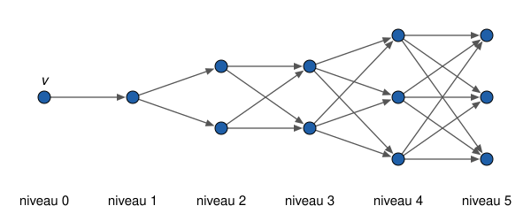

## Statement

Soit $G$ un graphe orienté qui a une infinité de sommets. Entre deux sommets $x$ et $y$, il y a au
plus une arête allant de $x$ vers $y$. Pour un sommet $s$, on appelle **degré entrant** de $s$ le
nombre d'arêtes qui arrivent en $s$, et **degré sortant** de $s$ le nombre d'arêtes qui partent de
$s$. On suppose que ces deux degrés sont finis pour chaque sommet, et que, pour chaque sommet $s$,
le degré entrant de $s$ est strictement plus petit que son degré sortant.

Soit $v$ un sommet de $G$. Pour tout entier $n \geqslant 1$, on note $V_n$ le nombre de sommets
que l'on peut atteindre à partir de $v$ en suivant au plus $n$ arêtes (dans leur sens), le sommet
$v$ compris.

Quelle est la plus petite valeur possible de $V_n$ ?

## Hints

1. Commence par de petites valeurs de $n$. Le sommet $v$ a un degré sortant au moins $1$, donc
   $V_1 \geqslant 2$. Construis un exemple qui grandit le plus lentement possible et calcule $V_2$,
   $V_3$, $V_4$.
2. Note $E_n$ l'ensemble des sommets que l'on atteint en au plus $n$ arêtes, et $F_n$ ceux de $E_n$
   que l'on n'atteint pas en $n - 1$ arêtes. Compte les arêtes qui partent de $E_n$, et compare
   avec celles qui arrivent dans $E_n$ : au moins $|E_n|$ arêtes sortent de $E_n$.
3. Une arête qui sort de $E_n$ va d'un sommet de $F_n$ vers un sommet de $F_{n+1}$. Déduis-en
   $|F_{n+1}| \times |F_n| \geqslant |E_n|$.
4. Exprime $|E_{n+2}|$ à l'aide de $|E_n|$ et de $|F_{n+1}|$, et utilise l'inégalité
   $x + \frac{c}{x} \geqslant 2\sqrt{c}$, vraie pour $x > 0$ et $c \geqslant 0$.
5. Pour l'exemple, range les sommets par niveaux de tailles $1, 1, 2, 2, 3, 3, \ldots$, et relie
   chaque sommet à tous les sommets du niveau suivant.

## Solution

Pour un ensemble fini $A$, on note $|A|$ son nombre d'éléments.

**Réponse : la plus petite valeur possible de $V_n$ est $(m + 1)^2$ si $n = 2m$ est pair, et
$(m + 1)(m + 2)$ si $n = 2m + 1$ est impair.** Dans les deux cas, c'est la partie entière de
$\frac{(n + 2)^2}{4}$.

### Notations

Pour tout entier $n \geqslant 0$, notons $E_n$ l'ensemble des sommets que l'on peut atteindre à
partir de $v$ en suivant au plus $n$ arêtes, de sorte que $V_n = |E_n|$. On a $E_0 = \{v\}$, et
$E_0 \subset E_1 \subset E_2 \subset \cdots$ Notons aussi $F_0 = E_0$ et, pour $n \geqslant 1$,
$F_n$ l'ensemble des sommets de $E_n$ qui ne sont pas dans $E_{n-1}$ : ce sont les sommets que l'on
atteint en $n$ arêtes, mais pas moins. Ainsi $|E_{n+1}| = |E_n| + |F_{n+1}|$. Comme tous les degrés
sont finis, chaque $E_n$ est un ensemble fini.

### Étape 1 : au moins $|E_n|$ arêtes sortent de $E_n$

Fixons $n \geqslant 0$. Parmi les arêtes qui partent d'un sommet de $E_n$, notons $p$ le nombre de
celles qui arrivent dans $E_n$, et $q$ le nombre de celles qui arrivent hors de $E_n$.

- La somme des degrés sortants des sommets de $E_n$ compte toutes les arêtes qui partent de $E_n$ :
  elle vaut $p + q$.
- La somme des degrés entrants des sommets de $E_n$ compte toutes les arêtes qui arrivent dans
  $E_n$, parmi lesquelles les $p$ arêtes qui en partent aussi : elle vaut au moins $p$.
- Pour chaque sommet, le degré sortant est au moins le degré entrant plus $1$, puisque ce sont des
  entiers et que l'inégalité est stricte.

En additionnant sur les $|E_n|$ sommets de $E_n$ :
$$p + q \geqslant p + |E_n| , \qquad \text{donc} \qquad q \geqslant |E_n| .$$

### Étape 2 : $|F_n| \times |F_{n+1}| \geqslant |E_n|$

Prenons une des $q$ arêtes précédentes, qui va d'un sommet $x$ de $E_n$ vers un sommet $y$ hors de
$E_n$.

- Le sommet $y$ est atteint en au plus $n + 1$ arêtes (on va jusqu'à $x$, puis on suit l'arête),
  mais il n'est pas dans $E_n$ : il est dans $F_{n+1}$.
- Le sommet $x$ est dans $F_n$. Sinon, il serait dans $E_{n-1}$, et $y$ serait dans $E_n$.

Ces $q$ arêtes vont donc toutes d'un sommet de $F_n$ vers un sommet de $F_{n+1}$. Comme il y a au
plus une arête d'un sommet donné vers un autre, il y en a au plus $|F_n| \times |F_{n+1}|$. Avec
l'étape 1 :
$$|F_n| \times |F_{n+1}| \geqslant |E_n| , \qquad \text{donc} \qquad |F_{n+1}| \geqslant \frac{|E_n|}{|F_n|} .$$

En particulier, avec $n = 0$, on obtient $|F_1| \geqslant 1$, donc $|E_1| \geqslant 2$.

### Étape 3 : $|E_{n+2}| \geqslant \left(\sqrt{|E_n|} + 1\right)^2$

Notons $e = |E_n|$ et $f = |F_{n+1}|$, de sorte que $|E_{n+1}| = e + f$. D'après l'étape 2 appliquée
à $n + 1$,
$$|F_{n+2}| \geqslant \frac{|E_{n+1}|}{|F_{n+1}|} = \frac{e + f}{f} = \frac{e}{f} + 1 .$$
Donc
$$|E_{n+2}| = |E_{n+1}| + |F_{n+2}| \geqslant e + f + \frac{e}{f} + 1 .$$

Or, pour tous réels $x > 0$ et $c \geqslant 0$, on a $x + \frac{c}{x} \geqslant 2\sqrt{c}$, car
$$x + \frac{c}{x} - 2\sqrt{c} = \left(\sqrt{x} - \frac{\sqrt{c}}{\sqrt{x}}\right)^2 \geqslant 0 .$$
Avec $x = f$ et $c = e$, on obtient
$$|E_{n+2}| \geqslant e + 2\sqrt{e} + 1 = \left(\sqrt{e} + 1\right)^2 .$$

### Étape 4 : la minoration

Montrons par récurrence sur $m \geqslant 0$ que
$$|E_{2m}| \geqslant (m + 1)^2 \qquad \text{et} \qquad |E_{2m+1}| \geqslant (m + 1)(m + 2) .$$

Pour $m = 0$ : $|E_0| = 1$ et $|E_1| \geqslant 2$.

Supposons ces deux inégalités vraies pour un certain $m$. D'après l'étape 3 :

- $|E_{2m+2}| \geqslant \left(\sqrt{(m + 1)^2} + 1\right)^2 = (m + 2)^2$ ;
- $|E_{2m+3}| \geqslant \left(\sqrt{(m + 1)(m + 2)} + 1\right)^2 = (m + 1)(m + 2) + 2\sqrt{(m + 1)(m + 2)} + 1$.
  Comme $(m + 1)(m + 2) > (m + 1)^2$, on a $\sqrt{(m + 1)(m + 2)} > m + 1$, donc
  $$|E_{2m+3}| > (m + 1)(m + 2) + 2(m + 1) + 1 = m^2 + 5m + 5 = (m + 2)(m + 3) - 1 .$$
  Comme $|E_{2m+3}|$ est un entier, $|E_{2m+3}| \geqslant (m + 2)(m + 3)$.

La récurrence est terminée : $V_n = |E_n|$ est toujours au moins égal à la valeur annoncée.

### Étape 5 : un graphe qui atteint ces valeurs

Rangeons les sommets par **niveaux** $0, 1, 2, \ldots$ : le niveau $a$ contient
$\lfloor a/2 \rfloor + 1$ sommets, c'est-à-dire $1, 1, 2, 2, 3, 3, \ldots$ sommets. Pour chaque $a$,
on met une arête de **chaque** sommet du niveau $a$ vers **chaque** sommet du niveau $a + 1$, et il
n'y a pas d'autre arête. On prend pour $v$ le sommet du niveau $0$.

*Les degrés.* Un sommet du niveau $a$ reçoit une arête de chaque sommet du niveau $a - 1$ et en
envoie une vers chaque sommet du niveau $a + 1$. Or le niveau $a + 1$ a exactement un sommet de plus
que le niveau $a - 1$, car $\lfloor (a + 1)/2 \rfloor = \lfloor (a - 1)/2 \rfloor + 1$. Le degré
sortant vaut donc le degré entrant plus $1$. Pour $a = 0$, le degré entrant est $0$ et le degré sortant
est $1$. La condition de l'énoncé est vérifiée, et tous les degrés sont finis.

*Le nombre de sommets atteints.* En suivant au plus $n$ arêtes depuis $v$, on atteint exactement les
sommets des niveaux $0$ à $n$. Donc :

- pour $n = 2m$ : $V_{2m} = 1 + 1 + 2 + 2 + \cdots + m + m + (m + 1) = m(m + 1) + (m + 1) = (m + 1)^2$ ;
- pour $n = 2m + 1$ : on ajoute le niveau $2m + 1$, qui a $m + 1$ sommets, et
  $V_{2m+1} = (m + 1)^2 + (m + 1) = (m + 1)(m + 2)$.

**Conclusion : la plus petite valeur possible de $V_n$ est $(m + 1)^2$ si $n = 2m$, et
$(m + 1)(m + 2)$ si $n = 2m + 1$, c'est-à-dire la partie entière de $\frac{(n + 2)^2}{4}$.**

## Going further

- Où a-t-on utilisé qu'il y a au plus une arête d'un sommet vers un autre ? Si l'on autorise
  plusieurs arêtes de $x$ vers $y$, montrer que l'on peut avoir $V_n = n + 1$ pour tout $n$, avec des
  sommets placés en file.
- Si l'on suppose seulement que le degré entrant est au plus égal au degré sortant, la réponse
  change complètement : une file de sommets, chacun relié au suivant par une seule arête, donne
  $V_n = n + 1$.
