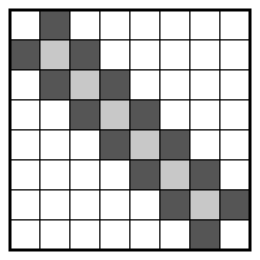

## Statement

Une grille de $20 \times 20$ est formée de $400$ cases carrées de côté $1$.

Clara colorie chaque case en blanc ou en noir, comme elle veut. Ensuite, Isabelle découpe la
grille en rectangles, en suivant les lignes du quadrillage. Chaque rectangle doit contenir **au
plus deux** cases noires. Pour chaque rectangle qui contient $0$ ou $1$ case noire, Isabelle
donne un chocolat à Clara.

Isabelle choisit son découpage pour donner le moins de chocolats possible. Clara, elle, choisit
son coloriage pour en recevoir le plus possible.

Combien de chocolats Isabelle donnera-t-elle à Clara ?

## Hints

1. Cherche séparément deux choses : une façon de découper qui marche pour Isabelle quel que soit
   le coloriage, et un coloriage qui oblige Isabelle à donner beaucoup de chocolats.
2. Pour Isabelle : découpe d'abord la grille en ses $20$ lignes. Dans une ligne, comment
   regrouper les cases noires deux par deux avec des coups de ciseaux ? Combien de chocolats
   coûte au plus une ligne ?
3. Attention, un nombre pair de cases noires ne permet pas toujours de les regrouper par deux.
   Essaie une grille $3 \times 3$ où seules les cases de la croix centrale sont noires.
4. Pour Clara : si un rectangle contient deux cases noires et rien d'autre de noir, ces deux
   cases sont-elles forcément voisines ? Cherche un coloriage où c'est le cas.
5. Essaie de noircir les cases de la diagonale et les cases juste au-dessus et juste en dessous.
   Parmi ces cases noires, distingue celles de la diagonale et les autres. Deux cases noires
   voisines sont-elles du même type ?

## Solution

On va montrer que la réponse est $20$ : Isabelle peut toujours s'en tirer avec au plus $20$
chocolats, et Clara a un coloriage qui l'oblige à en donner au moins $20$.

Dans toute la solution, la case de la ligne $i$ et de la colonne $j$ est notée $(i, j)$, avec
$1 \leqslant i \leqslant 20$ et $1 \leqslant j \leqslant 20$.

### Étape 1 : Isabelle donne au plus 20 chocolats

Quel que soit le coloriage, Isabelle commence par couper la grille en ses $20$ lignes. Puis, dans
chaque ligne, elle numérote les cases noires de gauche à droite et donne un coup de ciseaux juste
à droite de la case noire numéro $2$, puis juste à droite de la numéro $4$, de la numéro $6$, et
ainsi de suite.

Chaque morceau obtenu est un rectangle de hauteur $1$. Tous les morceaux d'une ligne contiennent
exactement deux cases noires, sauf peut-être le dernier, celui de droite. Une ligne coûte donc au
plus un chocolat. Remarque qu'une ligne sans case noire coûte bien un chocolat : elle reste un
seul morceau, avec $0$ case noire.

Avec $20$ lignes, Isabelle donne au plus $20$ chocolats.

### Étape 2 : le coloriage de Clara

Clara noircit :

- les cases juste au-dessus et juste en dessous de la diagonale, c'est-à-dire les cases $(i, j)$
  avec $|i - j| = 1$. Il y en a $19 + 19 = 38$. On les appelle les cases **foncées** ;
- les cases de la diagonale $(i, i)$, **sauf** les deux coins $(1, 1)$ et $(20, 20)$. Il y en a
  $18$. On les appelle les cases **claires**.

Toutes les autres cases sont blanches. Voici le même coloriage sur une grille $8 \times 8$, les
cases foncées en gris foncé et les cases claires en gris clair :

### Étape 3 : deux cases noires seules dans un rectangle sont voisines

Prenons deux cases noires $P$ et $Q$ qui ne sont pas voisines (voisines veut dire : avec un côté
commun). On va montrer que tout rectangle qui contient $P$ et $Q$ contient une troisième case
noire.

Un rectangle qui contient $P$ et $Q$ contient tout le « petit rectangle » qui a $P$ et $Q$ pour
coins opposés. Il suffit donc de trouver une case noire, autre que $P$ et $Q$, dans ce petit
rectangle. On va la trouver parmi les cases voisines de $P$ qui sont dans le petit rectangle,
c'est-à-dire les cases obtenues en faisant un pas depuis $P$ vers $Q$, en ligne ou en colonne.
Comme $P$ et $Q$ ne sont pas voisines, un tel pas n'arrive jamais sur $Q$.

Pour une case $(i, j)$, posons $s = i + j$ et $d = j - i$. Une case est noire exactement quand
$$-1 \leqslant d \leqslant 1 \qquad \text{et} \qquad 3 \leqslant s \leqslant 39 .$$
En effet, $|d| \leqslant 1$ décrit la bande des trois diagonales, et la condition sur $s$
retire seulement les deux coins, où $s = 2$ et $s = 40$.

Un pas vers le bas fait $(s, d) \to (s+1, d-1)$, un pas vers la droite fait
$(s, d) \to (s+1, d+1)$, et les pas vers le haut et vers la gauche font l'inverse. Écrivons
$P = (i_1, j_1)$ et $Q = (i_2, j_2)$ et regardons les cas.

- **$P$ et $Q$ sur la même ligne.** Alors $|j_2 - j_1| \geqslant 2$. Faisons un pas de $P$ vers
  $Q$ le long de la ligne. Les deux nombres $s$ et $d$ bougent de $1$, dans le sens qui les
  rapproche des valeurs de $Q$, et ils en sont à au moins $2$. Ils restent donc entre les valeurs
  de $P$ et celles de $Q$, qui vérifient toutes les deux les conditions ci-dessus. La nouvelle
  case est noire. Même chose si $P$ et $Q$ sont sur la même colonne.
- **$P$ et $Q$ sur des lignes et des colonnes différentes**, par exemple $Q$ en bas à droite de
  $P$ (les autres positions se traitent pareil). Les deux pas possibles, vers le bas et vers la
  droite, augmentent tous les deux $s$ de $1$. Comme $s$ augmente de $2$ au moins entre $P$ et
  $Q$, la nouvelle valeur de $s$ reste entre $3$ et $39$. L'un des deux pas fait $d - 1$, l'autre
  $d + 1$. Comme $d$ vaut $-1$, $0$ ou $1$ en $P$, l'un des deux nombres $d - 1$, $d + 1$ vaut
  encore $-1$, $0$ ou $1$. Le pas correspondant arrive sur une case noire.
  Si $Q$ est en bas à gauche de $P$, les deux pas possibles diminuent tous les deux $d$, et l'on
  échange simplement les rôles de $s$ et de $d$ dans ce raisonnement.

Conclusion : **si un rectangle d'Isabelle contient exactement deux cases noires, ces deux cases
sont voisines.**

### Étape 4 : Clara reçoit au moins 20 chocolats

Deux cases voisines ont des sommes $i + j$ qui diffèrent de $1$. Or une case foncée a une somme
$i + j$ impaire (puisque $|i - j| = 1$) et une case claire a une somme $2i$ paire. Deux cases
noires voisines sont donc toujours une foncée et une claire.

D'après l'étape 3, chaque rectangle d'Isabelle qui contient deux cases noires contient
exactement une case claire et une case foncée. Comme il n'y a que $18$ cases claires, il y a au
plus $18$ rectangles de ce genre, et ils contiennent au plus $18$ cases foncées.

Il reste donc au moins $38 - 18 = 20$ cases foncées, chacune dans un rectangle qui contient au
plus une case noire. Ces rectangles sont différents les uns des autres, puisque chacun contient
au plus une case noire. Il y en a au moins $20$, et chacun rapporte un chocolat à Clara.

### Conclusion

Isabelle peut toujours se limiter à $20$ chocolats, et Clara peut l'obliger à en donner $20$.
**Isabelle donnera exactement $20$ chocolats à Clara.**

## Going further

Le même raisonnement montre que, sur une grille $n \times n$ avec $n \geqslant 3$, la réponse est
$n$ : la bande des trois diagonales privée des deux coins contient $2(n-1)$ cases foncées et
$n - 2$ cases claires, ce qui laisse $2(n-1) - (n-2) = n$ cases foncées isolées.

Le corrigé officiel propose toute une famille de coloriages qui marchent : un « rectangle penché »
de cases noires disposées en damier, avec $(k+1)(\ell+1)$ cases d'une teinte et $k\ell$ de
l'autre, où $k + \ell = n - 1$. La bande ci-dessus est le cas $\ell = 1$.

Une erreur fréquente consiste à croire que, si le nombre de cases noires est pair, Isabelle peut
toujours les regrouper par deux. La croix de cinq cases au centre d'une grille $3 \times 3$
oblige pourtant Isabelle à donner $3$ chocolats.
