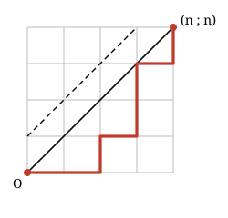

## Statement

Dans un repère, un jeton part du point $O(0\,;0)$ et se déplace par pas de deux sortes : un pas **vers la droite**, qui ajoute $(1\,;0)$, ou un pas **vers le haut**, qui ajoute $(0\,;1)$. On appelle *chemin* une suite de tels pas.

Soit $n$ un entier $\ge 1$. On s'intéresse aux chemins qui vont de $O$ au point $(n\,;n)$.

1. Montrer qu'il y a $\binom{2n}{n}$ chemins de $O$ à $(n\,;n)$.

Un chemin est dit **sage** s'il reste toujours sur la diagonale d'équation $y = x$ ou en dessous, c'est-à-dire si tous les points par lesquels il passe vérifient $y \le x$. Sinon il est dit **fou**.

2. Montrer qu'un chemin est fou si et seulement s'il passe par un point de la droite d'équation $y = x + 1$.
3. Montrer qu'il y a autant de chemins fous que de chemins allant de $O$ au point $(n+1\,;n-1)$.
   *Indication : repérer le premier point où le chemin touche la droite $y = x+1$, et remplacer le début du chemin par son symétrique par rapport à cette droite.*
4. En déduire que le nombre $C_n$ de chemins sages vaut

   $$C_n = \binom{2n}{n} - \binom{2n}{n+1} = \frac{1}{n+1}\binom{2n}{n} .$$

5. Calculer $C_1, C_2, C_3, C_4, C_5$.

## Hints

1. Un chemin de $O$ à $(n\,;n)$ comporte $2n$ pas, dont exactement $n$ vers la droite. Un chemin est donc entièrement déterminé par le choix des numéros des pas qui vont vers la droite.
2. Les coordonnées ne bougent que d'une unité à chaque pas. Si $y$ finit par dépasser $x$, la différence $y - x$ ne peut pas sauter par-dessus la valeur $1$.
3. La symétrie par rapport à la droite $y = x+1$ envoie le point $(x\,;y)$ sur le point $(y-1\,;x+1)$. Où part le point $O$ ?
4. La symétrie échange les pas vers la droite et les pas vers le haut. Compte alors les pas de chaque sorte dans le chemin obtenu.
5. Pour la dernière égalité, calcule le quotient $\binom{2n}{n+1} \,/\, \binom{2n}{n}$ en écrivant les deux coefficients avec des factorielles.

## Solution

### 1. Le nombre total de chemins

Chaque pas fait avancer d'une unité vers la droite ou vers le haut. Pour aller de $(0\,;0)$ à $(n\,;n)$, il faut donc $n$ pas vers la droite et $n$ pas vers le haut, soit $2n$ pas en tout.

Un chemin est entièrement décrit par un mot de $2n$ lettres prises dans $\{D, H\}$ comportant $n$ fois la lettre $D$. Choisir un tel mot, c'est choisir les $n$ positions des $D$ parmi les $2n$ positions. Il y a donc

$$\binom{2n}{n}$$

chemins de $O$ à $(n\,;n)$.

### 2. Les chemins fous touchent la droite $y = x+1$

Posons, pour chaque point $M(x\,;y)$ visité, $d = y - x$. Au départ $d = 0$, et chaque pas change $d$ de $+1$ (pas vers le haut) ou de $-1$ (pas vers la droite).

Si un chemin est fou, il visite un point où $y > x$, c'est-à-dire où $d \ge 1$. Comme $d$ part de $0$ et varie d'une unité à la fois, il prend forcément la valeur $1$ à un moment : le chemin touche la droite $y = x+1$.

Réciproquement, un chemin qui touche cette droite visite un point où $y = x+1 > x$ : il est fou.

### 3. La symétrie

Soit un chemin fou. D'après la question 2, il touche la droite $\Delta : y = x+1$. Notons $A$ le **premier** point de $\Delta$ qu'il atteint.

Construisons un nouveau chemin ainsi : on remplace la portion allant de $O$ à $A$ par son symétrique par rapport à $\Delta$, et on garde la portion allant de $A$ à $(n\,;n)$ telle quelle.

La symétrie par rapport à $\Delta$ transforme le point $(x\,;y)$ en $(y-1\,;x+1)$. Elle échange les directions « droite » et « haut », donc la portion réfléchie est encore un chemin formé de pas autorisés ; et comme $A$ est sur $\Delta$, il est son propre symétrique, si bien que les deux portions se recollent bien en $A$.

Le point de départ $O(0\,;0)$ devient $O'(-1\,;1)$. Le nouveau chemin va donc de $(-1\,;1)$ à $(n\,;n)$ : il comporte $n - (-1) = n+1$ pas vers la droite et $n - 1$ pas vers le haut.

Cette transformation est **réversible** : partant d'un chemin de $(-1\,;1)$ à $(n\,;n)$, ce chemin part d'un point situé au-dessus de $\Delta$ et arrive en $(n\,;n)$ qui est en dessous, donc il touche $\Delta$ ; en réfléchissant sa portion initiale jusqu'au premier point de contact, on retrouve un chemin fou de $O$ à $(n\,;n)$, et les deux constructions se défont l'une l'autre.

Il y a donc exactement autant de chemins fous que de chemins de $(-1\,;1)$ à $(n\,;n)$. Par translation, ces derniers sont aussi nombreux que les chemins de $O$ à $(n+1\,;n-1)$, et il y en a

$$\binom{2n}{n+1}$$

puisqu'un tel chemin compte $2n$ pas dont $n+1$ vers la droite.

### 4. Le compte des chemins sages

Les chemins de $O$ à $(n\,;n)$ se partagent en sages et fous, donc

$$C_n = \binom{2n}{n} - \binom{2n}{n+1} .$$

Calculons le quotient des deux coefficients :

$$\frac{\binom{2n}{n+1}}{\binom{2n}{n}} = \frac{\dfrac{(2n)!}{(n+1)!\,(n-1)!}}{\dfrac{(2n)!}{n!\,n!}} = \frac{n!\,n!}{(n+1)!\,(n-1)!} = \frac{n}{n+1} .$$

D'où

$$C_n = \binom{2n}{n}\left(1 - \frac{n}{n+1}\right) = \frac{1}{n+1}\binom{2n}{n} .$$

### 5. Les premières valeurs

$$C_1 = \frac{1}{2}\binom{2}{1} = 1, \quad C_2 = \frac{1}{3}\binom{4}{2} = 2, \quad C_3 = \frac{1}{4}\binom{6}{3} = 5, \quad C_4 = \frac{1}{5}\binom{8}{4} = 14, \quad C_5 = \frac{1}{6}\binom{10}{5} = 42 .$$

Ces nombres $1, 2, 5, 14, 42, \ldots$ s'appellent les **nombres de Catalan**. On peut vérifier à la main, pour $n = 2$, qu'il y a bien $2$ chemins sages sur les $\binom{4}{2} = 6$ chemins possibles : $DDHH$ et $DHDH$.

## Going further

1. Vérifier à la main, pour $n = 3$, que les $5$ chemins sages sont $DDDHHH$, $DDHDHH$, $DDHHDH$, $DHDDHH$ et $DHDHDH$.
2. Montrer que la suite des nombres de Catalan vérifie $C_{n+1} = C_0 C_n + C_1 C_{n-1} + \cdots + C_n C_0$ avec $C_0 = 1$. *(Indication : regarder le premier retour du chemin sur la diagonale.)*
3. Les nombres de Catalan comptent aussi les façons de placer correctement $n$ paires de parenthèses. Le vérifier pour $n = 3$.
