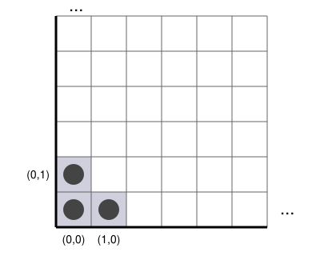

## Statement

On dispose d'un quadrillage infini occupant un quart de plan. Une case est repérée par un couple d'entiers $(i,j)$ avec $i \geqslant 0$ et $j \geqslant 0$ : $i$ est le numéro de la colonne, compté vers la droite, et $j$ celui de la ligne, compté vers le haut. La case $(0,0)$ est le coin.

Trois clones sont enfermés dans la **prison**, formée des trois cases
$$(0,0), \qquad (1,0), \qquad (0,1) .$$

**La règle du jeu.** Un clone ne peut se déplacer qu'en se dédoublant : un clone situé en $(i,j)$ disparaît, et deux clones apparaissent sur les cases $(i+1,j)$ et $(i,j+1)$, c'est-à-dire la case de droite et la case du dessus. Ce coup n'est autorisé que si ces deux cases sont **libres**, car une case ne peut jamais contenir plus d'un clone.

Peut-on, en un nombre fini de coups, libérer les clones, c'est-à-dire aboutir à une position où les trois cases de la prison sont toutes vides ?

## Hints

1. Essaie d'abord à la main, sur un coin de quadrillage. Tu verras vite que tu te bloques, mais cela ne prouve rien.
2. Cherche une quantité qui ne change pas quand on joue un coup. Donner un « poids » à chaque case, et regarder le poids total des cases occupées.
3. Un coup remplace un clone d'une case par deux clones sur des cases plus éloignées du coin. Quel poids faut-il donner à une case pour que l'échange soit équitable ?
4. Essaie le poids $\dfrac{1}{2^{\,i+j}}$ pour la case $(i,j)$. Vérifie qu'un coup ne change rien.
5. Calcule le poids total de la prison, puis le poids total de tout le quadrillage. Que reste-t-il pour les cases hors de la prison ?
6. Combien de clones y a-t-il après $n$ coups ? Combien de cases occupent-ils ?

## Solution

La réponse est **non** : il est impossible de libérer les clones.

### Le poids d'une case

Donnons à la case $(i,j)$ le poids
$$p(i,j) = \frac{1}{2^{\,i+j}} .$$

Ainsi la case du coin pèse $1$, ses deux voisines pèsent $\frac12$ chacune, les trois cases suivantes $\frac14$, et ainsi de suite : le poids est divisé par $2$ à chaque pas vers le haut ou vers la droite.

Le **poids d'une position** est la somme des poids des cases occupées par un clone. C'est une somme finie, puisqu'il n'y a jamais qu'un nombre fini de clones.

### Le poids ne change pas

Jouons un coup à partir de la case $(i,j)$. On retire le poids $p(i,j)$ et on ajoute $p(i+1,j)$ et $p(i,j+1)$. Or
$$p(i+1,j) + p(i,j+1) = \frac{1}{2^{\,i+j+1}} + \frac{1}{2^{\,i+j+1}} = \frac{2}{2^{\,i+j+1}} = \frac{1}{2^{\,i+j}} = p(i,j) .$$

Le poids retiré est exactement le poids ajouté : **le poids total de la position ne change jamais**. C'est un invariant.

Au départ, les trois clones occupent la prison, donc le poids vaut
$$p(0,0) + p(1,0) + p(0,1) = 1 + \frac12 + \frac12 = 2 .$$

À tout instant, le poids de la position vaut donc $2$.

### Le poids disponible en dehors de la prison

Montrons maintenant que les cases situées **hors de la prison** ne peuvent jamais porter un poids de $2$, du moins en nombre fini.

Soit $F$ un ensemble **fini** de cases, toutes situées hors de la prison. Choisissons un entier $N$ assez grand pour que toutes les cases de $F$ vérifient $i \leqslant N$ et $j \leqslant N$.

Le poids total du carré $\{0, \ldots, N\} \times \{0, \ldots, N\}$ se calcule colonne par colonne. La colonne $i$ pèse
$$\sum_{j=0}^{N} \frac{1}{2^{\,i+j}} = \frac{1}{2^{\,i}} \sum_{j=0}^{N} \frac{1}{2^{\,j}} = \frac{1}{2^{\,i}} \times \left(2 - \frac{1}{2^{\,N}}\right) ,$$
en utilisant la somme d'une suite géométrique de raison $\frac12$. En additionnant sur les colonnes :
$$\sum_{i=0}^{N} \frac{1}{2^{\,i}} \times \left(2 - \frac{1}{2^{\,N}}\right) = \left(2 - \frac{1}{2^{\,N}}\right)^2 < 4 .$$

Le carré entier pèse donc strictement moins que $4$. Comme $F$ est contenu dans ce carré privé des trois cases de la prison, et que ces trois cases pèsent $2$ :
$$\text{poids}(F) \leqslant \left(2 - \frac{1}{2^{\,N}}\right)^2 - 2 < 4 - 2 = 2 .$$

**Tout ensemble fini de cases hors de la prison pèse donc strictement moins que $2$.**

### La contradiction

Supposons qu'après un certain nombre de coups la prison soit vide. Il n'y a jamais qu'un nombre fini de clones : on part de $3$, et chaque coup en ajoute exactement un. Les clones occupent donc un ensemble **fini** de cases, toutes situées hors de la prison.

D'après le paragraphe précédent, le poids de la position est alors strictement inférieur à $2$. Mais d'après l'invariant, il vaut exactement $2$. Contradiction.

**Il est donc impossible de libérer les clones**, quel que soit le nombre de coups joués et quel que soit l'ordre dans lequel on les joue.

### Le mot de la fin

Le résultat est un peu vertigineux : le quadrillage est infini, la place ne manque pas, et pourtant les clones restent coincés. Le poids $\frac{1}{2^{\,i+j}}$ explique pourquoi : les cases lointaines ne pèsent presque rien, et le stock total de poids disponible loin du coin est tout juste égal à celui de la prison — à condition d'occuper une infinité de cases, ce qu'un nombre fini de coups ne permettra jamais. Il s'en faut de très peu, mais il s'en faut toujours.

## Going further

1. Montrer qu'une fois la case du coin $(0,0)$ libérée, plus aucun clone ne pourra jamais y revenir. Quelles sont les autres cases dont on peut dire la même chose ?
2. Montrer qu'après $n$ coups il y a exactement $n+3$ clones sur le quadrillage. Peut-on en déduire une position atteignable avec beaucoup de clones et un poids très inférieur à $2$ ?
3. Vérifier que le poids total de tout le quadrillage vaut exactement $4$, en faisant tendre $N$ vers l'infini dans le calcul ci-dessus.
4. Le même genre d'invariant règle le jeu des « soldats de Conway », où des pions sautent par-dessus leurs voisins pour monter le plus haut possible au-dessus d'une ligne. Jusqu'où peuvent-ils aller ?
