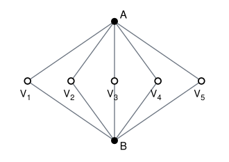

## Statement

Le pays d'Animath compte $2026$ villes. Certaines paires de villes sont reliées par une route, que l'on peut emprunter dans les deux sens.

Le réseau routier vérifie la propriété suivante, qu'on appellera la **règle du détour** :

> pour tout choix de trois villes distinctes $X$, $Y$ et $Z$, il existe un trajet allant de $X$ à $Z$ par des routes **sans passer par $Y$**.

On dit que $n$ villes $V_1, V_2, \ldots, V_n$ forment un **circuit de longueur $n$** si elles sont deux à deux distinctes, si $V_i$ et $V_{i+1}$ sont reliées pour tout $i$ de $1$ à $n-1$, et si $V_n$ est reliée à $V_1$.

Quelle est la plus grande valeur de $n$ telle que, quelle que soit la façon dont les routes sont tracées (en respectant la règle du détour), on soit certain de trouver un circuit de longueur au moins $n$ ?

*Vocabulaire.* Un « trajet » est une suite de villes dans laquelle deux villes consécutives sont reliées par une route. D'un trajet quelconque on peut toujours extraire un trajet qui ne repasse jamais deux fois par la même ville, en supprimant les boucles : c'est ce type de trajet que l'on utilisera.

## Hints

1. Deux moitiés, comme toujours : construire un réseau où les circuits sont courts, et démontrer qu'un circuit d'une certaine longueur existe toujours.
2. Pour la construction, essayez de faire passer tout le trafic par deux villes seulement. Vérifiez ensuite que la règle du détour est respectée, et regardez à quoi ressemble un circuit.
3. Pour l'autre moitié, commencez par le plus simple : montrez qu'aucune ville n'est isolée, et qu'aucune ville n'a une seule route.
4. Avec au moins deux routes partant de chaque ville, on ne peut pas se promener indéfiniment sans repasser deux fois au même endroit. Marchez au hasard en vous interdisant seulement de faire demi-tour, et regardez la première ville revisitée.
5. Vous obtiendrez un circuit de longueur au moins $3$. S'il fait exactement $3$, appelez-le $A$, $B$, $C$. Montrez qu'une ville extérieure est reliée à l'un des trois, puis utilisez la règle du détour pour revenir dans le triangle par un autre sommet.

## Solution

La réponse est $n = 4$.

### Un réseau où aucun circuit ne dépasse la longueur 4

Choisissons deux villes $A$ et $B$. On relie $A$ à chacune des $2024$ autres villes (celles qui ne sont ni $A$ ni $B$), on relie $B$ à chacune de ces mêmes $2024$ villes, et **on ne trace aucune autre route** : en particulier, $A$ et $B$ ne sont pas reliées entre elles, et les $2024$ autres villes ne sont reliées entre elles par aucune route.

Voici le réseau, dessiné avec $5$ villes ordinaires au lieu de $2024$ :

**La règle du détour est respectée.** Soient $X$, $Y$, $Z$ trois villes distinctes ; il faut relier $X$ à $Z$ en évitant $Y$.

- Si $Y = A$ (le cas $Y = B$ est identique en échangeant les rôles de $A$ et $B$) : si $X$ et $Z$ sont deux villes ordinaires, on passe par $B$ ; si l'une des deux est $B$, elles sont directement reliées.
- Si $Y$ est une ville ordinaire : si $X$ et $Z$ sont deux villes ordinaires, on passe par $A$ ; si $X$ et $Z$ sont $A$ et $B$, on passe par n'importe quelle ville ordinaire autre que $Y$, et il en reste $2023$ ; sinon l'une des deux est $A$ ou $B$ et l'autre est ordinaire, et elles sont directement reliées.

**Les circuits sont courts.** Toute route de ce réseau relie une ville ordinaire à $A$ ou à $B$. En parcourant un circuit, on alterne donc entre les villes ordinaires et l'ensemble $\{A, B\}$. Un circuit de longueur $2k$ utilise donc $k$ villes de $\{A,B\}$, toutes distinctes, donc $k \leq 2$ : la longueur est au plus $4$. Et un circuit de longueur $4$ existe bien, par exemple $A$, $V_1$, $B$, $V_2$.

Dans ce réseau, le plus long circuit fait donc exactement $4$, ce qui montre que la réponse cherchée vérifie $n \leq 4$.

### Il y a toujours un circuit de longueur au moins 4

**Étape 1 : de chaque ville partent au moins deux routes.**

Supposons qu'aucune route ne parte de la ville $X$. Choisissons deux autres villes $Y$ et $Z$ (c'est possible, il y en a $2025$). Alors aucun trajet ne part de $X$, donc en particulier aucun trajet de $X$ à $Z$ évitant $Y$. La règle du détour est violée.

Supposons maintenant qu'une seule route parte de $X$, vers une ville $Y$. Tout trajet partant de $X$ commence forcément par cette route, donc passe par $Y$. Choisissons $Z$ différente de $X$ et de $Y$ : aucun trajet de $X$ à $Z$ n'évite $Y$. La règle du détour est encore violée.

**Étape 2 : il existe un circuit de longueur au moins 3.**

Partons d'une ville quelconque $A_1$, allons vers une ville voisine $A_2$, puis construisons la suite en nous imposant une seule règle : depuis $A_i$, on part vers une voisine $A_{i+1}$ **différente de $A_{i-1}$**, c'est-à-dire qu'on ne fait jamais demi-tour. C'est toujours possible, car de chaque ville partent au moins deux routes.

Le pays ne compte que $2026$ villes, donc cette promenade infinie finit par revisiter une ville. Soit $j$ le plus petit indice tel que $A_j$ coïncide avec une ville déjà visitée, disons $A_j = A_i$ avec $i < j$. Par minimalité de $j$, les villes $A_i, A_{i+1}, \ldots, A_{j-1}$ sont deux à deux distinctes.

De plus $j - i \geq 3$ : on ne peut avoir $j = i+1$, car $A_i$ et $A_{i+1}$ sont reliées par une route et sont donc distinctes ; et on ne peut avoir $j = i+2$, car la règle « pas de demi-tour » impose justement $A_{i+2} \neq A_i$.

Les villes $A_i, A_{i+1}, \ldots, A_{j-1}$ forment donc un circuit de longueur $j - i \geq 3$.

**Étape 3 : on passe de 3 à 4.**

Si le circuit trouvé est de longueur au moins $4$, c'est gagné. Sinon, c'est un triangle : trois villes $A$, $B$, $C$ reliées deux à deux.

*Une ville extérieure touche le triangle.* Supposons le contraire : aucune route ne relie une ville de $\{A,B,C\}$ à une ville extérieure. Prenons $X = A$, $Y = B$, et $Z$ n'importe quelle ville hors du triangle (il y en a $2023$). Tout trajet partant de $A$ reste alors enfermé dans $\{A,B,C\}$ et ne peut jamais atteindre $Z$. La règle du détour est violée. Il existe donc une ville $D$ hors du triangle, reliée à l'un des trois sommets ; comme le triangle est symétrique, on peut supposer que $D$ est reliée à $A$.

*On referme un circuit.* Appliquons la règle du détour à $X = D$, $Y = A$, $Z = B$ : il existe un trajet allant de $D$ à $B$ sans passer par $A$. Prenons-en un qui ne repasse jamais par la même ville, et suivons-le depuis $D$ jusqu'à la **première** ville rencontrée qui appartient à $\{B, C\}$. Appelons $F$ cette ville et $\mathcal{P}$ le début du trajet, de $D$ à $F$.

Par construction, les villes de $\mathcal{P}$ sont deux à deux distinctes, aucune n'est $A$, et les villes strictement entre $D$ et $F$ sont hors de $\{A, B, C\}$.

- Si $F = C$ : le circuit $D \to \cdots \to C \to B \to A \to D$ convient. Les routes $C$–$B$ et $B$–$A$ existent (triangle), la route $A$–$D$ existe par choix de $D$, et toutes les villes citées sont distinctes.
- Si $F = B$ : le circuit $D \to \cdots \to B \to C \to A \to D$ convient, pour les mêmes raisons.

Dans les deux cas, le circuit contient au moins les quatre villes $D$, $F$, la troisième ville du triangle, et $A$ : sa longueur est au moins $4$.

### Conclusion

$$\boxed{n = 4.}$$

*Deux erreurs à éviter.* D'abord, construire un circuit sans vérifier que toutes ses villes sont bien distinctes : une suite de routes qui revient à son point de départ n'est pas un circuit si elle repasse deux fois au même endroit. Ensuite, croire que « deux trajets différents entre deux villes » donne « deux trajets sans ville commune ». C'est vrai sous l'hypothèse de l'énoncé, mais c'est un théorème difficile (le théorème de Menger), et pas une évidence.

## Going further

1. Dans le réseau construit, que se passe-t-il si l'on ajoute la route entre $A$ et $B$ ? Le plus long circuit change-t-il ?
2. Remplacez la règle du détour par une règle plus forte : pour toutes villes distinctes $X$, $Y$, $Z$, **et** $W$, il existe un trajet de $X$ à $Z$ évitant à la fois $Y$ et $W$. Quel est alors le plus long circuit garanti ?
