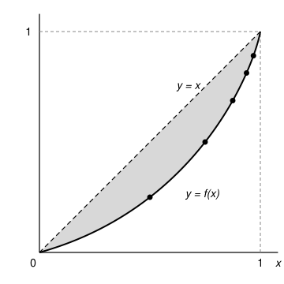

## Statement

Soit $p$ un réel tel que $0 < p < 1$, et $q = 1 - p$. Pour tout entier $n \geqslant 1$, on pose

$$S_n = 1 - q^n, \qquad E_n = 1 + q + q^2 + \cdots + q^{n-1} - nq^n, \qquad E = \frac{1}{p}.$$

(Si l'on lance $n$ fois une pièce qui tombe sur Pile avec la probabilité $p$, $S_n$ est la
probabilité d'obtenir au moins un Pile, et $E_n$ est l'espérance du rang du premier Pile, compté
$0$ quand il n'y a pas de Pile. Quand $n$ tend vers $+\infty$, $E_n$ tend vers $E$.)

Pour tout entier $n \geqslant 1$, on note $Q_n = \frac{E_n}{E}$, et l'on s'intéresse aux points de
coordonnées $(S_n, Q_n)$.

1. a) Justifier que, pour tout entier $n \geqslant 1$, $Q_n = S_n - np(1 - S_n)$.

   b) Vérifier que $n = \frac{\ln(1 - S_n)}{\ln q}$, puis que
   $$Q_n = S_n - \frac{p}{\ln q}(1 - S_n)\ln(1 - S_n).$$

   c) En déduire une fonction $f$, définie sur $[0, 1[$, telle que $Q_n = f(S_n)$ pour tout
   entier $n \geqslant 1$.
2. a) Justifier que $f$ est convexe sur $[0, 1[$ et calculer $f(0)$.

   b) On admet que $z\ln z$ tend vers $0$ quand $z$ tend vers $0$ par valeurs supérieures. En
   déduire la limite de $f(x)$ quand $x$ tend vers $1$ par valeurs inférieures.

   c) Quelle est la position de la courbe de $f$ par rapport à la droite d'équation $y = x$ ?
   Donner l'allure de la courbe de $f$ sur $[0, 1[$.
3. a) Vérifier qu'une primitive de la fonction $x \mapsto (1 - x)\ln(1 - x)$ sur $[0, 1[$ est la
   fonction
   $$F : x \mapsto \frac{(1 - x)^2}{2}(\frac{1}{2} - \ln(1 - x)).$$

   b) Soit $A \in\, ]0, 1[$. En déduire la valeur de $\int_0^A f(x)\,dx$.

   c) Pour $A \in\, ]0, 1[$, on note $\mathcal{A}(A)$ l'aire du domaine compris entre la courbe de
   $f$ et la droite d'équation $y = x$, pour $x$ allant de $0$ à $A$. Montrer que $\mathcal{A}(A)$
   a une limite $\mathcal{A}$ quand $A$ tend vers $1$. On appelle *indice de Gini* associé à $f$ le
   réel $G(p) = 2\mathcal{A}$. Montrer que
   $$G(p) = -\frac{p}{2\ln(1 - p)}.$$

## Hints

1. **Question 1 a.** Écrire la somme géométrique $1 + q + \cdots + q^{n-1}$ à l'aide de $S_n$, et
   remarquer que $q^n = 1 - S_n$.
2. **Question 1 b.** Que vaut $\ln(1 - S_n)$ ?
3. **Question 2 a.** Poser $c = -\frac{p}{\ln q}$ : quel est son signe ? Calculer ensuite $f'$ et
   $f''$.
4. **Question 2 b.** Poser $z = 1 - x$.
5. **Question 2 c.** Étudier le signe de $f(x) - x$. Pour l'allure, calculer $f'(0)$ et la limite de
   $f'(x)$ quand $x$ tend vers $1$.
6. **Question 2 c.** Pour savoir si $f'(0)$ est positif, comparer $p$ et $-\ln(1 - p)$ en étudiant
   la fonction $t \mapsto -\ln(1 - t) - t$ sur $[0, 1[$.
7. **Question 3 c.** La courbe est sous la droite, donc
   $\mathcal{A}(A) = \int_0^A (x - f(x))\,dx$.

## Solution

**1.** a) Comme $q \neq 1$, la somme géométrique vaut

$$1 + q + \cdots + q^{n-1} = \frac{1 - q^n}{1 - q} = \frac{S_n}{p},$$

et $q^n = 1 - S_n$. Donc $E_n = \frac{S_n}{p} - n(1 - S_n)$. Comme $E = \frac{1}{p}$, on a
$Q_n = pE_n = S_n - np(1 - S_n)$.

b) On a $1 - S_n = q^n > 0$, donc $\ln(1 - S_n) = n\ln q$. Comme $0 < q < 1$, $\ln q < 0$, en
particulier $\ln q \neq 0$, et $n = \frac{\ln(1 - S_n)}{\ln q}$. En remplaçant $n$ dans la question
1 a) :

$$Q_n = S_n - \frac{p}{\ln q}(1 - S_n)\ln(1 - S_n).$$

c) Pour $x \in [0, 1[$, on pose

$$f(x) = x - \frac{p}{\ln q}(1 - x)\ln(1 - x).$$

Comme $0 < S_n < 1$, le nombre $f(S_n)$ est défini, et $Q_n = f(S_n)$ d'après la question 1 b).

**2.** Posons $c = -\frac{p}{\ln q}$. Comme $p > 0$ et $\ln q < 0$, on a $c > 0$, et

$$f(x) = x + c\,(1 - x)\ln(1 - x).$$

a) La dérivée de $x \mapsto \ln(1 - x)$ est $x \mapsto -\frac{1}{1 - x}$. La dérivée de
$x \mapsto (1 - x)\ln(1 - x)$ est donc

$$-\ln(1 - x) + (1 - x) \times (-\frac{1}{1 - x}) = -\ln(1 - x) - 1.$$

Ainsi $f'(x) = 1 - c - c\ln(1 - x)$, puis $f''(x) = \frac{c}{1 - x}$. Sur $[0, 1[$, on a $c > 0$ et
$1 - x > 0$, donc $f''(x) > 0$ : **la fonction $f$ est convexe sur $[0, 1[$.**

De plus, $f(0) = 0 + c \times 1 \times \ln 1 = 0$.

b) Posons $z = 1 - x$. Quand $x$ tend vers $1$ par valeurs inférieures, $z$ tend vers $0$ par
valeurs supérieures, donc $(1 - x)\ln(1 - x) = z\ln z$ tend vers $0$. Par conséquent, $f(x)$ tend
vers $1 + c \times 0 = 1$.

c) *Position.* On a $f(x) - x = c\,(1 - x)\ln(1 - x)$. Pour $0 < x < 1$ : $c > 0$, $1 - x > 0$ et
$\ln(1 - x) < 0$ car $0 < 1 - x < 1$. Donc $f(x) < x$. **La courbe de $f$ est strictement au-dessous
de la droite $y = x$ sur $]0, 1[$** ; elle la touche en $x = 0$, et $f(x)$ se rapproche de $1$ quand
$x$ tend vers $1$.

*Allure.* On a $f'(0) = 1 - c$. Montrons que $c < 1$. Comme $-\ln q > 0$, l'inégalité $c < 1$
équivaut à $p < -\ln q = -\ln(1 - p)$. Soit $g(t) = -\ln(1 - t) - t$ sur $[0, 1[$. Alors
$g'(t) = \frac{1}{1 - t} - 1 = \frac{t}{1 - t} > 0$ pour $t > 0$, donc $g$ est strictement croissante,
et $g(p) > g(0) = 0$. Ainsi $0 < c < 1$ et $0 < f'(0) < 1$.

Comme $f'' > 0$, la dérivée $f'$ est croissante, donc $f'(x) \geqslant f'(0) > 0$ : $f$ est
strictement croissante sur $[0, 1[$. Enfin, quand $x$ tend vers $1$, $-\ln(1 - x)$ tend vers
$+\infty$, donc $f'(x)$ tend vers $+\infty$.

En résumé, la courbe part de l'origine avec une pente $1 - c$ comprise entre $0$ et $1$, elle monte
en restant sous la diagonale, en se courbant vers le haut (convexité), et elle arrive près du point
$(1, 1)$ avec une pente de plus en plus forte, presque verticale. Voici la courbe pour
$p = \frac{1}{2}$, avec les points $(S_n, Q_n)$ pour $n = 1, \ldots, 5$ et, en gris, le domaine
dont l'aire sert à la question 3 c).

**3.** a) Soit $F(x) = \frac{(1 - x)^2}{2}(\frac{1}{2} - \ln(1 - x))$. On dérive un produit. La
dérivée de $\frac{(1 - x)^2}{2}$ est $-(1 - x)$, celle de $\frac{1}{2} - \ln(1 - x)$ est
$\frac{1}{1 - x}$. Donc

$$F'(x) = -(1 - x)(\frac{1}{2} - \ln(1 - x)) + \frac{(1 - x)^2}{2} \times \frac{1}{1 - x}.$$

En développant, $F'(x) = -\frac{1 - x}{2} + (1 - x)\ln(1 - x) + \frac{1 - x}{2} = (1 - x)\ln(1 - x)$.
$F$ est bien une primitive de $x \mapsto (1 - x)\ln(1 - x)$ sur $[0, 1[$.

b) Par linéarité de l'intégrale, avec $F(0) = \frac{1}{2} \times \frac{1}{2} = \frac{1}{4}$ :

$$\int_0^A f(x)\,dx = \int_0^A x\,dx + c\int_0^A (1 - x)\ln(1 - x)\,dx = \frac{A^2}{2} + c\,(F(A) - \frac{1}{4}),$$

c'est-à-dire, avec $c = -\frac{p}{\ln q}$,

$$\int_0^A f(x)\,dx = \frac{A^2}{2} - \frac{p}{\ln q}(\frac{(1 - A)^2}{4} - \frac{(1 - A)^2\ln(1 - A)}{2} - \frac{1}{4}).$$

c) Sur $[0, A]$, la courbe de $f$ est sous la droite $y = x$ (question 2 c), donc

$$\mathcal{A}(A) = \int_0^A (x - f(x))\,dx = \frac{A^2}{2} - \int_0^A f(x)\,dx = c\,(\frac{1}{4} - F(A)).$$

Quand $A$ tend vers $1$ : $(1 - A)^2$ tend vers $0$, et
$(1 - A)^2\ln(1 - A) = (1 - A) \times (1 - A)\ln(1 - A)$ tend vers $0 \times 0 = 0$ (question 2 b).
Donc $F(A) = \frac{(1 - A)^2}{4} - \frac{(1 - A)^2\ln(1 - A)}{2}$ tend vers $0$, et $\mathcal{A}(A)$
tend vers $\mathcal{A} = \frac{c}{4}$.

L'indice de Gini vaut donc $G(p) = 2\mathcal{A} = \frac{c}{2} = -\frac{p}{2\ln q}$, c'est-à-dire

$$G(p) = -\frac{p}{2\ln(1 - p)}.$$

Par exemple, pour $p = \frac{1}{2}$, $G = \frac{1}{4\ln 2} \approx \text{0,361}$.

**Bilan.** Les points $(S_n, Q_n)$ sont tous sur la courbe de
$f(x) = x - \frac{p}{\ln(1 - p)}(1 - x)\ln(1 - x)$. Cette fonction est convexe et croissante sur
$[0, 1[$, part de $0$, tend vers $1$ en $1$, et sa courbe reste sous la droite $y = x$. Le double
de l'aire comprise entre cette courbe et la droite, sur $[0, 1[$, vaut $-\frac{p}{2\ln(1 - p)}$.

## Going further

- Une telle courbe s'appelle une *courbe de Lorenz*. En économie, on y place en abscisse la part
  de la population la plus pauvre, et en ordonnée la part des revenus qu'elle reçoit. Ici,
  $S_n$ est la probabilité d'avoir $1 \leqslant X \leqslant n$, où $X$ est le rang du premier Pile
  quand on lance la pièce sans s'arrêter, et $Q_n$ est la part de l'espérance de $X$ qui vient de
  ces valeurs-là. L'indice de Gini vaut $0$ quand tout le monde reçoit la même part, et il est
  d'autant plus grand que la répartition est inégale.
- Étudier la fonction $G$ sur $]0, 1[$ : montrer qu'elle est décroissante, que $G(p)$ tend vers
  $\frac{1}{2}$ quand $p$ tend vers $0$, et vers $0$ quand $p$ tend vers $1$. Comment
  l'interpréter ?
- La première partie du problème (loi et espérance du rang du premier Pile) est l'exercice 41041.
