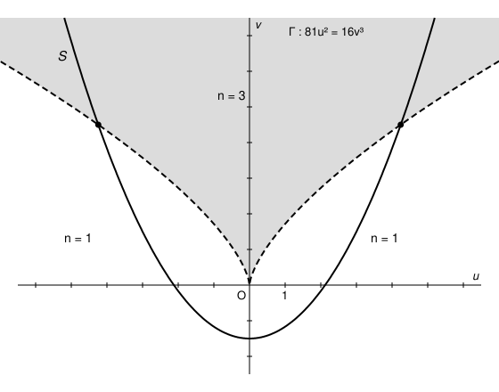

## Statement

Le plan est muni d'un repère orthonormé $(O ; \vec{\imath}, \vec{\jmath})$. On note $S$ la parabole
d'équation $y = \frac{x^2}{3} - \frac{3}{2}$ et, pour tout réel $x$, $M(x)$ le point de $S$
d'abscisse $x$.

Pour tout point $U$ de coordonnées $(u ; v)$, on pose $f_U(x) = UM(x)$ et
$g_U(x) = \left(f_U(x)\right)^2$. On a montré dans une partie précédente que
$$g_U(x) = \frac{x^4}{9} - \frac{2v}{3}\,x^2 - 2ux + u^2 + \left(v + \frac{3}{2}\right)^2,
\qquad
g_U'(x) = \frac{4}{9}\,x^3 - \frac{4v}{3}\,x - 2u,
\qquad
g_U''(x) = \frac{4}{3}\left(x^2 - v\right).$$

On dit qu'un cercle de centre $U$ et de rayon $UM$ est *tangent en $M$ à $S$* si $M$ est un point
de $S$ et si la tangente en $M$ au cercle et la tangente en $M$ à $S$ sont la même droite. On a
aussi montré le résultat suivant, que l'on admet :

> Si $U$ n'est pas sur $S$, le cercle de centre $U$ et de rayon $UM(a)$ est tangent en $M(a)$ à
> $S$ si et seulement si $g_U'(a) = 0$.

1. Étudier les variations de la fonction $g_U'$ sur $\mathbb{R}$ :

   a) lorsque $v \leqslant 0$ ;

   b) lorsque $v > 0$. On calculera $g_U'\left(-\sqrt{v}\right)$ et $g_U'\left(\sqrt{v}\right)$.

2. a) Montrer que tout point $U$ qui n'est pas sur $S$ est le centre d'au moins un et d'au plus
   trois cercles tangents à $S$.

   b) Pour $U$ hors de $S$, on note $n(U)$ le nombre de réels $x$ pour lesquels le cercle de centre
   $U$ et de rayon $UM(x)$ est tangent en $M(x)$ à $S$. Pour $i = 1$, $2$, $3$, caractériser par
   une égalité ou une inégalité simple l'ensemble des points $U$ hors de $S$ tels que $n(U) = i$.
   On pourra discuter selon le signe de $81u^2 - 16v^3$.

3. Pour $U$ hors de $S$, donner le tableau de variations de $f_U$. On ne cherchera pas à calculer
   les réels où $f_U$ admet un extremum local.

4. Faire un croquis représentant $S$ et les ensembles trouvés à la question 2 b).

## Hints

1. **Question 1.** Le signe de $g_U''$ donne les variations de $g_U'$. Penser aussi aux limites de
   $g_U'$ en $-\infty$ et en $+\infty$.
2. **Question 2 a).** Sur un intervalle où $g_U'$ est strictement monotone, combien de fois
   peut-elle s'annuler ? Pour montrer qu'elle s'annule au moins une fois, utiliser ses limites et
   le théorème des valeurs intermédiaires.
3. **Question 2 b).** Quand $v > 0$, poser $k = \frac{4}{9}\,v\sqrt{v}$. On trouve
   $g_U'\left(-\sqrt{v}\right) = 2(k - u)$ et $g_U'\left(\sqrt{v}\right) = -2(k + u)$.
4. **Question 2 b).** Il y a trois racines exactement quand le maximum local de $g_U'$ est
   strictement positif et son minimum local strictement négatif, c'est-à-dire quand $|u| < k$.
   Élever au carré.
5. **Question 2 b).** Ne pas oublier les cas d'égalité, ni le point $U = O$.
6. **Question 3.** Comme $f_U = \sqrt{g_U}$ et que la racine carrée est croissante, $f_U$ a les
   mêmes variations que $g_U$.
7. **Question 4.** La courbe d'équation $81u^2 = 16v^3$ s'écrit aussi
   $v = \left(\frac{81}{16}\,u^2\right)^{1/3}$. Où coupe-t-elle $S$ ?

## Solution

**1. a)** Si $v \leqslant 0$, alors $g_U''(x) = \frac{4}{3}(x^2 - v) \geqslant 0$ pour tout $x$, et
$g_U''$ ne s'annule qu'en $x = 0$, et seulement quand $v = 0$. Donc $g_U'$ est **strictement
croissante** sur $\mathbb{R}$. Comme son terme de plus haut degré est $\frac{4}{9}x^3$, elle tend
vers $-\infty$ en $-\infty$ et vers $+\infty$ en $+\infty$.

**b)** Si $v > 0$, $g_U''(x) = \frac{4}{3}\left(x - \sqrt{v}\right)\left(x + \sqrt{v}\right)$ est
positive à l'extérieur de $[-\sqrt{v} ; \sqrt{v}]$ et négative à l'intérieur. Donc
$g_U'$ est croissante sur $]-\infty ; -\sqrt{v}]$, décroissante sur
$[-\sqrt{v} ; \sqrt{v}]$ et croissante sur $[\sqrt{v} ; +\infty[$, toujours
strictement. En utilisant $\left(\sqrt{v}\right)^3 = v\sqrt{v}$ :
$$g_U'\left(-\sqrt{v}\right) = -\frac{4}{9}\,v\sqrt{v} + \frac{4}{3}\,v\sqrt{v} - 2u = \frac{8}{9}\,v\sqrt{v} - 2u,
\qquad
g_U'\left(\sqrt{v}\right) = \frac{4}{9}\,v\sqrt{v} - \frac{4}{3}\,v\sqrt{v} - 2u = -\frac{8}{9}\,v\sqrt{v} - 2u .$$
Avec $k = \frac{4}{9}\,v\sqrt{v} > 0$, cela s'écrit $g_U'\left(-\sqrt{v}\right) = 2(k - u)$ (maximum
local) et $g_U'\left(\sqrt{v}\right) = -2(k + u)$ (minimum local). Les limites en $\pm\infty$ sont
les mêmes qu'au a).

**2. a)** D'après le résultat admis, les points de contact des cercles de centre $U$ tangents à $S$
sont les points $M(a)$ pour lesquels $a$ est une racine de $g_U'$. Un tel cercle est déterminé par
son point de contact, puisque son rayon est $UM(a)$.

- *Au plus trois.* D'après la question 1, $\mathbb{R}$ se découpe en au plus trois intervalles sur
  lesquels $g_U'$ est strictement monotone, et sur chacun elle s'annule au plus une fois. Donc
  $g_U'$ a au plus trois racines, et il y a au plus trois cercles.
- *Au moins un.* La fonction $g_U'$ est continue (c'est un polynôme), elle tend vers $-\infty$ en
  $-\infty$ et vers $+\infty$ en $+\infty$. Elle prend donc une valeur négative et une valeur
  positive, et d'après le théorème des valeurs intermédiaires elle s'annule au moins une fois. Il
  y a donc au moins un cercle.

Deux points de contact différents peuvent donner le même cercle (quand ils sont à la même distance
de $U$), c'est pourquoi la question suivante compte les points de contact plutôt que les cercles.

**b)** Par le résultat admis, $n(U)$ est le nombre de racines distinctes de $g_U'$.

*Cas $v \leqslant 0$.* La fonction $g_U'$ est continue, strictement croissante, de $-\infty$ à
$+\infty$ : elle s'annule exactement une fois, $n(U) = 1$. Dans ce cas $16v^3 \leqslant 0 \leqslant 81u^2$,
donc $81u^2 - 16v^3 \geqslant 0$, avec égalité seulement pour $u = v = 0$, c'est-à-dire $U = O$.

*Cas $v > 0$.* On suit le tableau de la question 1 b) :

- **Si $-k < u < k$**, le maximum local $2(k - u)$ est strictement positif et le minimum local
  $-2(k+u)$ est strictement négatif. Sur $]-\infty ; -\sqrt{v}]$, $g_U'$ croît de
  $-\infty$ à une valeur positive : une racine. Sur $[-\sqrt{v} ; \sqrt{v}]$, elle
  décroît d'une valeur positive à une valeur négative : une racine. Sur
  $[\sqrt{v} ; +\infty[$, elle croît d'une valeur négative à $+\infty$ : une racine.
  Donc $n(U) = 3$.
- **Si $u > k$**, le maximum local est négatif. Alors $g_U' < 0$ sur
  $]-\infty ; \sqrt{v}]$, et sur $[\sqrt{v} ; +\infty[$, $g_U'$ croît d'une
  valeur négative à $+\infty$ : une seule racine en tout, $n(U) = 1$. **Si $u < -k$**, de même
  le minimum local est positif, $g_U' > 0$ sur $[-\sqrt{v} ; +\infty[$, et il y a une
  seule racine, dans $]-\infty ; -\sqrt{v}[$ : $n(U) = 1$.
- **Si $u = k$**, le maximum local vaut $0$ : $-\sqrt{v}$ est une racine, et c'est la seule sur
  $]-\infty ; \sqrt{v}]$, puisque $g_U'$ est strictement croissante puis strictement
  décroissante sur cet intervalle. Sur $[\sqrt{v} ; +\infty[$, $g_U'$ croît de
  $-2(k + u) = -4k < 0$ à $+\infty$ : une racine de plus. Donc $n(U) = 2$. **Si $u = -k$**, de
  même $n(U) = 2$.

Enfin, comme $k > 0$ et que les deux membres sont positifs,
$$|u| < k \iff u^2 < k^2 = \frac{16}{81}\,v^3 \iff 81u^2 < 16v^3,$$
et de même $|u| = k \iff 81u^2 = 16v^3$, $|u| > k \iff 81u^2 > 16v^3$.

**Conclusion.** Pour $U$ hors de $S$ :

- $n(U) = 3$ si et seulement si $81u^2 < 16v^3$ (ce qui oblige $v > 0$) ;
- $n(U) = 2$ si et seulement si $81u^2 = 16v^3$ et $U \neq O$ ;
- $n(U) = 1$ si et seulement si $81u^2 > 16v^3$, ou $U = O$.

Le point $O$ n'est pas sur $S$, car le point de $S$ d'abscisse $0$ est
$\left(0 ; -\frac{3}{2}\right)$.

**3.** Comme $U$ n'est pas sur $S$, $g_U(x) > 0$ pour tout $x$. La fonction racine carrée est
strictement croissante, donc $f_U = \sqrt{g_U}$ a les mêmes variations que $g_U$, et le signe de
$g_U'$ donne ces variations. De plus $f_U(x)$ tend vers $+\infty$ en $\pm\infty$.

- **Si $n(U) = 1$ ou $n(U) = 2$**, la fonction $g_U'$ est négative puis positive. Elle ne change de
  signe qu'en une seule racine $x_0$ : une racine double, quand $n(U) = 2$, est un point où
  $g_U'$ touche $0$ sans changer de signe. Donc $f_U$ est décroissante sur
  $]-\infty ; x_0]$ et croissante sur $[x_0 ; +\infty[$ : un seul minimum,
  pas de maximum local.
- **Si $n(U) = 3$**, avec des racines $x_1 < x_2 < x_3$, $g_U'$ est négative, positive, négative,
  positive. Donc $f_U$ est décroissante sur $]-\infty ; x_1]$, croissante sur
  $[x_1 ; x_2]$, décroissante sur $[x_2 ; x_3]$ et croissante sur
  $[x_3 ; +\infty[$ : deux minimums locaux, en $x_1$ et $x_3$, et un maximum local en
  $x_2$.

**4.** La courbe $\Gamma$ d'équation $81u^2 = 16v^3$ est formée des points tels que $v \geqslant 0$
et $v = \left(\frac{81}{16}\,u^2\right)^{1/3}$. Elle est symétrique par rapport à l'axe des
ordonnées et forme une pointe en $O$. Quelques points : $\left(\pm\frac{4}{9} ; 1\right)$,
$\left(\pm\frac{3}{2} ; \frac{9}{4}\right)$, $\left(\pm\frac{32}{9} ; 4\right)$.

Elle coupe $S$ quand $u^2 > \frac{9}{2}$ (pour avoir $v > 0$) et $81u^2 = 16\left(\frac{u^2}{3} - \frac{3}{2}\right)^3$.
On vérifie que $u^2 = 18$ convient : $v = 6 - \frac{3}{2} = \frac{9}{2}$, et
$16 \times \left(\frac{9}{2}\right)^3 = 1458 = 81 \times 18$. La fonction
$t \mapsto 16\left(\frac{t}{3} - \frac{3}{2}\right)^3 - 81t$ est négative en $t = \frac{9}{2}$, et sa
dérivée $16\left(\frac{t}{3} - \frac{3}{2}\right)^2 - 81$ ne s'annule qu'en $t = \frac{45}{4}$ sur
$[\frac{9}{2} ; +\infty[$ : elle décroît puis croît, donc ne s'annule qu'une fois. Les
points communs sont donc $\left(\pm 3\sqrt{2} ; \frac{9}{2}\right)$.

Sur le croquis, la région grisée, au-dessus de $\Gamma$, est l'ensemble des points où $n(U) = 3$ ;
la courbe $\Gamma$ en pointillés, privée de $O$, est l'ensemble où $n(U) = 2$ ; le reste du plan,
avec $O$, est l'ensemble où $n(U) = 1$. Dans chaque cas, on retire les points de $S$ (en trait
plein).

**Bilan.** Le nombre de points où un cercle de centre $U$ touche la parabole est le nombre de
racines d'un polynôme de degré 3. Il vaut 3 à l'intérieur de la courbe $81u^2 = 16v^3$, 2 sur
cette courbe (sauf en $O$) et 1 à l'extérieur.

## Going further

- Le cercle de centre $U$ tangent en $M$ à $S$ a son centre sur la *normale* à $S$ en $M$ : $n(U)$
  est donc aussi le nombre de normales à la parabole qui passent par $U$. La courbe
  $81u^2 = 16v^3$ s'appelle la *développée* de la parabole : c'est l'ensemble des centres des
  cercles qui « épousent » le mieux la parabole en chacun de ses points. Son point $O$ est le
  centre du cercle qui épouse la parabole en son sommet. Pouvez-vous calculer son rayon ?
- Dans la suite du sujet, on cherchait les points $U$ qui sont le centre d'un cercle tangent à $S$
  en deux points distincts. Voir l'exercice 40243.
