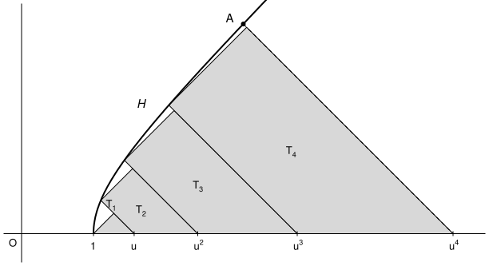

## Statement

Le plan est rapporté à un repère orthonormé. Soit $\mathcal{H}$ la courbe définie par $x \geqslant 1$
et $y = \sqrt{x^2 - 1}$, et soit $A$ un point de $\mathcal{H}$, de coordonnées $(r, s)$, avec $r > 1$.
On note $\mathcal{A}$ l'aire de la partie du plan définie par $1 \leqslant x \leqslant r$ et
$y^2 \leqslant x^2 - 1$.

On veut calculer $\mathcal{A}$ par une méthode dont le principe remonte à Fermat, peu après 1658.

Soit $n$ un entier naturel non nul et $u$ le réel positif tel que $u^n = r + s$. Pour tout entier $k$
entre $1$ et $n$, on considère le trapèze rectangle $T_k$ (éventuellement réduit à un triangle) :

- dont le côté oblique est le segment d'extrémités $(u^{k-1}, 0)$ et $(u^k, 0)$ ;
- dont les deux bases (les côtés parallèles) ont pour pente $-1$ ;
- dont l'un des angles droits a pour sommet le point $M_k$ de $\mathcal{H}$ d'abscisse
  $\frac{u^{k-1} + u^{1-k}}{2}$.

1. a) Vérifier que $u > 1$ et que $M_k$ a pour ordonnée $\frac{u^{k-1} - u^{1-k}}{2}$. Montrer que
   $T_k$ est bien défini de façon unique, qu'il est réduit à un triangle lorsque $k = 1$, et
   l'illustrer par un croquis.
   b) Calculer l'aire de $T_k$, puis la somme $\Sigma_n$ des aires des trapèzes $T_1, \ldots, T_n$.
2. Pourquoi peut-on conjecturer que $\Sigma_n$ admet $\frac{\mathcal{A} + s^2}{2}$ comme limite
   lorsque $n$ tend vers l'infini ?
3. Démontrer cette conjecture en utilisant une autre suite de trapèzes, combinée à la première.
4. Retrouver la valeur de $\mathcal{A}$.

## Hints

1. **Question 1.a.** Une droite de pente $-1$ passant par $(\alpha, 0)$ a pour équation
   $x + y = \alpha$. Pour un point de $\mathcal{H}$, $(x + y)(x - y) = x^2 - y^2 = 1$.
2. **Question 1.a.** Il est commode de suivre les deux quantités $x + y$ et $x - y$ : les bases sont
   sur les droites $x + y = u^{k-1}$ et $x + y = u^k$, et le côté perpendiculaire aux bases qui part
   de $M_k$ est sur une droite $x - y = \text{constante}$.
3. **Question 1.b.** La distance entre les droites $x + y = \alpha$ et $x + y = \beta$ vaut
   $\frac{\lvert \alpha - \beta \rvert}{\sqrt{2}}$. Sur une droite $x + y = \alpha$, la distance entre
   deux points vaut l'écart de leurs valeurs de $x - y$, divisé par $\sqrt{2}$.
4. **Question 2.** Regarder la partie $\Omega$ limitée par l'axe des abscisses, l'arc de $\mathcal{H}$
   de $(1, 0)$ à $A$, et le segment de pente $-1$ qui va de $A$ à l'axe. Que vaut son aire ?
5. **Question 3.** Construire les trapèzes $T'_k$ de la même façon, mais avec l'angle droit au point
   de $\mathcal{H}$ situé sur l'autre base. Montrer que $T_k$ est contenu dans $\Omega$, et que la
   partie de $\Omega$ comprise entre les deux bases est contenue dans $T'_k$.
6. **Question 3.** Écrire $u = e^{\ell/n}$ avec $\ell = \ln(r + s)$, et reconnaître dans $n(u - 1)$ un
   taux d'accroissement de la fonction exponentielle.

## Solution

Pour un point $(x, y)$, notons $\sigma = x + y$ et $\delta = x - y$. Une droite de pente $-1$ a une
équation $\sigma = \text{constante}$, une droite de pente $1$ une équation $\delta = \text{constante}$,
et pour un point de $\mathcal{H}$, $\sigma\delta = x^2 - y^2 = 1$.

**1.a)** On a $r > 1$ et $s > 0$, donc $r + s > 1$, et $u = (r + s)^{1/n} > 1$. Posons
$w = u^{k-1} \geqslant 1$. Le point de coordonnées
$\left(\frac{w + w^{-1}}{2}, \frac{w - w^{-1}}{2}\right)$ a une abscisse au moins égale à $1$ (car
$w + \frac{1}{w} - 2 = \frac{(w - 1)^2}{w} \geqslant 0$), une ordonnée positive, et
$x^2 - y^2 = (x + y)(x - y) = w \times \frac{1}{w} = 1$ : c'est le point $M_k$ de $\mathcal{H}$. Il
vérifie $\sigma = w$ et $\delta = \frac{1}{w}$.

Les bases passent par $(w, 0)$ et $(uw, 0)$ avec la pente $-1$ : elles sont sur les droites
$\sigma = w$ et $\sigma = uw$. Le point $M_k$ est sur la première. L'angle droit en $M_k$ est formé par
la base et le côté perpendiculaire aux bases, de pente $1$, donc sur la droite $\delta = \frac{1}{w}$.
Ce côté coupe l'autre base au point $N_k$ tel que $\sigma = uw$ et $\delta = \frac{1}{w}$, soit
$N_k\left(\frac{uw + w^{-1}}{2}, \frac{uw - w^{-1}}{2}\right)$. Les quatre sommets sont donc
imposés : $(w, 0)$, $(uw, 0)$, $N_k$ et $M_k$, et
$$T_k = \left\{ (x, y) : w \leqslant \sigma \leqslant uw \ \text{ et } \ \frac{1}{w} \leqslant \delta \leqslant \sigma \right\},$$
la condition $\delta \leqslant \sigma$ voulant dire $y \geqslant 0$. Pour $k = 1$, $w = 1$ et
$M_1 = (1, 0)$ est aussi l'extrémité du côté oblique : $T_1$ est le triangle de sommets $(1, 0)$,
$(u, 0)$ et $N_1$.

**1.b)** La hauteur du trapèze, distance entre les droites $\sigma = w$ et $\sigma = uw$, vaut
$\frac{(u - 1)w}{\sqrt{2}}$. Sur la base $\sigma = w$, les extrémités ont $\delta = w$ et
$\delta = \frac{1}{w}$ : longueur $\frac{w - w^{-1}}{\sqrt{2}}$. Sur la base $\sigma = uw$ : longueur
$\frac{uw - w^{-1}}{\sqrt{2}}$. L'aire vaut donc
$$\frac{1}{2} \times \frac{(u - 1)w}{\sqrt{2}} \times \frac{(1 + u)w - 2w^{-1}}{\sqrt{2}} = \frac{(u^2 - 1)w^2}{4} - \frac{u - 1}{2}.$$
Avec $w^2 = u^{2(k-1)}$ et la somme des termes d'une suite géométrique de raison $u^2 \neq 1$,
$$\Sigma_n = \frac{u^2 - 1}{4} \times \frac{u^{2n} - 1}{u^2 - 1} - \frac{n(u - 1)}{2} = \frac{(r + s)^2 - 1}{4} - \frac{n(u - 1)}{2}.$$

**2.** Soit $\Omega$ la partie limitée par l'axe des abscisses, l'arc de $\mathcal{H}$ de $(1, 0)$ à
$A$, et le segment de pente $-1$ qui joint $A$ au point $(r + s, 0)$. Elle est formée de la moitié
supérieure de la partie d'aire $\mathcal{A}$ (cette partie est symétrique par rapport à l'axe des
abscisses), d'aire $\frac{\mathcal{A}}{2}$, et du triangle rectangle isocèle de sommets $(r, 0)$,
$A$, $(r + s, 0)$, de côtés de l'angle droit $s$, d'aire $\frac{s^2}{2}$. Donc
$$\text{aire}(\Omega) = \frac{\mathcal{A} + s^2}{2}.$$
Les trapèzes $T_1, \ldots, T_n$ sont posés côte à côte dans $\Omega$, de $\sigma = 1$ à
$\sigma = u^n = r + s$, et leurs coins $M_k$ et $N_k$ touchent l'arc ou sont juste en dessous. Ils
remplissent $\Omega$ sauf de petits morceaux le long de l'arc. Quand $n$ augmente, $u$ se rapproche de
$1$, les trapèzes deviennent plus fins, et ces morceaux devraient devenir négligeables. D'où la
conjecture : $\Sigma_n$ tend vers l'aire de $\Omega$, c'est-à-dire vers $\frac{\mathcal{A} + s^2}{2}$.

**3.** *Description de $\Omega$.* Un point $(x, y)$ avec $x > 0$ est dans $\Omega$ si et seulement si
$y \geqslant 0$, $x^2 - y^2 \geqslant 1$ et $x + y \leqslant r + s$. En termes de $\sigma$ et
$\delta$ : $\delta \leqslant \sigma$, $\sigma\delta \geqslant 1$ et $\sigma \leqslant r + s$, ce qui
impose $1 \leqslant \sigma \leqslant r + s$.

*Les trapèzes intérieurs.* Si un point est dans $T_k$, alors $\sigma \geqslant w$ et
$\delta \geqslant \frac{1}{w}$, donc $\sigma\delta \geqslant 1$ ; de plus $\delta \leqslant \sigma$ et
$\sigma \leqslant uw \leqslant r + s$. Donc $T_k \subset \Omega$. Les $T_k$ sont dans des bandes
différentes, donc ne se chevauchent pas, et $\Sigma_n \leqslant \text{aire}(\Omega)$.

*Les trapèzes extérieurs.* Construisons $T'_k$ comme $T_k$, mais avec l'angle droit au point
$M_{k+1}$ de $\mathcal{H}$ situé sur la base $\sigma = uw$, où $\delta = \frac{1}{uw}$ :
$$T'_k = \left\{ (x, y) : w \leqslant \sigma \leqslant uw \ \text{ et } \ \frac{1}{uw} \leqslant \delta \leqslant \sigma \right\}.$$
Un point de $\Omega$ situé dans la bande $w \leqslant \sigma \leqslant uw$ vérifie
$\delta \geqslant \frac{1}{\sigma} \geqslant \frac{1}{uw}$, donc il est dans $T'_k$. Les bandes
recouvrent $\Omega$ (de $\sigma = 1$ à $\sigma = r + s$), donc
$\text{aire}(\Omega) \leqslant \Sigma'_n$, la somme des aires des $T'_k$. Le calcul de la question 1.b,
avec $\frac{1}{uw}$ au lieu de $\frac{1}{w}$, donne pour l'aire de $T'_k$ la valeur
$\frac{(u^2 - 1)w^2}{4} - \frac{u - 1}{2u}$, et
$$\Sigma'_n = \frac{(r + s)^2 - 1}{4} - \frac{n(u - 1)}{2u}.$$

*Passage à la limite.* Posons $\ell = \ln(r + s) > 0$, de sorte que $u = e^{\ell/n}$. Alors
$$n(u - 1) = \ell \times \frac{e^{\ell/n} - 1}{\ell/n} .$$
Quand $n \to +\infty$, $h = \frac{\ell}{n}$ tend vers $0$ et $\frac{e^h - 1}{h}$ tend vers la dérivée
de l'exponentielle en $0$, qui vaut $1$. Donc $n(u - 1) \to \ell$, et $u \to 1$. Ainsi $\Sigma_n$ et
$\Sigma'_n$ tendent tous deux vers
$$L = \frac{(r + s)^2 - 1}{4} - \frac{\ln(r + s)}{2}.$$
Comme $\Sigma_n \leqslant \text{aire}(\Omega) \leqslant \Sigma'_n$ pour tout $n$, en passant à la
limite, $\text{aire}(\Omega) = L$.

**Conclusion :** $\Sigma_n$ tend vers $L = \text{aire}(\Omega) = \frac{\mathcal{A} + s^2}{2}$.

**4.** On a $\mathcal{A} = 2\,\text{aire}(\Omega) - s^2 = \frac{(r + s)^2 - 1}{2} - \ln(r + s) - s^2$.
Comme $r^2 - 1 = s^2$, $(r + s)^2 - 1 = 2s^2 + 2rs$, donc
$$\mathcal{A} = rs - \ln(r + s).$$

**Bilan.** En découpant l'axe des abscisses suivant une progression géométrique $1, u, u^2, \ldots$,
Fermat obtient des trapèzes dont les aires forment presque une suite géométrique, donc une somme
calculable. Encadrée entre trapèzes intérieurs et extérieurs, l'aire de la partie $\Omega$ vaut
$\frac{(r + s)^2 - 1}{4} - \frac{\ln(r + s)}{2}$, et l'on retrouve $\mathcal{A} = rs - \ln(r + s)$.

## Going further

- Fermat ne connaissait pas le logarithme sous ce nom. Que devient la méthode pour calculer l'aire
  sous la courbe $y = \frac{1}{x}$ entre $1$ et $a$, avec des rectangles dont les abscisses sont
  $1, u, u^2, \ldots, u^n = a$ ?
- L'exercice 40007 calcule la même aire $\mathcal{A}$ en tournant le repère, puis l'utilise pour
  comparer un triangle pseudo-rectangle à la partie qu'il découpe sous l'hyperbole.
