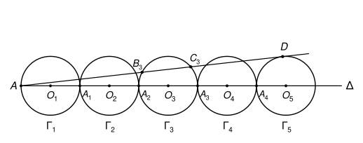

## Statement

Dans le plan, soit $A$ un point et $\Delta$ une demi-droite d'origine $A$. Pour un entier
$n \geq 2$, on considère $n$ cercles $\Gamma_1$, …, $\Gamma_n$ de rayon $1$, de centres $O_1$, …,
$O_n$ alignés dans cet ordre sur $\Delta$ : le cercle $\Gamma_1$ passe par $A$ et chaque cercle
$\Gamma_k$ ($k \geq 2$) est tangent au précédent. Par $A$, on trace la droite tangente au cercle
$\Gamma_n$ en un point $D$. On admet que, pour $1 \leq k \leq n - 1$, la droite $(AD)$ coupe le
cercle $\Gamma_k$ en deux points $B_k$ et $C_k$, et que
$$B_kC_k = \frac{4}{2n - 1}\sqrt{n(n-1) - k(k-1)} .$$

On note $\lambda_n$ la proportion du segment $[AD]$ située à l'intérieur des cercles :
$$\lambda_n = \frac{1}{AD}\sum_{k=1}^{n-1} B_kC_k .$$

**1. Une intégrale.** On définit la fonction $f$ sur $[0, 1]$ par
$f(x) = \int_0^x \sqrt{1 - t^2}\,\mathrm{d}t$, puis la fonction $F$ sur
$\left[0, \frac{\pi}{2}\right]$ par $F(x) = f(\sin x)$.

a) Montrer que $F$ est dérivable et calculer sa dérivée $F'$.

b) Montrer que, pour tout $x$ de $\left[0, \frac{\pi}{2}\right]$, $F(x) = \int_0^x \cos^2 t\,\mathrm{d}t$.

c) Sans calculer de primitive de $\cos^2$, démontrer que
$\int_0^{\pi/2} \cos^2 t\,\mathrm{d}t = \int_0^{\pi/2} \sin^2 t\,\mathrm{d}t$, et en déduire la
valeur commune de ces deux intégrales.

d) En déduire que $\int_0^1 \sqrt{1 - t^2}\,\mathrm{d}t = \frac{\pi}{4}$, et interpréter
géométriquement ce résultat.

**2. Un encadrement.**

a) Montrer que, pour tout $n \geq 2$,
$$\lambda_n = \frac{2}{2n - 1}\sum_{k=1}^{n} \sqrt{1 - \frac{k}{n} \cdot \frac{k-1}{n-1}} .$$

b) Montrer que, si $n \geq 2$ et $1 \leq k \leq n$,
$$\left(\frac{k-1}{n}\right)^2 \leq \frac{k}{n} \cdot \frac{k-1}{n-1} \leq \left(\frac{k}{n}\right)^2 .$$

c) On pose $I_{n,k} = \int_{(k-1)/n}^{k/n} \sqrt{1 - t^2}\,\mathrm{d}t$. Préciser des valeurs de
$n$ et de $k$ pour lesquelles on a
$$n\,I_{n,k+1} \leq \sqrt{1 - \frac{k-1}{n-1} \cdot \frac{k}{n}} \leq n\,I_{n,k-1} ,$$
et démontrer cet encadrement.

**3. La limite.** Démontrer, à partir des questions 1 et 2, que la suite $(\lambda_n)$ converge, et
calculer sa limite.

## Hints

1. **Question 1 a).** La fonction $f$ est une primitive d'une fonction continue. Utiliser la
   dérivée d'une fonction composée, et le signe de $\cos x$ sur $\left[0, \frac{\pi}{2}\right]$.
2. **Question 1 b).** Deux primitives d'une même fonction sur un intervalle qui prennent la même
   valeur en $0$ sont égales.
3. **Question 1 c).** Soit $S$ une primitive de $\sin^2$. Calculer la dérivée de la fonction
   $x \mapsto -S\left(\frac{\pi}{2} - x\right)$.
4. **Question 1 c).** Pour trouver la valeur commune, additionner les deux intégrales.
5. **Question 1 d).** Que représente la courbe d'équation $y = \sqrt{1 - t^2}$ pour $t$ dans
   $[0, 1]$ ?
6. **Question 2 a).** Calculer $AD$ dans le triangle $AO_nD$, rectangle en $D$, avec
   $AO_n = 2n - 1$. Que vaut le terme $k = n$ de la somme ?
7. **Question 2 c).** La fonction $t \mapsto \sqrt{1 - t^2}$ est décroissante sur $[0, 1]$.
   Majorer l'intégrande sur $\left[\frac{k}{n}, \frac{k+1}{n}\right]$ par sa valeur en
   $\frac{k}{n}$, et la minorer sur $\left[\frac{k-2}{n}, \frac{k-1}{n}\right]$ par sa valeur en
   $\frac{k-1}{n}$. Les intervalles d'intégration doivent rester dans $[0, 1]$.
8. **Question 3.** Additionner les encadrements de 2 c) pour $k$ allant de $2$ à $n - 1$, et
   utiliser la relation de Chasles. Le terme $k = 1$ vaut $1$ et le terme $k = n$ vaut $0$.
9. **Question 3.** Pour minorer $\int_{2/n}^{1} \sqrt{1 - t^2}\,\mathrm{d}t$, remarquer que
   $\int_0^{2/n} \sqrt{1 - t^2}\,\mathrm{d}t \leq \frac{2}{n}$.

## Solution

**1. a)** La fonction $t \mapsto \sqrt{1 - t^2}$ est continue sur $[0, 1]$, donc $f$ est sa
primitive qui s'annule en $0$ : $f$ est dérivable sur $[0, 1]$ et $f'(x) = \sqrt{1 - x^2}$. La
fonction $\sin$ est dérivable sur $\left[0, \frac{\pi}{2}\right]$ et prend ses valeurs dans
$[0, 1]$. La composée $F = f \circ \sin$ est donc dérivable, et
$$F'(x) = \cos x \cdot f'(\sin x) = \cos x \sqrt{1 - \sin^2 x} = \cos x \sqrt{\cos^2 x} = \cos x \, \lvert \cos x \rvert .$$
Sur $\left[0, \frac{\pi}{2}\right]$, $\cos x \geq 0$.

**Conclusion :** $F'(x) = \cos^2 x$.

**1. b)** La fonction $G : x \mapsto \int_0^x \cos^2 t\,\mathrm{d}t$ est la primitive de la fonction
continue $\cos^2$ qui s'annule en $0$. La fonction $F$ est aussi une primitive de $\cos^2$ sur
l'intervalle $\left[0, \frac{\pi}{2}\right]$, et $F(0) = f(\sin 0) = f(0) = 0$. Deux primitives
d'une même fonction sur un intervalle diffèrent d'une constante ; ici la constante est nulle, donc
$F = G$.

**1. c)** La fonction $\sin^2$ est continue sur $\mathbb{R}$ ; soit $S$ une de ses primitives.
Posons $\varphi(x) = -S\left(\frac{\pi}{2} - x\right)$. Par la dérivée de $x \mapsto u(ax + b)$,
$$\varphi'(x) = S'\left(\frac{\pi}{2} - x\right) = \sin^2\left(\frac{\pi}{2} - x\right) = \cos^2 x .$$
Donc $\varphi$ est une primitive de $\cos^2$, et
$$\int_0^{\pi/2} \cos^2 t\,\mathrm{d}t = \varphi\left(\frac{\pi}{2}\right) - \varphi(0) = -S(0) + S\left(\frac{\pi}{2}\right) = \int_0^{\pi/2} \sin^2 t\,\mathrm{d}t .$$
(Géométriquement, les courbes de $\cos^2$ et de $\sin^2$ sur $\left[0, \frac{\pi}{2}\right]$ sont
symétriques l'une de l'autre par rapport à la droite $x = \frac{\pi}{4}$, donc limitent la même
aire.)

Notons $J$ cette valeur commune. Par linéarité,
$$2J = \int_0^{\pi/2} \left(\cos^2 t + \sin^2 t\right)\mathrm{d}t = \int_0^{\pi/2} 1\,\mathrm{d}t = \frac{\pi}{2} .$$

**Conclusion :** $\int_0^{\pi/2} \cos^2 t\,\mathrm{d}t = \int_0^{\pi/2} \sin^2 t\,\mathrm{d}t = \frac{\pi}{4}$.

**1. d)** On a $\int_0^1 \sqrt{1 - t^2}\,\mathrm{d}t = f(1) = f\left(\sin \frac{\pi}{2}\right) = F\left(\frac{\pi}{2}\right) = \int_0^{\pi/2} \cos^2 t\,\mathrm{d}t = \frac{\pi}{4}$.

*Interprétation.* Pour $t \in [0, 1]$, le point de coordonnées $\left(t, \sqrt{1 - t^2}\right)$
vérifie $x^2 + y^2 = 1$ avec $x \geq 0$ et $y \geq 0$ : la courbe est le quart du cercle de centre
$O$ et de rayon $1$ situé dans le premier quadrant. L'intégrale est l'aire du quart de disque, et
l'on retrouve $\frac{\pi \times 1^2}{4}$.

**2. a)** On a $AO_1 = 1$ et deux centres consécutifs sont à la distance $2$, donc
$AO_n = 2n - 1$. Le triangle $AO_nD$ est rectangle en $D$ (une tangente est perpendiculaire au
rayon) et $O_nD = 1$, d'où
$$AD^2 = (2n - 1)^2 - 1 = 4n^2 - 4n = 4n(n - 1), \qquad AD = 2\sqrt{n(n-1)} .$$
Pour $1 \leq k \leq n - 1$,
$$\frac{B_kC_k}{AD} = \frac{4\sqrt{n(n-1) - k(k-1)}}{(2n - 1) \cdot 2\sqrt{n(n-1)}} = \frac{2}{2n - 1}\sqrt{1 - \frac{k(k-1)}{n(n-1)}} .$$
On ajoute ces quantités pour $k$ de $1$ à $n - 1$. Le terme qu'on obtiendrait pour $k = n$ vaut
$\sqrt{1 - 1} = 0$, on peut donc l'ajouter à la somme sans la changer.

**Conclusion :** $\lambda_n = \frac{2}{2n - 1}\sum_{k=1}^{n} \sqrt{1 - \frac{k}{n} \cdot \frac{k-1}{n-1}}$.

**2. b)** *Inégalité de gauche.* Pour $k = 1$, elle s'écrit $0 \leq 0$. Pour $k \geq 2$, on divise
par $\frac{k-1}{n} > 0$ : elle équivaut à $\frac{k-1}{n} \leq \frac{k}{n-1}$, soit
$(k-1)(n-1) \leq kn$, soit $kn - k - n + 1 \leq kn$, soit $1 \leq k + n$, ce qui est vrai.

*Inégalité de droite.* On divise par $\frac{k}{n} > 0$ : elle équivaut à
$\frac{k-1}{n-1} \leq \frac{k}{n}$, soit $n(k-1) \leq k(n-1)$, soit $-n \leq -k$, soit
$k \leq n$, ce qui est vrai.

**2. c)** Notons $g(t) = \sqrt{1 - t^2}$, décroissante sur $[0, 1]$, et
$s_k = \sqrt{1 - \frac{k-1}{n-1} \cdot \frac{k}{n}}$.

*Majoration de $n\,I_{n,k+1}$.* Il faut $\frac{k+1}{n} \leq 1$, c'est-à-dire $k \leq n - 1$. Pour
$t$ dans $\left[\frac{k}{n}, \frac{k+1}{n}\right]$, on a $g(t) \leq g\left(\frac{k}{n}\right)$. Par
l'inégalité de droite de 2 b),
$1 - \left(\frac{k}{n}\right)^2 \leq 1 - \frac{k}{n} \cdot \frac{k-1}{n-1}$, et la racine carrée est
croissante, donc $g\left(\frac{k}{n}\right) \leq s_k$. En intégrant sur un intervalle de longueur
$\frac{1}{n}$, on obtient $I_{n,k+1} \leq \frac{s_k}{n}$.

*Minoration de $n\,I_{n,k-1}$.* Il faut $\frac{k-2}{n} \geq 0$, c'est-à-dire $k \geq 2$. Pour $t$
dans $\left[\frac{k-2}{n}, \frac{k-1}{n}\right]$, on a $g(t) \geq g\left(\frac{k-1}{n}\right)$, et
par l'inégalité de gauche de 2 b), $g\left(\frac{k-1}{n}\right) \geq s_k$. En intégrant,
$I_{n,k-1} \geq \frac{s_k}{n}$.

**Conclusion :** l'encadrement $n\,I_{n,k+1} \leq s_k \leq n\,I_{n,k-1}$ est vrai pour tout
$n \geq 3$ et tout entier $k$ tel que $2 \leq k \leq n - 1$.

**3.** Soit $n \geq 3$ et $T_n = \sum_{k=1}^{n} s_k$, de sorte que $\lambda_n = \frac{2}{2n-1}T_n$.
On a $s_1 = 1$ et $s_n = 0$. En additionnant les encadrements de 2 c) pour $k = 2$, …, $n - 1$, et
en regroupant les intégrales par la relation de Chasles :
$$n\int_{2/n}^{1} g(t)\,\mathrm{d}t \;\leq\; \sum_{k=2}^{n-1} s_k \;\leq\; n\int_{0}^{(n-2)/n} g(t)\,\mathrm{d}t .$$
En effet $I_{n,3} + \cdots + I_{n,n}$ est l'intégrale de $g$ de $\frac{2}{n}$ à $1$, et
$I_{n,1} + \cdots + I_{n,n-2}$ est l'intégrale de $g$ de $0$ à $\frac{n-2}{n}$.

- Comme $g \geq 0$, $\int_0^{(n-2)/n} g \leq \int_0^1 g = \frac{\pi}{4}$.
- Comme $g \leq 1$, $\int_0^{2/n} g \leq \frac{2}{n}$, donc
  $\int_{2/n}^{1} g = \frac{\pi}{4} - \int_0^{2/n} g \geq \frac{\pi}{4} - \frac{2}{n}$.

En ajoutant $s_1 = 1$ et $s_n = 0$ :
$$n\,\frac{\pi}{4} - 1 \leq T_n \leq n\,\frac{\pi}{4} + 1, \qquad \text{donc} \qquad \frac{2n}{2n-1} \cdot \frac{\pi}{4} - \frac{2}{2n-1} \leq \lambda_n \leq \frac{2n}{2n-1} \cdot \frac{\pi}{4} + \frac{2}{2n-1} .$$
Quand $n$ tend vers $+\infty$, $\frac{2n}{2n-1}$ tend vers $1$ et $\frac{2}{2n-1}$ tend vers $0$ :
les deux bornes tendent vers $\frac{\pi}{4}$. Par le théorème des gendarmes, $(\lambda_n)$ converge.

**Conclusion :** la suite $(\lambda_n)$ converge vers $\frac{\pi}{4} \approx \text{0,785}$.

**Bilan.** L'intégrale $\int_0^1 \sqrt{1 - t^2}\,\mathrm{d}t$ vaut $\frac{\pi}{4}$, l'aire d'un quart
de disque. La proportion $\lambda_n$ est, à un facteur près qui tend vers $1$, une somme de valeurs
de $\sqrt{1 - t^2}$ prises à pas réguliers, et l'encadrement par des intégrales montre qu'elle tend
vers cette aire : quand il y a beaucoup de cercles, environ 78,5 % de la tangente $[AD]$ est
à l'intérieur des cercles.

## Going further

- À la calculatrice, on trouve $\lambda_2 = \frac{2}{3}$, $\lambda_{10} \approx \text{0,776}$ et
  $\lambda_{100} \approx \text{0,785}$. Pouvez-vous calculer $\lambda_3$ exactement ?
- Pourquoi pouvait-on deviner $\frac{\pi}{4}$ ? La demi-corde $\frac{1}{2}B_kC_k$ vaut
  $\sqrt{1 - h_k^2}$, où $h_k = \frac{2k-1}{2n-1}$ est la distance du centre $O_k$ à la droite
  $(AD)$, et les $h_k$ sont régulièrement espacés de $\frac{2}{2n-1}$ entre $0$ et $1$. La somme
  ressemble donc à une aire sous le quart de cercle.
- Les exercices 40081 et 40084 étudient pour quelles valeurs de $n$ et $k$ la longueur $B_kC_k$
  est un nombre rationnel.
