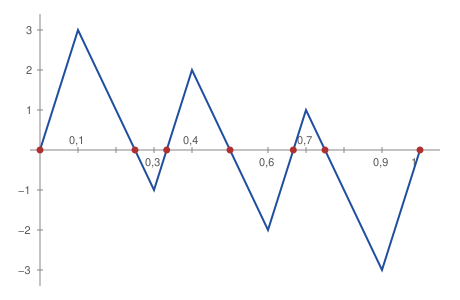

## Statement

Soit $f : [0, 1] \to \mathbb{R}$ une fonction continue sur l'intervalle $[0, 1]$. On suppose que
$f(0) = f(1) = 0$ et que, pour tout réel $x$ de l'intervalle $\left[0, \frac{7}{10}\right]$,

$$f\left(x + \frac{3}{10}\right) \neq f(x).$$

1. Démontrer que l'équation $f(x) = 0$ a au moins sept solutions dans $[0, 1]$.

2. Donner un exemple de fonction $f$ qui vérifie toutes ces hypothèses. On pourra se contenter
   d'une représentation graphique claire, en expliquant pourquoi elle convient.

## Hints

1. **Question 1.** Introduire la fonction $g$ définie sur $\left[0, \frac{7}{10}\right]$ par
   $g(x) = f\left(x + \frac{3}{10}\right) - f(x)$. Que dit le théorème des valeurs intermédiaires
   sur le signe de $g$ ?
2. **Question 1.** Supposons $g > 0$. En partant de $f(0) = 0$ et en avançant par pas de
   $\frac{3}{10}$, quel est le signe de $f$ en $\text{0,3}$, $\text{0,6}$ et $\text{0,9}$ ?
3. **Question 1.** Partir aussi de $f(1) = 0$ et reculer par pas de $\frac{3}{10}$ : signe de $f$
   en $\text{0,7}$, $\text{0,4}$ et $\text{0,1}$. Ranger ensuite les six points dans l'ordre.
4. **Question 2.** La preuve montre ce qu'il faut viser : prendre $g$ constante, par exemple
   $f\left(x + \frac{3}{10}\right) = f(x) - 1$. Il suffit de choisir $f$ sur $\left[0, \frac{3}{10}\right]$,
   puis de la prolonger par cette relation. Quelle valeur doit-on donner à $f(\text{0,1})$ pour
   que $f(1) = 0$ ?

## Solution

**1.** Soit $g$ la fonction définie sur $\left[0, \frac{7}{10}\right]$ par
$g(x) = f\left(x + \frac{3}{10}\right) - f(x)$. Elle est continue (différence de deux fonctions
continues) et ne s'annule jamais, par hypothèse.

*La fonction $g$ garde un signe constant.* Si $g$ prenait une valeur strictement positive et une
valeur strictement négative, le théorème des valeurs intermédiaires donnerait un point où elle
s'annule, ce qui est exclu. Donc $g > 0$ sur tout l'intervalle, ou $g < 0$ sur tout l'intervalle.

Si $g < 0$, la fonction $-f$ vérifie les mêmes hypothèses que $f$, avec $g$ changée en $-g > 0$,
et elle a les mêmes zéros que $f$. On peut donc supposer $g > 0$, c'est-à-dire
$f\left(x + \frac{3}{10}\right) > f(x)$ pour tout $x \in \left[0, \frac{7}{10}\right]$.

*En avançant depuis $0$.* Avec $x = 0$, puis $\text{0,3}$, puis $\text{0,6}$ :
$$f(\text{0,3}) > f(0) = 0, \qquad f(\text{0,6}) > f(\text{0,3}) > 0, \qquad f(\text{0,9}) > f(\text{0,6}) > 0.$$

*En reculant depuis $1$.* Avec $x = \text{0,7}$, puis $\text{0,4}$, puis $\text{0,1}$ :
$$f(\text{0,7}) < f(1) = 0, \qquad f(\text{0,4}) < f(\text{0,7}) < 0, \qquad f(\text{0,1}) < f(\text{0,4}) < 0.$$

*Les signes, dans l'ordre :*

| $x$ | $\text{0,1}$ | $\text{0,3}$ | $\text{0,4}$ | $\text{0,6}$ | $\text{0,7}$ | $\text{0,9}$ |
|---|---|---|---|---|---|---|
| signe de $f$ | $-$ | $+$ | $-$ | $+$ | $-$ | $+$ |

Le signe change entre deux points consécutifs du tableau. Sur chacun des cinq intervalles
$[\text{0,1}\,;\text{0,3}]$, $[\text{0,3}\,;\text{0,4}]$, $[\text{0,4}\,;\text{0,6}]$,
$[\text{0,6}\,;\text{0,7}]$ et $[\text{0,7}\,;\text{0,9}]$, la fonction continue $f$ prend une
valeur strictement négative et une valeur strictement positive aux deux bouts. D'après le théorème
des valeurs intermédiaires, elle s'annule en un point strictement à l'intérieur de chacun.

Ces cinq intervalles ouverts sont deux à deux disjoints et ne contiennent ni $0$ ni $1$. On obtient
ainsi cinq zéros distincts, auxquels s'ajoutent $0$ et $1$.

**Conclusion :** l'équation $f(x) = 0$ a au moins sept solutions dans $[0, 1]$.

**2.** La preuve suggère de prendre $g$ constante. Cherchons $f$ telle que
$f\left(x + \frac{3}{10}\right) = f(x) - 1$ pour tout $x \in \left[0, \frac{7}{10}\right]$.

Une telle fonction est déterminée par ses valeurs sur $\left[0, \frac{3}{10}\right]$, avec deux
contraintes :

- $f(\text{0,3}) = f(0) - 1 = -1$ ;
- $f(1) = f(\text{0,7}) - 1 = f(\text{0,4}) - 2 = f(\text{0,1}) - 3$, et l'on veut $f(1) = 0$, donc
  $f(\text{0,1}) = 3$.

Prenons $f$ affine par morceaux, dont le graphique relie dans l'ordre les points
$$(0\,;0),\ (\text{0,1}\,;3),\ (\text{0,3}\,;-1),\ (\text{0,4}\,;2),\ (\text{0,6}\,;-2),\ (\text{0,7}\,;1),\ (\text{0,9}\,;-3),\ (1\,;0)$$
par des segments.

*Vérification.* $f$ est continue (ses morceaux se raccordent) et $f(0) = f(1) = 0$. Le graphique sur
$[\text{0,3}\,;\text{0,6}]$ est celui sur $[0\,;\text{0,3}]$ décalé de $\text{0,3}$ vers la droite
et de $1$ vers le bas : les sommets $(0\,;0)$, $(\text{0,1}\,;3)$, $(\text{0,3}\,;-1)$ deviennent
$(\text{0,3}\,;-1)$, $(\text{0,4}\,;2)$, $(\text{0,6}\,;-2)$. Il en va de même entre
$[\text{0,3}\,;\text{0,6}]$ et $[\text{0,6}\,;\text{0,9}]$, et entre $[0\,;\text{0,1}]$ et
$[\text{0,9}\,;1]$ (décalé de $\text{0,9}$ vers la droite et de $3$ vers le bas). Donc, pour tout
$x \in \left[0, \frac{7}{10}\right]$, $f\left(x + \frac{3}{10}\right) = f(x) - 1 \neq f(x)$.

Cette fonction a exactement sept zéros : $0$, $\frac{1}{4}$, $\frac{1}{3}$, $\frac{1}{2}$,
$\frac{2}{3}$, $\frac{3}{4}$ et $1$. Le nombre sept de la question 1 ne peut donc pas être
amélioré.

**Bilan.** Si une fonction continue nulle en $0$ et en $1$ n'a aucune « corde horizontale » de
longueur $\frac{3}{10}$, alors $f(x + \text{0,3}) - f(x)$ garde un signe constant, et cela force
$f$ à changer de signe au moins cinq fois entre $0$ et $1$. Une telle fonction existe bien, et
sept zéros est le minimum possible.

## Going further

- Une formule qui convient aussi : $f(x) = \sin^2\left(\frac{10\pi x}{3}\right) - \frac{3}{4}x$.
  Vérifier que $f(0) = f(1) = 0$ et que $f\left(x + \frac{3}{10}\right) - f(x)$ est constante.
- Montrer qu'au contraire, si $f$ est continue sur $[0, 1]$ avec $f(0) = f(1)$, il existe toujours
  un $x$ tel que $f\left(x + \frac{1}{2}\right) = f(x)$, et plus généralement $f\left(x + \frac{1}{n}\right) = f(x)$
  pour tout entier $n \geq 1$. (Indication : sommer les valeurs de $g$ aux points
  $0, \frac{1}{n}, \ldots, \frac{n-1}{n}$.) C'est le théorème de la corde universelle : les
  longueurs $\frac{1}{n}$ sont les seules pour lesquelles une corde horizontale existe toujours.
